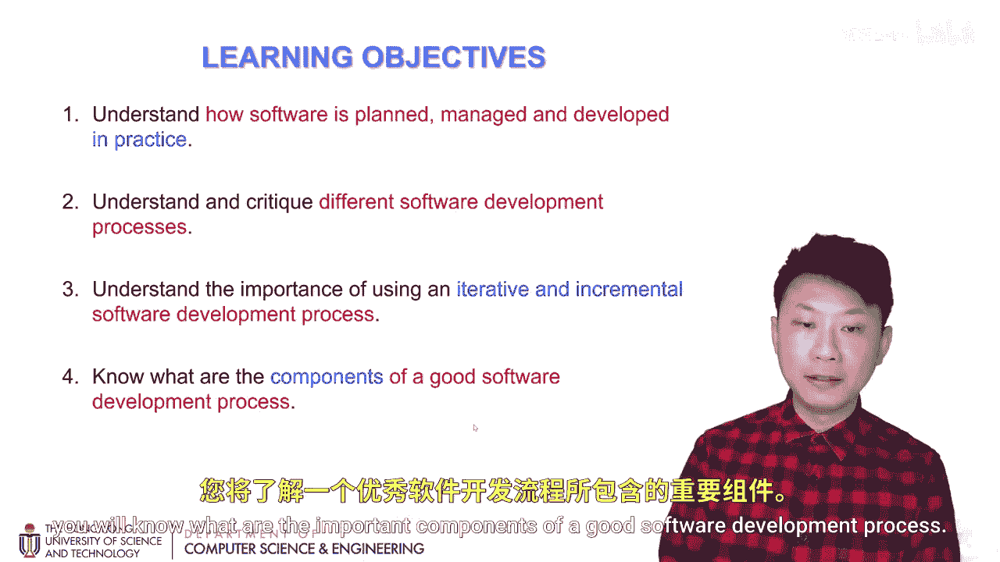
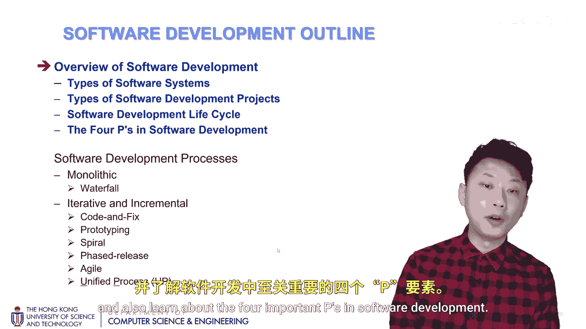
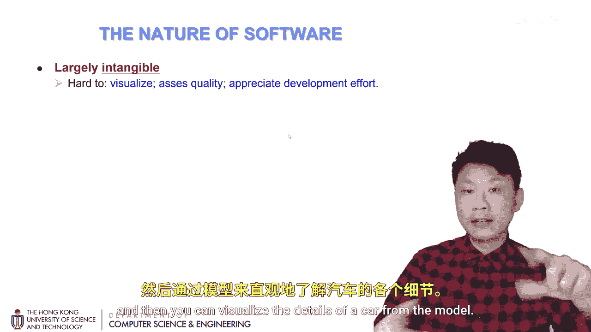
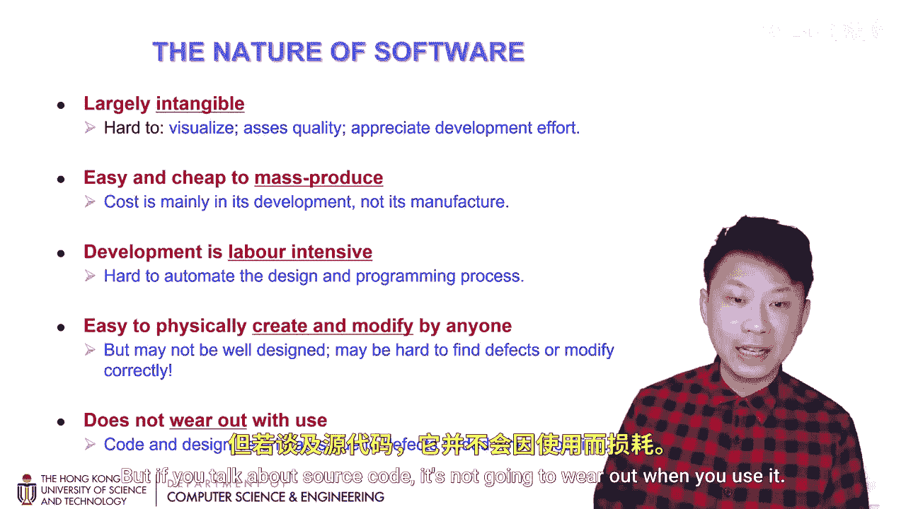
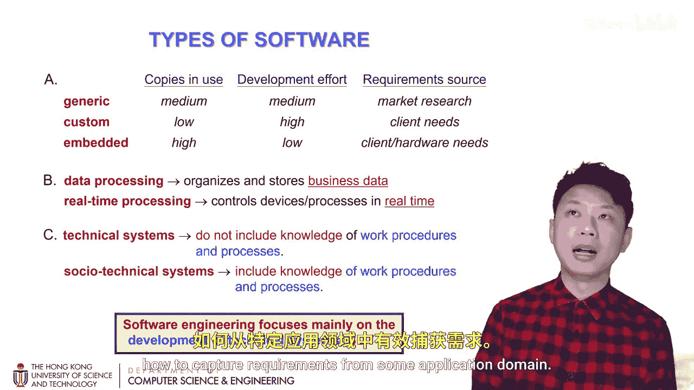
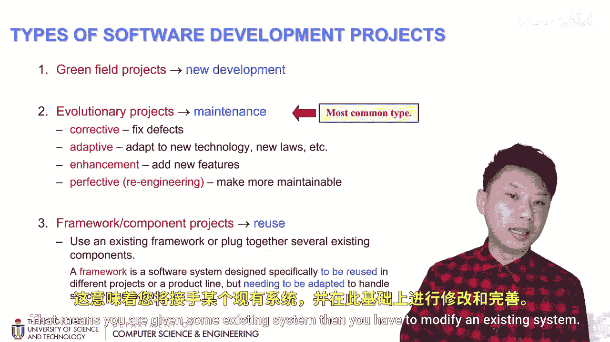
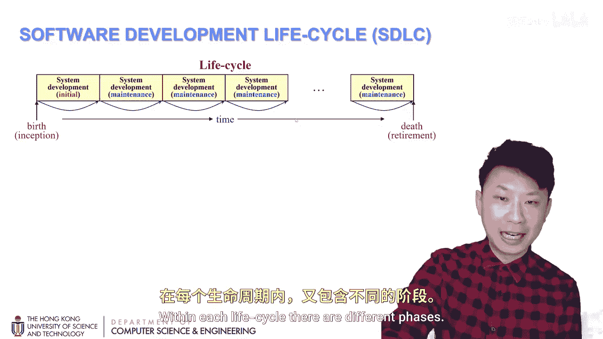
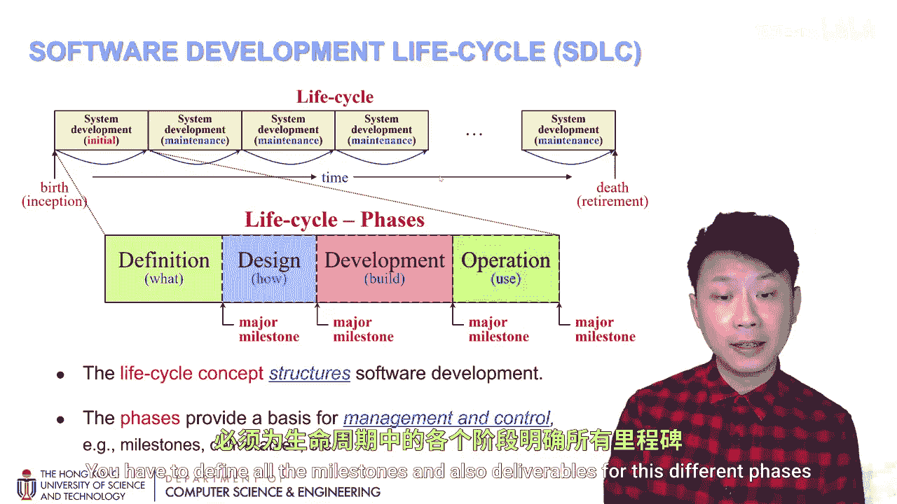
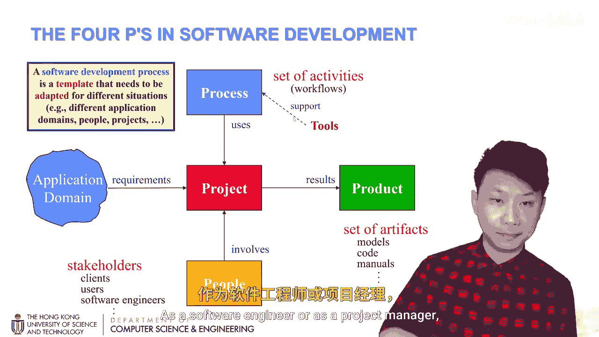
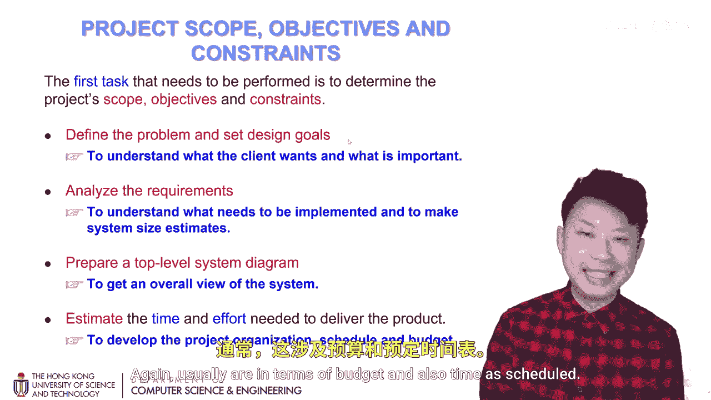

# 香港科技大学【中英⚡软件工程｜Software Engineering Specialization】 p21 P21 01_软件开发入门 -BV1MMEjzoEhg_p21-

Hi， this lecture is an overview about software development。

And these are the learning objectives of this lecture after this lecture you will understand how software is planneded。

 managed and also developed in practice and in the next lecture you will learn different software development processes that we can use in software engineering。

And you also understand the importance of using iterative and also incremental software development process when we build a software system。

And finally， you will know what are the important components of a good software development process？

And this lecture is just an overview about software development。

 You will learn about different types of software and projects that you may encounter in software engineering。

And also， you will learn about the development life cycle of a software engineering project and also learn about the four important pieces in software development。

So these are the nature of a software development project。

A software development project is largely intangible that means it's difficult to visualize all the details within the project。

 unlike for example， manufacturing a car you can build a model of the car and you can visualize the details of a car from the model and it's easy and cheap to mass produce for software engineering project the product is usually in terms of source code so if we are talking about sourceco it's going to be easy to copy to maps produce。

And the development is labor intensive， that means the major resources that you need is going to be programmes。

 right to help you build a source code。And it's easy to physically create it and modify it by anyone。

 so anyone knows how the program can actually modify the product。

 the sourcesco right after the project。And does not wear it out with use right unlike a car。

 it's going to wear it out when you use it okay， but if you are talking about Cisco。

 it's not going to wear it out when you use it。

And these are the different types of software that you may have to build for your client。For example。

 it can be generic， that means let's say Windows 10 or Microsoft Office or the applications that you can download from App Store or Google Play okay they are generic software okay and basically all the requirements you get them from market research so people say that they like this and you do it for those people。

Okay。Or you may be building a custom software for some application domain Okay。

 let's say you are building a software system for a restaurant Okay。

 then basically all the requirements， they come from the client needs Okay。

 that means they come from the restaurant Okay， the development effort is going to be high because you have to capture all the requirements before you can build a system。

and the copies in use is going to be low because it's going to be just a restaurant using the software system。

 or it may be an embedded software system that means， for example。

 it's an embedded system within a DVD player。OkayThe development effort is low because from the DVD player you already know all the requirements。

 so that means you already know all the requirements before you develop okay and the copy in use is going be high because all the DVD players they will be using the same system so this are the different types of software that you may have to deal with okay when you work as a software engineer。

And maybe data processing， that means your system has to somehow organize and store business data okay or real time processing。

 so that means you have to control devices and processes in real time。Or technical system。

 that means you do not include knowledge about the application domain。

 about the work procedures and also processes from the application domain or socioote systems。

 that means somehow you have to learn about the application domain before you can develop the software system。

So software engineering focuses mainly on the development of technical systems that means generic software or embedded system but in this course we still focus on custom software because custom software is not easy somehow you have to capture auto requirements before you can work with custom software and in this course we still focus on custom software because many custom software they fail because they cannot meet user requirements and they fail just because they cannot correctly capture audit requirements at the very beginning of the project so that's why one very important topic that we recover in this course is how to capture requirements from some application domain domain。

And these are the different types of software development projects that you may have to deal with as a software engineer。

It may be a greenfield project that means you have to start from scratch， okay？

Or evolutionary project， that means you are given an existing system。

 then based on the existing system， you may have to fix defects， adapt to new technology。

 or add some new features， or make it more maintainable。Okay。

 and you are provided with an existing system。came to work with。

And then finally you may be provided with a framework okay and then based on the framework。

 you have to adapt the framework to handle some specific requirements from the and trust me or not when you work in the industry later on you will find that most of the projects they are evolutionary projects。

And it's the most common type and that means you are given some existing system。

 then you have to modify an existing system。

So this is the software development lifecycl of a software project after you start developing the project。

 you have to keep maintaining， maintaining and maintaining the software project。

Until the we time in of the project。Okay， and within each life cycle。

Okay， there are different phrases Okay， first， you have to define what you have to do within that life cycle okay。

 that means what you have to build okay for your client。

And then double check whether what you're going to do is going to be feasible or not if it's feasible。

 you go ahead if it's not feasible， then you stop and you tell your client that it's not feasible。

Then you try to come up with all the details about your design。

Then build your system and they eventually deploy your system。

And the life cyclee concept structures software development and these are the things that you have to do with in software development and the phrases provide a basic for management and control and you have to define all the milestones and also deliverables for this different phrases that we have in a lifecycl and there are four important piece in a software development project okay so you have to capture all the requirements from the application domain for your project。

And in your project， you have to work with different people。 for example。

 different stakeholders like clients， users， and also software engineers。

And then you have to use different processes within your development。Okay。

 that means a set of activities that you have to perform in your project。

And eventually you achieve a set of artifacts as your product okay， for example， different diagrams。

 different models that you use in your software system， source code， or even user manuals。

And these are the four important piecess involved in a software development project。

And a software development process is a template that needs to consider different situations。

 for example， different people that we have in the team。

 different processes that we're going to use in development and different artifacts that we're going to have in our product。

 etca， etc。

And as a software engineer or as a project manager。

 the first task that you have to do is to define the scope。

 the objectives and also the constraints of your project scope means what you have to do or what you don't have to do within your project you have to define exactly what are the requirements of your project and also the objectives。

 okay what you want to achieve in your project and also constraints usually in terms of budget and time。

Of a project then in your project plan you have to define the problem and then set up design goals okay in the very first lecture we have said that at the very beginning of the project you have to choose a field design goals Okay。

 then when you design your system you design the system based on the design goals。

And then you have to analyze the requirements， you have to capture all the requirements from the application domain。

And then prepare some diagram， for example， a class diagram to capture all the important data objects that we have in the application domain and also a use case diagram to capture all the functionalities of the software system。

It's going to give you an overview of all the requirements within in the system。And finally。

 estimate the tunnel and effort required to deliver the product again。

 usually in terms of budget and also tunnel and schedule。

