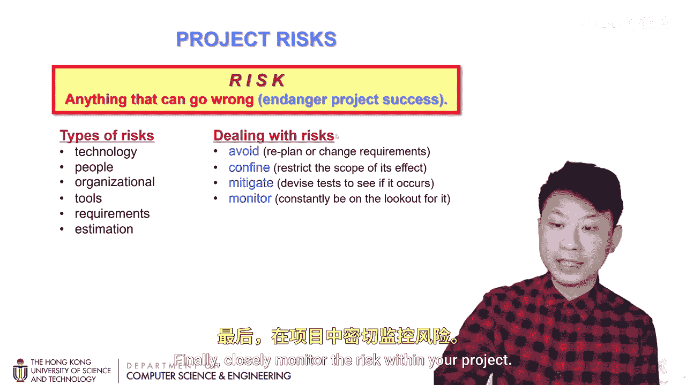
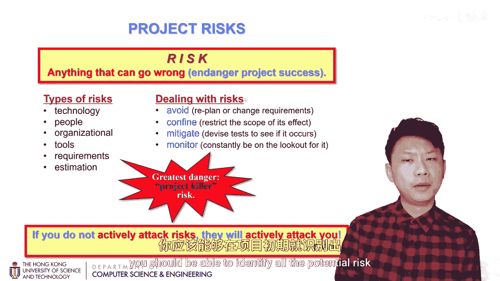
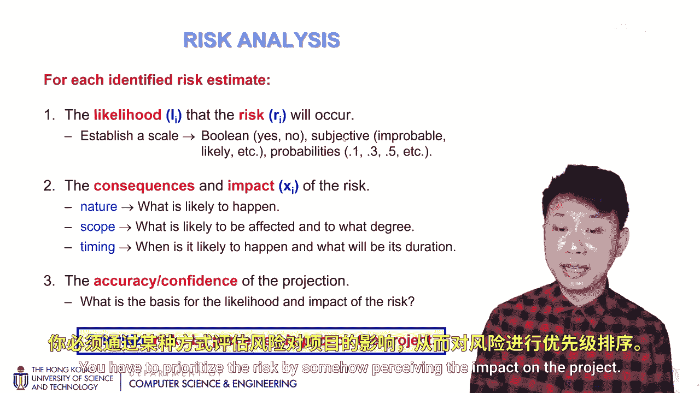
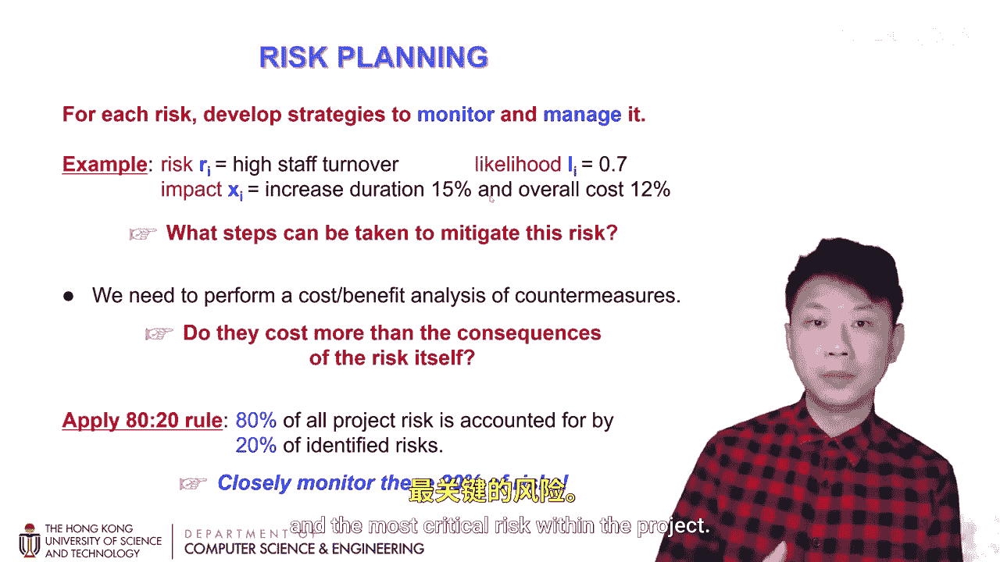
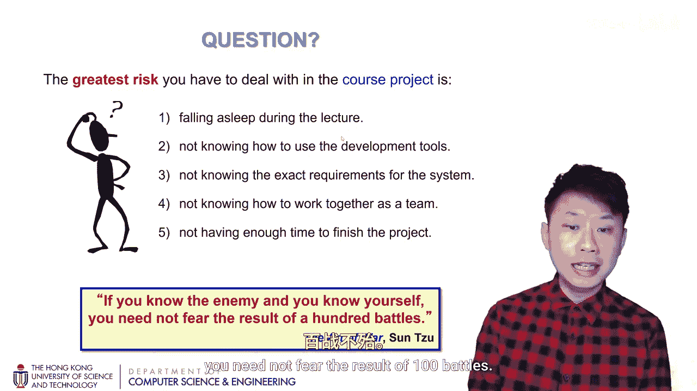

# 香港科技大学【中英⚡软件工程｜Software Engineering Specialization】 p22 P22 02_项目风险 -BV1MMEjzoEhg_p22-

And as a project manager， another thing that you have to do is to identify all the risk that may happen in your project and the definition of risk is simple。

 okay， anything that can go wrong in your project。OkayT of risks right may be related to technology。

 people organizational tools requirements or estimation okay estimation is also a kind of risk right because if you wrongly estimate。

 for example， the time and budget that you need for your project then your project may be behind schedule your project may be out of budget。

 that certainly is going to be a risk within a project。So how to deal with risk， we can either avoid。

 try to avoid the risk from happening。Confine， okay， restrict the scope of its effect okay。

 eventually if the risk is going to happen， try to confine or restrict the scope of the effect of the risk。

And also mitigate okay try to deviceise tasks to see if its going to happen or not okay and finally closely monitor the risk within your project so notice that if you don't actively attack risk okay they may actively attack you so as a good manager you should be able to identify all the potential risk at the very beginning of the project and it's not easy because for each potential risk you have to somehow come up with the likelihood okay and also the impact okay of the risk。

likelihood that means the chance that it going to happen okay for example。

 80% of the chance that this risk is going to happen within the project。And also impact means。

 for example， the nature of the risk， what is likely to happen。

 what is the scope of effect and also timing， okay how long is going to happen。

And then you have to come up with some accuracy and also confidence of the projection。

 so that means the basis for likelihood and also impact of the risk。

And you have to priorize the risk by somehow preceiving the impact on the project。

 so this is an example of risk planning， for example。

 one potential risk within the project may be high staff turnover okay and the likelihood is going to be like 70%。

And then the impact is that it's going to increase the duration of the project by 15% and then also the overall cost by 12% so what are the possible steps right that we can perform to mitigate this risk then as a project manager you have to think about what are the steps that can be taken to mitigate the risk。

And you have to perform a cost benefit analysis of countermeasures that means you have to think about whether the risk is going to cost more than the consequence of the risk itself。

For example， if the consequence is going to be just some tiny effect right in your project。

Then you may simply let the risk to happen and then eventually just fix up what's going to go wrong in your project because fixing it is going to be just the effort is going to be just minimal。

Then we're going to just let it happen and then fix it up later on and that's why we have to perform a cost benefit analysis and see what are the potential consequences。

And we're going to apply  AD20 rule just because there are many potential risk that may happen in the project。

 So that's why instead of closely monitoring all the risk。We're going to simply focus on the 20%。

 okay， the most important and the most critical risk within the project。

And we will closely monitor this 20% of the most important and the most critical risk within the project。

Okay， so this is one interesting question， what is the greatest risk within the cost project okay is it like falling asleep during the lecture or not knowing how to use the development tools or not knowing exactly what are the requirements of the project or not knowing how to work as a team okay or not having enough time to finish the project。

Maybe all of them because all of them are critical。

And that's why you have to identify all the potential risk at the very beginning of the project。

 because if you know the enemy and you know yourself， you need not fear the result of 100 battlelons。

