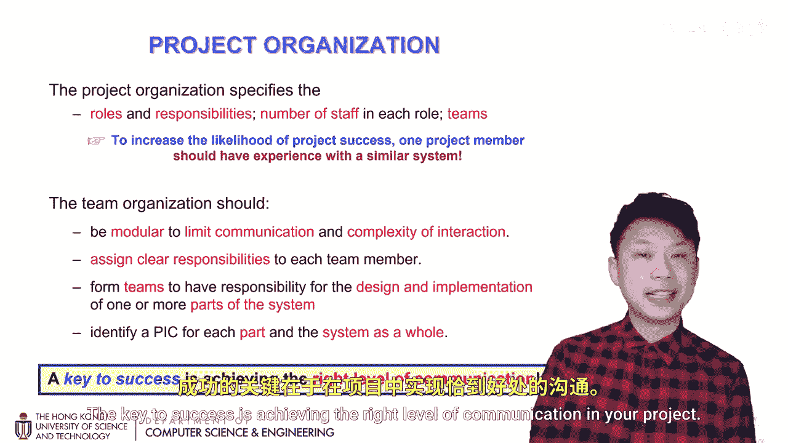
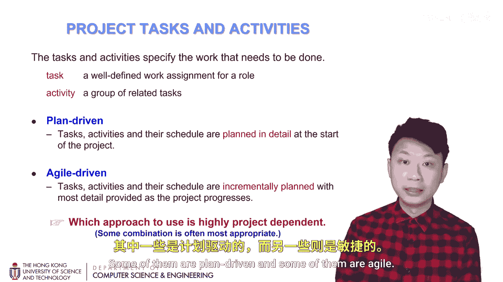
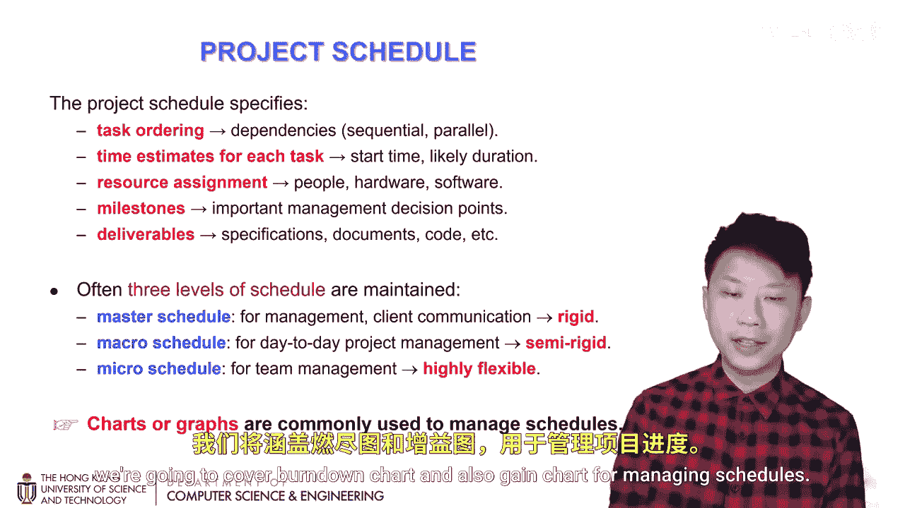
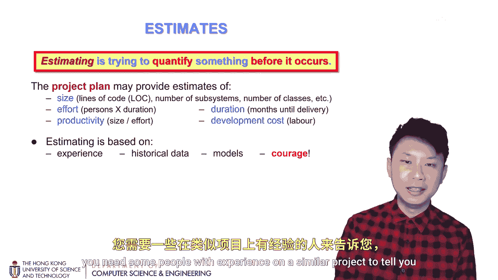
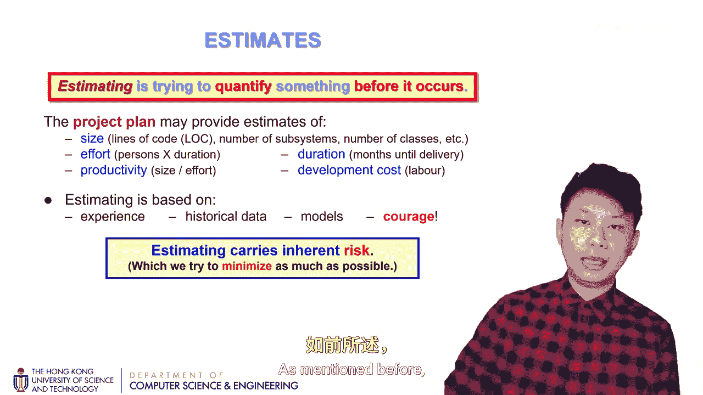
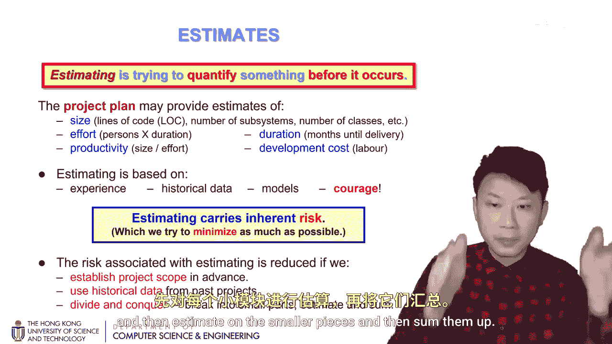
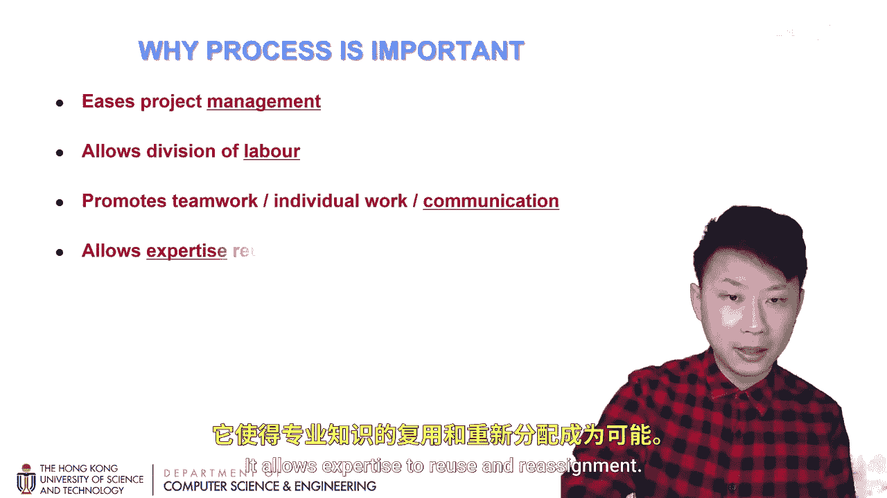
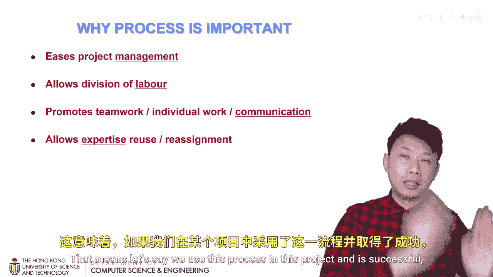
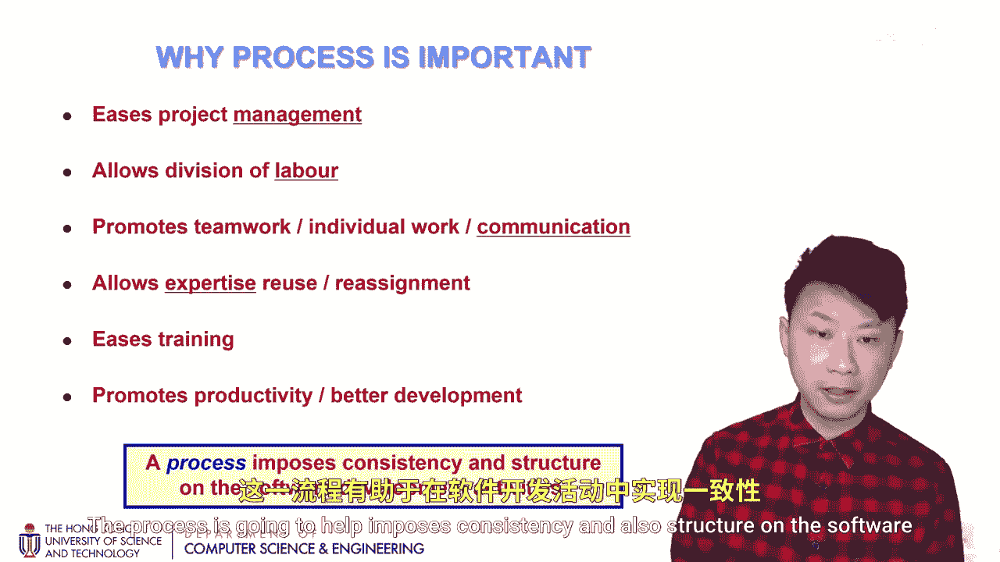
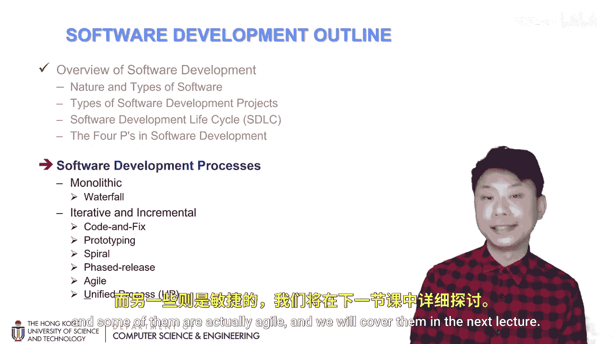

# 香港科技大学【中英⚡软件工程｜Software Engineering Specialization】 p23 P23 03_项目规划 -BV1MMEjzoEhg_p23-

And you also have to specify your project organization in your project plan。

 which specify the roles and also responsibilities and also the number of people that you need in your team for your project。

And you also have to specify your project organization in your project plan。

 which specifies the roles and also responsibilities and also the number of people that you need in your team for your project。

To increase the likelihood of project success is a good idea to include a team member who have experience with a similar system that you can implement for your project。

And to increase the likelihood of project success is a good idea to include a team member who have experience with a similar system。

 which is a system that' is similar to the one that you're going to build for your project。

And the team organization should be modular to limit communication and also complexity of interaction because if you have too many people in your team。

 then communication is going to be complicated and you have to assign clear responsibilities to each member in your team。

And inform teams to have responsibility for the design and implementation of one or more parts of the system。

 Again， we are talking about divide and conquerr。 We try to tra the large software system into smaller pieces。

 and then each team should be responsible for one or more smaller pieces of the system。

And you also have to identify a person in charge for each part and also the system as a whole。

 because if anything goes wrong in your project， you can always talk to the person in charge。

And the key to success is achieving the right level of communication in your project。

And in your project plan， you have to also specify the task and also activities within your project。

 The definition of a task is a well defined work assignment for a role。

And the definition for activity is a group of related tasks。

 So some of the projects they are plannedtered。 That means the task。

 activities and also their schedule are well planneded in details at the very beginning of the project。

Some of the projects they are agile， so that means the task activities and also their schedule are incrementally planneded as the project progresses okay which approach to use is highly project dependent and we're going cover different software development processes in the next lecture some of them are planned driven and some of them are agile。

And also in the project plan， we have to come up with a project schedule which specifies all the tasks within the project and also the ordering of the task and also the time estimates for each task。

And also resource assignment， milestones， and also deliverables within the project。

And very often we have to keep track free levels of schedule within a project。

 one is what we call the master schedule which is going to give you an overview of the entire project for management and also trying communication。

And also macro schedule for day to day project management and also micro schedule for team management。

And in this course， we cover， burn on chart and also gain chart for managing schedules。

And also you have to come up with all the estimates at the first beginning of the project in your project plan。

 for example， the size of the project， the effort that you need to spend on the project， duration。

 productivity and also development costs， etcter， etc。

So estimating is based on experience historical data or even using mathematical models and trust me or not in order to get the estimates to be correct or close to correct。

Somehow you need some people with experience on a similar project to tell you what are the possible numbers they can use in your project。

As mentioned before， estimating carry inherent risk and the risk can be reduced by establishing the project scope in advanced at the very beginning of the project so you know exactly what you have to do and what you don't have to do at the very beginning of the project。

And also use historical data from past projects， let's say from a similar project。

 you know that you need this number of lines of code and this number of people for your project。

 then you can come up with estimates using a past project。and also divide and conquer。

 try to break your large software system into smaller pieces and then estimate on the smaller pieces and then sum them up。

And another important P in a software project is process。

The definition of process is the complete set of activities or sometimes called workflows and also their sequencing that transforms the user requirements into a software product。

A process pre all the major activities within your project。

 and it has a set of guiding principles that explain the goals of each activity and a process is going to use some resources and it may be composed of some subprosses。

And each process activity has an entry and also exits criteria so that we know when the activity begins and when it ends。

And the process activities are organized in sequence so that we can perform one after the other。

And constraints and also controls， they may apply to a process activity。

 we may spend some time on a particular activity or spend some people right to work on a particular activity within the project。

So why process is important because it's going to help easy project management。Okay。

 by knowing exactly what are the activities that you have to perform in your project， okay。

 it's going to help you with the management of your project。

And also allow division of labor because you know exactly what you have to do in your project。

 then you can divide those activities to different people in your team。Okay。

 and also promote teamwork， individual work， and also communication。

And it allows expertise to reuse and reassignment that means let's say we use this process in this project and it successful okay。

 then we can apply the same process in another similar project。

And also EC training。And promotes productivity and also better development。

And the process is going to help imposes consistency and also structure on the software development activities。

And this is what I want to cover in this lecture in the next lecture。

 I will cover different software development processes and notice that some of the processes they are plant driven。

And some of them are at Aia， and we will cover them in the next lecture year。

