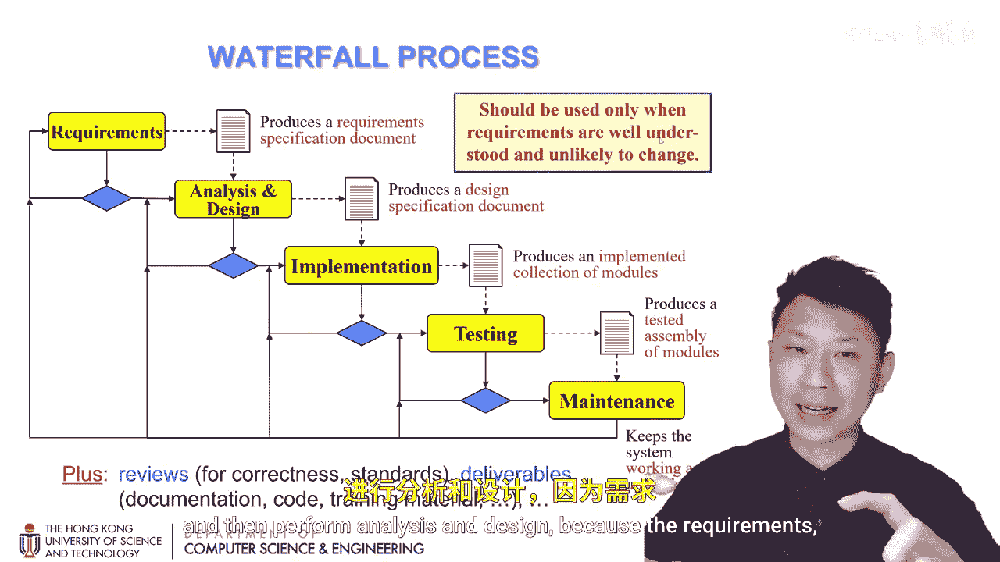
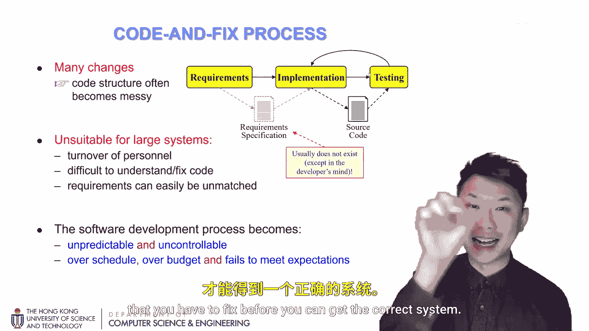
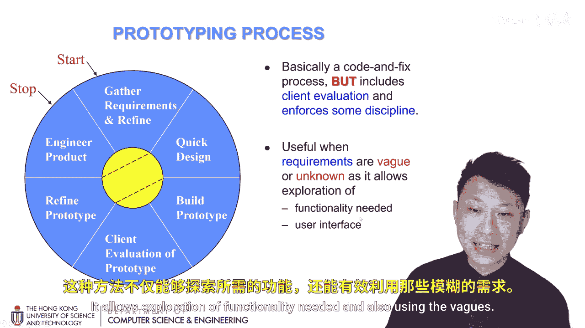
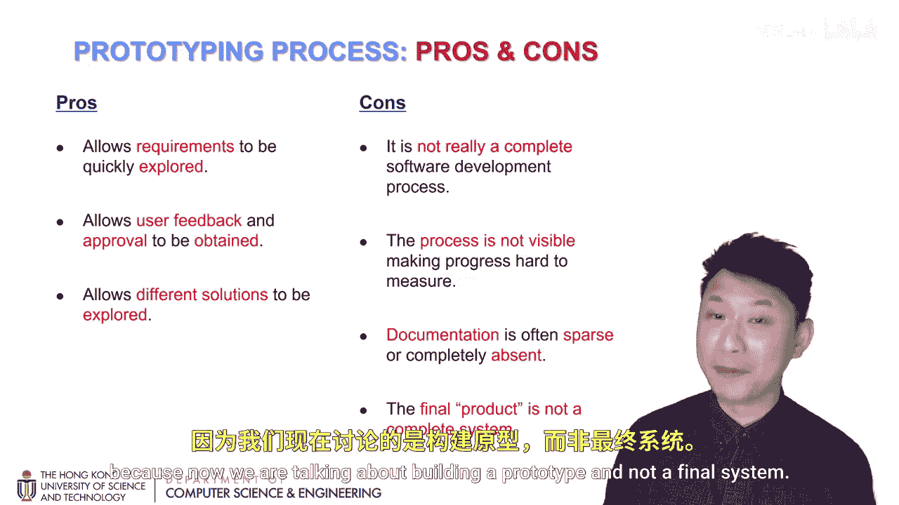
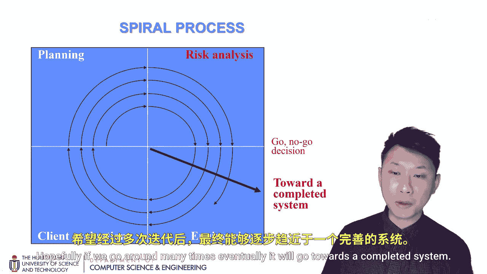
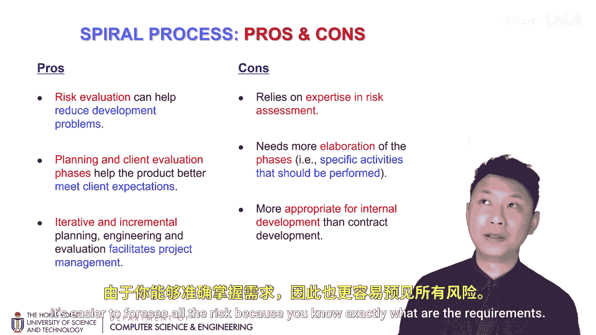
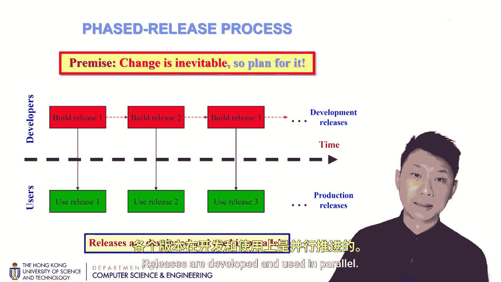
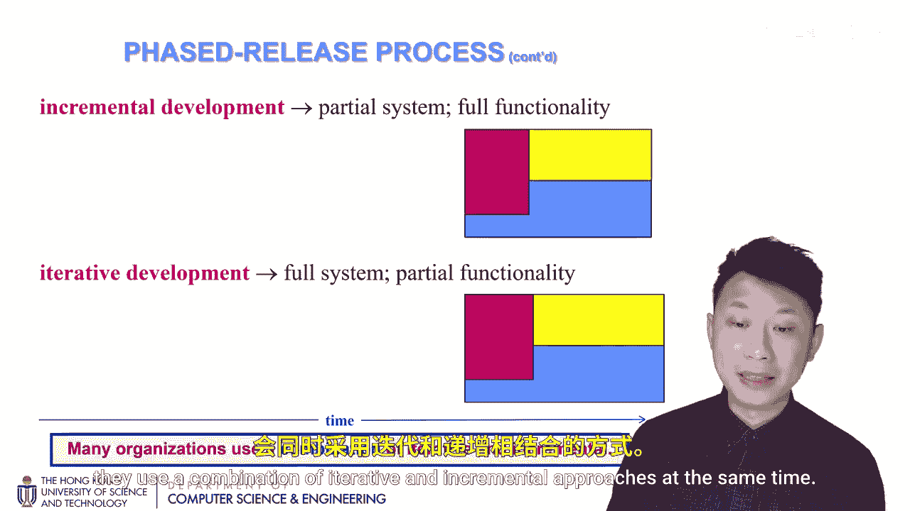
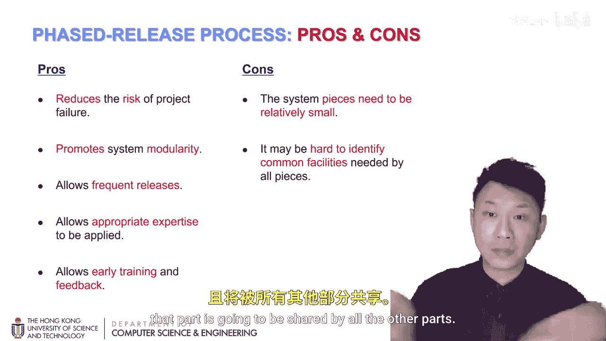

# 香港科技大学【中英⚡软件工程｜Software Engineering Specialization】 p24 P24 01_软件开发流程 -BV1MMEjzoEhg_p24-

Hi， in this lecture， we will talk about different processes that we can use for software development。

And we will cover different processes like waterfall model， code and fix， protypings， B。

 phrase release， agile and unified process in this lecture。

And notice that no matter which software development process that you use for your project。

 eventually the process will contain the following stages。

 Somehow you will need to get a requirements， Somehow you need to perform an analysis and design and then come up with a design for the system and then eventually implement a system and finally test the system。

And different software development processes， they mainly differ in how these stages are combined。

 emphasized and carried out。So after you learn about all these software development processes。

 the most important thing that you should pick up is that you should understand the strengths and weaknesses of different software development processes so that given a particular scenario。

 given a particular situation， you know exactly which development process is suitable for that situation。

So the first model that we cover is what we call the waterfall model。So for waterfall model。

 we first get our auto requirements。Then given all the requirements。

 we try to perform an assess and design and then come up with a model that we can use for implementation。

And then after that， we will go ahead and perform implementation。

And then after we finish implementation， we will perform testing to make sure that there's no defects within the software system。

And then finally， we have to perform maintenance to maintain the system。

And we say that this is a waterfall model because we try to always go down so after we get all the requirements we perform an analysis and design and then implementation and then testing and then maintenance。

 But from this model， you can see that we can go back but notice that if we want to go back。

 for example， when we find that the design is not correct because we have captured some incorrect requirements you can always go back and then fix all the requirements and then come up with another model but notice that this is going to be costly so that's why we call it waterfall model because we want to always go down not going back。

So that's why after you finish a particular phrase， for example， and access and design。

 you have to always perform review to double check the design that you come up with is actually correct before you go into the next step because you know that going back is going to be costly。

So this model can only be applied when the requirements are well understood and also unlikely to change So that's why this is what we call a more disciplined model and that's why it's not likely that we use waterfall model in the industry because very likely when we build a software system changes are going to happen So it's unlikely that we can capture all the requirements and then freeze all the requirements and then we go to the next stage and then perform analysis and design because the requirements they may change from time time。

So these are the pros and cons of waterfall process。The process is that and is disciplined。

And it keeps development predictable and also easy to monitor because you go from one stage to another and then you try to avoid going back and also enforces documentation standards and approval of documents before you proceed to the next stage。

And it fits well with other engineering process model。 It's not just for software engineering。

 If you have other kinds of engineering projects， you may also apply what for model。

The coin is that you assume linear sequential development is possible。

 so you try to avoid going back。And rigid assuming results of each phrase can be frozen before you move to another phrase。

And different languages and notations are often used in different phrases。

And also make little provision or opportunity for user feedback。

 which is a source of high risk because you assume that all the things they are not going to change within the project。

And now we're going to cover some iterative and incremental software development processes。

The first one that we talk about is code and fixed。

 This is usually the approach that we use in programming assignment。

 So in your programming assignment， you will be given a set of requirements then based on the requirement。

You're going to build something。Okay，If it's correct， then you move on Okay， if it's not correct。

 then you have to perform testing and you find that the software is not correct。

 then you have to go back and fix your implementation。

 So that's what we call it code and fix right we code and then we perform testing。

 If there's something wrong， we fix it。And if we are using this process。

 then very likely there will be many changes because when there's something wrong we have to fix it。

 and very often the code structure is going to be messy because you're going to put many workarounds in your source code to make it work。

And it's not suitable for large systems because usually this is the approach that we use for program assignment。

 but not for a large software system and if you are using this process。

 then you make the process unpredictable and also uncontrollable and very likely maybe over budget over schedule and also fails to meet expectations。

Because you don't know exactly how many times that you have to fix before you can get the correct system。

So that's why this is the process that we should avoid。

 So the next process that I'm going to talk about is what we call prototyping So for prototyping we try to gather some quick requirements and then come up with some quick design。

And then we build a prototype and then involve the client to evaluate the prototype and notice that the prototype is not the entire system。

 it's not the full system， for example， if we are building a web application。

 then we may simply build the UI of the application so that we can show the UI to the client and then get some further feedback about the system。

And then we have to refine the prototype after we gather the feedback from the client。

 and we may have to also redesign the system after we get the feedback from the client and then we build another prototype and then until we get the final product。

So basically is similar to code and fix， but now by using prototyping。

 somehow we involve client evaluation and also enforces some discipline。

And it's useful when requirements are vague， guess when the requirements are vague。

 when you don't know exactly what are the requirements。

 then you can simply come up with some quick design and build a little prototype and then ask。😡。

Your client whether this prototype satisfy your requirements or not Okay， if yes。

 then you further work on the prototype， if not， then you have to refine your design and then build an up prototype。

So that's why it's very useful when the requirements are vague because you can collect more requirements from your client using the prototype。

And it allows exploration of functionality needed and also usually innovates。

And these are the pros and cons of prototyping。The process is that you allow requirements to be quickly explored and it allows user feedback and approval before we further refine the system。

And also allow different solutions to be explored。But the concept is not really a complete software development process。

 and the process is not visible making progress hard to measuresh here because you don't know exactly how many times that you have to refine the prototype before you get the final system。

And documentation is often sparse or completely absent if we are using prototyping and notice that the final product may not be the complete system because now we are talking about building a prototype。

 but not a final system。

And the next process that I'm going to cover is what we call spiral and notice therefore spiral。

 what special is that we involve another phrase called risk analysis。

So what we're going to do is that we're going to perform some planning and then perform some risks and access to foresee all the possible risk within the project and then now after we gather all the risk。

 we decide to whether go or not go。And then if we decide the go。

 then we implement the system and then after that we involve client evaluation and then we plan the system and then get a risk again etc cea。

 etc cea。 so that's why we call it spiral because we have to go several rounds before we get the final system and hopefully if we go around many。

 many times then eventually it will go toward a complete system。

And the prose of spiral is that the risk evaluation can help reduce development problems because you try to foresee all the risk before you actually implement the system。

And planning and client evaluation phrases help the product better meet client expectations just because before you go for another run。

 you will always ask for client feedback。An iterative and incremental planning。

 engineering and evaluation facilitates project management。

The coin is that you need some expert in the risk and assess ratess to identify all the risks within the project。

And also， you need more elaboration of phrases before you can get the final system。

And it's more appropriate for internal development rather than contract development。

 why because you know exactly what are the requirements。

 if it's an internal system and also it's easier to foresee all the risk because you know exactly what are the requirements。

And the next process that we cover is what we call phrase release process just because changes are likely to happen in the project。

 So that's why we have to plan for it。 and in phrase release。

 we try to release the system part by part。By releasing different builds of the system from time time。

 and then we may further refine build number one and then get build number two and after build number two is completed。

 then we may release it to the users， etc ce， etc ce， so releases are developed and used in parallel。

And notice that the development may be incremental。

 that means we start with part of the system and then we build another part of the system and then we build another part of the system until we get all the functionalities。

Or it can be iterative。 That means we try to get the full system。

 but we make the system more and more sophisticated。And notice that many organizations。

 they use a combination of iterative and incremental approaches at the same time。

And these are the pros and coins of phrase release。

So the process is that it's reduce the risk of project failure because at one time we're going to focus on just one part of the system。

And it promotes system modularity。It also allows frequent releases and also allows appropriate expertise to be applied to a particular part of the system。

And also allow early training and also user feedback。

But the coins are that and the system pieces need to be relatively small。

And it may be hard to identify common facilities needed by all pieces in our pictures where we assume that the parts they are separated。

 but in reality very likely there will be some sharing or some common facilities needed by all the parts。

 so that's why we need to identify that part because that part is going to be critical that part is going to be shared by all the other parts。

