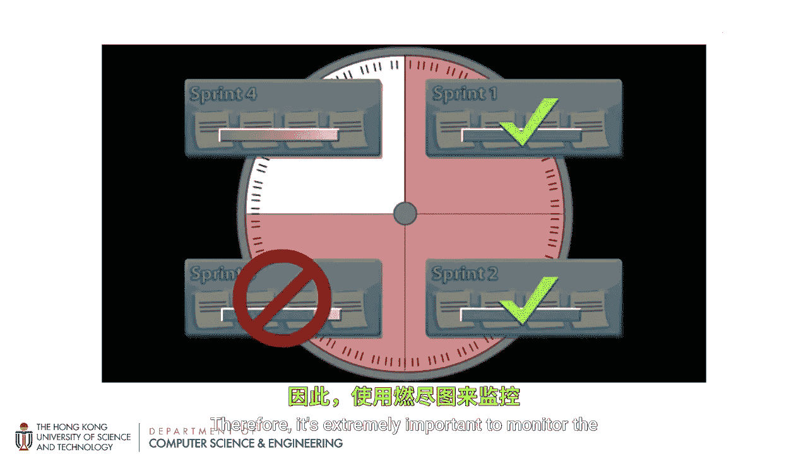
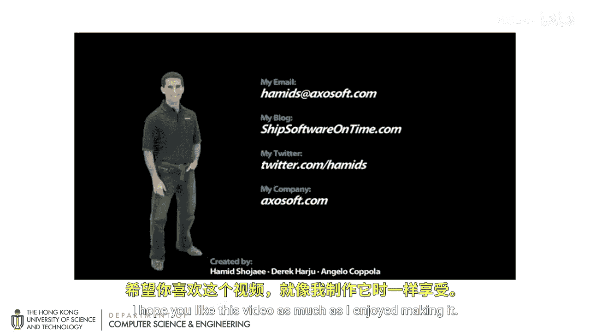
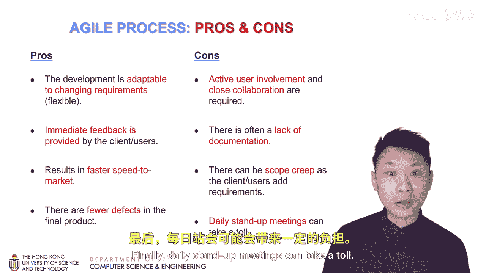

# 香港科技大学【中英⚡软件工程｜Software Engineering Specialization】 p25 P25 02_敏捷开发 -BV1MMEjzoEhg_p25-

And then the next approach that we're going to talk about is what we call Aia for AA process。

 we focus on the items on the left hand side。And we focus less on the items on the right hand side。

 So for example， we focus more on individuals and interactions and also a working software and also client involvement and also collaborations and also responsiveness to changes rather than processes and tools or documentation or contract negotiation or following a plan So now you can see that instead of coming up with documentation or a plan we try to focus more on implementation。

 this is what we focus when we talk about agile processes。

But this does not imply that there is no value in the items on the right hand side。

 just that we focus less on those items。And these are the LGL processes that I'm going to cover in this lecture and they are extreme programming。

 continuous integration and also STrum， and there are some common practices used by these AGL processes。

 for example， planning poker to estimate the resources and the number of people the time the schedule needed for the project。

Pair programming to avoid making mistakes。 What is pair programming That means when you are。

Programming another guy will be sitting beside you watching you typing in Sosco Why do we want to do pair programming because if you try to avoid making mistakes just because right another guy is double checking your sourceco。

 then we can avoid making mistake。😡，And also test driven development。 So that means before。

 even before we we implement， we think about what are the possible task cases for the system。

So the first one that we're going cover is what we call extreme programming in extreme programming we have to gather requirements and perform analysis and developers they will determine the features required for the system。

 and then they will also provide a time and cost estimation for each feature。

And the client will select features to be included in a particular iteration of the development。

And then when we implement， the developer will break each iteration into some task。

And then different people and different teams， right， they will be responsible for a different task。

 And for each task， the developer has to design the test cases。

 So that means we're going to use test driven development。

 We have to think about the test cases before we implement a particular task。

And then we implement the task using power programming again。

 when you're programming another guy is going to double check your program to make sure that there's no mistakes。

And then finally， we will integrate the task together as to find a product。

And this is what we do in extreme programming。And the next one that we're going to talk about is continuous integration and notice that continuous integration is an agile software development process where developers。

 they will integrate Soco into a share repository on a daily basis。

 so that means once the developer gets something done。

They will immediately integrate the code into a shared repository So why do we want to do that Because if we are just talking about integrating a small part of the sourcesco into the repository。

 then the effort that we need to spend for integration and also testing is going to be minimal。

 So that's why we want to perform integration quickly and also testing quickly to identify any errors and also any integration errors immediately。

So these are the advantages of using continuous integration。

 It allows developers to integrate and test their code early。 So once they get a little part done。

 then they will integrate and test their code immediately。And also。

 quick catches and also exposes of any bug that may break the bill。

And also reduce integration conflicts by doing integration continuously。

 and it helps developers to check the progress of their development。

 because now you can see the work under the shared repository。

And also building and testing are done automatically using scripts on the CI server and the coin is that you will need a CI server to compile the code periodically and also reports the results to the developer and also you have to prepare all the scripts on the server to do the building and also testing automatically on the server。

And this is the architecture that we use in continuous integration， so developers。

 they will commit changes to a version control repository。

Then this CI server will pull the most updated。And the C server will pull the most updated version from the version control repository and then try to build and test the most updated version if there's any mistakes with the most updated version。

 then there will be some feedback to the developers and we assume that testing and building they are done automatically using some scripts on the C server。

And the next process that I'm going to talk about is what we call Scrorum and its a very common process being used in the industry。

 and I will show you a little video about Scrorum。

Oh。🎼H， this is me。 My name is Hammichojai and have been involved with a number of software development projects over the years at a number of different companies and have come to recognize Scrum as one of the best agile development practices in use today。

 In this past paced video。 I want to show you why Scrum is so great and how you can get started with scrum in under 10 minutes。

 I'll cover all the core scrum concepts like product backlogs。 Teammerolls。😊，Spprints。

🎼Burn down charts and more。 So get ready to be bombarded with information。

 Let's say this is the product we want to build for this product。

 We get all kinds of feature requests from users， customers， executives or even other team members。

 in Scrum， The collection of all these features is called the product backlog。

 Another way to think of the product backlog is to think of it as a wish list of all the things that would make this product great。

 Once we have our wish list or the product backlog We need to start planning which specific features we're going to put into a particular release of our product。

 But we're getting ahead of ourselves。😊，Let's back up a bit to build this product。

 we need to have one or more people on our team who are going to play a variety of roles。🎼First。

 we need her。 She plays the role of product owner and helps make sure the right features make it into the product backlog。

 representing the users and customers of the product。 She helps set the direction of the product。

 Then we need this guy。 He's the scrum master and his job is to make sure the project is progressing smoothly and that every team member as the tools they need to get their job done。

 He sets up meetings， monitors the work being done and facilitates release planning。

 He's essentially a project manager but that's such a boring title to welcome call him a scrum master to imply he knows somejijitsu。

🎼And the rest of the team has similar roles to other development processes。

 These guys build the product while these guys test it to make sure it works right。

 these guys use it and hopefully pay for it。 And these guys generally get in the way。

 But it turns out you can't build many products without them。

 But let's get back to this release planning。 The plan and release。 the team starts with this。

 The product backlog and they identify the features they want to put into this release。

These features then become part of the release backlog。

 the team then prioritizes the features and estimates the amount of work involved for each feature。

 providing a rough idea of the total amount of work involved to complete the entire release。

🎼A quick side note about estimates。 There are a lot of techniques for creating estimates from poker games to basing estimates on historical trends to using story points instead of hourss。

 But no matter what technique you use， you'll want to make sure you involve at least two or three subject matter experts。

 There is simply no replacement for what a subject matter expert brings to the table。

 Keep that in mind as you do your estimates。 Let's get back to this。

 The release backlog with a prioritize and release backlog in hand。

 We are now ready to plan out several sprints to get the work done。

🎼Sprints are short duration milestones that allow teams to tackle a manageable chunk of the project and get it to a ship ready state。

 Sprints generally range from a couple of days to as much as 30 days in length。

 depending on the product's release cycles。 The shorter the product's release cycles。

 The shorter each sprint should be。 And you'll want to have at least four to as many as a dozen sprints in a given release。

 So at this point， we can take our release backlog and split it up into several of these sprint backlogs。

 One of the most important things to remember about sprints is that the goal of each sprint is to get a subset of the product backlog to a ship ready state。

 So at the end of each sprint， you should have a fully tested product with all the features of that sprint。

100% complete。 Since sprints are a very short but the realistic representation of part of the product。

 A late finish of the sprint is a great indicator that the project is not on schedule。

 and something needs to be done。 Therefore， it's extremely important to monitor the progress of each sprint with this。

 A burnout chart。 The burndown chart is the number one reason。😊。

🎼For Srum's popularity and one of the best project visibility tools to ensure a project is progressing smoothly。

 The burndown chart provides a day by day measure of the amount of work that remains in a given sprint or release。

 In this graph， you can see that the amount of work remaining bounces up and down from day to day。

 but is generally trending down towards 0。 because historical information is provided in the burndown chart。

 It's easy to see if the team is on the right track， using the burndown chart。

 the team can quickly calculate this， the slope of the graph。

 which is also called the burndown velocity。 This is the average rate of productivity for each day。

 For example， a team's rate of productivity， might be that on a typical day they finish approximately 50 hours of work。

 knowing that it's possible to calculate an estimated completion date for the sprint。

 or even for the entire release based on the amount of work remaining。

 What's great about the burndown chart is that we can compare our actual velocity and projected completion date to what the team needs to do in order to finish on time。

 and we can use that to see if it's a realistic time frame。 This is。😊。

🎼Perhaps the most useful piece of knowledge that any team member。

 product owner or product executive can have about the project。

 because knowing whether or not the project is on track early in the schedule can help teams make the proper adjustments necessary to get the project on track。

 The burndown chart provides empirical proof that the project is on track or if it's going to be late。

 So let's talk a little about where the data for this incredibly useful burndown chart comes from。

 As you recall， part of the release planning process was to create an estimate for each feature in the product backlog。

 The collection of these estimates for a given sprint represents the total amount of work that must be done to complete that sprint。

 as each team member goes through and makes progress on one or more of the features。

 they simply update the amount of time remaining for each of their own items。

 So the total amount of time remaining on the group of features that make up a sprint changes on a day by day basis。

 Hopefully going downward until it hits0 when the sprint is complete。

 The burndown chart aggregates it remaining work data and shows it visually。

 It's brilliant because it communicates a massive amount of information。In just a few seconds。

🎼At this point， one question you might have is， what do we do about these little guys。

 Buuggs come up during the development of every product。

 And while there is no way to avoid them altogether。

 there are some best practices on how to deal with them。 First。

 it's a good idea to track bugs separately from features in their own defect backlog and during a feature sprint。

 any bugs that are found relating to a feature in development should be dealt with immediately before marking the feature complete。

🎼You'll also want to plan at least one or two sprints that focus only on your defect backlog。

 And that brings us to this。 The daily scrum。 Scrum components often insist on short daily standing meetings。

 The idea behind a standing meetings is that if everyone is standing。

 Nobody will waste time and therefore meeting will be short。 and by meeting daily。

 you can feel confident that everyone is on top of their tasks。

 The daily scrum is a great idea and especially useful in less experienced teams。

 but I wouldn't call it a core or essential part of scrum。

 insisting on these meetings in an already efficient and experienced team。

 especially teams that work in close proximity with one another。

 could actually backfire by lowering team morale。 Keep Ben in mind when deciding on having daily scrums。

 So there you have it。 Scrum in under 10 minutes。 You not know all the essential concepts to start implementing scrum inside of your organization。

 It's quickly review them in scrum， you work with this。 a product backlog。

 which is nothing more than a list of features。 We then break down the product backlog into one or more release。

🎼Blogs。 and for a given release， you further break up the release backlog into a number of sprint backlogs。

 which are essentially short duration milestones throughout your project。

 You then monitor the progress of each sprint using these burn down charts。 depending on your team。

 you might want to have daily srum meetings to ensure everything is on track。

 That's all there is to it。I hope you liked this video as much as I enjoyed making it。

So now after watching the video， you will know that As ScRrum is an agile software development process that mainly specifies what you should do to develop a software product。

And there is no specific software engineering practices are prescribed for developing the product。

 and the team needs to decide how to work on it。The requirements are captured as items in a product backlog right so a list of features required by the software system and the product owner the client sets the priority for the items。

And the software product is developed in a series of iterations called sprints。

And team self organized to determine the best way to deliver the product。

And these are the things that we have to do with in Scrum。

 So now you should know what is a sprint within Scrum after you watch the video。

 the product backlog contains all the features required by the system。

 Then we're going to pick a subset of the features and then put it in a sprint。

 Then within that sprint， usually two or four weeks time。

 we're going to focus on the implementation of those features within a sprint。

And that's why we say the software product is designed， coded and tested during sprints。

And the requirements are not allowed to change during a sprint。

And also after watching video you should recognize all these keywords in Scrum The product owner is your client。

 The Scrum master is usually the manager and also we may have different meetings， for example。

 sprint planning meeting to plan exactly what are the features required within a slin and also daily Scrum meeting to keep track the progress of development and also there may be different artifacts for example。

 the product backlog which contains all the features required by the system and also sprint backlog which is the features required by a sprint and also burn on charts to keep track the progress of development。

So now you know that if we are talk about product owner， we are talking about our client。

 is usually the key stakeholder and is going to define and priorize the requirements of the product and also adjust requirements and priority of every iteration as needed and also decides on the release dates and content and also accepts and reject work results etc。

 etc and its Scrum master is usually the manager of the project and he or she is responsible for enacting Scrum values and practices。

And also ensure that the team is fully functional and also productive and also enable close cooperation across all rows and functions。

 And finally， we moves impediments to progress and shift the teams from external inferences So in a sprint planning meeting we have to decide from the product backlog from the all the features pick a subset of the features in a slinprint so that we gonna to focus on those features in a sprint And then if we are talk about daily Scrum meeting。

 this are the questions that you may ask in the meeting， what did you do yesterday。

 what will you do today， is there anything in your way， etca， etca again。

 asking this questions this can help you track the progress of the development and this are the artifacts of Scrum So somehow you still have some kind of documentation to keep track all the features required by the system and it' called product backlog。

And then within a sprint， we are going to choose some of the features from the Pro to develop within a sprint。

And then we will use burnt onchar to keep track the progress of development。

 And these are the pros and cons of agile。 The pros are that the development is adaptable to changing requirements。

And immediate feedback is provided by the client or users。It also results in fast speed to market。

And there are fewer defects in the final product， because if we have defects within a sprint。

 we should clean up all the defects before we move to another sprint。

And the coins are that active user involvement and close collaboration are required。And also。

 there is often a lack of documentation。And there can be scope creep as declining our users at requirements。

And finally， daily stand up meetings can take a toll。

