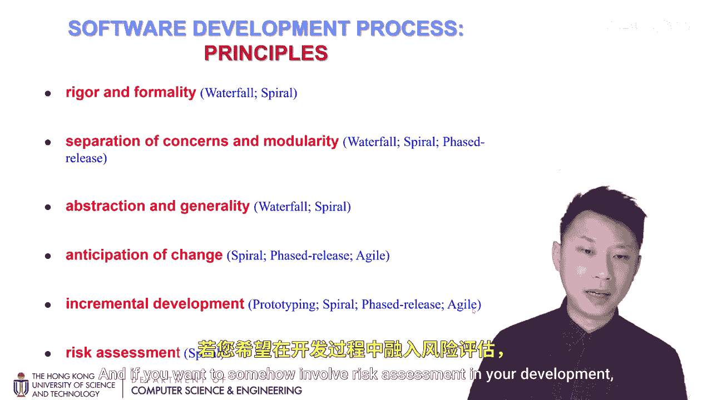
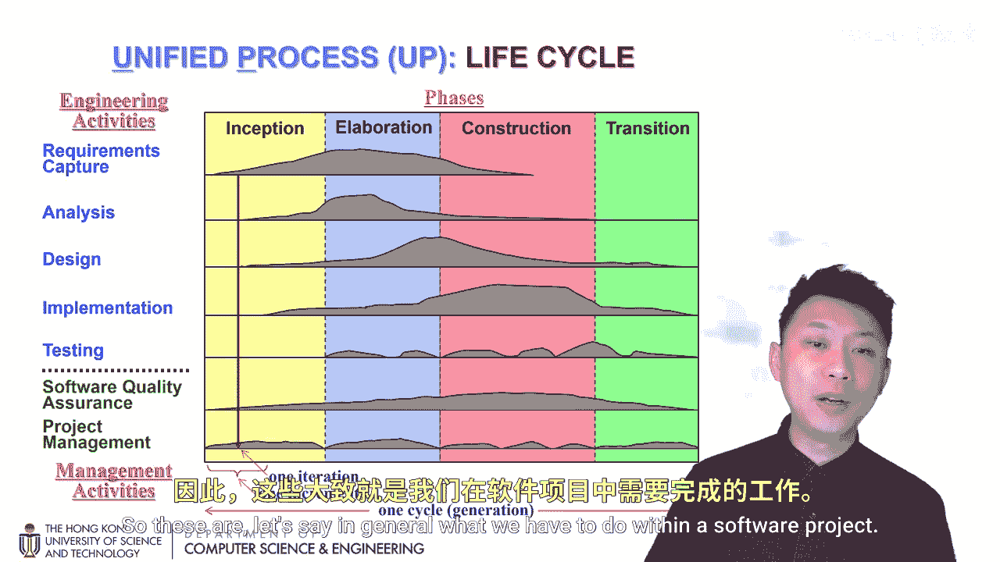
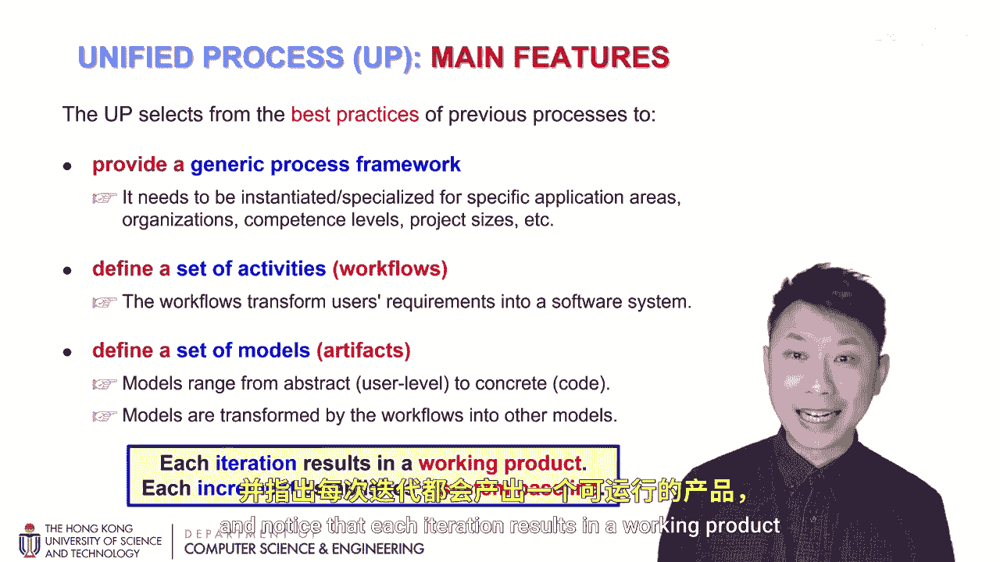
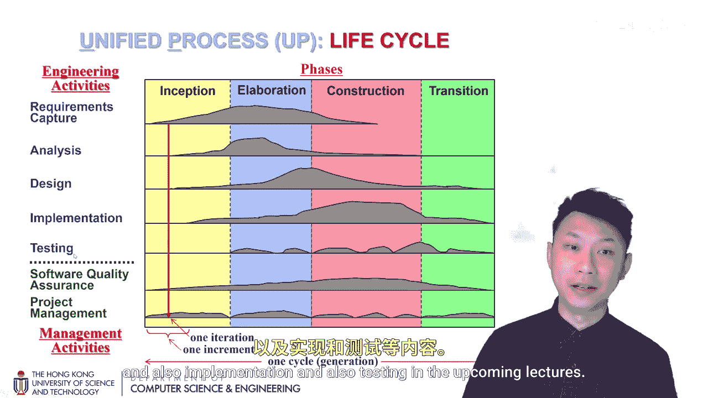
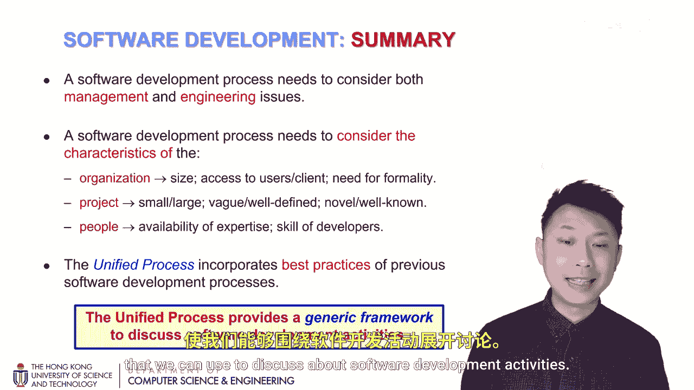

# 香港科技大学【中英⚡软件工程｜Software Engineering Specialization】 p26 P26 03_统一过程 -BV1MMEjzoEhg_p26-

In this lecture we have covered many software development processes。

 if you need formality and also discipline， you can choose waterfall or spiral processes。

If you want a separate of concerns and modularity， you can choose waterfalls。

 spiral or freight release。If you want abstraction and generality。

 then you can choose waterfall or spiral。If you want processes that allow anticipation of change。

 then you may choose spiral， face release or Aile。If you want incremental development。

 then you may choose prototyping， spiral， phrase release， or Agure。

 and if you want to somehow involve risk assessment in your development， then you may choose spiral。

So this is what we call unified process， which is a general framework that we can use for software development and no matter which process that you're going to use for development。

Basically you have to perform the following activities， somehow you have to capture requirements。

 perform analysis， and then come up with a design that you're going to use for implementation。

 then implement the system and finally test the system。And then within the project。

 you have to perform software quality assurance to make sure that eventually you going get some quality software and also perform project management。

And also within the project we're going to have different phrases inception phrase means we're going to gather all requirements and then double check whether the requirements they feasible or not。

 if they are feasible then you can go ahead if they are not feasible then you may stop the project。

And then elaboration means we're going to come up with a design that we're going to use for implementation and then construction means implementing the system。

 transition means we're going to deploy the system and also maintain the system。So these are。

 let's say， in general， what we have to do within a software project。

So that's why we say that unified process U P select from the best practices of previous processes to。

Provide a generic process framework for software development。

And also define a set of activities that you have to perform within in software development。

And also define a model that you can follow within a project。

And notice that each iteration results in a working product and then each increment establishes a system baseline。

And for the upcoming lectures， we will go back to this picture for unified process again and again because we will talk about different activities。

 for example， and analysis and design and also implementation and also testing in the upcoming lectures。

So you have learned that a software development process needs to consider both management and also engineering issues。

And also a software development process needs to consider the characteristics of， for example。

 the organization， the project， and also people that we have within the organization and unified process incorporates best practices of previous software development processes。

And it provides a general framework that we can use to discuss about software development activities and that's all I want to cover in this lecture。

