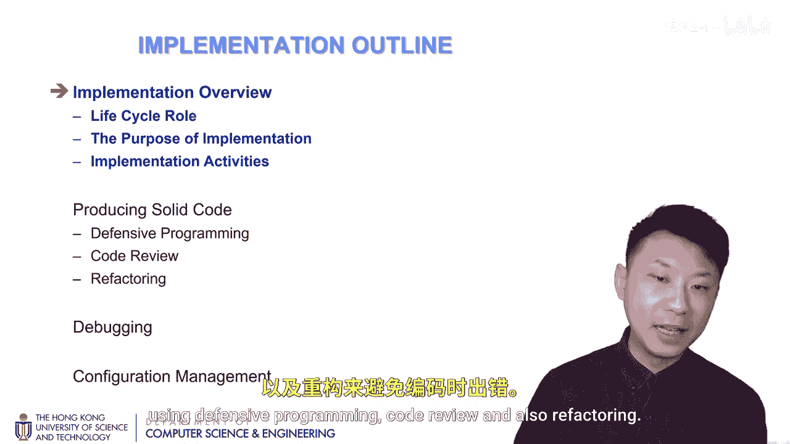
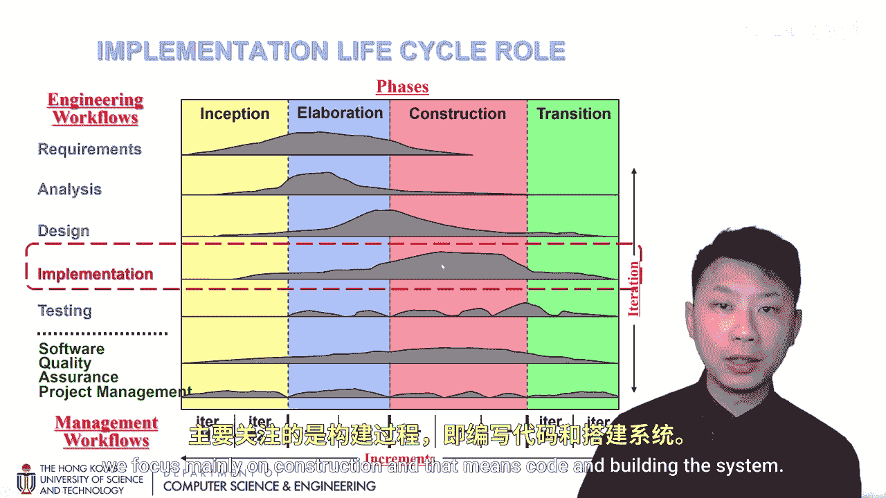
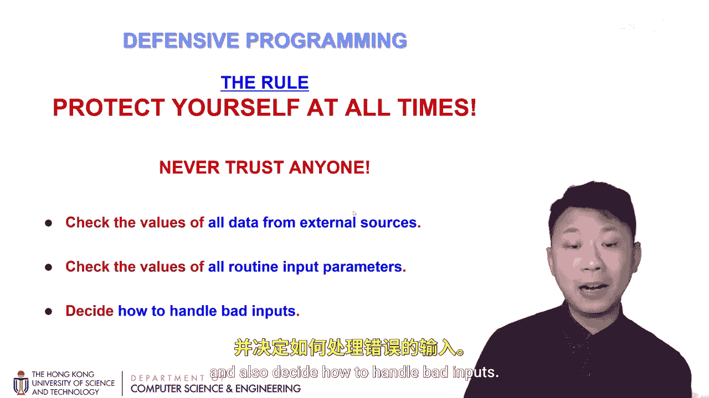
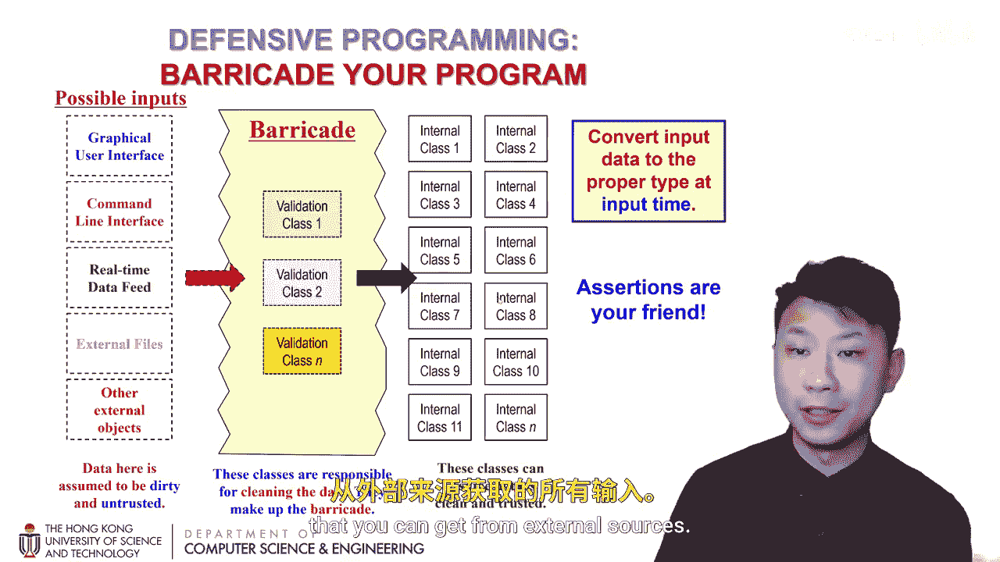
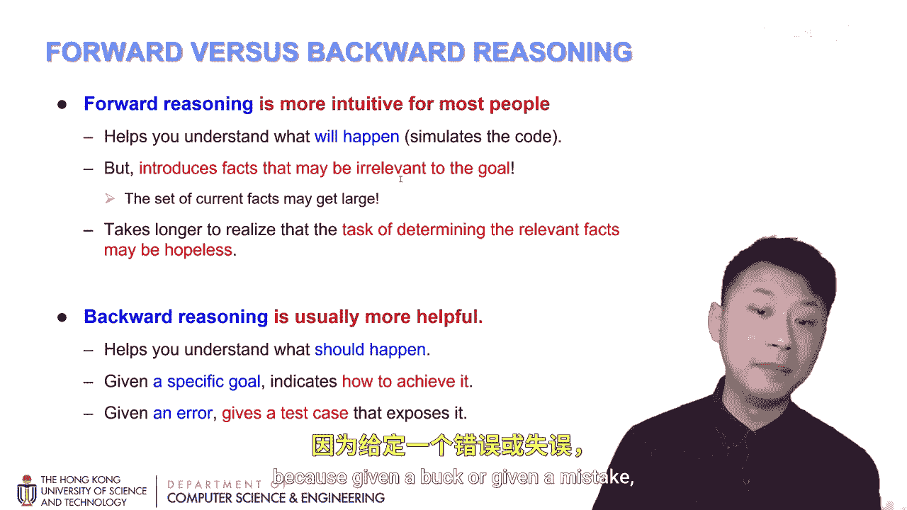
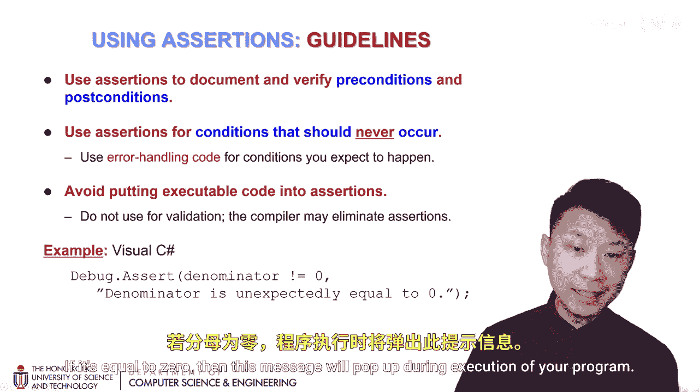

# 香港科技大学【中英⚡软件工程｜Software Engineering Specialization】 p27 P27 01_防御性编程 -BV1MMEjzoEhg_p27-

Hi， this lecture is about implementation that means we code and build a system in this lecture I'm not going to teach you how to code。

 but instead I will teach you how to avoid making mistakes when you code so this are the learning objectives of this lecture after this lecture you will know the purpose and the major activities of implementation you will also know how to protect your code and also how to improve your code then you will learn how to debug your code and then finally how to back up your code so this lecture is an overview about implementation and I will also talk about how to avoid making mistakes when you code using defensive programming code review and also refactoring so if we are talk about implementation。

 we focus mainly on construction。

That means code and build a system in implementation。

 we try to transform a design into executable code。

And the implementation workflow implements the system in terms of modules and subsystem。

 so we try to develop modules one by one， and then we try to build subsystem one by one。

And a module is a physical replaceable part of a system that packages implementation and conforms to and also provides a set of interfaces。

And a substem organized modules into more manageable pieces。

 so we try to group modules together as a subsystem and examples of modules are， for example。

 source code binaries， scripts or executables So during implementation we try to generate source code for each class and we need to choose and code suitable algorithms to implement the methods that we have within the software system and then we have to assign classes to different modules then we have to integrate modules and subsystems by compiling them and linking them together into executables and when we perform implementation we need version control then when we perform integration。

 we also need an integration plan and they eventually visit distributed system then we may have to distribute the executable modules onto different processing notes So now I will talk about how we can avoid making mistakes by defensive programming So what is defensive programming the rule of thumb is that you try to protect yourself at all time and we never trust。

Anyone， including your users and we have to double check all the values of all data from external sources。

 especially those data from users and also check the values of all routine input parameters and also decide how to handle bad inputs So one important thing that you have to do in defensive programming is to double check all the inputs from external sources using barquet classes so you may get some inputs from your user via graphical user interface。

 command interface etc etc so for all the inputs that you get from the user you have to double check them before you feed them into internal classes into your system so now let's say we have a cost registration system and student has to input student IDs and their email address before they can access something on the system then we have to double check this inputs that means their student ID and their email address before we feed their student ID and email address into the internal classes into our system by。

Doing this， we can use the barocade classes to clean the data before we feed any data into internal classes So all the data that we use within the internal classes。

 they are clean and they can be trusted An assertion are your friend and you can use assertion to double check all the inputs that you can get from external sources So what are assertions assertions are statement that you can insert into your program to double check for some conditions within your program for example。

 what is true here。

X should be 17， then you can insert an assertion here to double check that x should be 17 at this point of execution。

 So what should be true here Now x should be 17 and y should be 42。

 Now you can insert another assertion here to double check that and make sure that X should be 17 and y should be 42。

 just to make sure that you achieve all the required conditions while you executing the program。

 So what should be true here Now x should be 17。 Y should be 42 and then set should be 59。

 and then finally， what should be true here nothing It's gonna be just true。

 So now you can insert assertions into your program to double check for some condition while you executing the program。

 So that's why I say here an assertion is a logical formula inserted at some point in a program and you can use assertions to check for precondition and also postcon precondition means an assertion inserted before the execution and post conditiondition means an assertion inserted。

After execution so we can come up with all the assertions using forward reasoning。

So this means we know what is true before running the code。

 Then we ask ourselves what must be true after running the code。 This is one example。

 let's say the precondition is that it is even。Then after we execute this free lines of source code。

 what should be the post condition？Now， you can see that after you execute this free lines of code。

X should be5 and y should be even because y is two times x and it's gonna be always even or you can come up with assertions using backwardwork reasoning so backward reasoning means we know what's going to be true after executing the code Then we try to derive what should be true before running the code So this is one example。

 Let's say that you know the post condition is y is going to be bigger than X。

 Then what should be the precondition。😡，Now let's say x and y。

 they are both integer and if y is bigger than x now in the last line of code。

 we know that x should be5 if y is bigger than x， then y has to be bigger than or equals to6。

So y is equals to2 times x in the second line of code。 that means x has to be。

Bigger than or equals to3 in the second line of code and in the first line of code。

 we know that x is gonna be equals to x plus3。 then since from the second line of code。

 we know that x has to be bigger than or equals to3。

 that means we need x to be non- negativegative in the first line of code in order to achieve the necessary postcon that means x has to be bigger than or equals to zero so now why backward reasoning is good because somehow you can reestablish a class invariant at operation exit So given a postcon you will know exactly what is required to generate the postcon and also for example。

 given a bug you will know exactly what must the input have been in order to somehow we produce the bug so notice step forward reasoning is more intuitive for most people because it's gonna to help you understand what will happen in your program but then you may introduce facts that may be irrelevant to the goal because during the execution you're gonna derive a large set of conditions and some of them may not be relevant to the goal and it may take you a long long time before you can derive all the relevant。

Fact so that's why usually backward reasoning is going to be more useful。

 It's going to help you what should happen。 That means given a specific goal how do you achieve it and given an error or a bug how do you produce a test case to somehow we produce the bug So that's why I say backward reasoning is going to be very useful for testing because given a bug or given a mistake you will know exactly how to we produce the mistake and then you can use assertions to double check for the following things for example input parameters output parameters whether a file or a stream is opened or closed and the value of an input only variable a pointer is empty or not。

An array or other container passed into a routine can contain at least X number of elements。

A table has been initialized or a container is empty and you can use assertions to double check for all these things and why do we focus on checking these things right because these are the places that we can easily make mistakes so that's why we focus on double checking these things in our program and this are some guidelines for using assertions you can use assertions to document and verify preconditions and also postconditions and you can use assertions to check for conditions that should never occur and you should avoid putting executable code into assertions So this is an example assertion in C sharp and the condition here is that the denominator should not be equals to0 if it's equals to zero then this message will pop up during execution of your program。

