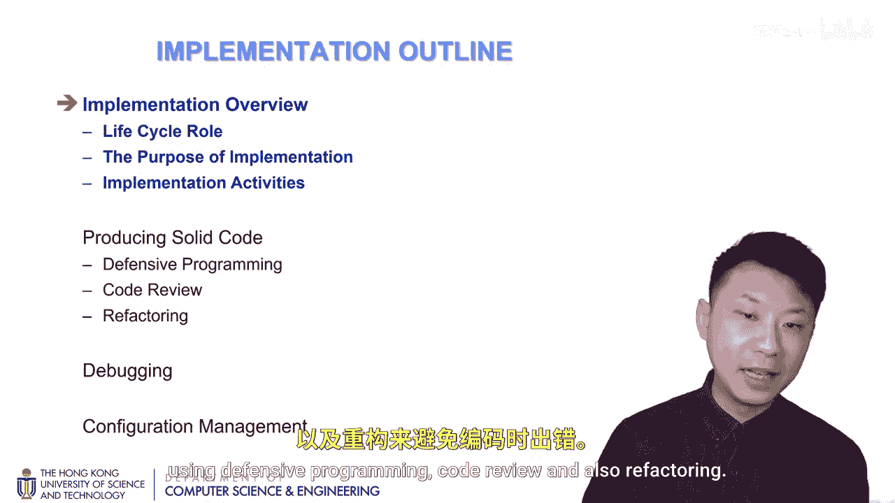
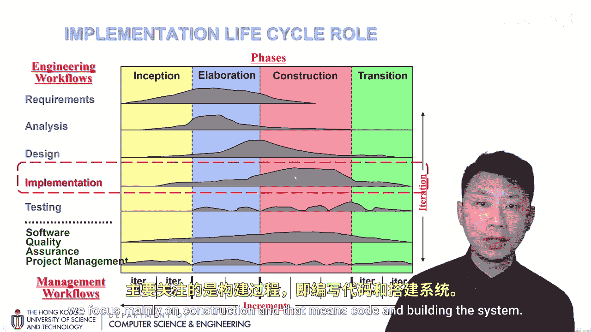
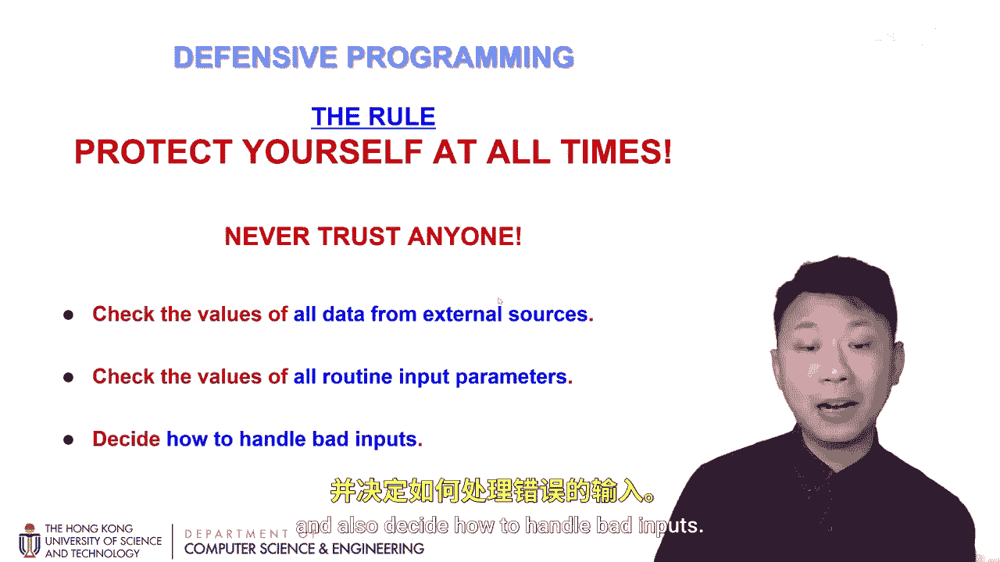
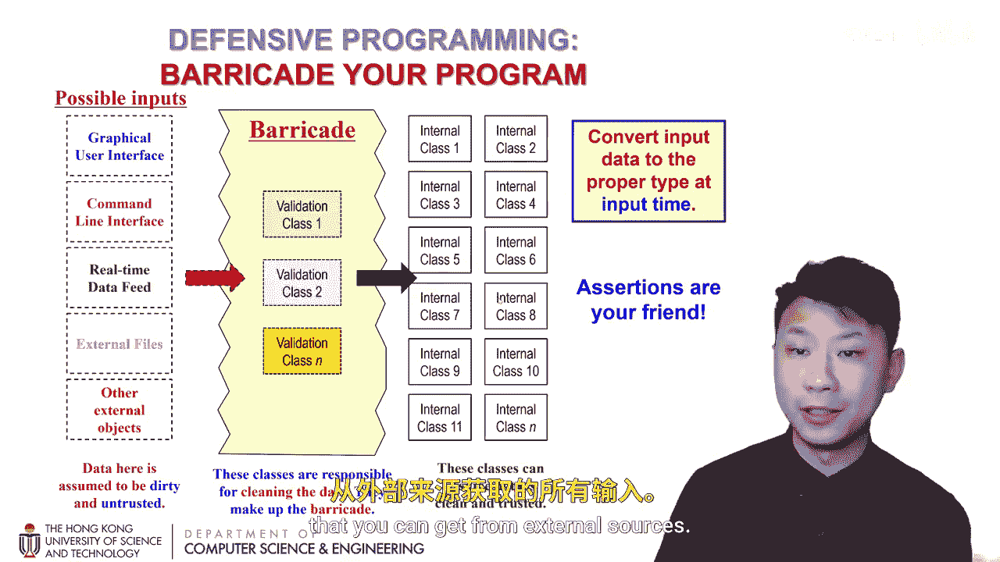
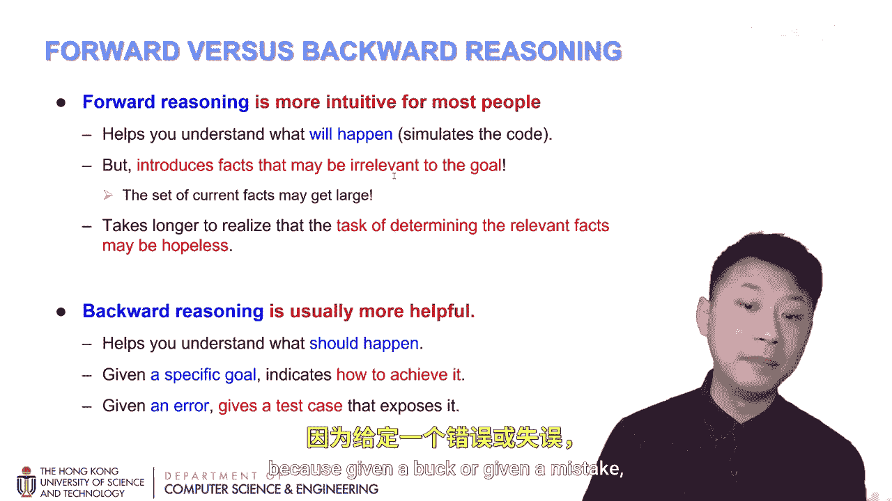
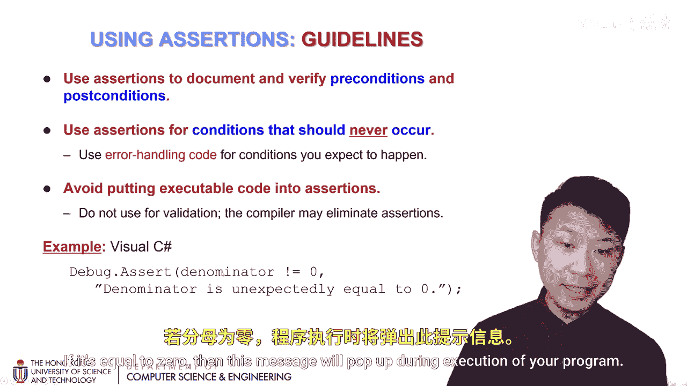

# 软件工程：P27：防御性编程 🛡️

在本节课中，我们将学习软件实现阶段的核心概念，重点是如何在编码时避免错误。我们将探讨防御性编程、代码审查和重构等实践方法，以保护并提升代码质量。





## 实现概述

上一节我们介绍了实现阶段的目标。本节中，我们来看看实现的具体活动和关注点。

实现主要关注**构建**，即将设计转化为可执行的代码。实现工作流以模块和子系统为单位来构建系统。

*   **模块** 是系统中可物理替换的部分，它封装了实现，遵循并提供一组接口。例如：源代码、二进制文件、脚本或可执行文件。
*   **子系统** 将模块组织成更易管理的部分。

在实现过程中，我们需要为每个类生成源代码，选择并编写合适的算法来实现方法，将类分配给不同的模块，并通过编译和链接将模块与子系统集成为可执行文件。此外，还需要进行版本控制，制定集成计划，并在分布式系统中将可执行模块部署到不同的处理节点上。

## 防御性编程



上一节我们介绍了实现的基本流程。本节中，我们来看看如何通过防御性编程来避免编码错误。

防御性编程的核心原则是：时刻保护自己，不信任任何人（包括用户），并双重检查所有来自外部源的数据值。



以下是防御性编程的关键实践：

*   **检查所有外部输入**：必须双重检查来自用户的所有输入（如通过图形界面、命令行等），然后再将其传入系统内部类。
*   **使用屏障类**：通过屏障类在数据进入内部类之前进行清理，确保内部类使用的所有数据都是干净且可信的。
*   **善用断言**：断言是插入程序中的逻辑公式，用于在运行时检查特定条件是否成立。

### 断言的使用

断言是防御性编程的重要工具。它们用于检查程序执行过程中的前置条件和后置条件。

*   **前置条件**：在代码执行前插入的断言。
*   **后置条件**：在代码执行后插入的断言。

我们可以通过两种推理方式来建立断言：

1.  **正向推理**：已知代码执行前的条件（前置条件），推导执行后必须成立的条件（后置条件）。
    ```python
    # 示例：已知 x 是偶数
    # 执行以下代码后...
    x = 5
    y = 2 * x
    # 后置条件：y 是偶数 (因为 y = 10)
    ```

2.  **反向推理**：已知代码执行后的目标（后置条件），推导执行前必须满足的条件（前置条件）。这种方法在测试和调试中尤其有用，因为它能帮助你理解为了产生特定结果或错误，输入需要满足什么条件。

断言常用于检查以下容易出错的地方：
*   输入/输出参数
*   文件或流是否已打开/关闭
*   只读输入变量的值
*   指针是否为空
*   传入例程的数组或容器是否至少包含 X 个元素
*   表是否已初始化，或容器是否为空

使用断言的指导原则：
*   用断言来文档化和验证前置条件与后置条件。
*   用断言检查那些“绝不应该发生”的情况。
*   避免在断言中放入可执行代码。



以下是一个 C# 中断言的示例，用于检查分母不为零：
```csharp
Debug.Assert(denominator != 0, "Denominator cannot be zero.");
```

## 总结



本节课中，我们一起学习了软件实现阶段的主要活动，并重点掌握了防御性编程的理念与实践。我们了解到，通过不信任外部输入、使用屏障类清理数据以及善用断言来检查关键条件，可以有效地在编码阶段避免许多常见错误，从而构建出更健壮、可靠的软件系统。