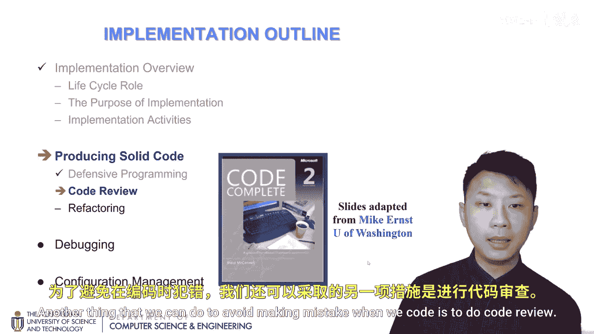
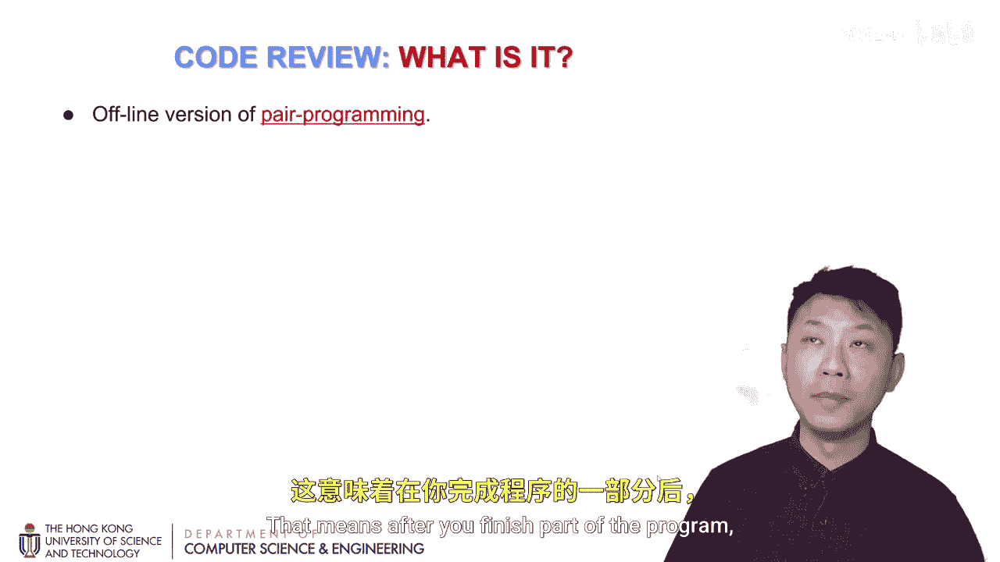
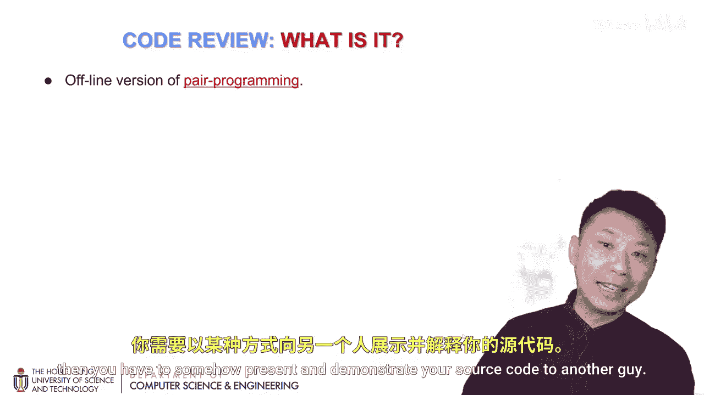
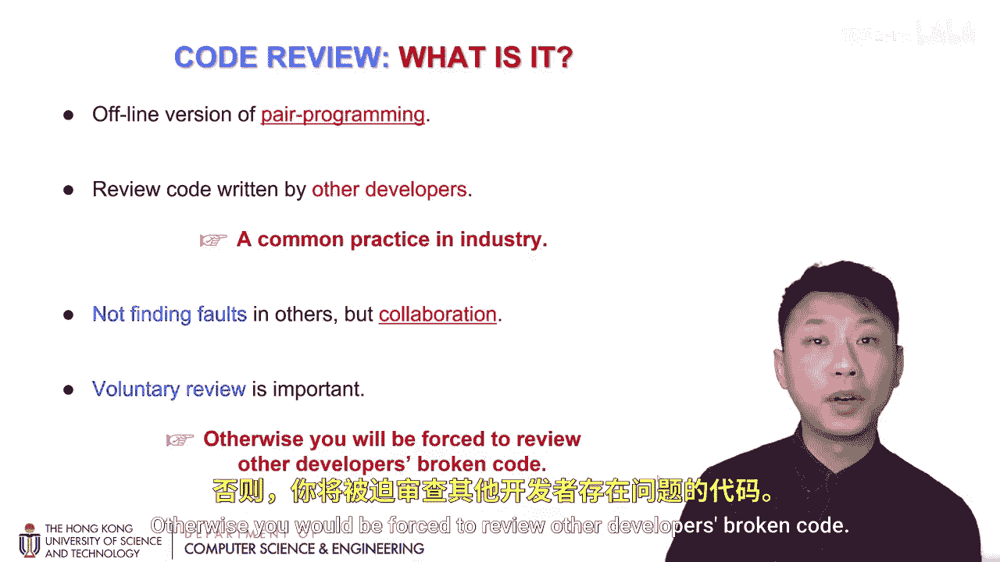
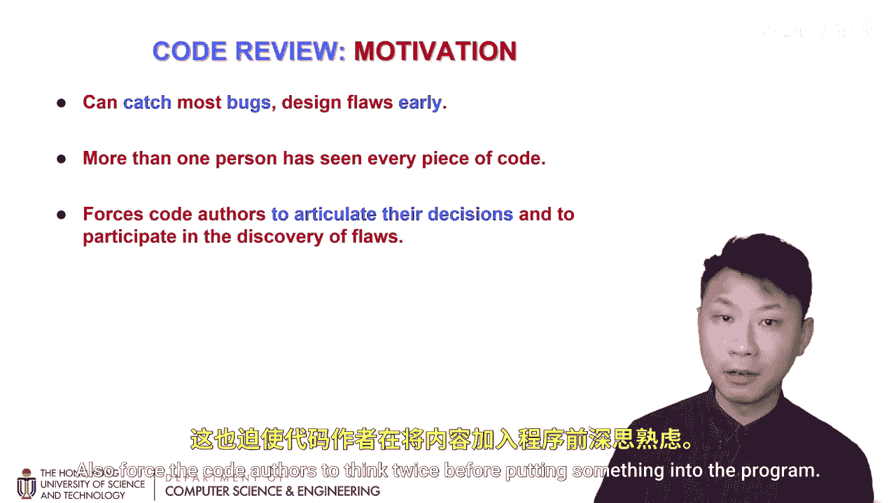
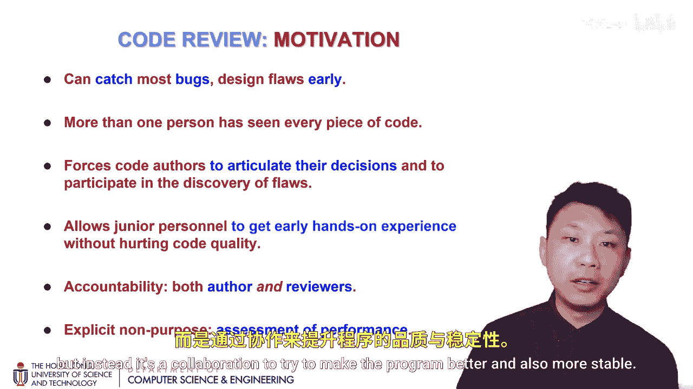
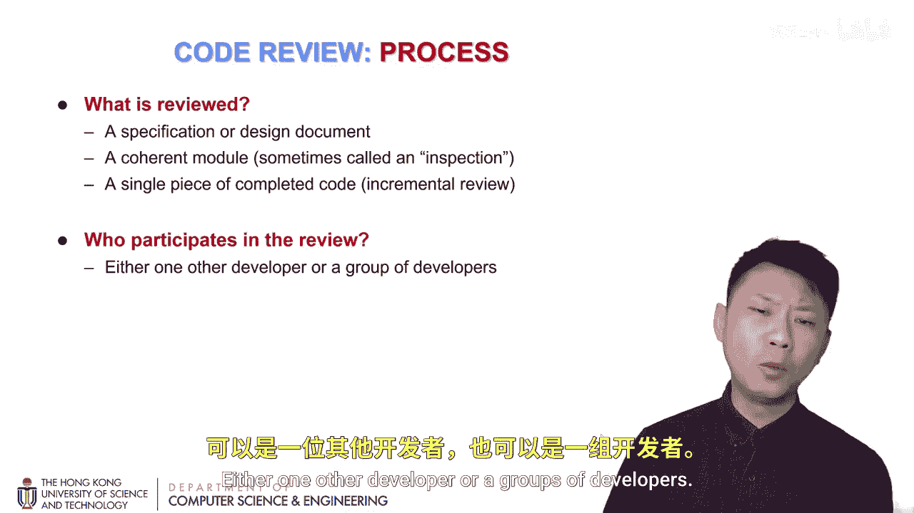
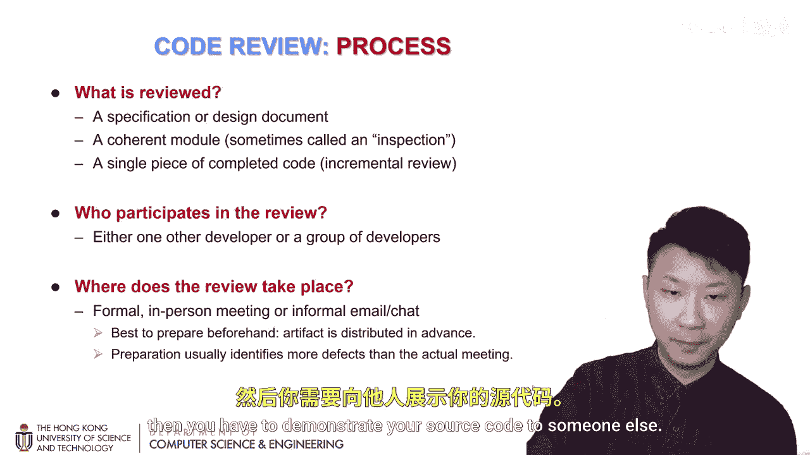
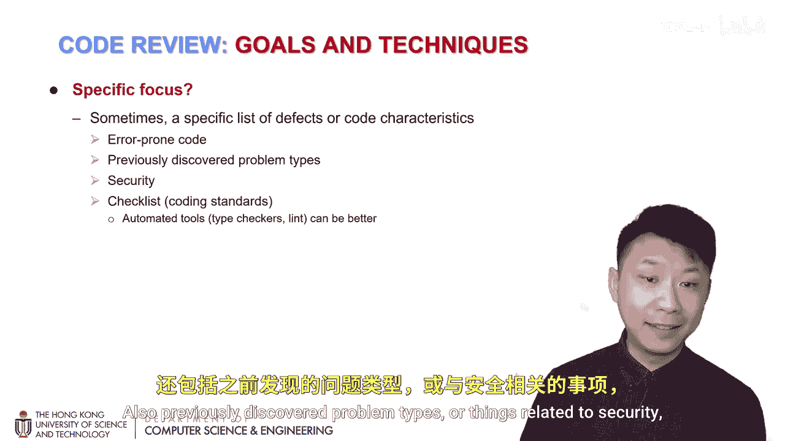
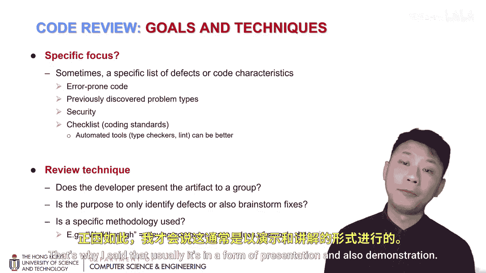

# 香港科技大学【中英⚡软件工程｜Software Engineering Specialization】 p28 P28 02_代码审查 -BV1MMEjzoEhg_p28-

Another thing that we can do to avoid making a mistake when we code is to do code review。

So what is COV view？And code review is an offline version of pair programming that means after you finish part of the program then you have to somehow present and demonstrate your source codepe to another guy you have to explain the source code to another guy and this is what we do in code review we try to review code written by other developers and it's a very common practice in the industry but it's not finding thoughts in others but collaboration to make the program better and also more stable and voluntary review is gonna be very important and otherwise you will be forced to review other developers broken code and the motivation is that by having another developer to double check your source code we can try to catch most bugs and most mistakes early and also make sure that more than one person has seen every piece of code in the system and also forced the code offers to think twice before putting something into the program and allows junior programmer to learn from more experience。

Programr and the accountability is both the offer and also reviewers and again the purpose is not assessment of performance。

 but instead it's kind of a collaboration to try to make the program better and also more stable so what should be reviewed we can review documentation a coherent module or a single piece of completed code and who should be participating in the review either one other developer or a groups of developers and where does the review takes usually in front of your own computer then you have to demonstrate your source code to someone else and these are the things that we can focus on when we perform code review。

 for example error pro code that means places that you make mistakes again again than we can review those places and also previously discovered program types or things related to security or based on the checklist based on some coding standards and how to perform the review basically we have to demonstrate and present。

source code to someone else and it's in a form of presentation and you have to present your code and also walk through your code and also explain what's happening within your program step by step to another developer so that's why I say that useless in a form of presentation and also demonstration。

