# 香港科技大学【中英⚡软件工程｜Software Engineering Specialization】 p29 P29 03_重构 -BV1MMEjzoEhg_p29-

And the next topic that we're gonna to cover is refactoring and by doing refactoring we try to improve a piece of software's internal structure without changing its external behavior so you may ask why fix a part of your system that is functional and it's not broken and notice that your system's code has free purposes it should execute its functionality and also allow change and also come to KWell to other developers who read it so if the code cannot do all free of this is broken so to make sure that your program is gonna to be having a good structure and it's gonna to be easy to maintain and also allow change and also come KWell to the other developers then we have to refactor the source code and notice that code ros over time if its structure does not evolve。

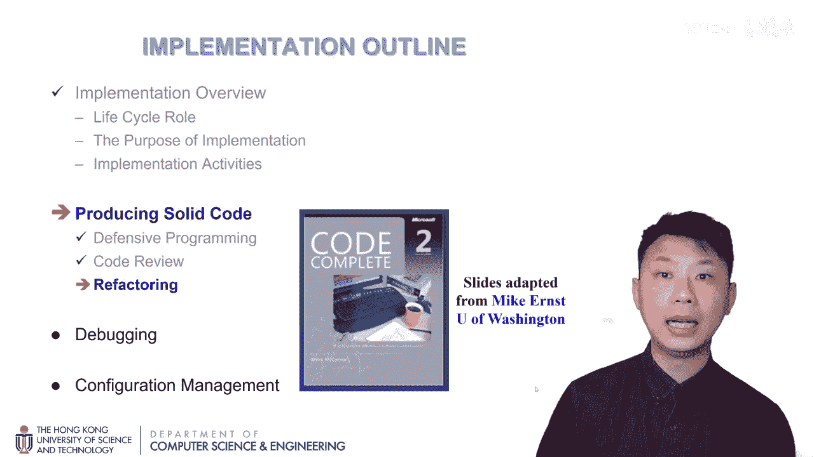

Why， because when you program， you may add one little thing at a time into your program。😡。

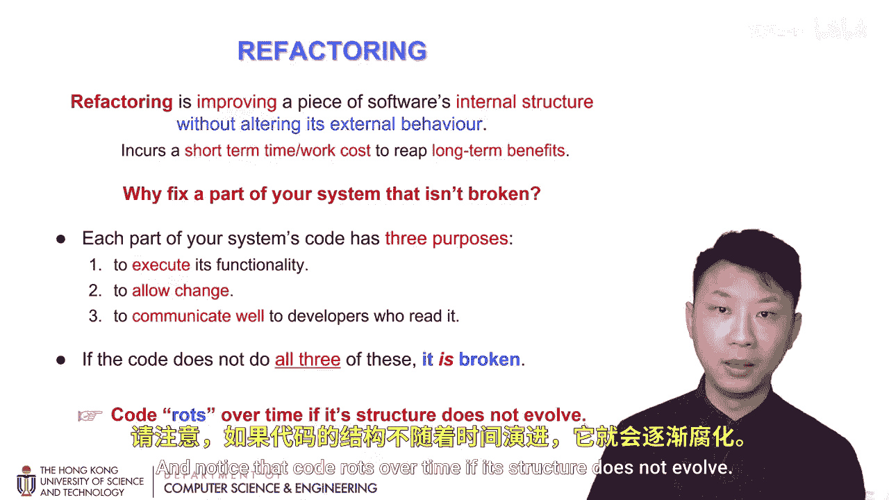

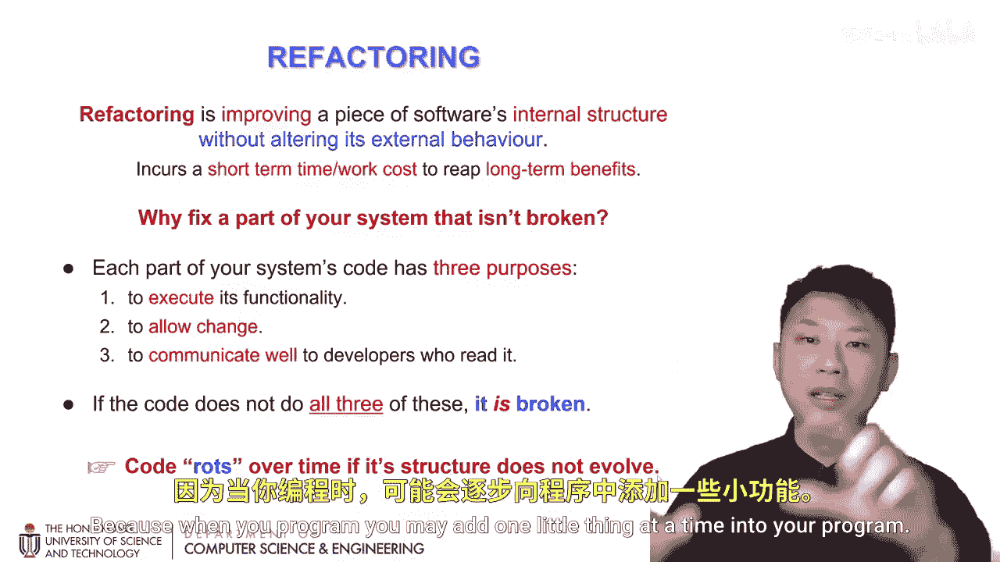

And you may also include many rockarounds into your program from time time。

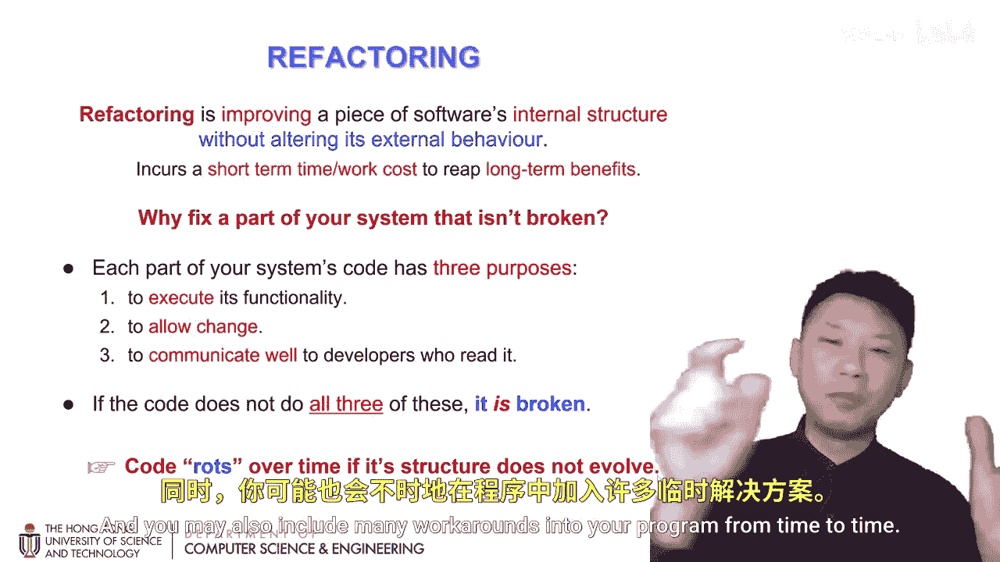

So eventually code is going to rots over time in terms of structure。😡。

So to improve the overall structure of your program you have to perform refactoring from time to time so for lowlevel refactoring we are talking about renaming operations and also variables so instead of using names like function1 function 2 for operations and also using names like X Y Z。

 ABC for variables， you have to give more meaningful names to your operations and also variables to make sure that they are going to be meaningful to not just you but also other developers and make sure that you name all the magic constants that you have within your program so instead of saying that we have a magic constants x equals240 you should give a more meaningful name to your constant for example。

 the upper bound of the enrollment for a class is gonna to be 40 or you can extract code into a method or extract some common functionality into a module or operation or in an operation or Pro into your program or changing the operation signatures。

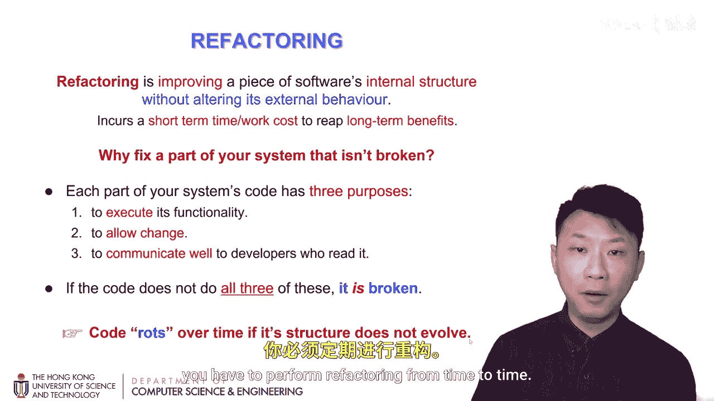

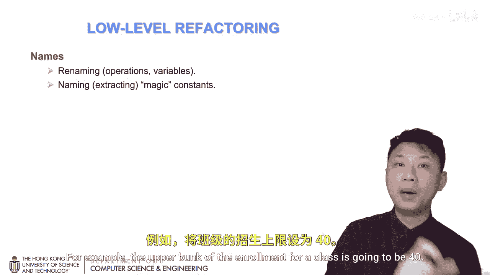

We can also improve the structure of the program by splitting one operation into several to improve cohesion and also readability and also putting statements that are semantically belong together near to each other physically within your program and notice that there are some IDEs or tos that support this kind of refactoring so compared to lowlel refactoring highlevel refactoring is going to be even more important because you can help you improve the overall structure of your program so in highlevel refactoring we have to exchange obscure language idioms with safer alternatives so for example even if you can write and if statement in one single line try to avoid doing that because you can read that one single line but some other developers if they are not familiar with writing if statement in one single line they may not be able to understand your software and also clarify。

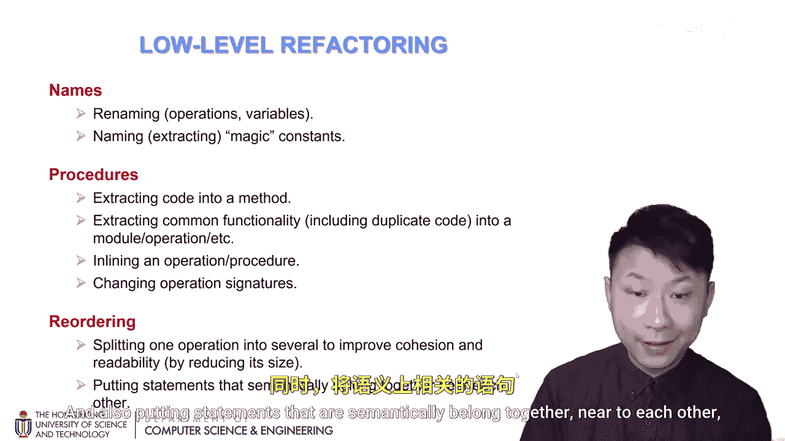

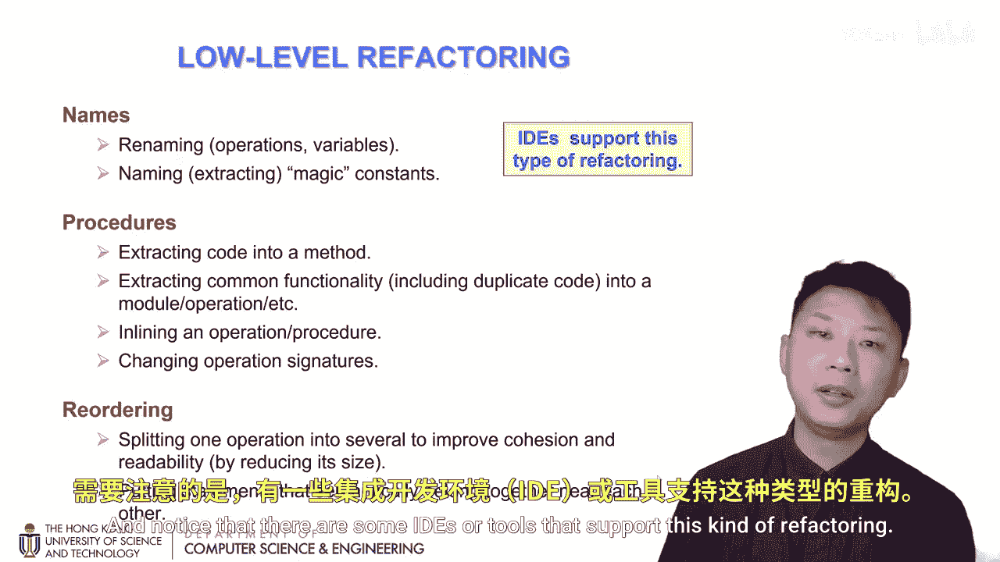

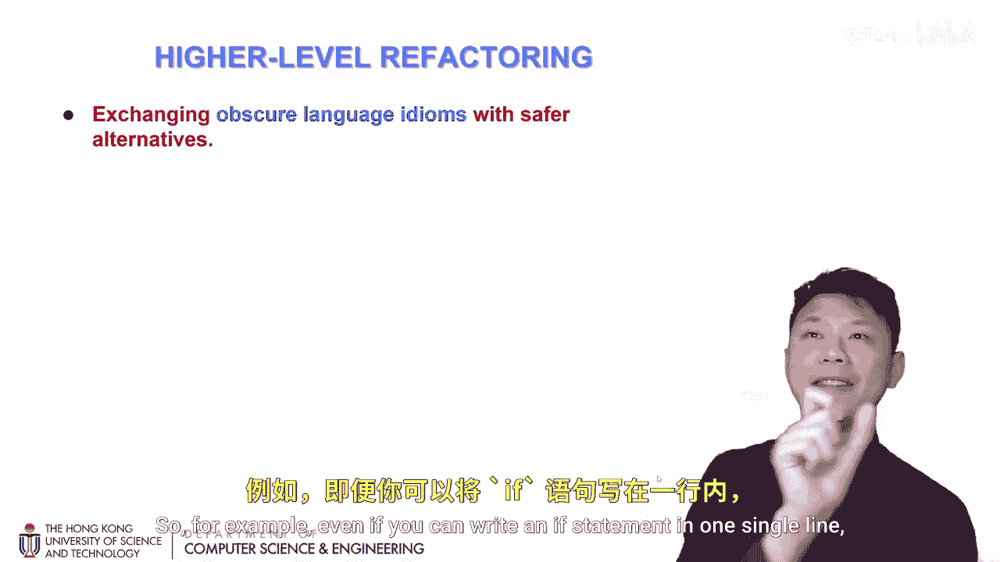

And also clarify a statement that has evolved over time or is unclear using comments and also we factor according to some design patterns which we will cover later on as I've said。

 compared to lowlevel refactoring highlel reing is much more important because it's going improve the overall structure of your program but it's not well supported by tubes so you have to do it manually yourself and this types of refactoring is going to increase code maintainability because you improve the overall structure of your program So now let's take a look at this example which is a program for a library and now you can see that in the main class we have many operations and this is a typical example of a god class so what is a god class a god class means you have a very big class in your program or in your system that try to do everything within the system so now you can see that we have a big main class that does almost everything within the system and this kind of code is not good because it's difficult to read and also difficult to maintain so how can we improve。

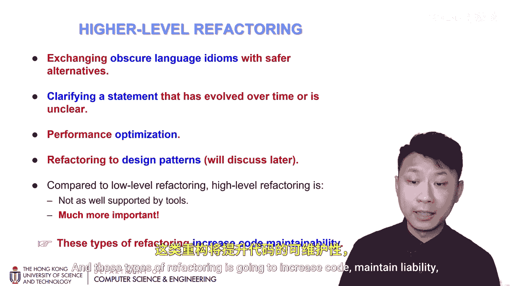

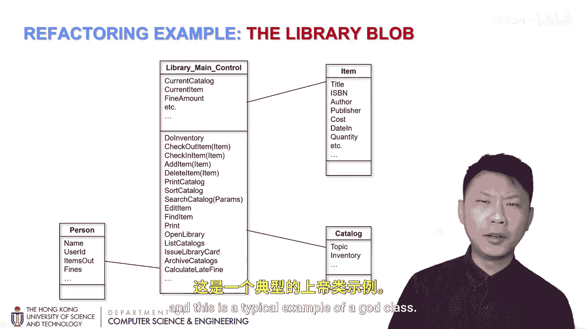

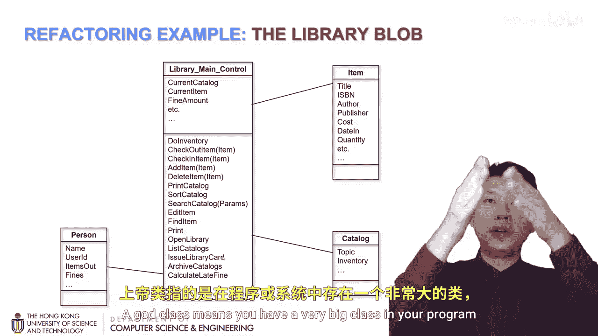

The structure and in the first step you try to identify or categorize related attributes and operations from the class diagram and now you can see that you have many related operations in the main class and all these operations they are related to item for example checking out item checking in item adding items deleting item or edit item or finding items they are all related to item so instead of putting it in the main class now we should put it in the item class and we can also find that many of the operations they are related to catalog for example printing catalog。

 sorting catalog searching for some catalog listing catalogs or a catalogs So instead of putting them in the main class should be more reasonable to put them in the catalog class So that's why we have to find the natural homes for this collection of functionalities and then migrate them there so we should put all these operations related to item in the item class and all this operations related to catalog in the catalog class。

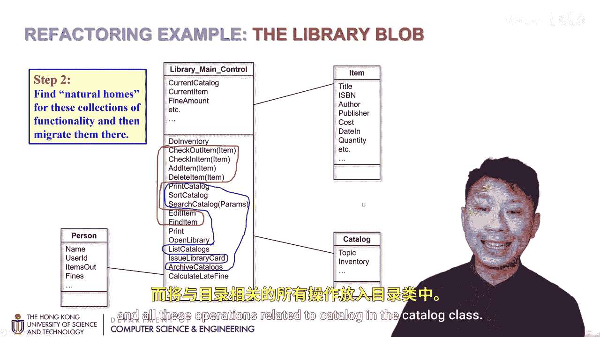

And this is the updated class diagram and in the last step we have to remove all the transient associations replacing them as appropriate with type specifier to attributes and operation arguments and now in this example we can see that the main class is going to access catalog and within catalog we're going to get different items within the library so that's why we don't access items directly using the main class。

Now we can remove this transient association because we assess items through catalog。

So now instead of having this association here that's why here we say that it's a transient association because we don't use the main class to directly assess item so that's why we can remove this association and finally we will get this much cleaner and much more easy to read class diagram for the library example So now suppose that you want to add new features to the code that is not particularly welldes it or follow test but works so far so what should you do so you should first assume that you have adequate time to do things right and then write unit test to verifyify that the code works correctly and then we refactor the code and then add some new features So of you may argue that I don't have time to refactor because we have limited time within the project and it's true that many developers they don't want to do refactoring because if the program is working why border touching my working or my perfect program and also most management people they do not like doing refactoring because they。

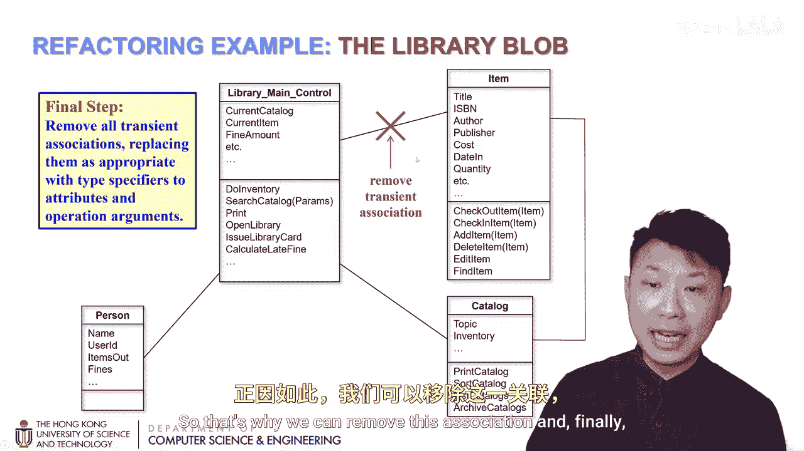

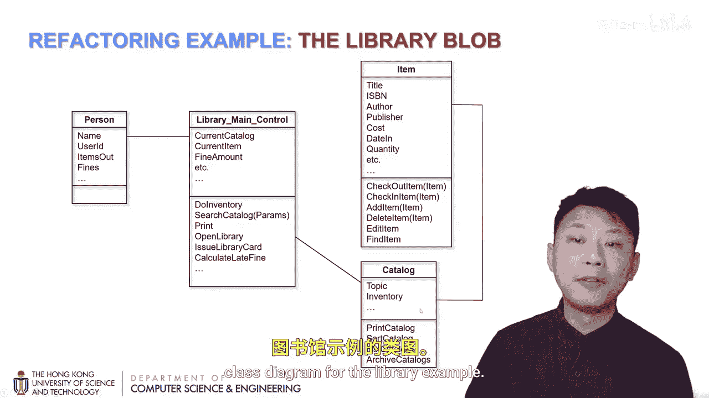

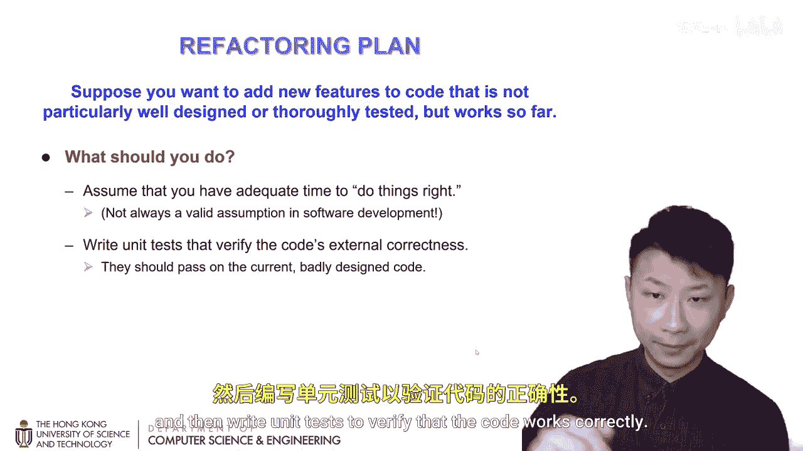

Time and also gain nothing again because the program is working why border touching it however it's important to do reing because rail written code is much more conductucive to rapid development and also finishing reing increases programmer morale and as a programmer。

 I guess you guys prefer working in a cleanhouse that means a program with a better structure So when do we be factor。

😡。

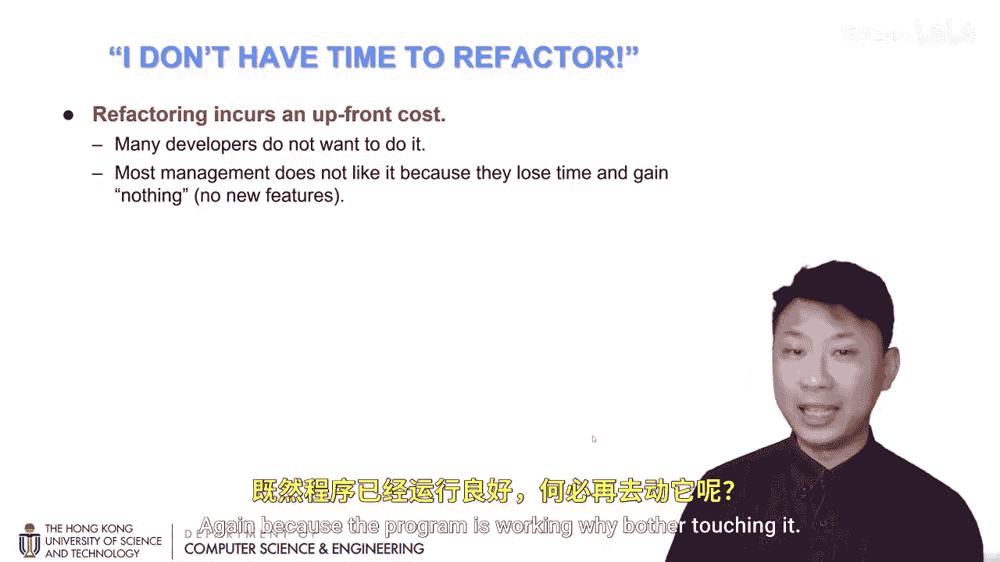

We try to do it continuously as part of the development so we we factor and then we develop something then we will factor and then we develop something and it's hard to do well late in the project because by the end of the project you're gonna to have many features in your system and touching one of the features may affect the other features so that's why it's difficult to restructure your program by the end of the project and that's what I want to cover in this lecture。

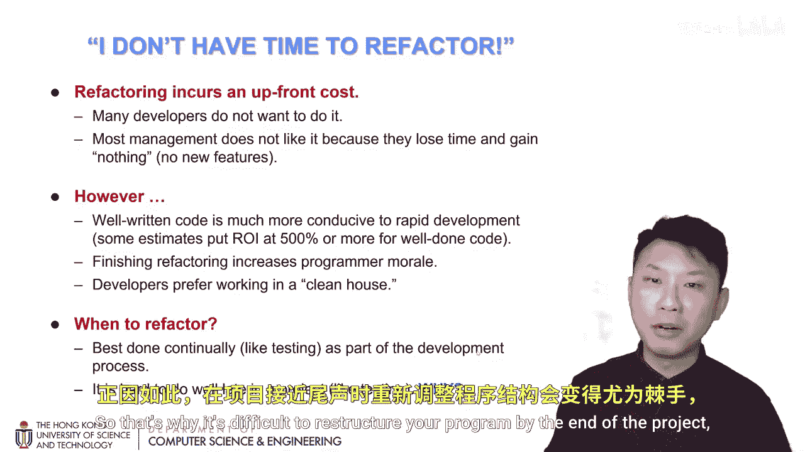