# 香港科技大学【中英⚡软件工程｜Software Engineering Specialization】 p30 P30 01_调试 -BV1MMEjzoEhg_p30-

Hi， this is the second lecture about implementation In this lecture we're going talk about debuing and also configuration management So we all know that debuing is painful and its gonna be time consuming So what are the things that we can do to try to get your right and try to avoid debuing The first thing that we can do is try to use defensive programming try to avoid making mistakes and this is the topic that we have covered in the last lecture and try to perform testing to uncover problems and also increase the confidence of your program and then eventually if bugs exist then you have to debug and find out why a program is not functioning as intended and then notice that testing is not the same as debuing for testing。

 we try to find the existence of a problem for debuing。

 we try to piningpon location of a problem and also try to figure out the cause of a problem and this is the first computer bug discovered in September 91947 and yes。

 it actually a bug that exists in some hardware component and eventually make the entire system not working。

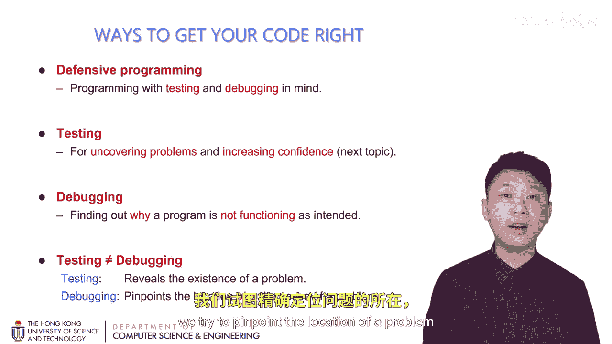

And that's how the term bug came from。 And this is the first bug。

 So to defend against bugs right because we all know that debuing is gonna be painful and also time consuming。

 these are the things that you can do。 you can try to make errors impossible by design or try not to introduce defects or try to make errors immediately visible by。

 for example， using assertions and the last we shot is debuing So we can make errors impossible by design。

 For example， if you choose a language like Java， then you make memory over write bugs impossible。

 For example， if you are using TCP， it will guarantee that all the packages that you send out and receive will not be reordered and if you are using Java per integer。

 you avoid overflow， you may also use some selfimpposted conventions for example。

 if you are using some hierarchical locking algorithms then you can avoid that locks or if you ban the use of recursion。

 then you avoid。

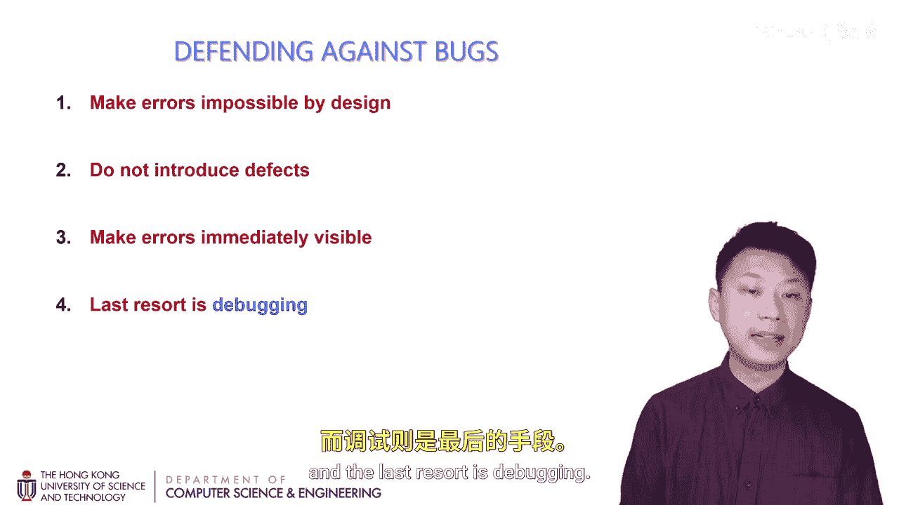

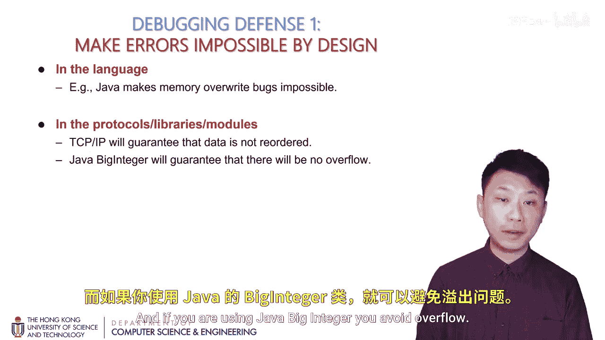

recursion kind of bugs。 Or if you are using imm mututable data structure。

 it will guarantee behavioral equality and notice that if you choose to use a particular strategy。

 then you must maintain the discipline。 That means for example， if you avoid the use of recursion。

 then you should avoid using recursion in your entire program。

 The second way to defend against bug is try not to introduce defects。

 So you should try to get things right the first time。

 do not cope before you think think before you code。

 and notice that if you are making lots of easy to find bugs。

 you are also making hard to find bugs at the same time and do not use the compiler as a crch just because compiler can only find syntax errors。

 but not semantic or logical errors。 and it's gonna be expressively true when debuing is gonna be hard。

 For example， if you have a concurrent system or you have difficult tests and instrument environment or you have to meet some deadlines and you don't have enough time then you should try to avoid making mistake。

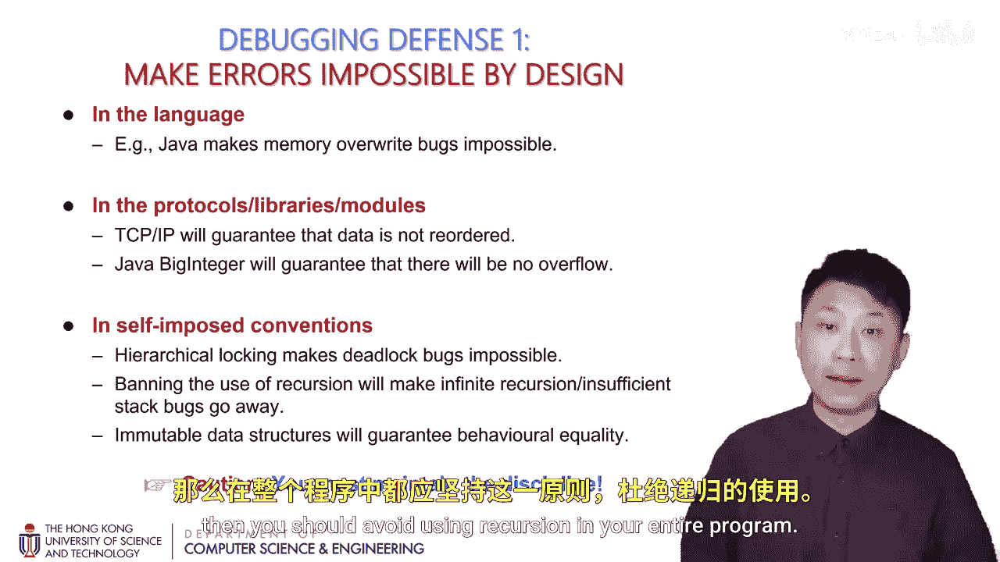

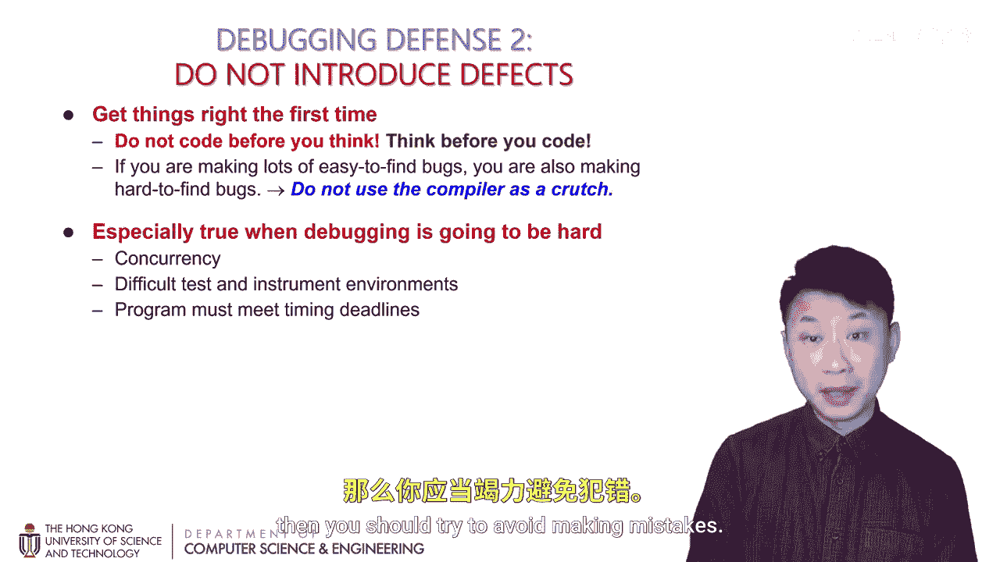

And simplicity is the key At the very beginning of the semester。

 we have said that modularity is one thing that you can do to deal with the complexity of a large software system。

 You try to divide your program into many small chunks that are easy to understand。

 and then you try to deal with one chunk at a time。

And you try to use abstract data types with well defineded interfaces and also use defensive programming to avoid making mistakes。

 You should also try to write specifications， for example。

 writing specifications for all modules so that all the stakeholders they know exactly what's gonna happen within the modules and you should also prepare well defineded interface for each module that clients or user they can rely on and eventually if bugs happen in your program。

 then what you should do is you should try to localize bugs to a small part of the program and you should take advantage of modularity For example。

 you can start with everything and then take away pieces until bugs disappears or you can start with nothing and then add pieces back into the program until you see the bug and this is how you can localize bugs to a small part of your program and also you should take advantage of modular reasoning。

 for example， you should trace through the program step by step and then view the intermediate results and then see what's happening within your。

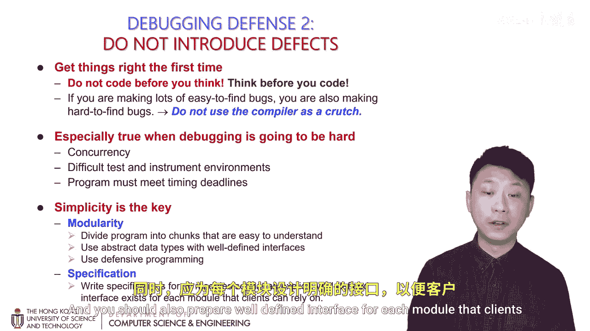

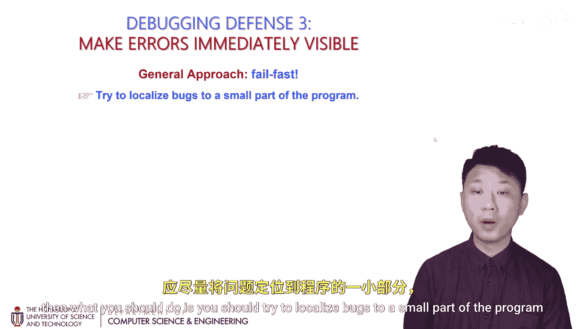

And you can also use binary search to speed things up for example， if you have a large program。

 then you can chunk your program into two halves if the error exists in the second half then you can focus on the second half and then you can further chunk the second half into two halves and if the error exists in one of the halves。

 then you can simply focus on one of the halves again。

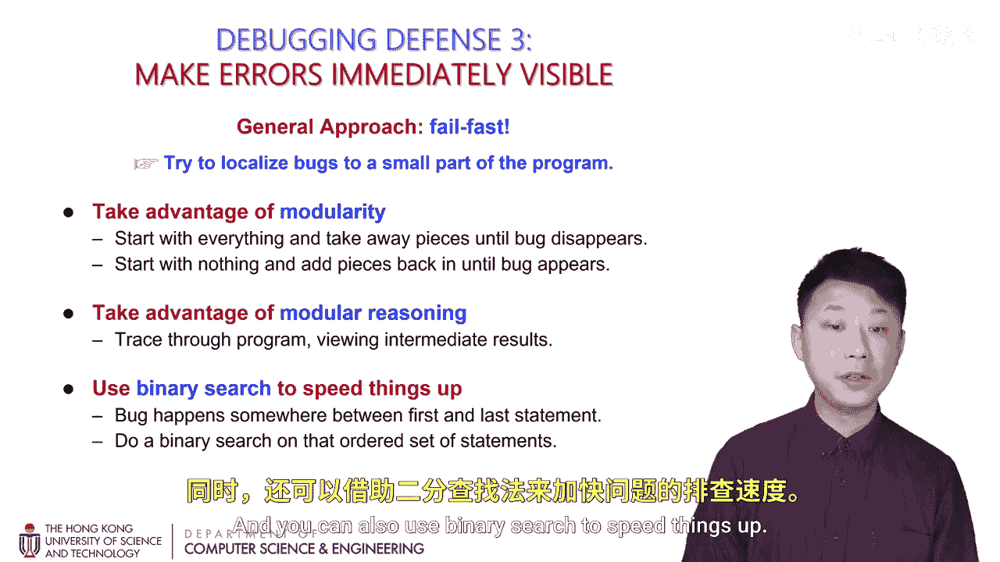

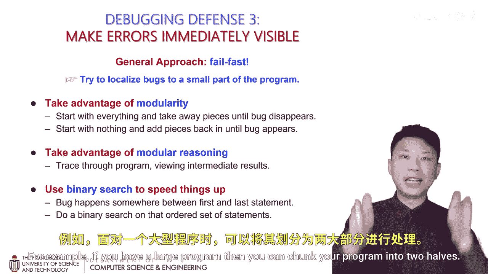

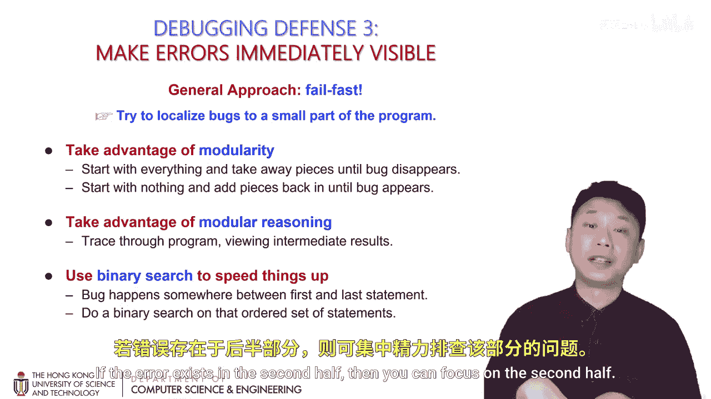

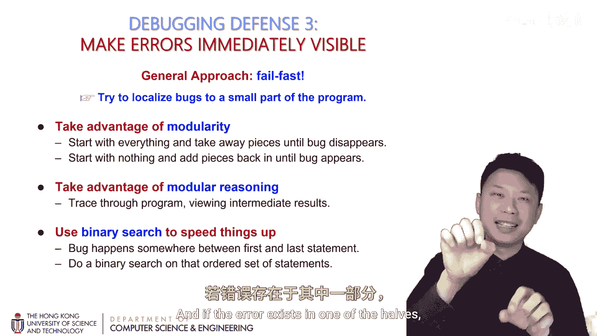

And this is how we can speed up the localization of bugs using binary search and you should make use of assertions whenever possible and we have covered what is assertion in the last lecture and this is an example code fragment and in this code fragment we try to look for the value K within an array A and we're gonna use this while loop to look for the value K within this array A if the value K exists in the array then I'm going to break and we're gonna move on and what's wrong or what's not good with this code fragment what if K does not exist in the array then notice that we will go into a forever loop because we have a while true statement here and if we never find K in the array。

 then we will never stop and that's what's not good with this first example and to avoid having infinitefin loop in this example。

 this is what we can do instead of using while true now we have this condition while I is less than the size。

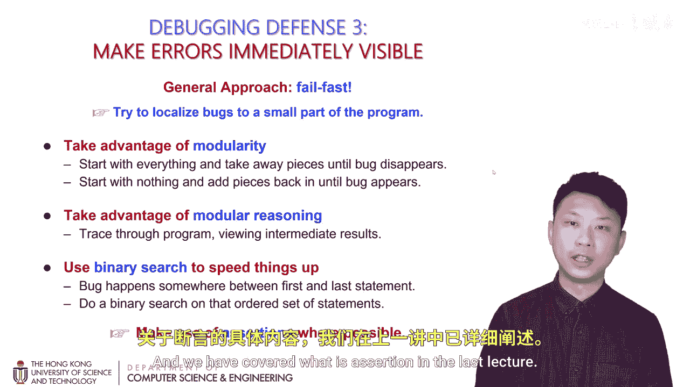

Of the array， we're going to do the checking。Now， the loop will always terminate。

 but so what's not good about this example， what if K does not exist in the array？

Now its no longer guarantee that K will exist in the array if the rest of the code relies on the fact that K should exist in the array。

 then problems may arise later on Now to make sure that you have achieved the condition that K should exist in a。

You may use assertion， you may use assertion to double check for this condition that you want to satisfy within your program and you can use assertions to document and also check for invariance and an error message will pop up as soon as a problem is detected within your program。

 So that's why I've said that whenever possible try to use assertions to double check for all the conditions that you want to satisfy with in the program。

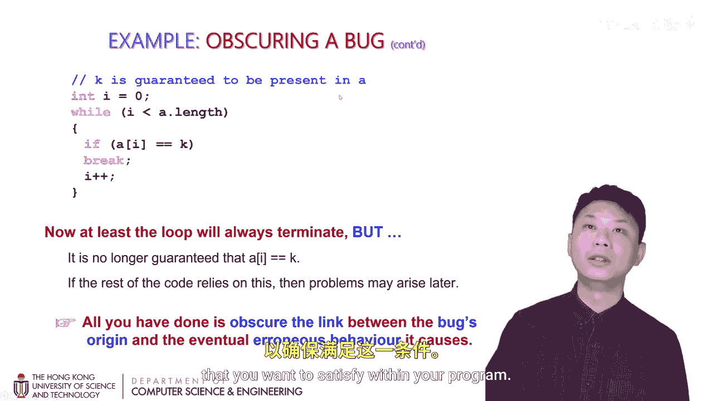

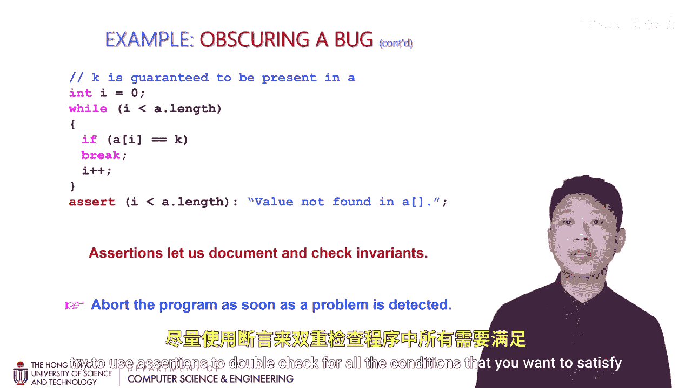

So where is the bug， Not that the bug is not where you think it。So where is the buck。

 notice that the buck is not where you think it is， ask yourself， ask yourself。So where is the bug。

 notice that the bug is not where you think it is ask yourself where it cannot be and then explain why and they ignore those places。

And look for stupid mistakes， for example， reverse order of arguments that you feed into a particular operation。

And also miss。Can also be spelling of identifiers。And when you double check whether two objects they are the same or not with in your program。

 make sure that if you are using double equal， you're simply double checking whether the addresses of the two objects they are the same or not versus right A dot equals B。

 which is going to double check whether the content of the two objects they are the same or not。

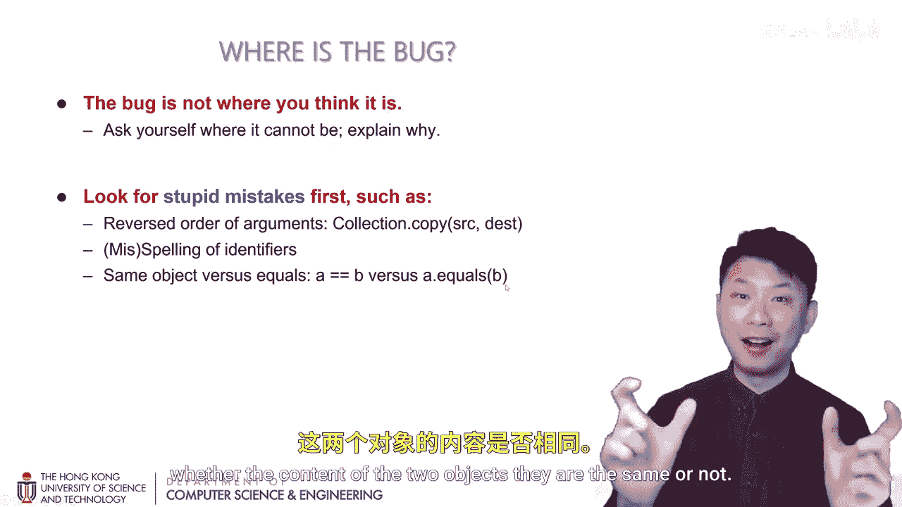

And a failure to initialize a variable。The copy versus shadow copy。

 whether you are simply copying the address or whether you are copying the content of the object。

And make sure that once you fix the bug and then you have the correctossco。

 remember to recompile everything before you link the files up and get the executable。

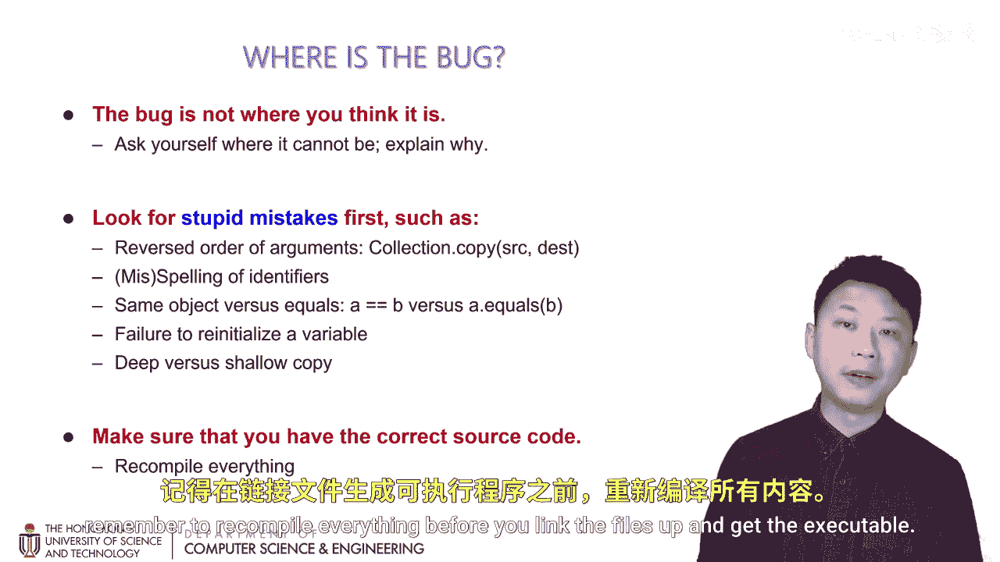

And insert a lot of checks within your program to look for mistakes， for example。

 precondition checks， consistent check or bug specific checks。

And the goal is to trace through the program and then stop the program as close to the buck as possible。

And should we include assertions or check in our final production code is yes， right。

 If you want to stop the program whenever errors or mistakes happen in your program。

 and you don't want to take a chance that the program you do something wrong。

 then you should include assertions and check in your production code。

 But if you want a program to keep going on and maybe the bug does not have such bad consequences。

 then you may not include assertions and check in your final production code。

 Let's say if it's just a game and you want to allow the game to keep going on。

 then you may not include assertions and check in your final production code。

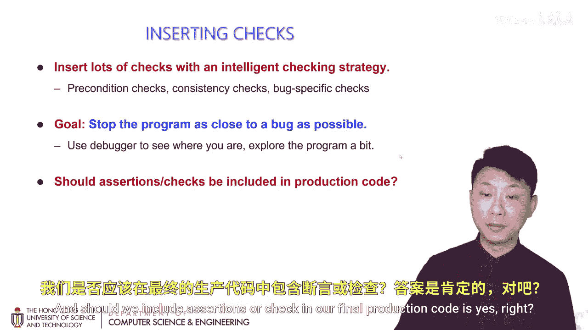

So the correct answer is going to be depending on the context of your software system。

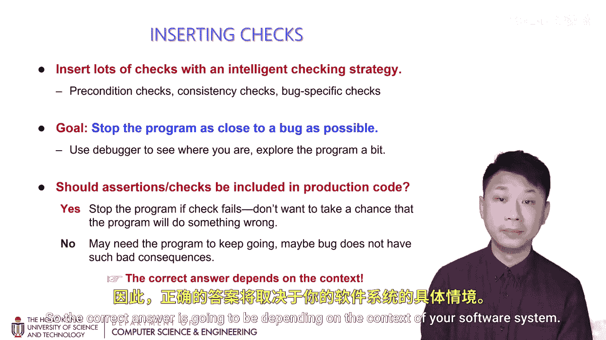

So whenever you find and fix a bug， you have to keep the input that you can use to reproduce the butt as a regression task for your system。

 and then you have to rerun all your tasks。So why is it a good idea because it's going to make sure that if you fix something。

 it's not going to affect other things？Just because it's very often that we may reintroduce old bugs while we are fixing new ones。

 it's going to help to populate a set of test cases that we can use for the system。

 And if a bug happens once it may happen again in the future。

 And if a bug happens once it may happen again in the future。

 So that's why we have to run regression test as frequently as you can afford to。

 and you should automate the process。 and also make concise test sets with few unnecessary test。

 bugs happens。 And in the industry， you're gonna generate 10 bugs per 1000 lines of code。

 and bugs that are not immediately localize will be fine during integration test or will be reported by the users。

 And once you get a report from the user， you should clarify the symptom and then find and understand the cause and then create a test。

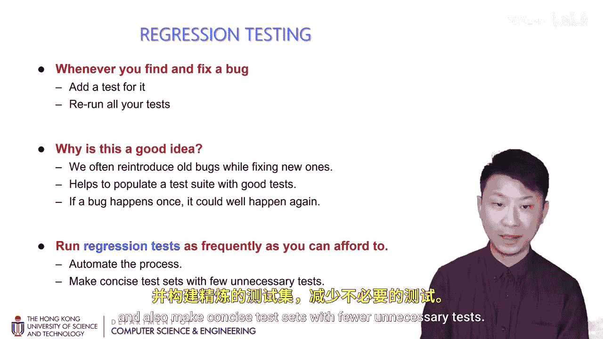

And then fix it。And then finally we run audit tests。 So when debuing is getting tough。

 try to reconsider all the assumptions。 For example。

 did you change the Os I there enough room in the hard drive。

 you try to debug the code but not the comments and then start documenting your system because by documenting your system。

 you know exactly the thro of events within your system and also try to get help you may get help from your teammates or from more experienced programmers And the last thing that you can do is to walk away because it's better to work early in the morning rather than late at night Once you have a clear mind you may be able to figure out where the bug is。

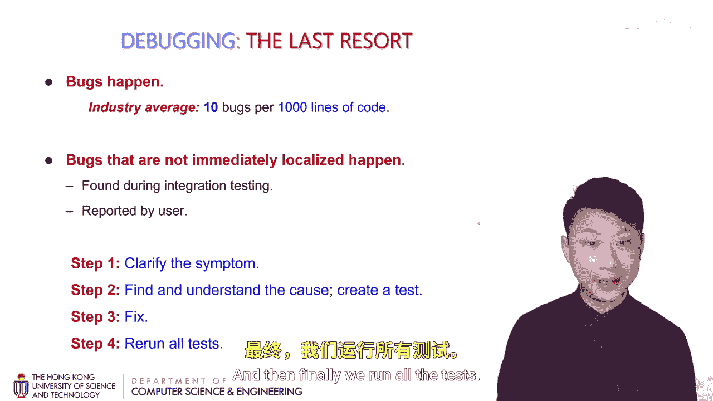

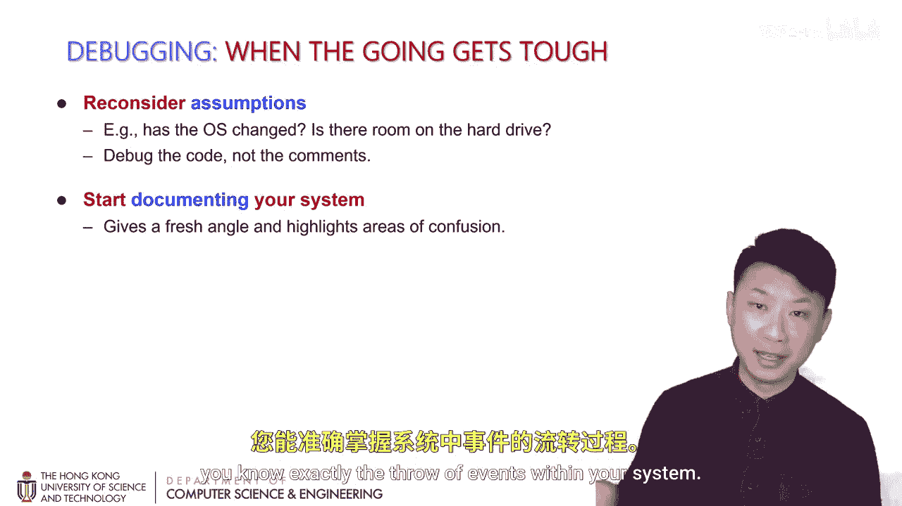

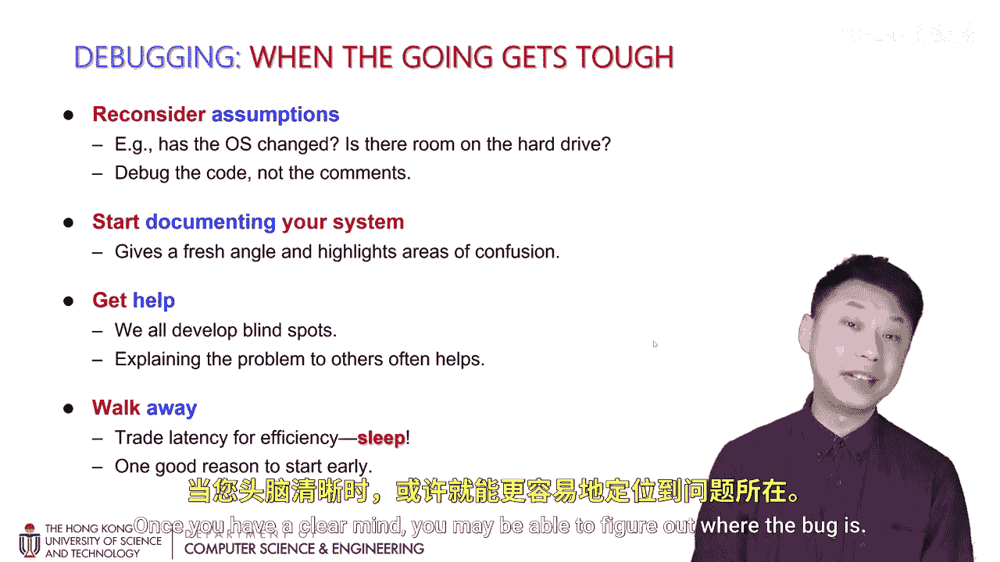