# 软件工程：P30：调试与配置管理 🐛

在本节课中，我们将要学习软件实现过程中的两个重要环节：调试与配置管理。调试是发现并修复程序中错误的过程，而配置管理则涉及对软件变更的系统性控制。我们将首先聚焦于调试，探讨如何高效地定位和修复程序中的缺陷。

---

## 概述

调试是软件开发中耗时且令人头疼的环节。为了减少调试工作，我们可以采取多种策略：首先，通过防御性编程和充分测试来尽量避免引入错误；其次，当错误确实出现时，需要系统性地进行调试以定位问题根源。请注意，**测试**（寻找问题是否存在）与**调试**（定位问题并找出原因）是两个不同的概念。

“Bug”（程序错误）一词的起源，可以追溯到1947年9月9日，当时在哈佛马克二型计算机的一个继电器中发现了一只飞蛾，导致系统故障。这成为了第一个被记录的计算机“Bug”。

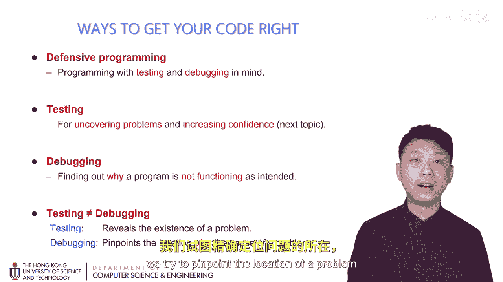


---

## 防御Bug的策略

既然调试如此痛苦，我们应优先考虑如何防御Bug。主要策略有以下几种，按优先级从高到低排列：

1.  **通过设计使错误不可能发生**。
2.  **尽量不引入缺陷**。
3.  **使用断言等方法使错误立即可见**。
4.  **进行调试**。

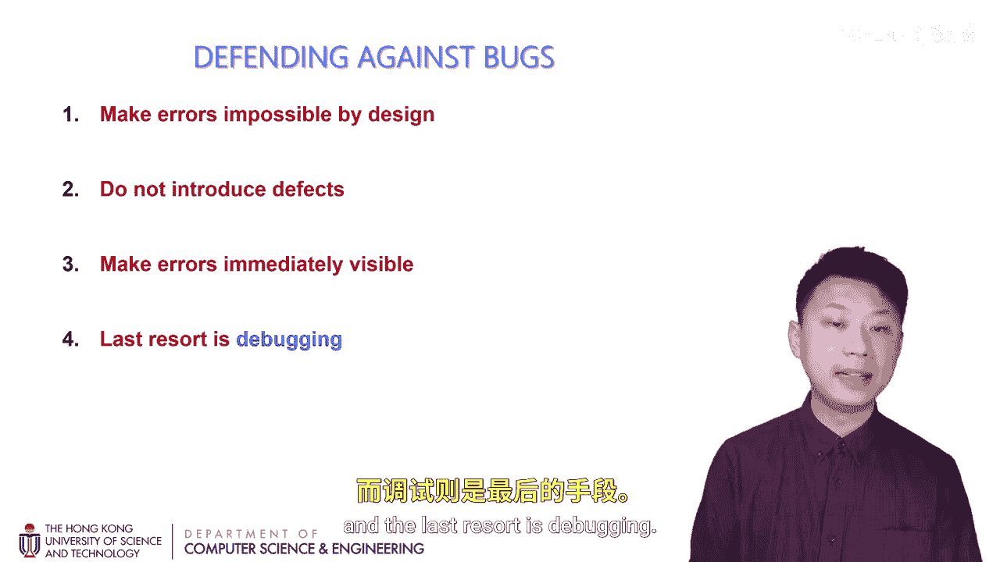

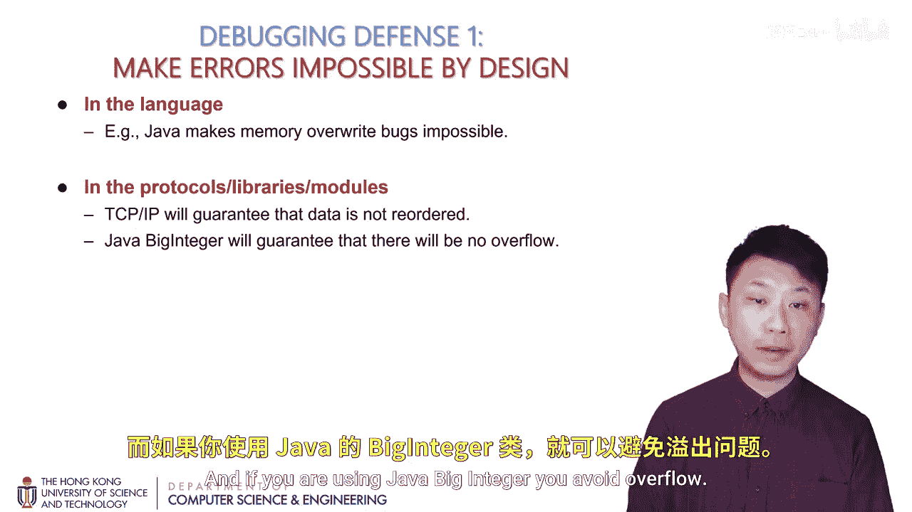

上一节我们概述了防御策略，接下来我们详细看看前两种策略。

### 1. 通过设计使错误不可能发生

选择特定的编程语言、协议或数据结构，可以从根源上杜绝某类错误。

*   **使用Java**：可以避免内存覆写错误。
*   **使用TCP协议**：保证数据包按序到达，避免乱序问题。
*   **使用Java的`BigInteger`**：避免整数溢出。
*   **制定团队规范**：例如，禁止使用递归，可以避免递归相关的错误；使用不可变数据结构，可以保证行为的一致性。


**关键点**：一旦选择了某种策略，就必须在整个项目中严格遵守相应的规范。

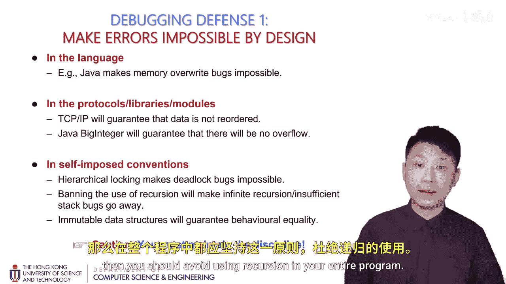

### 2. 尽量不引入缺陷

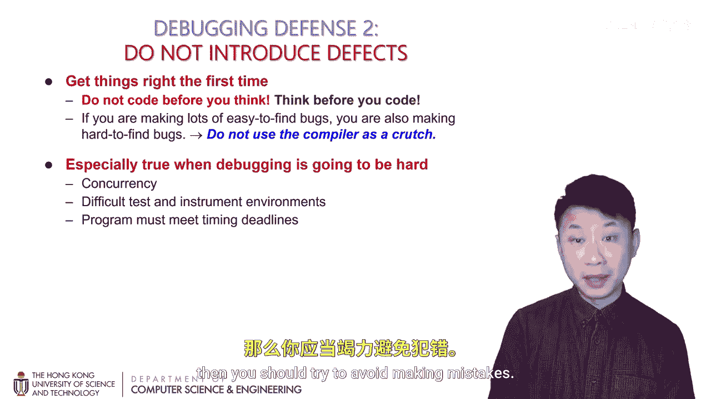

核心思想是“第一次就做对”。这要求我们在编码前充分思考。

*   **先思考，后编码**：不要盲目复制代码。
*   **警惕“简单错误”**：如果程序中存在大量容易发现的错误，通常也意味着存在难以发现的深层错误。
*   **不要依赖编译器**：编译器只能发现语法错误，无法发现语义或逻辑错误。
*   **追求简单性**：这是应对复杂性的关键。在学期初我们提到，**模块化**是管理大型软件系统复杂性的核心方法。


通过模块化，我们将程序分解为多个易于理解的小块，每次只处理一块。同时，应使用具有明确定义接口的抽象数据类型，并辅以防御性编程。

---

## 当Bug出现时：调试策略

尽管我们尽力预防，Bug仍会出现。本节中，我们来看看当Bug出现时，如何进行有效的调试。

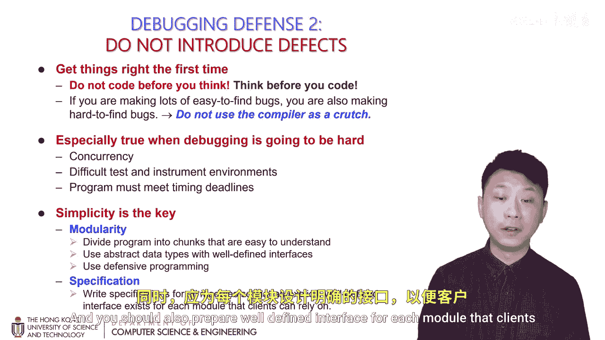

### 利用模块化定位Bug

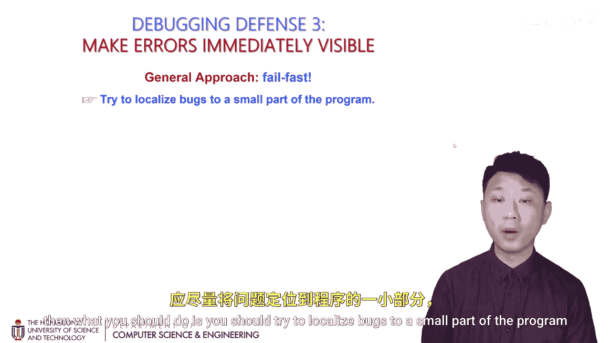

模块化的优势在调试时得以体现。目标是将Bug定位到程序的一小部分。

*   **“二分法”定位**：
    *   从完整程序开始，逐步移除模块，直到Bug消失。最后被移除的模块很可能包含Bug。
    *   或者，从空程序开始，逐步添加模块，直到Bug出现。最后添加的模块很可能包含Bug。
*   **利用模块化推理**：逐步跟踪程序执行，查看中间结果，理解程序内部状态。

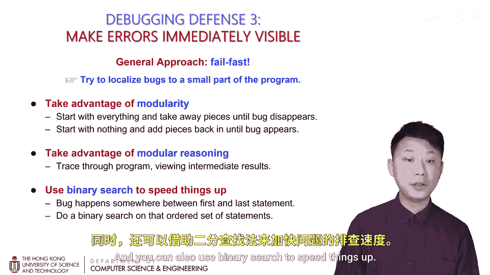

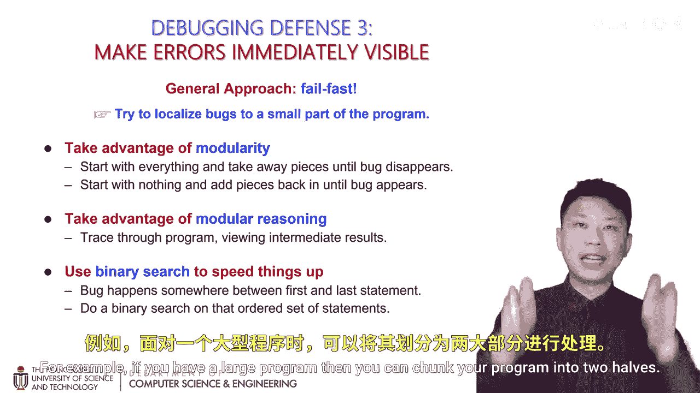


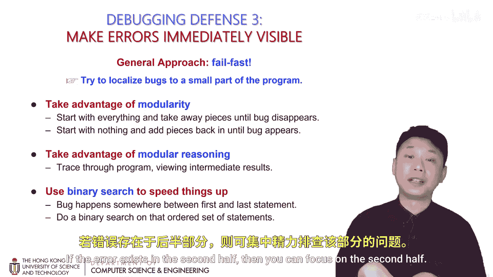

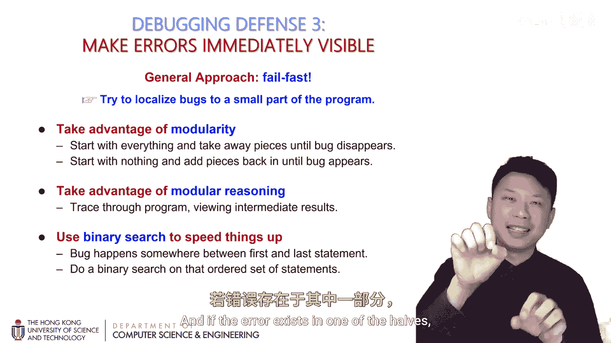

*   **二分搜索加速**：对于一个大型程序，可以将其分成两半。先测试其中一半是否存在错误。如果错误存在于这一半，则继续对这一半进行二分；否则，检查另一半。这能快速缩小问题范围。


### 充分利用断言

断言是防御性编程和调试的利器。它用于在代码中检查必须满足的条件，一旦条件为假，程序会立即报错。

考虑以下在数组`A`中查找值`K`的代码：

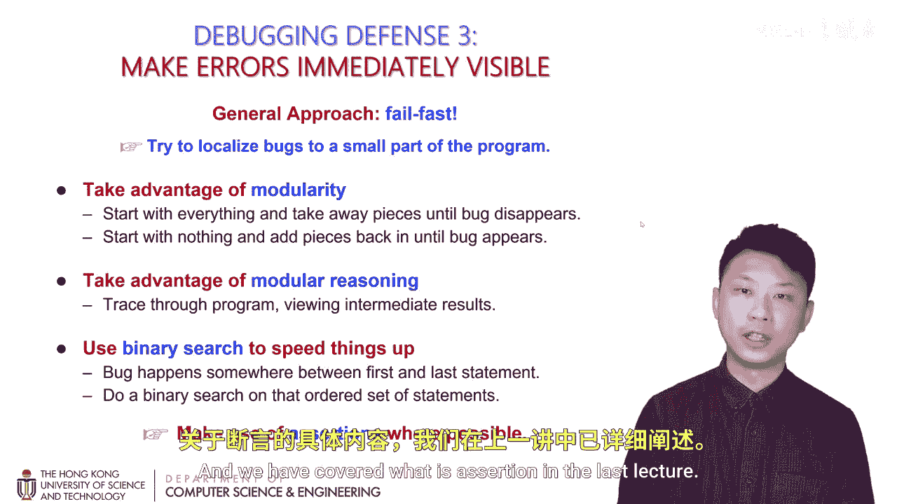

**示例1（有问题）:**
```java
int i = 0;
while (true) {
    if (A[i] == K) {
        break;
    }
    i++;
}
```
**问题**：如果`K`不在数组中，循环将永不终止（无限循环）。

**示例2（改进）:**
```java
int i = 0;
while (i < A.size()) {
    if (A[i] == K) {
        break;
    }
    i++;
}
```
**改进**：循环总会终止。
**新问题**：如果后续代码依赖“`K`一定在数组中”这个条件，而`K`实际上不在，则可能引发其他错误。

**示例3（使用断言）:**
```java
int i = 0;
while (i < A.size()) {
    if (A[i] == K) {
        break;
    }
    i++;
}
assert (i < A.size()) : “K was not found in array A”;
```
**优势**：通过断言，我们明确检查并声明了“`K`必须在数组中”这一条件。如果条件不满足，程序会立即停止并给出错误信息，便于快速定位问题。

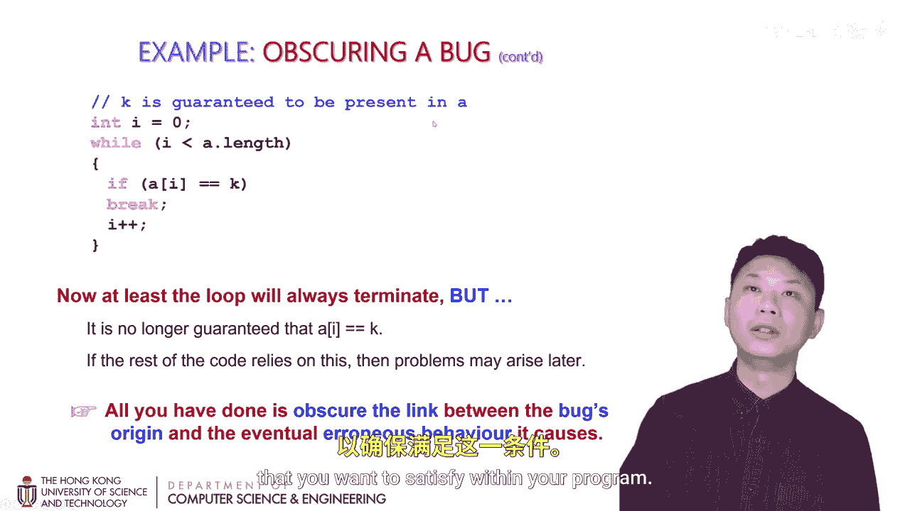
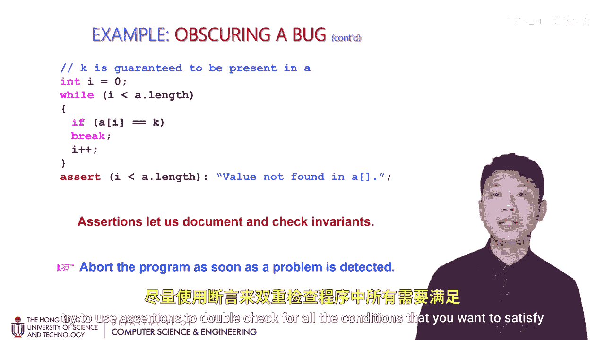

**断言的作用**：记录并检查程序中的不变量，使错误在发生时立刻显现。


---

## 调试思维与常见错误

调试时需要有正确的思维方式。Bug往往不在你认为的地方。

*   **自我提问**：问自己“Bug可能在哪里？”，更要问“Bug**不可能**在哪里？”，并解释原因。然后忽略那些不可能的地方。
*   **检查低级错误**：
    *   参数顺序传反。
    *   标识符拼写错误。
*   **区分对象相等性**：
    *   `a == b`：检查两个对象引用是否指向**同一个内存地址**。
    *   `a.equals(b)`：检查两个对象的**内容**是否相等。
*   **变量未初始化**。
*   **深拷贝与浅拷贝**：是复制了对象地址，还是复制了对象内容？
*   **修复后重新编译**：修复Bug后，记得**重新编译所有相关文件**，再链接生成可执行文件。

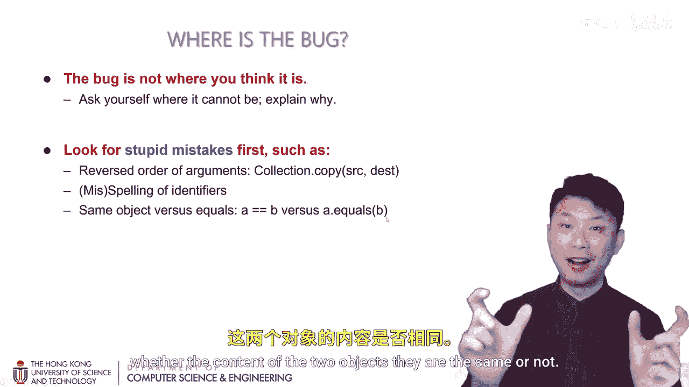
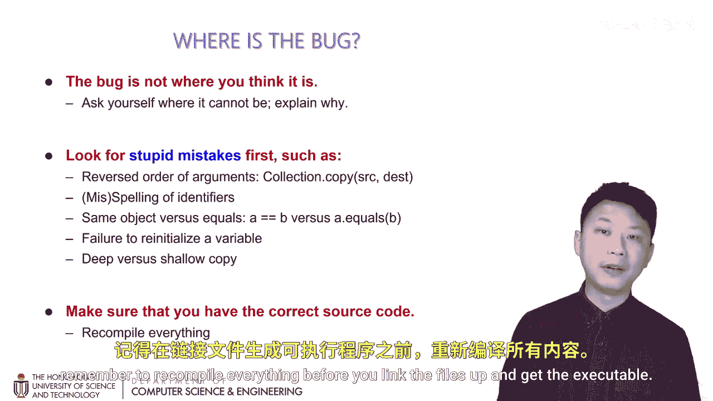


### 在代码中插入检查点

在程序中插入大量检查（如前置条件检查、一致性检查、针对特定Bug的检查），目标是跟踪程序执行，并在尽可能接近Bug的地方让程序停止。


**一个重要问题：生产代码中应该保留断言吗？**
答案是：**视情况而定**。
*   **保留**：如果你希望程序在发生任何错误时立即停止，避免产生更严重的后果（如数据损坏），则应保留。
*   **移除**：如果错误后果不严重，且你希望程序继续运行（例如某些游戏场景），则可以考虑移除断言以提高性能。

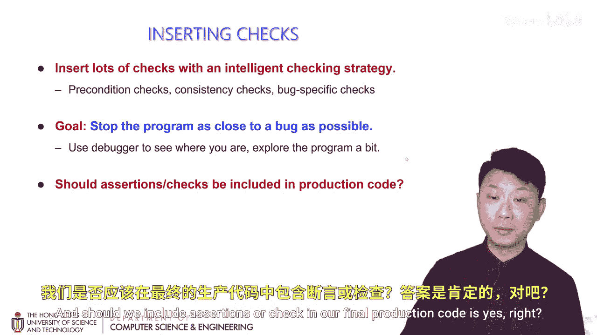
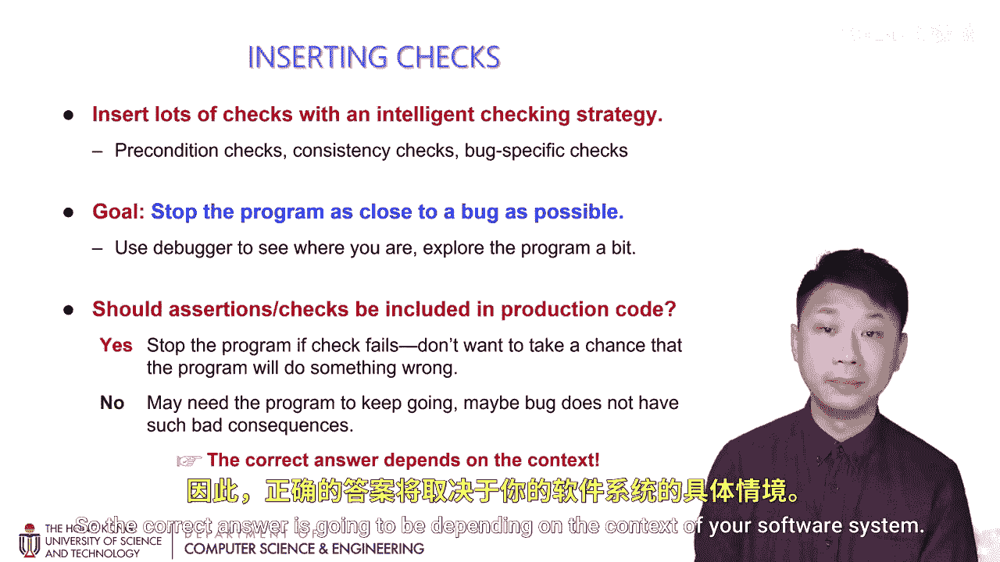

---

## 回归测试

每当发现并修复一个Bug后，必须将能重现该Bug的输入保存下来，作为系统的**回归测试用例**，并重新运行所有测试。

**为什么要做回归测试？**
1.  **确保修复不引入新问题**：我们常常在修复新Bug时，不小心重新引入了旧的Bug。
2.  **积累测试用例集**：帮助构建一个日益完善的测试套件。
3.  **防止Bug复发**：出现过的Bug，未来很可能再次出现。


因此，应尽可能频繁地运行回归测试，并**自动化**这一过程。同时，保持测试集的简洁，避免不必要的测试。

在工业界，代码缺陷率大约为每1000行代码10个Bug。那些无法立即定位的Bug，通常会在集成测试时被发现，或者由用户报告。

收到用户报告后的标准流程：
1.  澄清问题症状。
2.  找到并理解问题根源。
3.  创建测试用例。
4.  修复Bug。
5.  运行回归测试。

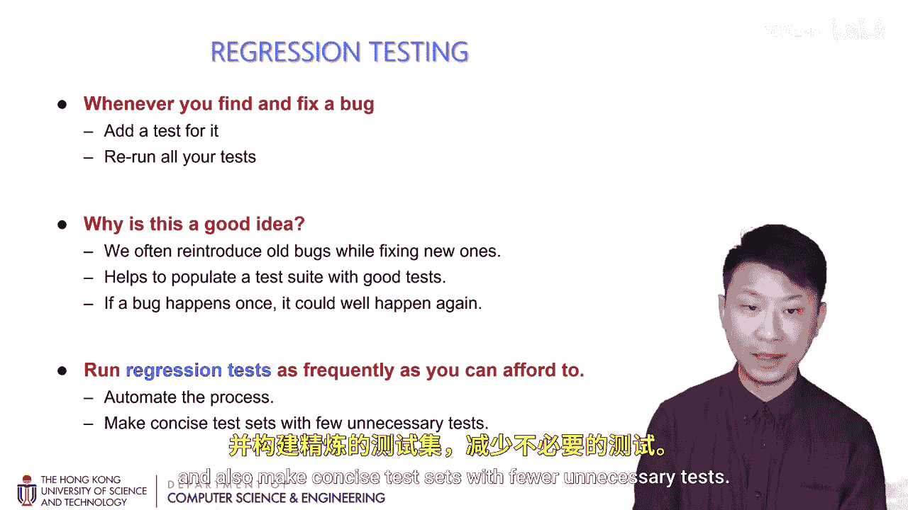

---

## 调试陷入困境时

当调试变得异常困难时，可以尝试以下方法：


*   **重新审视所有假设**：操作系统变了吗？硬盘空间足够吗？
*   **调试代码，而非注释**：注释可能已经过时。
*   **开始写文档**：通过梳理和记录系统流程，你可能会对系统有新的认识，从而发现Bug。
*   **寻求帮助**：向队友或更有经验的程序员请教。
*   **暂时离开**：休息一下，清空大脑。通常，在精神饱满的清晨解决问题，比在深夜苦苦挣扎更有效。

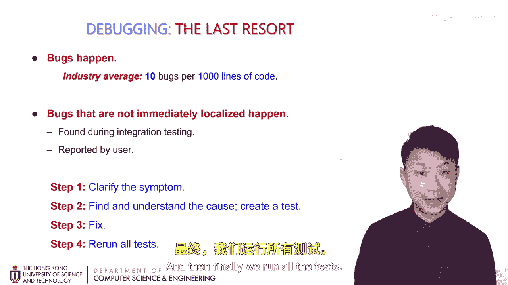
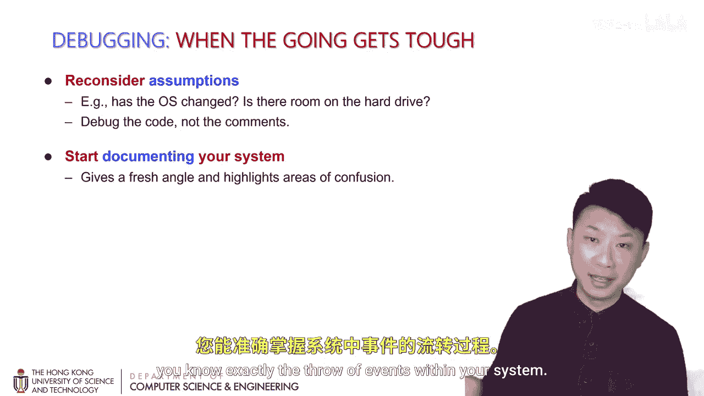
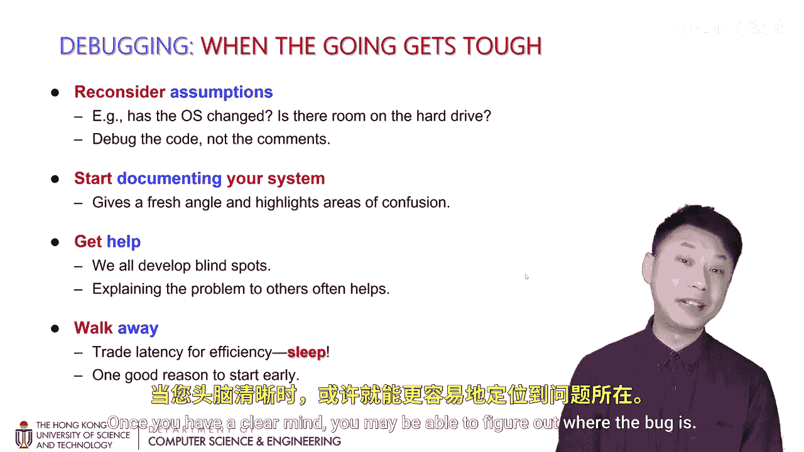

---

## 总结


本节课中，我们一起学习了软件调试的核心思想与实用技巧。我们首先了解了防御Bug的几种策略，优先级最高的是通过设计和规范避免错误。当Bug出现时，我们应利用模块化设计快速定位问题，并善用断言等工具。调试需要系统性的思维，要注意常见陷阱。修复Bug后，务必进行回归测试。最后，当调试遇到瓶颈时，不妨换个角度思考或寻求帮助。掌握这些方法，将能显著提升你解决软件问题的效率。