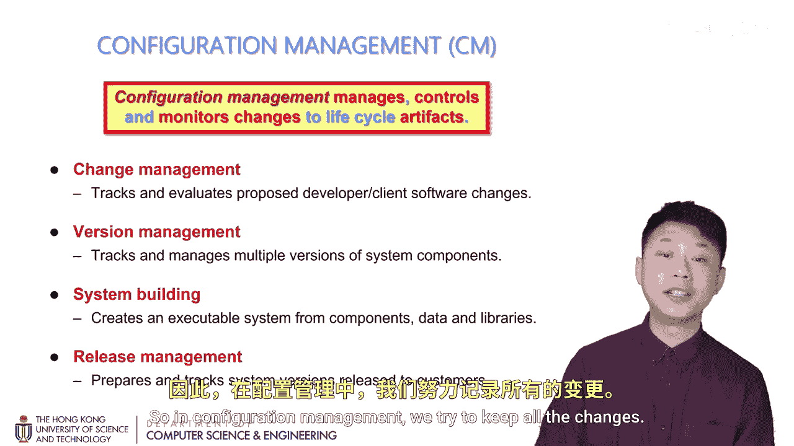
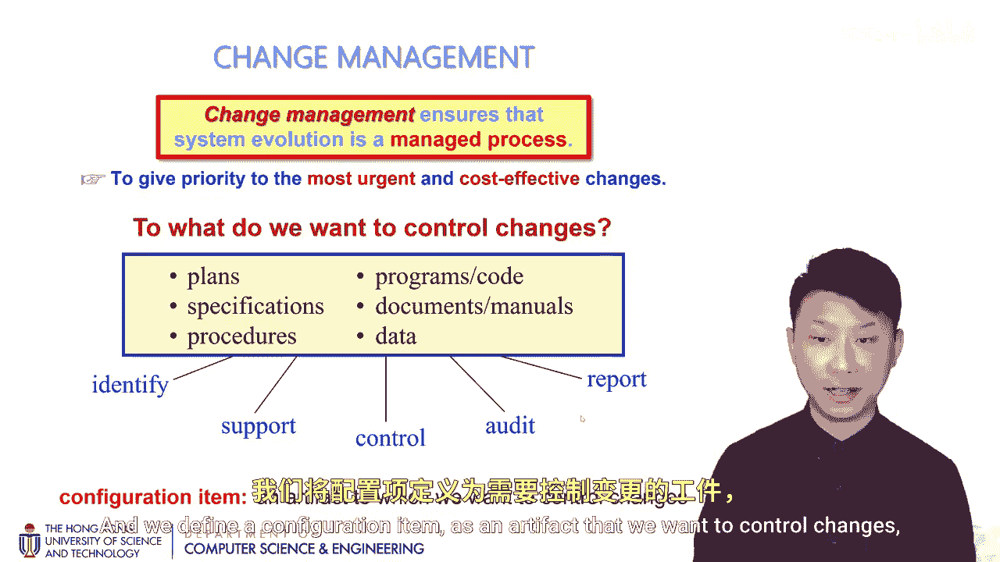
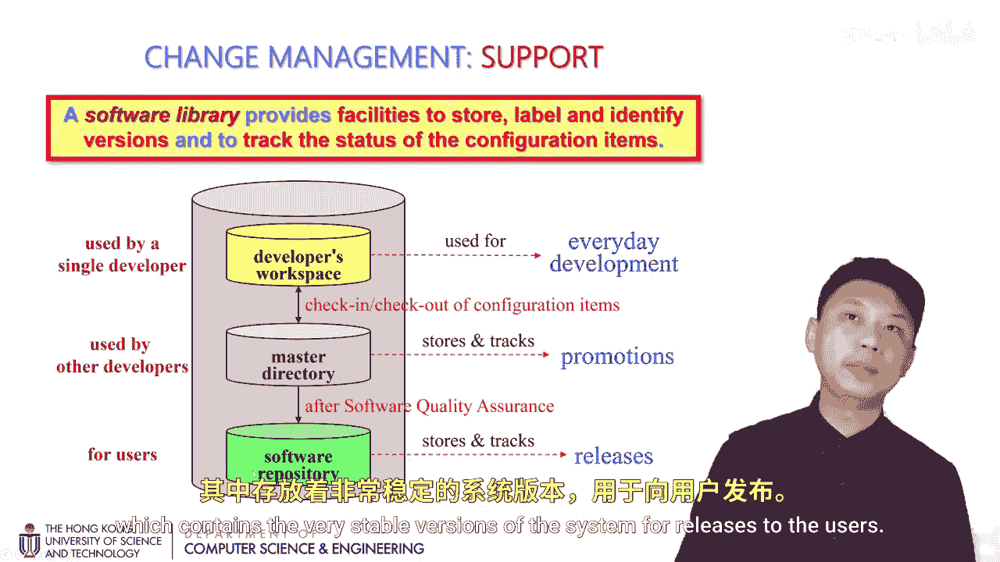
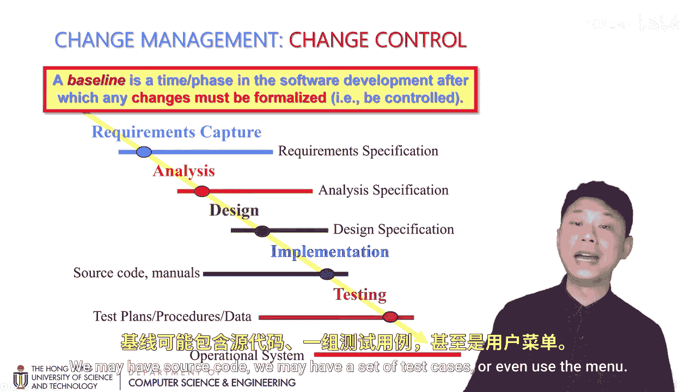
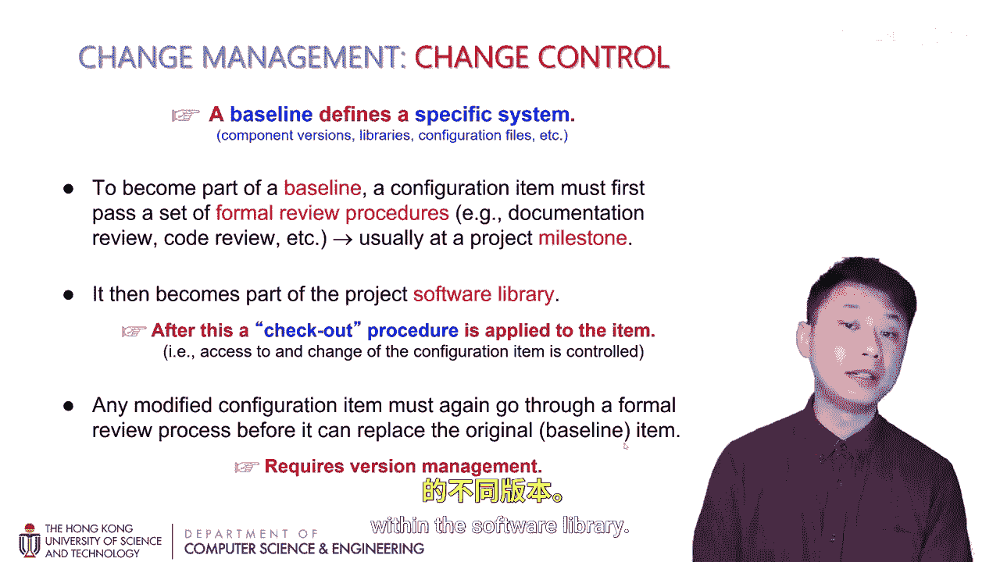
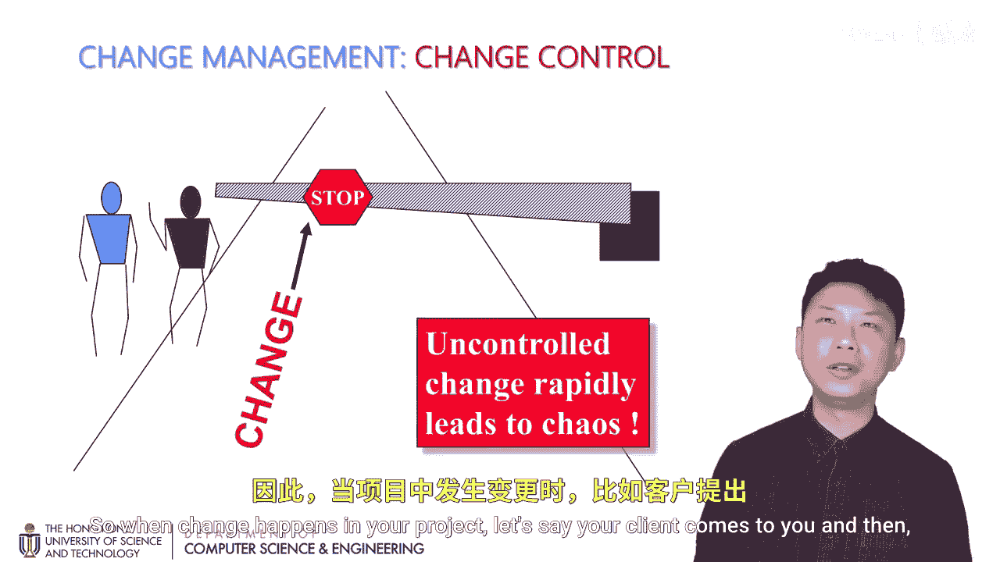
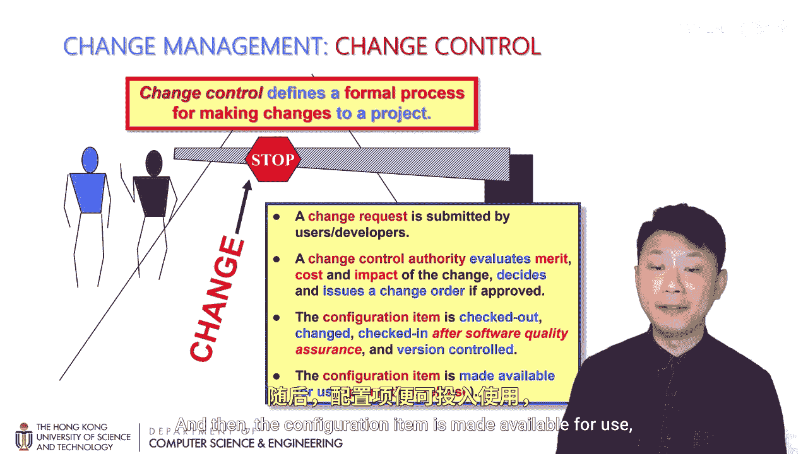
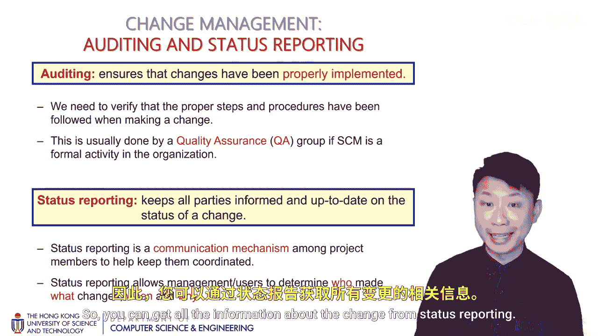
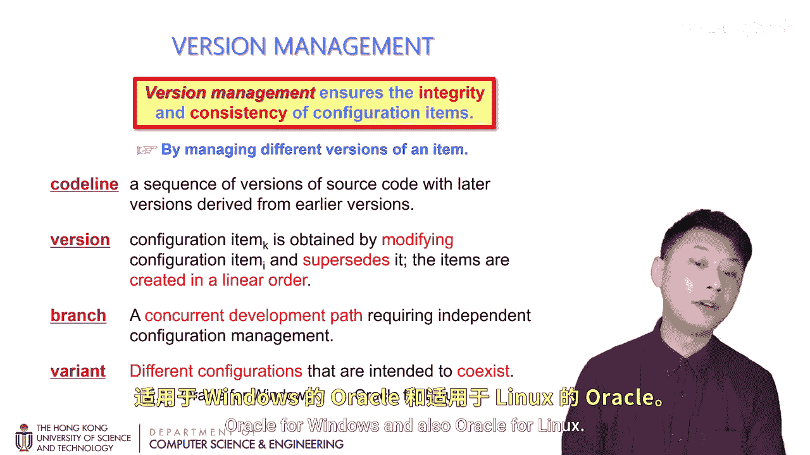
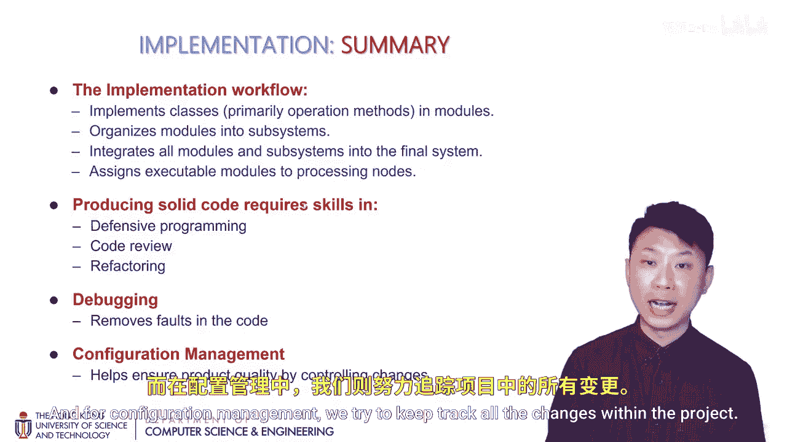

# 香港科技大学【中英⚡软件工程｜Software Engineering Specialization】 p31 P31 02_配置管理 -BV1MMEjzoEhg_p31-

And the next topic that we're gonna cover is configuration management。

 configuration management means we try to manage control and also monitor changes to life cycle artifacts。

 So artifacts means not just Sosco We are talking about maybe right documentation Soco or even user a menu So we try to keep track all the changes on those items is for change management。

 So we try to tracks and also evaluate proposed developer or client software changes and also version management。

 We try to tracks and also manages multiple versions of system components and then system building。

 we try to build an executable system from the components and also data libraries that we have within a repository and then we can also use it for release management。

 for example， prepares and track system versions released it to customers。

So in configuration management， we try to keep pre all the changes so change management ensures that system evolution is a managed process we're going to give priority to the most urgent and also most cost effective changes so to what do we want to control changes。

It may be plans， documentations， specifications， procedures， programs source documents。

 menus or even data and within a project we want to capture track all the changes on these items that we have in the project and we define a configuration item as an artifact that we want to control changes to support change management we need a software library a software library provides facilities to store label and also identify versions and to track the status of the configuration items This is an example of a software library within the library we have a developer workpas and is used by a single developer for everyday development and we also have to master directory directory。

And we also have the master directory， which contains relatively stable versions for other developers to work on and we also have the software repository。

 which contains the very stable versions of the system for releases to the users and a baseline is a time or phrase in the software development after which any changes must be formalized That means we try to freeze the system at a particular point of time and after we achieve some important feature and then the system is kind of stable we can freeze the system at a particular point of time and say that we have achieved some baseline Again。

 we are not just talking about sourcesco here you can see that within a baseline。

 we may have documentation， we may have sourcesco， we may have a set of task cases or even user menu So it's not just about source code and a baseline defines a specific system at a particular time to become part of a baseline a configuration item must first pass a set of formal review。

Seures and usually add a project milestone so that means we have to perform testing to make sure that the system is kind of stable and after we achieve some important features and we achieve some milestone in our project then we can freeze the system and say that we have a baseline and then we can check out the item from the software library and any modified configuration item must again go through a formal review process before it can replace the original item。

And that's why it requires version management。 That means we have to keep track different versions of the configuration item within the software library。

 So when change happened in your project， let's say your client comes to you and then asks you to change something and these are the things they have to do before you can change something in your project。

First， a change request is submitted by users or developer。

 and then a change control authority is can to evaluate the cost and impact of the change and then decides and issues a change order if approved。

 and usually the management people they will decide whether the change is feasible or not。

And then the configuration item is checked out， changed and enchecked after software quality assurance。

 that means after being tested by the testing team。And then it will be version control。

 So software quality assurance here means there will be a team of people performing tasks on the system。

 and then the configuration item is made available for use， for example。

 for promotion or a release and then there should be some auditing and also status reporting scheme within your project So auditing means we try to ensure that the changes have been properly implemented so usually there is a team of people。

 the software quality assurance team or the testing team to try to make sure that we have properly implemented the change and there should be some status reporting scheme or mechanism to keep all parties informed about the status of the change。

And it also allows management or users to determine who make what changes and when and why so you can get all the information about the change from status reporting and we also have to perform version management to keep track all versions that we have for a particular configuration item within the software library and version management is going to ensures the integrity and also consistency of configuration items and these are the things that we have to keep track in version management for example。

 Colline， which is a sequence of versions of sourceco with later versions derived it from earlier versions and also different versions of the configuration item。

And if we are going to perform development in parallel。

 then we're going to have different branches and also worrying if we have different configurations that are intended to coexist for example。

 a software system on different platforms for example Oracle for Windows and also Oracle for Linux and this is an example evolution graph to describe an items change history so you can see that in this graph we have different version。

When we go from one version to another version， we have a Col line。

Then if we are going to develop the system in parallel， we're gonna to have different branches。

 and then eventually these branches， they will merge back into the mainstream。 So from this graph。

 we can actually see the evolution of the configuration item and this is a little summary of what we have covered for implementation So in our implementation workflow。

 we try to implement classes in modules one by one。

 and then we're going to organize modules into subsystems and then integrate all the modules and subsystem together as a final system and then assign executable modules onto different processing nus if we are talk about a distributed system and then we can produce solid code by doing the following things to try not to make mistakes。

 For example， defensive programming code review and also refactoring to improve the overall structure of the system。

 And then in this lecture we talk about debuing and also configuration management。 For debuing。

 we try to discover and we move faults in our code and for configuration。Management。

 we try to keep track all the changes within the project。

And that's all I want to cover in this lecture。