# 香港科技大学【中英⚡软件工程｜Software Engineering Specialization】 p32 P32 01_测试 -BV1MMEjzoEhg_p32-

This lecture is about testing， as mentioned in the last lecture， when we perform testing。

 we try to find defects and also mistakes within a software system and these are the learning objectives of this lecture。

 After this lecture， you will understand the purpose of testing and you also know the three basic types of test cases and how they can be generated and you also understand the principle of component based and also system based testing and you also learn different strategies for performing the different types of test cases So we will start with testing overview。

 Some of you may think that if we talk about testing， we mainly do it after implementation。

 it's not true because if we talk about test driven and development we have to think about all the possible test cases test plan before we actually perform implementation so that's why it's possible that。

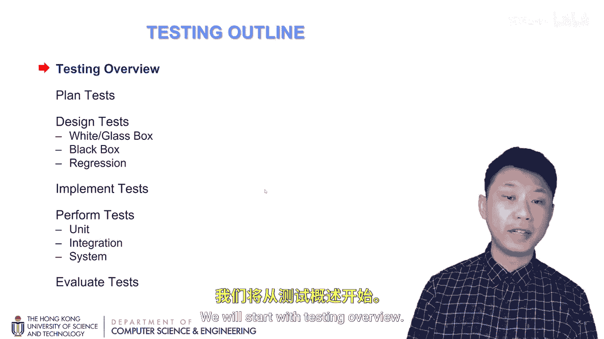

We perform testing before we perform implementation or while we are performing implementation。

 not just after implementation。 So there are many reasons why programmers they do not want to perform testing。

 The first reason is that I want to get the project done fast。 Testing is gonna to slow me down。

 The second reason is that I started programming when I was to Don't doubt about my perfect code。

 The third reason is that testing is for incompleing programmers who cannot have， it's not for me。

 We are not stupid students， and we know that our code actually works。

 I trust the sourceco for my teammate。 So that's why we don't need to perform testing。

 but notice that if you don't test your system fawly。 a tiny mistake may destroy the entire system。

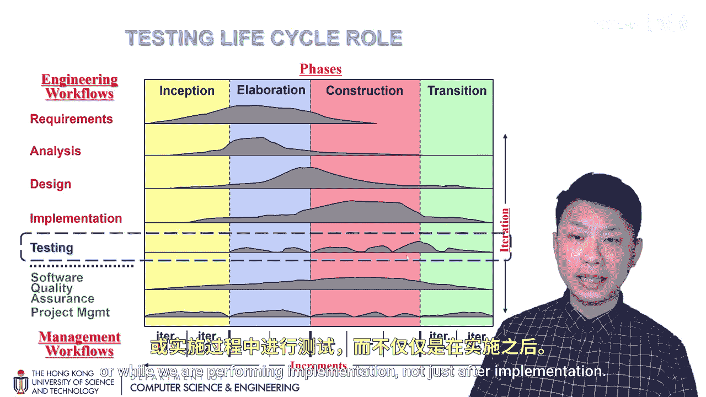

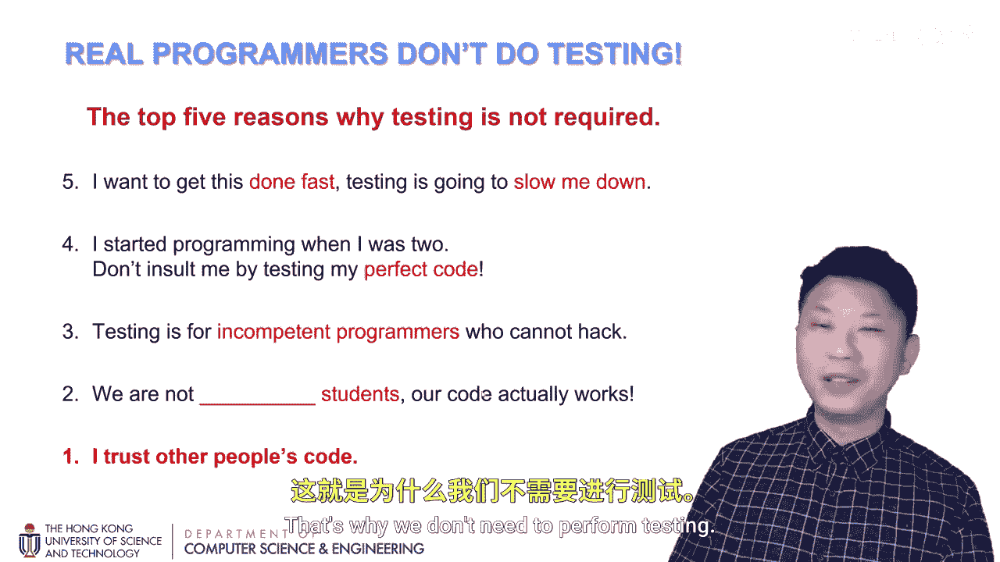

This is an example that we have seen at the very beginning of the semester。

 The rocket just brought up 37 seconds after launch。

 And the reason is that when they try to convert a 64 Bs floating point number into 16 Bs assigned it integer。

 the conversion cost it an exception。And then the program just crashed and then the rocket explode and the total cost is over $1 billion and the RN 5 rocket shows particularly costly error。

 So it's expensive。 However， every little errors is gonna add up。 For example。

 for the Vancouver stock exchange system in 1992。 the new stock exchange system initiated the index value as 1000 and then the index was updated after each transaction。

 and 22 months later， the index had fallen to 520。 The cost is that the updated value was truncated rather than rounded。

 So that's why they don't get the correct result within the system and the rounded calculation would give a value of 1098 points something。

 and insufficient software testing costs 22 up to 60 billion per year in the US And if your software worth writing is also worth testing because you want to make sure that it's gonna be correct。

 So in testing we try to find mistakes and errors within the software system。 So in testing。

 we try to find。

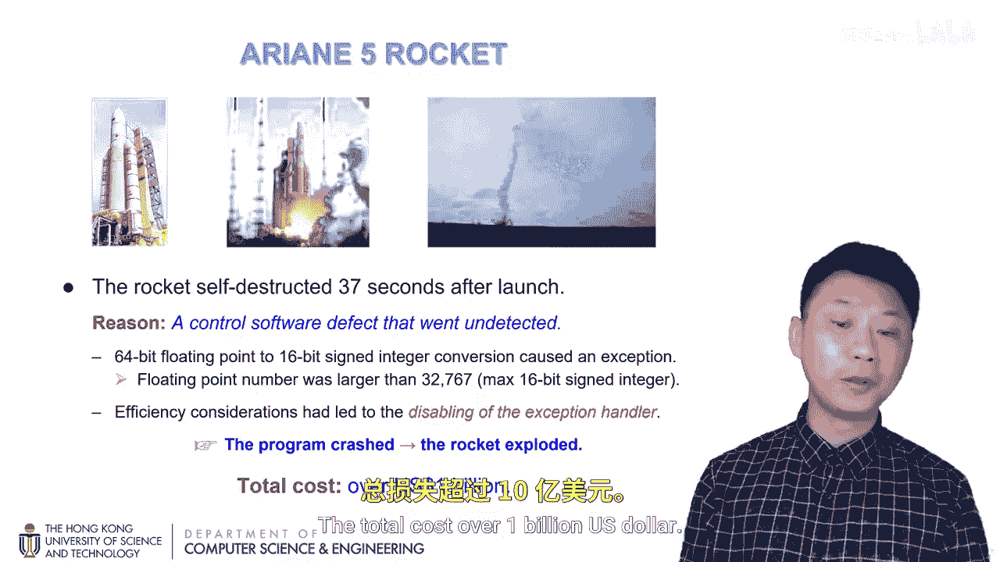

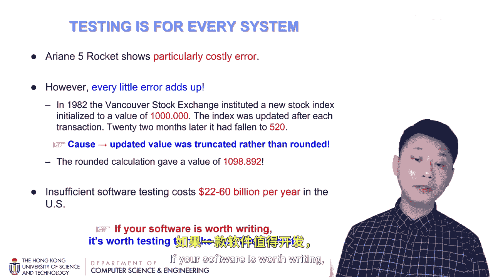

Differences between the specified and the observed system behavior。

 So we try to find differences between the expected and also the actual system behavior。

 And there are two major things that we have to do with in testing。 One is what we call validation。

In validation， we try to make sure that we have built the right product according to all the requirements stated in our documentation。

And a tasks do mainly with validation and we will cover a second tasks in one of the upcoming lectures and also we have to perform verification。

 that means we have to make sure that we have built a product right in verification we have to check the quality of the implementation and make sure that all the function works correctly and has no defects and most of the testing is targeted at doing verification that means try to find mistakes and errors within the software system and our goal in testing is to design a set of tasks that will systematically find defects from the software system and notice that testing cannot show the absence of software errors because there are too many possible conditions too many possible inputs and also situations that may happen within a software system So it's not possible to test a system exhaustively using testing。

 but that's why here I say that it's impossible to test a non-trifual system because there are two many。

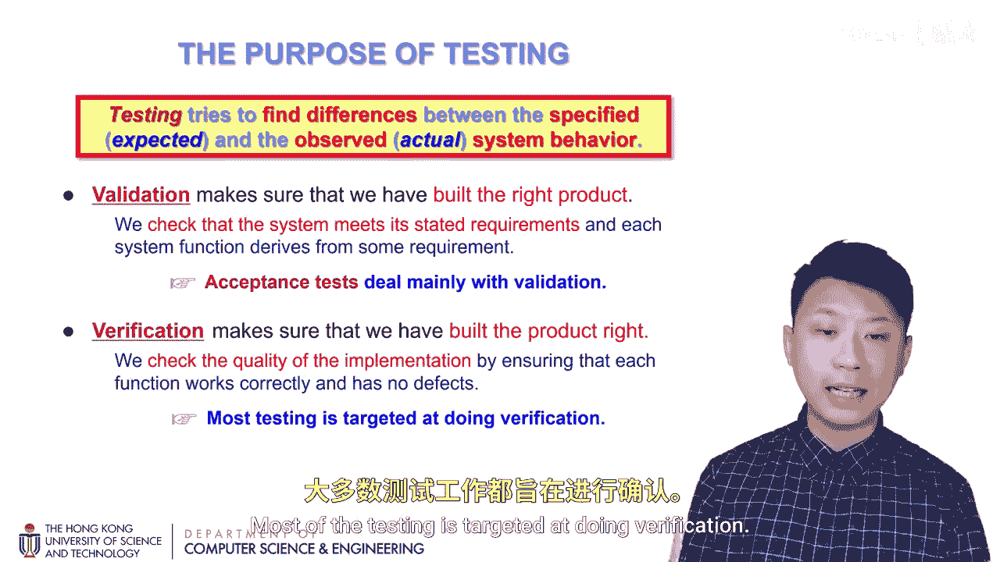

Any possible things that you have to consider within a software system and notice that testing is a destructive activity because we try to make the software fail and then it's often difficult for software engineers to effectively test their own software system because usually people are blind to their own mistakes。

 So now we talk about how to plan tasks That means how we can come up with a set of test cases to test a software system。

 So some of you may ask why don't I simply test the system exhaustively using all the possible inputs and see whether the system is going to work on all the possible inputs or not。

 Now， let's take a look at this example。

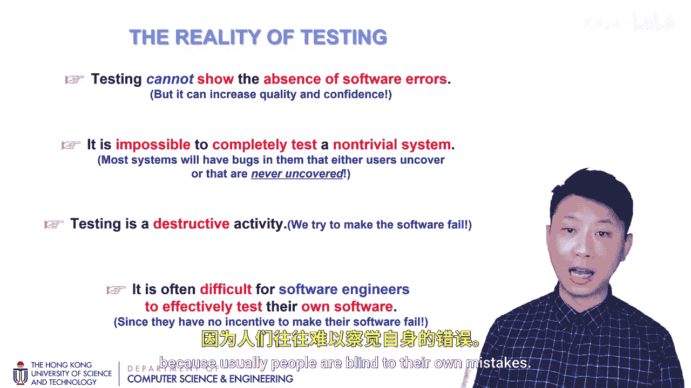

For example， we have a procedure that takes the inputs X， Y and Z， and X。

 Y and Z they are integers and they should be within this range from  one up to 10，000。

So now considering all the possible combinations of these inputs。

 how many possible combinations do we have 10000 to the power free， and we have many。

 many possible combinations of the inputs。 and it's going to take a long。

 long time before you can finish the testing。So that's why it's impractical So that's why in testing instead of testing all the possible inputs。

 what we're going to do is that we try to find a small set of test cases that can actually uncover as many defects as possible in the shortest possible time just because we usually perform testing after implementation and usually we have limited time。

After implementation， because we have to catch up some deadline line。

So that's why it's a good idea to try to come up with a small set of things。

 small set of test cases that we can use right to uncover as many defects as possible in the shortest possible time。

 So that's why our goal is that we try to come up with tasks that have the highest likelihood of finding defects with the minimum amount of time and effort and this is our target。

 why because we have limited time for testing after implementation and before the deadline。

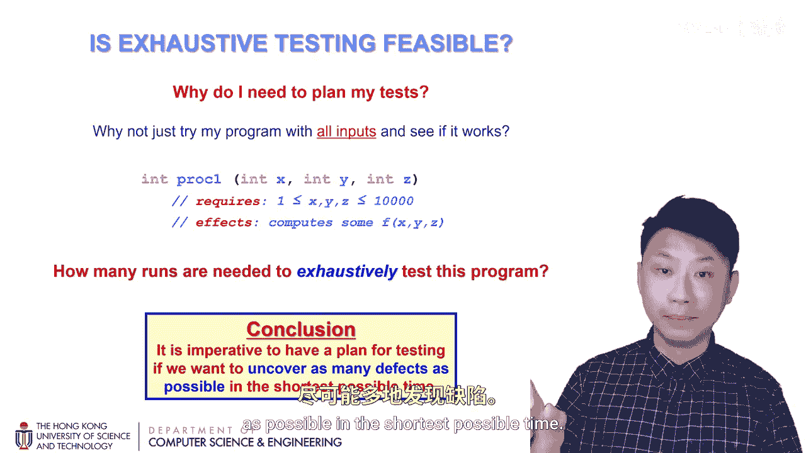

And test is going to cost money and also time to develop， perform any value。

 So that's why we want a small set of tasks that have the highest likelihood to find defects。

 So in our test plan， we have to specify a testing strategy。

 That means what test to perform how to perform them。

What are the required test and code coverage percentage that should execute with a specific results。

 So that means how many tests that we have to pass before we can say that our system is stable。

 and then we can release the system to our users and then we also need a schedule for testing。

 That means when to run the test and also an estimate of resources required。 For example。

 whether you're gonna run all the test using human or a system。 Again。

 the key problem here is that we try to figure out a set of inputs that is small enough to finish quickly but large enough to validate and verify the system。

 So that's why instead of testing all the possible values。

 What we're going to do is we're going to partition the possible values into different sets。

 and then each set is going to have similar behavior。

 And then we're gonna pick one value from each set to perform testing。

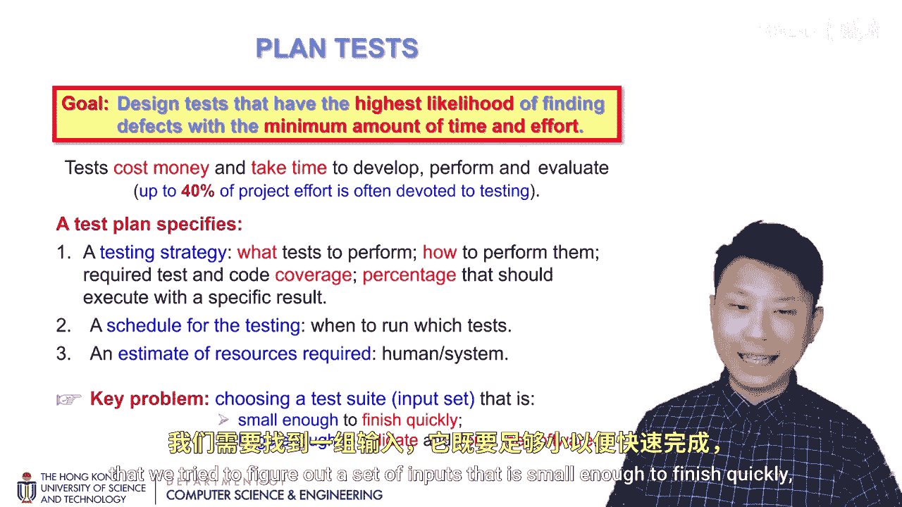

So that's why we have to partition the inputs into sets with similar behavior。

 and then we're gonna pick one value from each set， but how to define similar behavior。

 There are different approaches that we can use。 For example。

 whether we are talking about execution equivalentence or whether we are trying to find similar subdomomains and notice that discovering the set of inputs require perfect knowledge。

 that means we need to see the sourceco in order to figure out the set of inputs that we can use for testing and we also need to use some heuristics to approximate the sets cheaply and quickly。

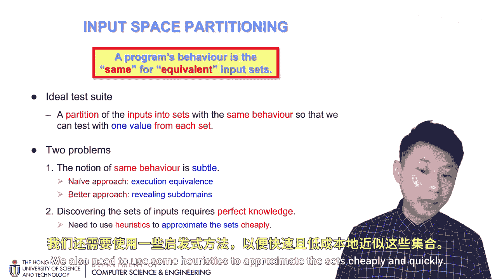

So if you partition all the possible inputs into different sets according to execution equivalentvalence。

 then there are two sets that we can actually use。If the number is negative。

 then we can execute this line。If the number is not negative。

 then we're going to execute another line so we can partition all the inputs into two different sets。

 One is like negative and another set is not negative。

So negative will be one set and then bigger than or equals to 0 will be another set。

And then we have to pick one value from each set and let's say we pick minus3 from one set and then free from another set。

 then we say that we have a set of values minus3 and three that is going to be a good set of values that we can use for testing。

So now let's consider this bugy code。 So in this bucky code， instead of having x less than 0。

 now we have x next  than minus-2。So now if we are using this set of values that we have derived before。

 can we actually find the error？😡，No。RightBecause if you feed minus3 into this function。

 you get the correct result and if you feed free into this function， you also get correct result。

 So now you cannot find the error using this set of values， minus-3 and free。

 So that's why using execution equivalence may not be always effective and sometimes we may have to use another heuristic。

 for example using subdomains to find out a set of values that we're gonna to use for testing So we have two subdomains in this example。

 one sub domainomain is that the set of values that is going to give you correct results For example。

 anything less than-2 or anything bigger than or equals to 0。

 you get correct results but if you have like， for example。

 minus-2 or-1 they will give you incorrect result and they are another sub domainomain that you can use So we're gonna to partition the set of values according to sub domainomas。

 rather you're gonna get correct or incorrect results。

 So that's why here we say that a program has the same behavior for two inputs if it。

A correct result on both or gives incorrect results on both and a sub domainoma is a subset of the set of possible inputs and a sub domainomain can be used to find for an error。

 for example， E if each element in the sub domainoma has the same behavior。

 So in our previous example。

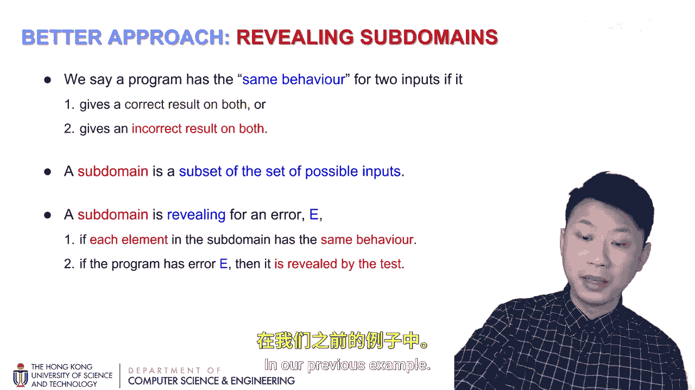

Any value that we have in this incorrect sub domainomain， for example。

-1 or -2 can be used to find out the mistake that we have in this line of code。

 And if the program has an error E， then it can be find by the test using this sub domainomain。

 So for this bucky absolute value function what are the possible sub domainomains that we can use。

 There are two sub domainomains right What is the set of values that we can use to uncover this error and then another set of values that is gonna to be always giving you the correct answer。

 So considering this input sets， Which one is gonna be the best one for finding this error within the program。

 So again， we need something from the correct sub domainomain and we need something from the incorrect sub domainomain And I will say this set right-3 and-1 will be the best set because-3。

 you get the correct result。 while-1 you can use it to uncover this error。

 why this set is not the best one。 because this large one contains one input。

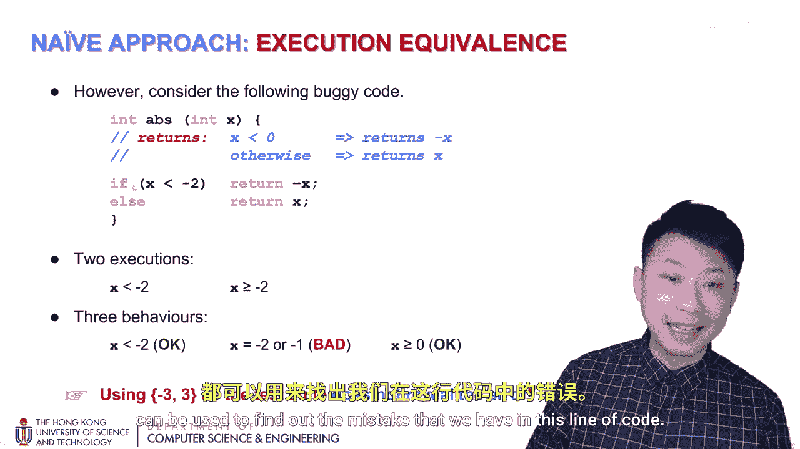

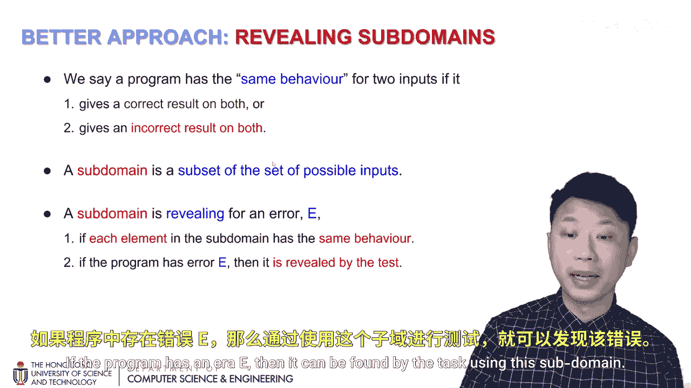

orThe correct sub domainomain， which is minus-3 and then we have two values。

 which is minus-2 and-1 that we can use to uncover this error and it's not minimal So that's why we prefer this one because its say minimum set and again always keep in mind that we want to find a small set of inputs that have a high chance of uncovering error So that's why we prefer this smaller set rather than this larger one and to partition the inputs and outputs into different subdomains we need all this information。

 for example， program dependent information that means we need the source code and also we need program independent information。

 for example， all the documentation algorithm being used input or output data structures， etca etc。

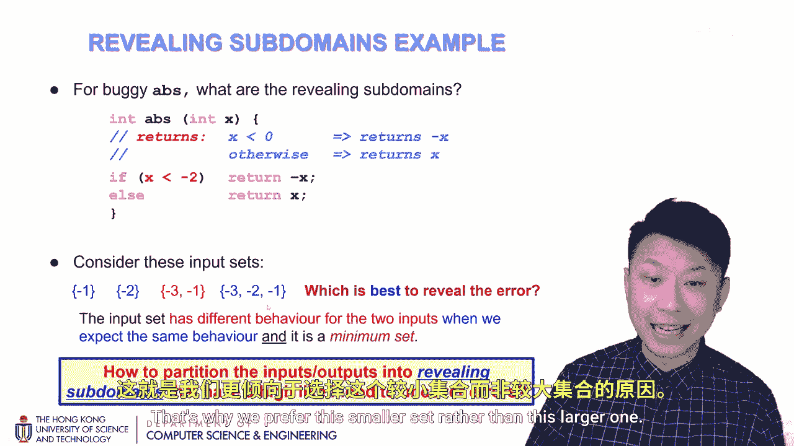

And then a good heuristic should give you a fill sub domains that have a high chance of finding errors and notice that different heuristics they target different classes or kinds of errorss。

So in reality， usually we use combination of multiple heuristics。😊。

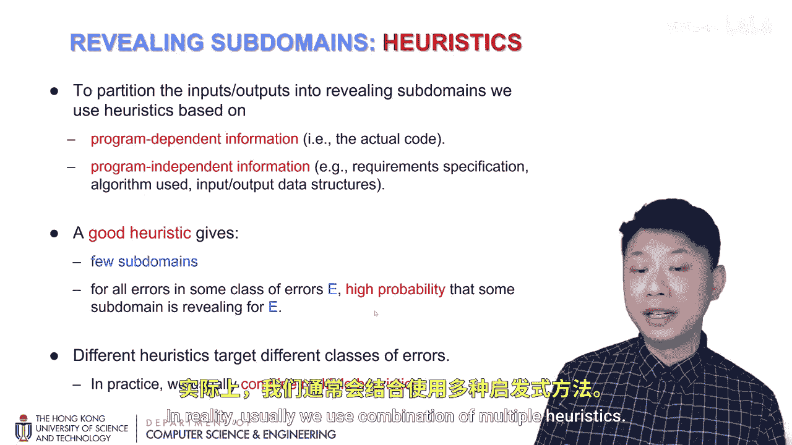