# 香港科技大学【中英⚡软件工程｜Software Engineering Specialization】 p33 P33 02_设计测试 -BV1MMEjzoEhg_p33-

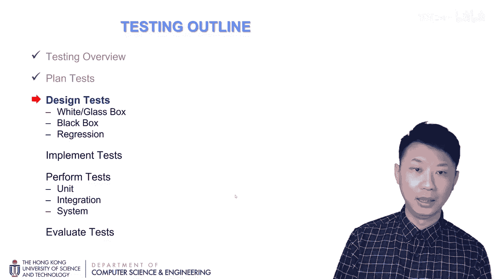

So now we will talk about different heuristics that we can use for finding sub domainomains。

 So when we design test， one thing that we have to do is to specify all the test cases that we're gonna to use in testing and the definition of a test case is a one way of testing the system。

 So it's going to specifies what to test under what conditions how to test and the expected result etc。

 etc。 So the basic steps of running a test case is that you have to choose the input data or software configuration for testing Then you have to define the expected output and then run the program or method against the input and then record the result and then compare the results against the expected outcome and see whether you get the correct result or not。

 If you get the correct result is a pass。

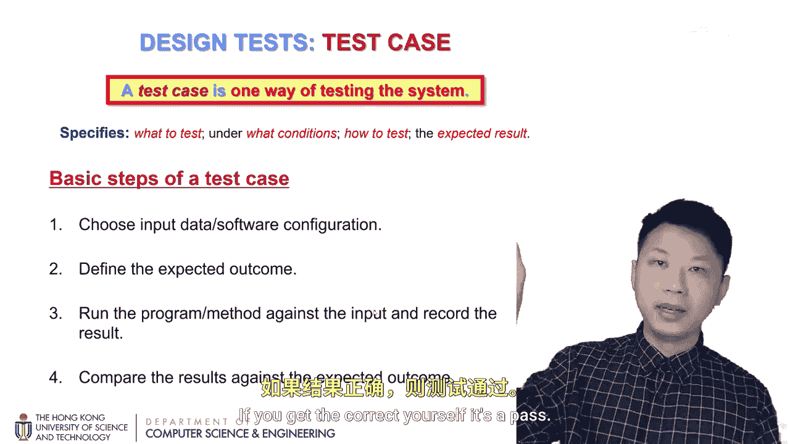

If the result is incorrect， then you say that it fails and there are three types of tasks that we can perform on a software system one is what we call white box testing that means testing in the small we have to verify component logic based on data or control structured。

And the test cases use knowledge of the internal working of a component that means source code。

 So that's why for white box testing， we need source code。

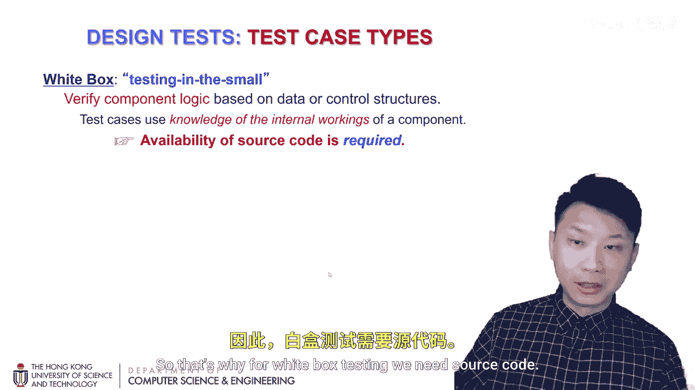

So for black box testing， we mean testing in the large。

 That means we want to verify component functionality based on the inputs and outputs。

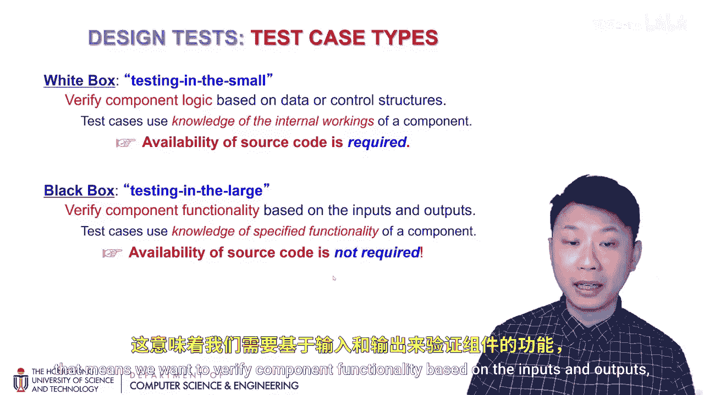

And test cases use knowledge of specified functionality of a component and for black box testing。

 we don't need Sosco。 we simply need to know all the functionalities of the software system and also we have regression testing。

 we have already covered regression testing when we talk about the bucking So when whenever we find a bug and we find some input that we can use to reproduce the bug we keep that input as another test case that we can use for regression testing again。

 just because once we make a mistake it's possible that we make the same mistake in the future again。

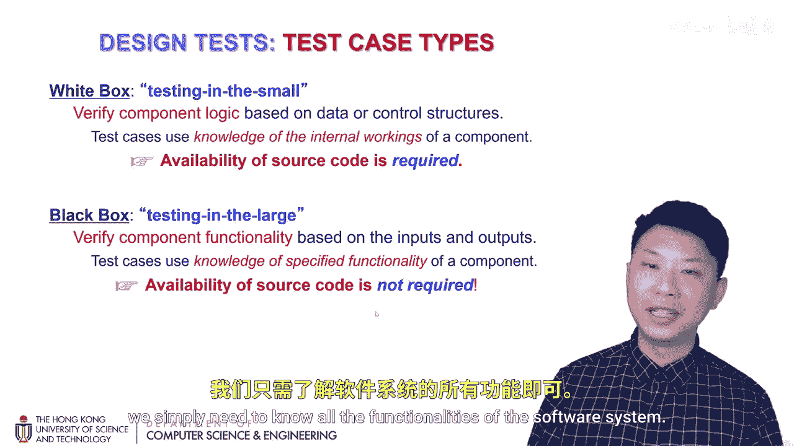

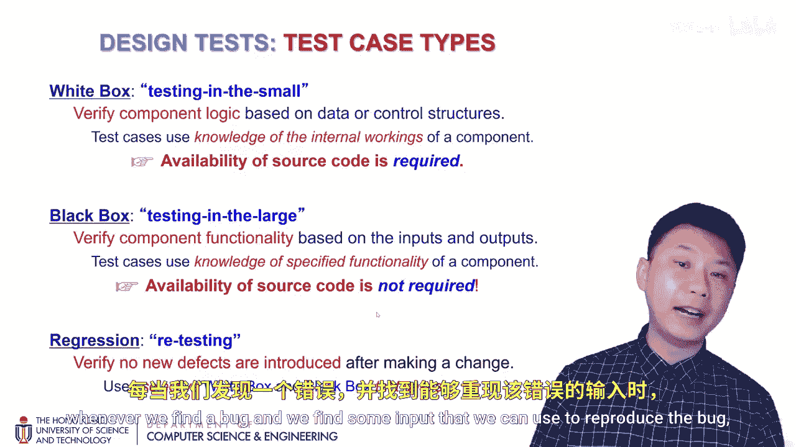

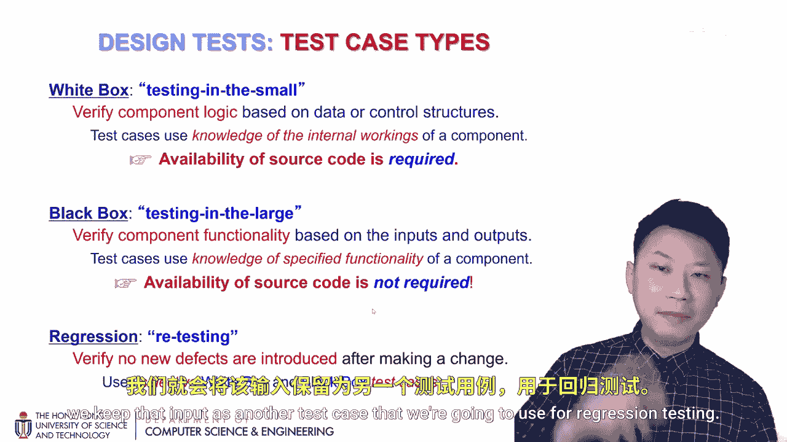

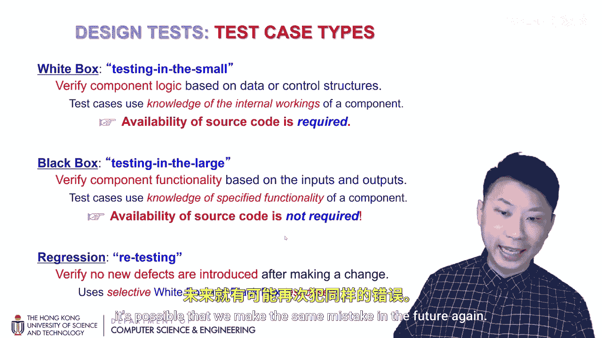

So that's why it's a good idea that if we introduce some defects。

 it's a good idea to keep all the inputs that we can use to reproduce the defects in our regression testing so for regression testing we can either use white box or black box text cases。

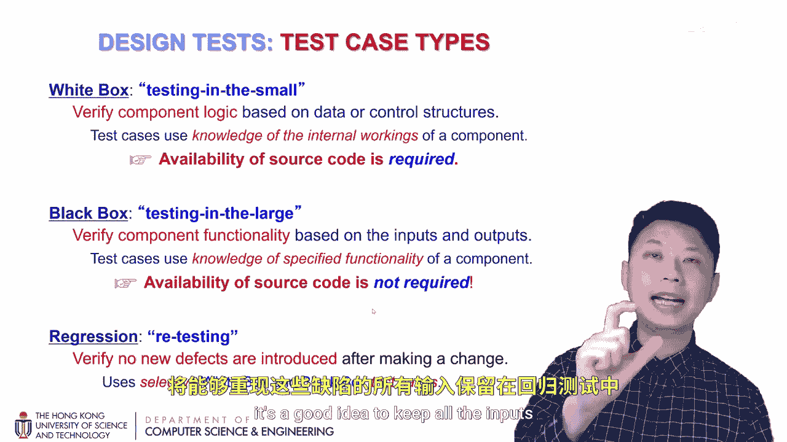

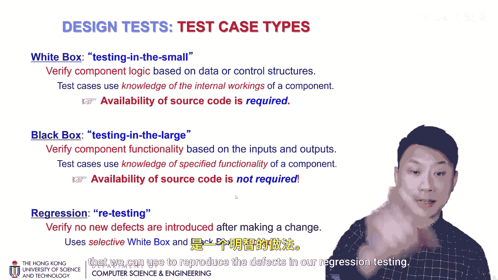

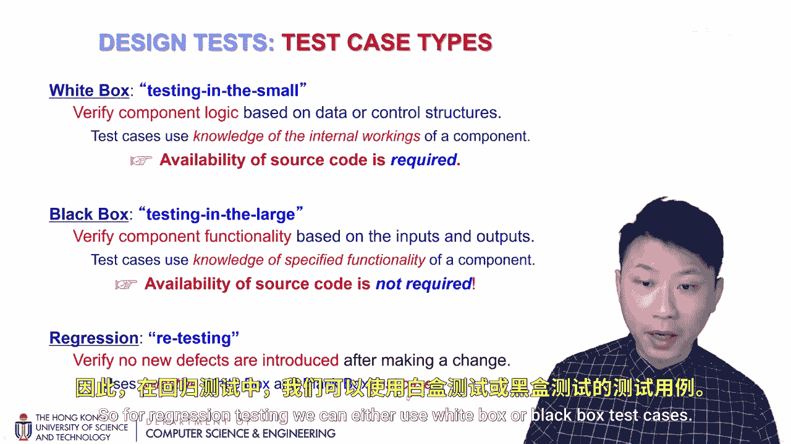

So now， so now we start。So now we start with white box testing。

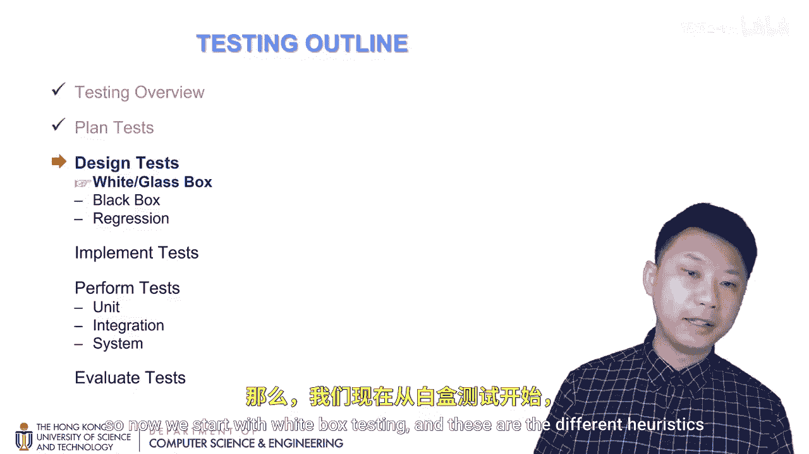

And these are the different heuristics that we're going to cover for white box testing in this course and this are the different heuristics that we're going cover for white box testing in this course and in white box testing。

 the goal is that we try to find subdomains to ensure that we have executed， for example。

 all the independent paths in our program。

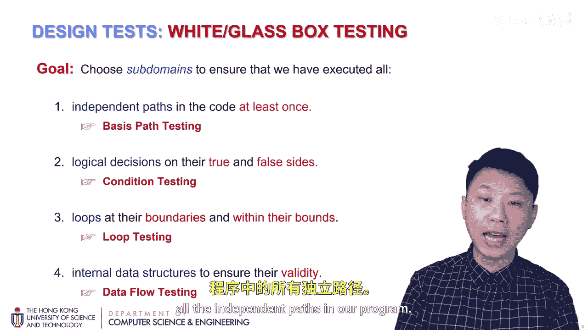

All the logical statements in our program， all loops or all the internal data structures within our program。

 we want to double check all these components within our software system and we will first cover basic path testing which focus on finding sub domainomains to cover all the independent paths within the program。

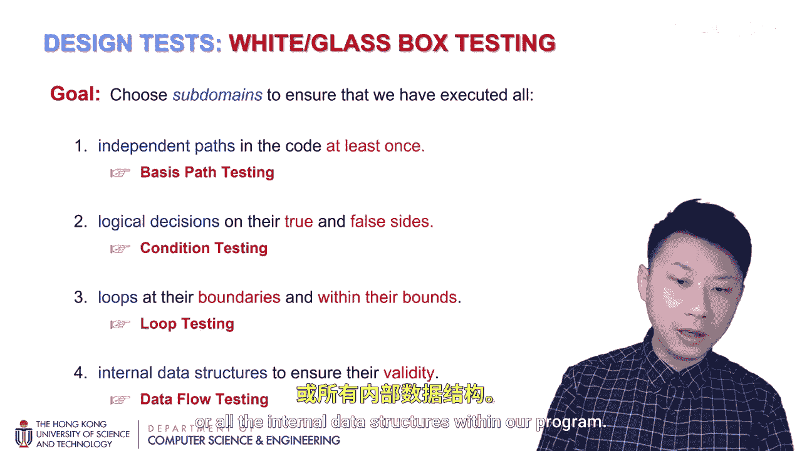

So some of you may ask， why do we bother studying the independent paths that we have within the poke grain？

For example， if we simply execute every single statement within the program。

 will that be sufficient for finding errors？So now let's take a look at this example。😊。

If we make this condition A and B to be true， then we could execute all the statements that we have within the program。

Will that be sufficient for finding errors？

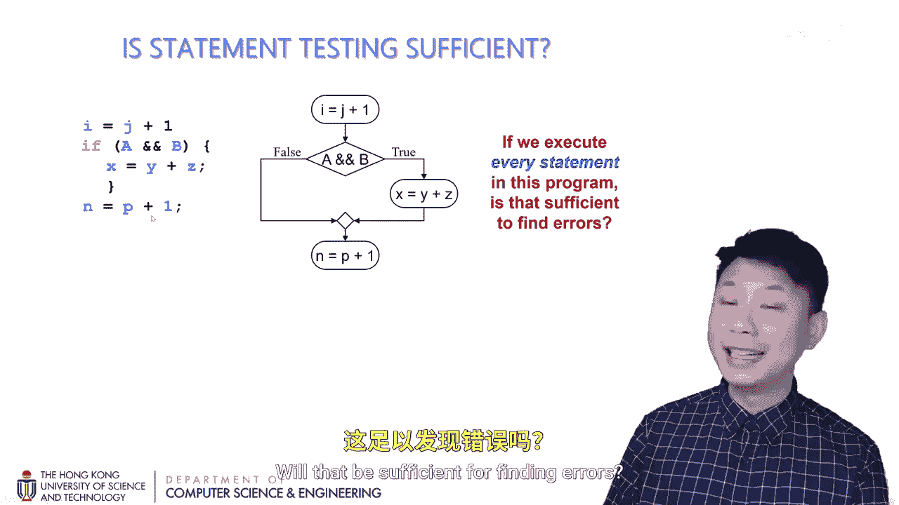

Yes or no。I would say no now let's study this in another example。

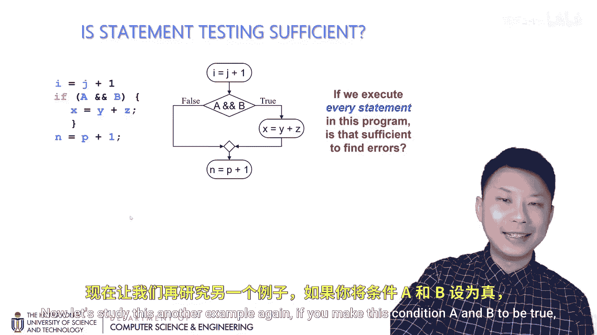

Again， if you make this condition A and B to B true。

 you simply execute all the statements that you have within the program。And I would saying no。Now。

 let's study this another example In this example， if we make this condition A and B to B true。

 we're going to execute all the possible statements that we have within the program。

But now what if we make the condition A and B2 B false。

Then we're going to have an error because we have a divided by zero kind of error within this program。

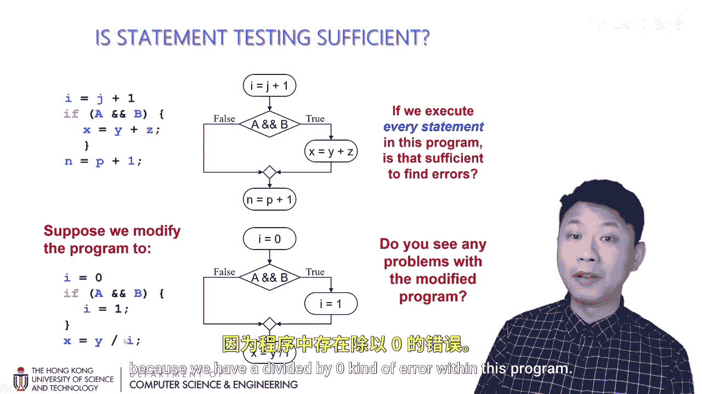

So that's why we also have to test out the false branch for this conditional statement。

And that's why we say that simply testing every single statement in the program is not going to be sufficient。

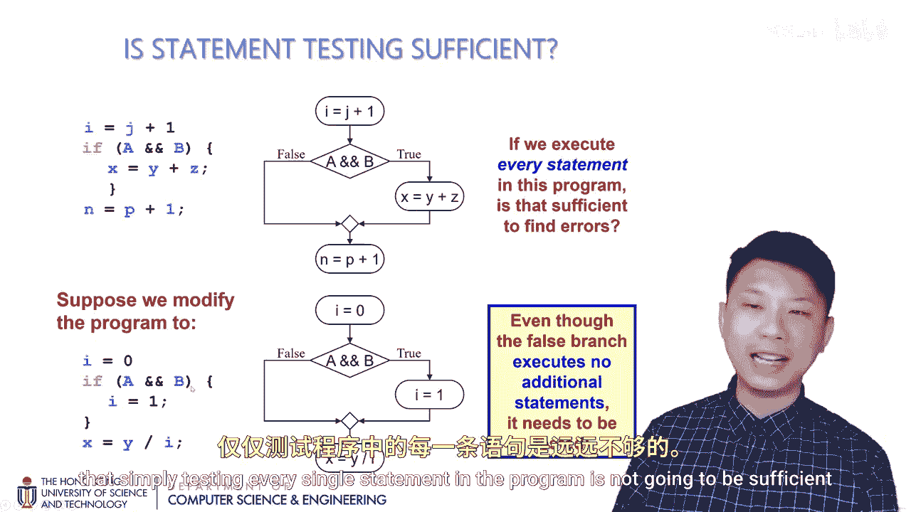