# 香港科技大学【中英⚡软件工程｜Software Engineering Specialization】 p36 P36 02_黑盒测试 -BV1MMEjzoEhg_p36-

And the next topic that we're going to cover is black box testing。

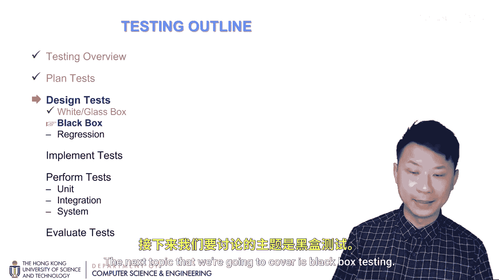

So for black box testing we don't have the source scope of the system and we only have the executables of the system so what we're going to do is that we're going to feed some inputs into the executable and then generate some output and then double check whether the output is going to be the same as the expected output。

And we call it black box testing because we cannot see the source code and the source code is put inside a black box。

So BlackBss tests attempt to find incorrect or missing functions on a system or interface incompatibility errors or data structure or external database SS errors or performance errors or initialization and termination errors。

So to achieve reasonable testing， a black box test case should cover a range of input or output valid。

And to achieve reasonable testing， a black boss test case should cover a range of input or output values。

 not just one single value。 That is， it should tell us something about the press or absence of a class of errors instead of just one single error。

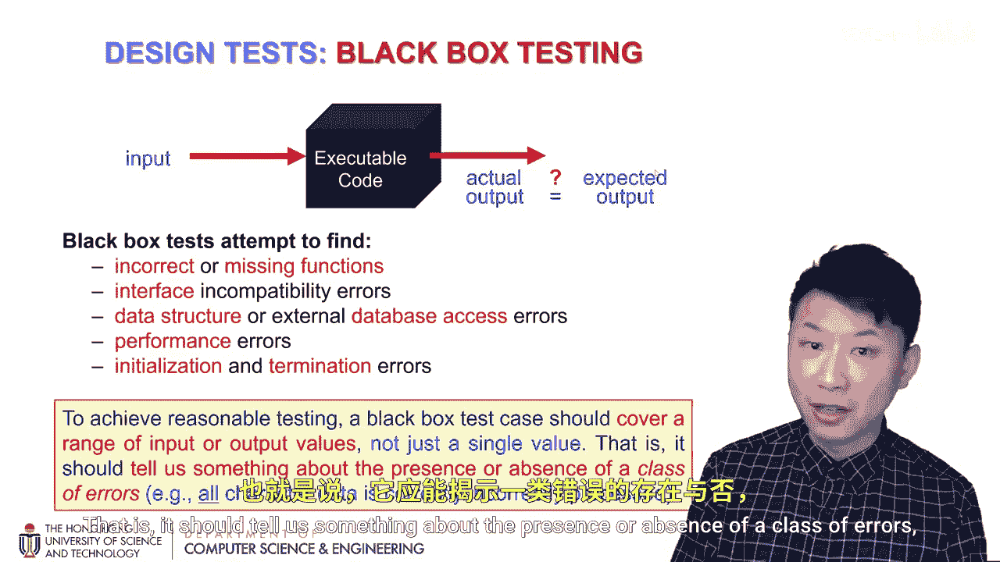

And here we focus on equivalent partitioning， which focus on creating subdomains by grouping inputs and outputs by type to create test coverage of a class of eras。

So we try to divide the input or output data of a component into partitions of equivalent data。

And then the equivalent partitions are usually derived from the requirements specification。

And then we try to come up with test cases that are decided to cover each equivalent partition at least once。

And the heuristic that we're going to use here is to try to partition all the inputs into different sub domainomains。

Based on valid and invalid inputs or outputs。And then when we perform testing。

 we have to select typical values inside each subdoma。

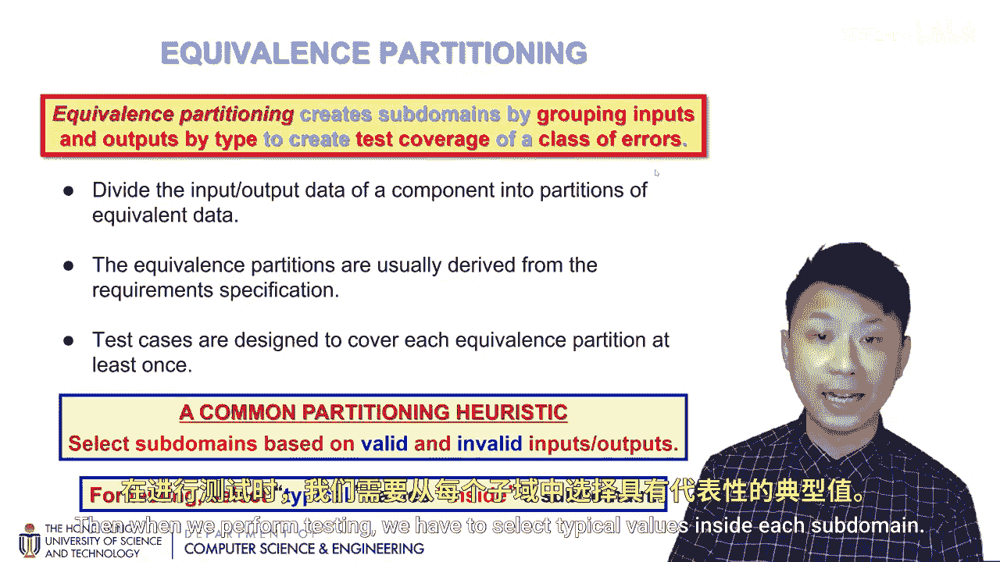

So let's say if the input is a range， for example， the range of student ID that we can use is going to be starting from 0 up to 9999。

Then the valid range is going to be C row up to 99，99。

And then the invalid range is going to be something less than 0， maybe negative numbers。

 and something greater than 99，99， maybe 10000。And if the input is a specific value。

 then you're going to get one valid and two invalid sub domainomains。For example。

 the valid value is going to be 100 then。The only valid value that we have is going to be 100 and then anything smaller than 100 or anything bigger than 100。

 they are within the invalid sub domainomas。And then if the input is a set of related values。

 then we have one valid and one invalid subdomain。For example。

 if you are talking about days of the week。Then Monday， Tuesday， Wednesday， Thursday， etc cetera。

 et cetera。 they are members of the Vi subdomain。And then anything outside Monday up to Sunday。

They are invited member。And anything outside Monday up to Sunday， they are members of the invited So。

And then if the input is boolean， then you have one validolet and one invalid sub domainomain。 Okay。

 so the valid sub domainomain is going to be true or false。And anything other than true of us。

 they will be members of the invited of Domin。

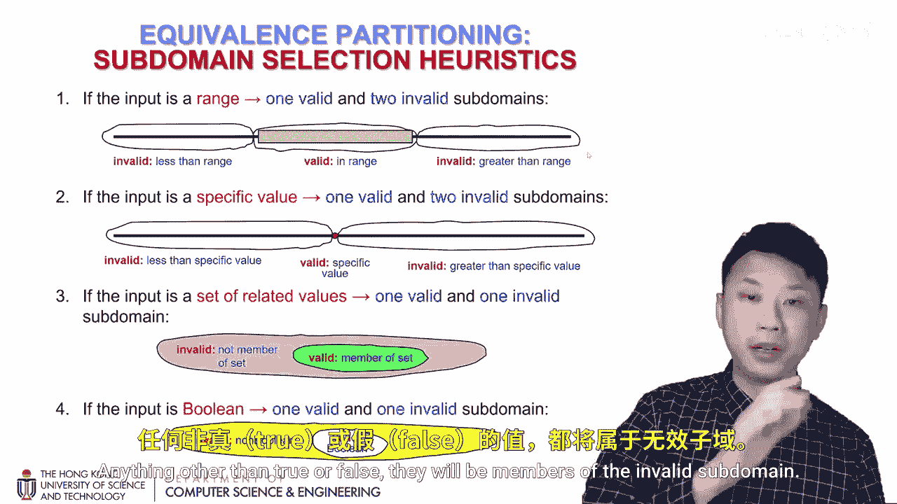

Apart from testing the valid and invalid sub domainomains。

 we should also test out the boundary situations when we perform black box testing， why。

 because the boundary cases， those are the locations that you can easily make mistakes so that's why we focus on those places when we perform testing。

So that's why here I say there are more errors occur at the boundaries of a subdoing than in the center。

 so that's why we focus on testing the boundaries。And these are the reasons for boundary testing。

 you may get off by one kind of box or forget to handle empty container or empty object。

Or overflow errors in arithmetic。Or program does not handle aliasing of objects， et cetera， et cea。

And the small subdomomas at the boundaries of domain main subdomomas have a high probability of finding this kind of errorss。

So that's why instead of simply testing something from the main subdomain。

 we should also test out the boundary cases。

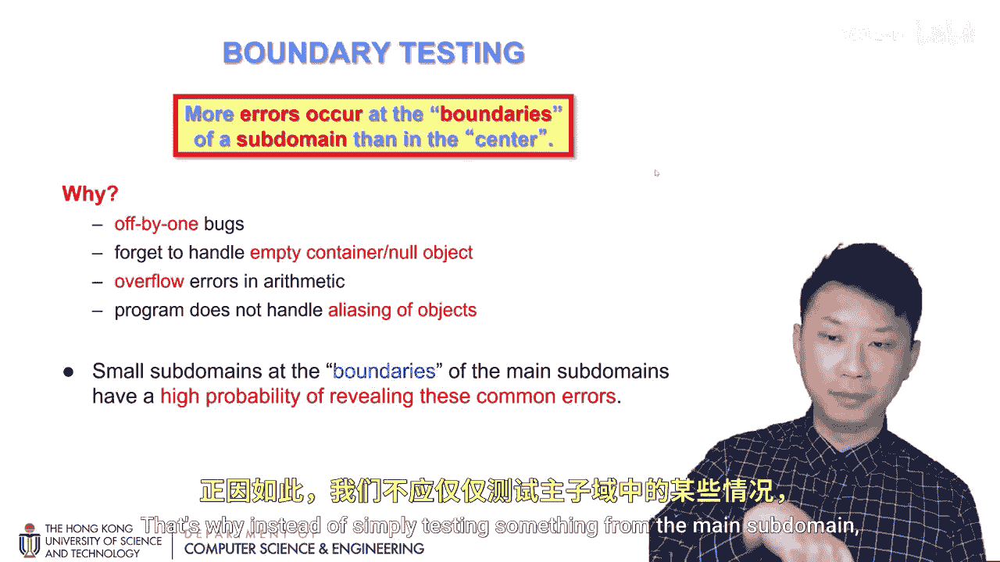

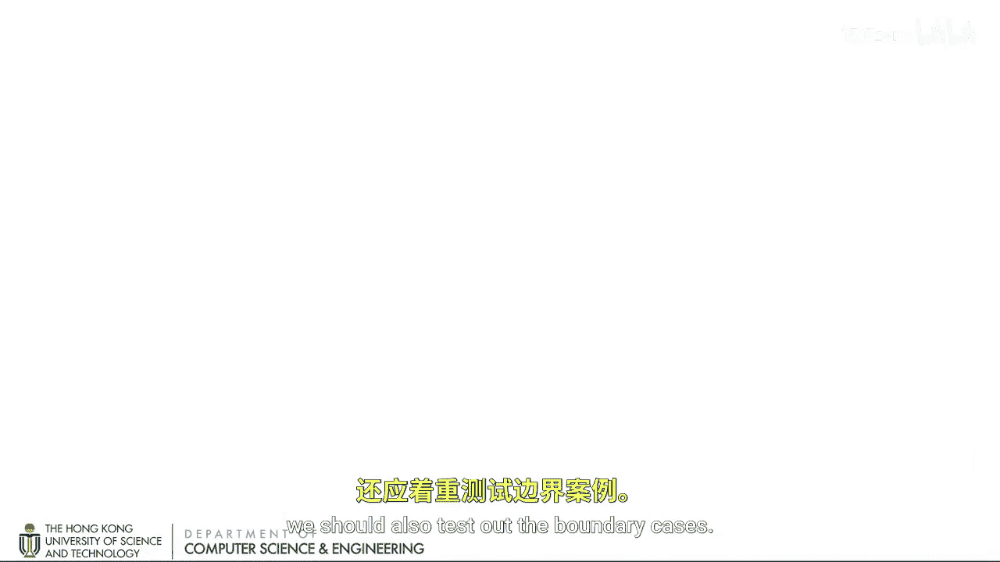

And for testing， we have to select values at the boundaries of the main subomy。

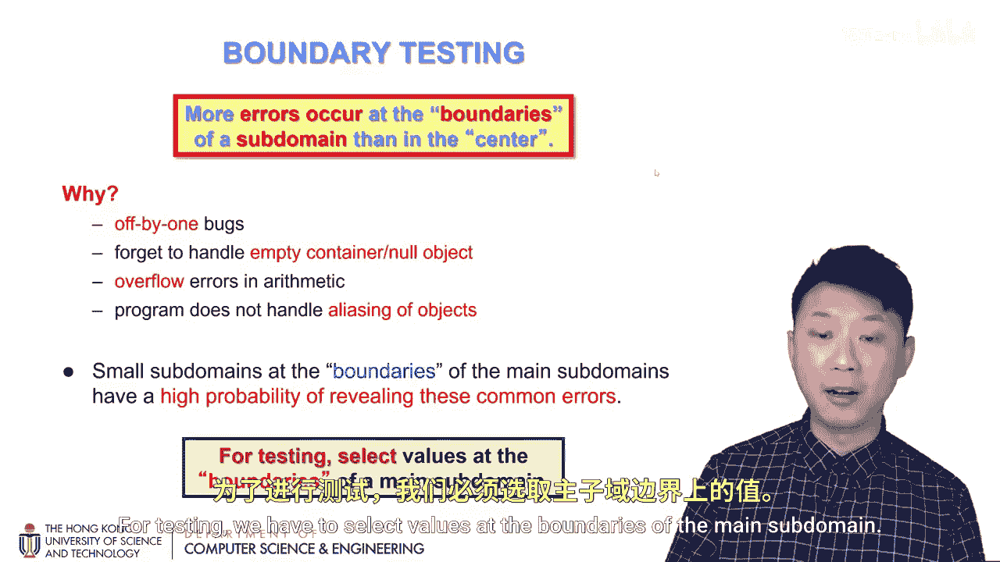

For example， this function that we can use for getting absolute value。

The boundary situation is gonna be 0。Then apart from testing zero。

 we should also consider the cases next to the boundary。So apart from testing zero。

Which is the boundary condition。We should also test out those numbers that are next to 0。

 for example，-1 and one。And those are the boundary cases that we need to consider when we perform boundary testing。

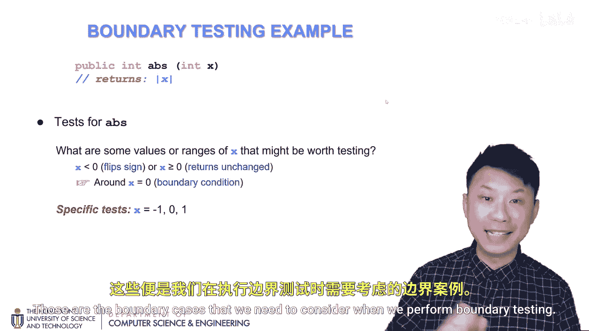

So if its a range of value， for example， student I D should be from 0 up to 9，9，9，9。

Then for the lower bound， we should try it out， for example， negative 1，0 and 1。For the upper bound。

 then we should try it out 9998，9999， and then 10，000。If it's a set of discrete values。

 then we should test the minimum value and also the maximum value and also those values that are next to the maximum and minimum。

 And if the input is a set of values， right， then try to test all the values in the set， if possible。

 For example， if you simply have a small set of inputs， let's say days of the week。

It's going to be just Monday， Tuesday， Wednesday up to Sunday。

 then you should try out all the possible inputs because you only have a small set of inputs。

But if the set of inputs that you get is large， then you may simply try it out some of the valid inputs。

And also one value outside the set， for example， value， which is not day of the week。

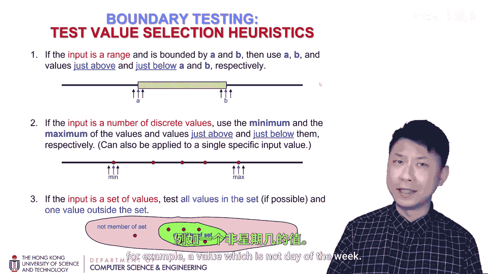

And then if it's brilliantian， then we should try out the poyan values。

 two or false and also one long boyan value。And you should also apply the guidelines that we have covered before to create output values at the minimum and also maximum expected values。

And if a data structure have boundaries， for example。

 if you have an array with bangs from one up to 10。

 then you should test out the array index at012 and also 9，1011。So we focus on the minimum in。

So we focus on the minimum index and also the maximum index and also those indexes beside the maximum and minimum。

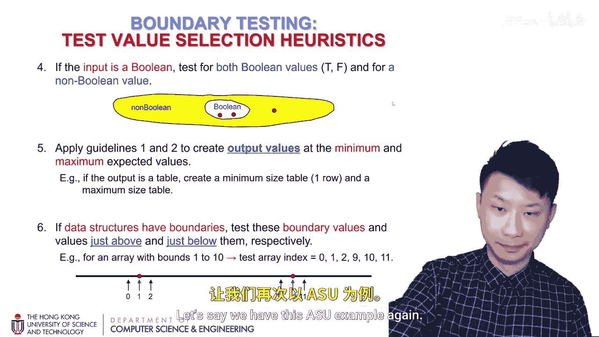

And let's say we have this ASU example again， and this is the system that students can use to register for causes。

And then one possible input is going to be the student IDd。

 and we know that the range or divided range of student ID is going to be。

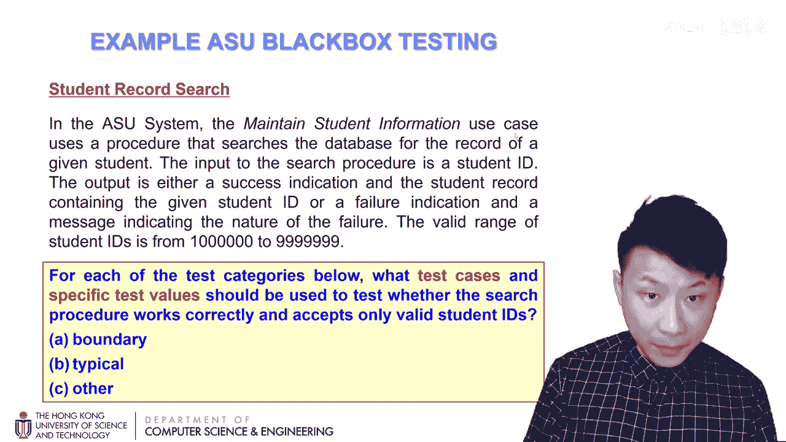

And let's say we know that the valid range of student ID is going to be 1 million up to 9999999。

Then how can we come up with the test cases according to these different situations。

 the boundary situations， typical situation， and any special cases？So for the boundary situation。

 we should try out the minimum value and also the maximum value and also those values next to the minimum and maximum。

For typical values， we may test out for example， 5000000。

 which is ava student ID and the student record exists within the databases。

And we may also try it out 5 million M1， which is a rather student ID。

 but the student record does not exist within the databases。And then something below the range。

 for example， 500，000。And something above the range， for example，50 million。

And you should also handle the special situation where students they may enter non numerical values。

 for example， 5647 ABC。And you should test out this special value and see what's going to happen on the system。

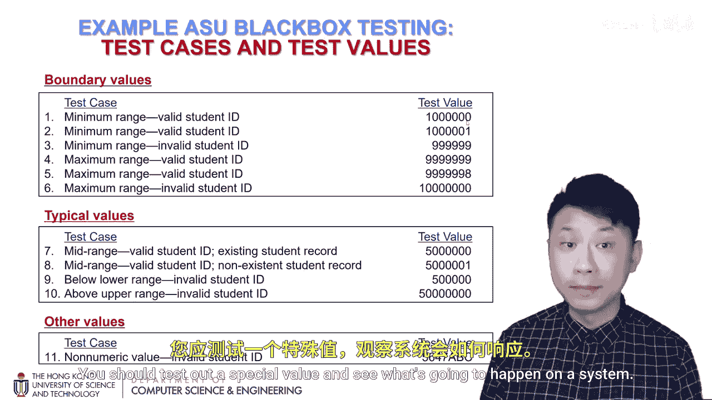

And then for each test case， you have to come up with a name with a setup and the test value and then how to verify whether you have passed the test case or not。

And you have to do it for all the inputs that you have prepared for Black box testing。

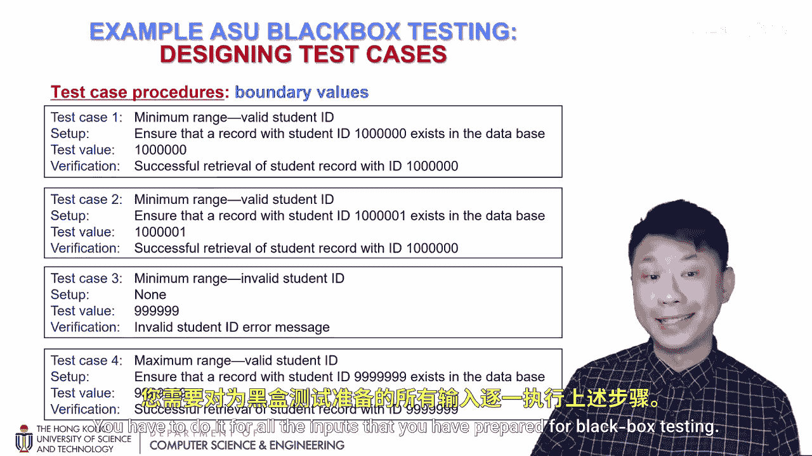

And we may also perform threat testing in black box testing。

Fret testing is an event based approach which tests are based on events which trigger system actions and is particularly important for object oriented system because for O system。

 we may have one object which call another object to do something for that object。

And is used after classes have been unit tested and integrated in the subsystems。

But it may not be always possible to complete threat testing because there are usually too many inputs or output combinations。

Therefore， we only focus on the most common executed friends。

And you can extract all those important threads from the basic flow of events within your use case specifications。

 and this is an example of f testing。 So let's say within your system。

 object number one is student and then object number two is cause and object number five is a university then student object number one may call object number two。

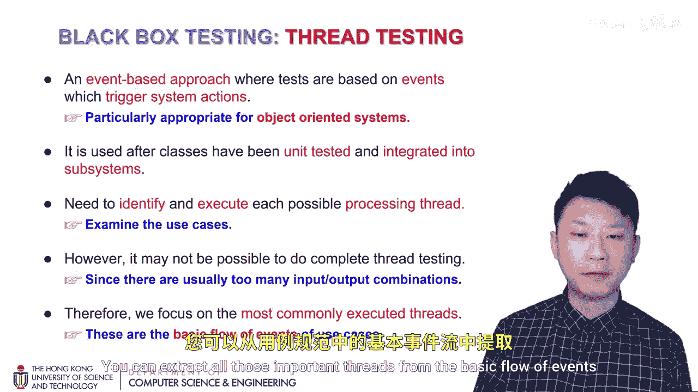

Because object number one want to enroll into a particular cause within a particular university。

 then object number two may have to call object number five to do something。

So this is one thing that we have to test when we perform ft testing。

So you may want to test the f from object number one to object number 2 and into object number 5。

And the types of ft test may include， for example， a single ft。

 let's say from object  three to object 2 to object 4。Or multiple thread。

 let's say object 1 to object 2 and then to object 4 and 5。Or a multiple input thread， for example。

 we have multiple things being input to optimalable one。

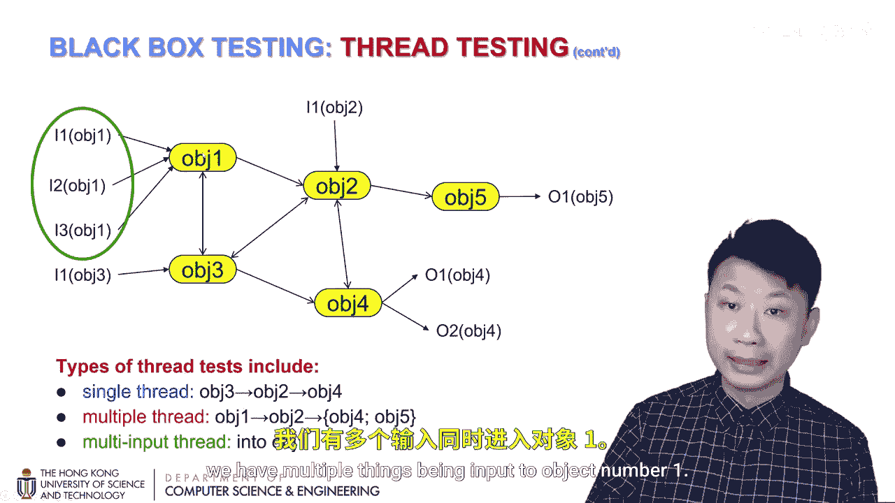

And we may also focus on state based testing。And we may also focus on state based testing when we perform blackB testing。

 because some programs they can be in many different states simultaneously， for example。

 when you use Microsoft Paye。You may put the brush into different colors。

Then when we perform testing， we should put the brush into different states。

 that means we should put the brush into different colors before we perform testing before we draw something on the whiteboard。

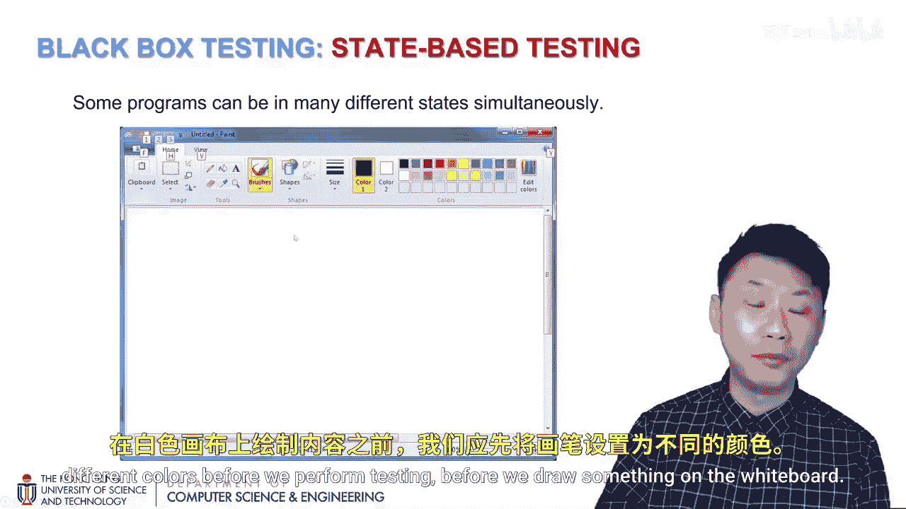

So notice that state based testing focuses on comparing the resulting state of a class with the expected date。

And all the stay of a particular object that we have within the system can be derived using Stay machine diagram and we will talk about how to draw stay machine diagram in one of the upcoming lectures。

Then we should derive a representative set of simile for each transition。

And then check the attributes or length of the class after applying a stimuli to determine if the specific stay has been reached。

So we can determine the state of an object based on the attributes or based on the links to other classes。

So for example， we can determine whether a class is full or not based on the attribute。

 the class size， so let's say if the class size is 50， then we know that the class is already full。

 then fo is a state is's a possible state of the object class。

And then we can also use length of the class to determine the state of an object。

 Let's say we have a set of movies。 And if a movie is linked with a particular customer with in the system then。

Then we know that that movie has been， for example。

 rented by some customer then is no longer available。

 Then we can double check whether the movie is available or not the stage of the movie based on the link from the movie to the customer。

So we have to put the class into the desired state using etils or using lengths before we apply the stimulile。

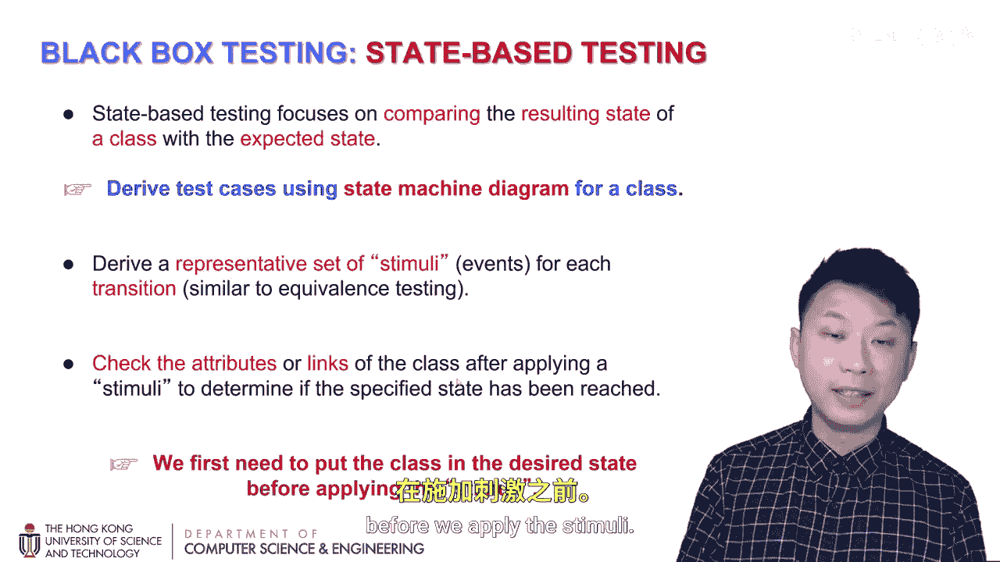