# 香港科技大学【中英⚡软件工程｜Software Engineering Specialization】 p37 P37 03_回归测试 -BV1MMEjzoEhg_p37-

And the last type of test that I want to cover in this course is regression test。

And we have already covered what is regressioncur test when we talk about de bucking。

So when we talk about de bucking， we have said that whenever we find a bug。

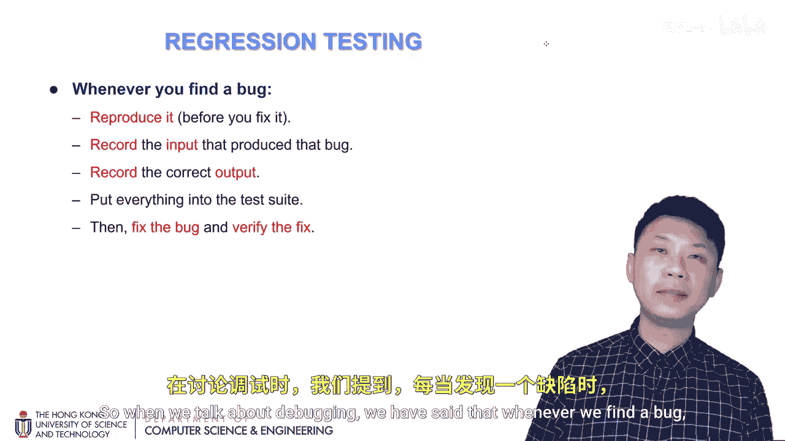

We should keep all the inputs that we can use to reproduce the bug。

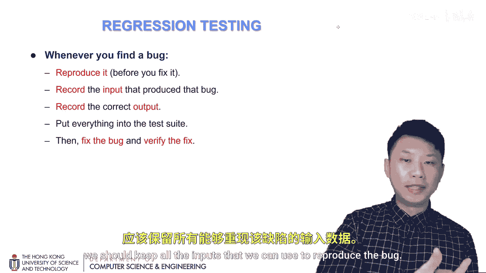

So whenever you find a bug， right， you should somehow reproduce the bug and then keep the input that you can use to reproduce the bug。

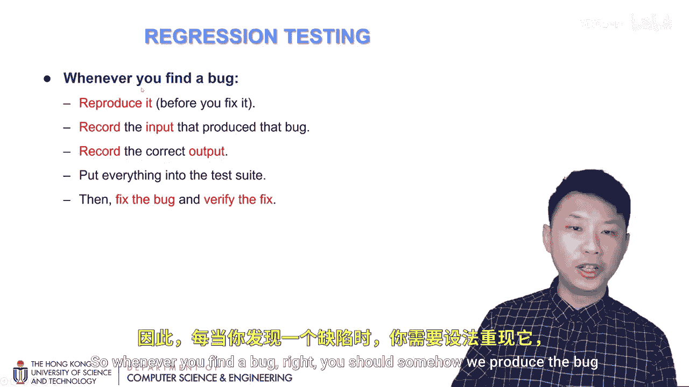

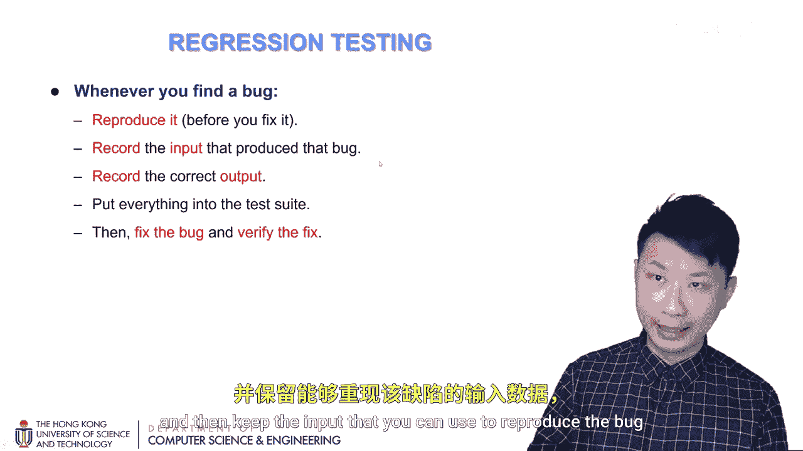

And then also keep the correct output。And then you should put everything into test casessis。

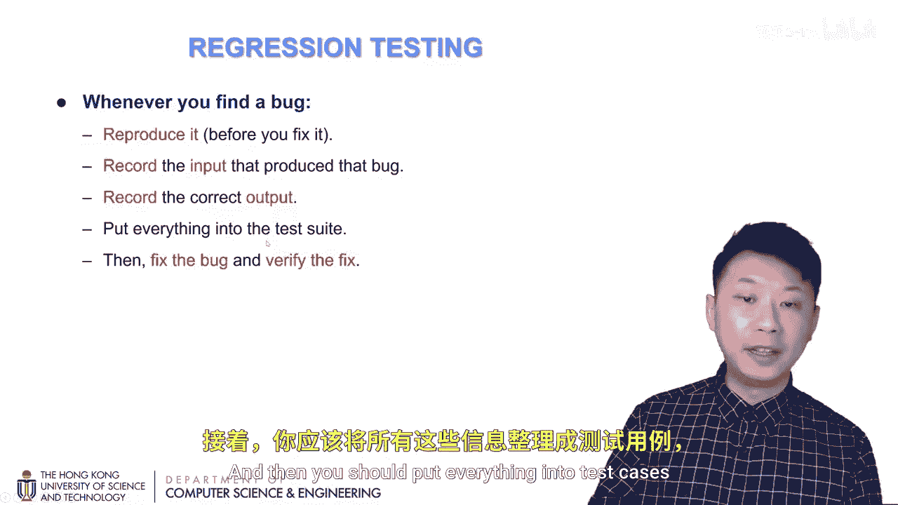

And then fixed it bug and then verify the fake。

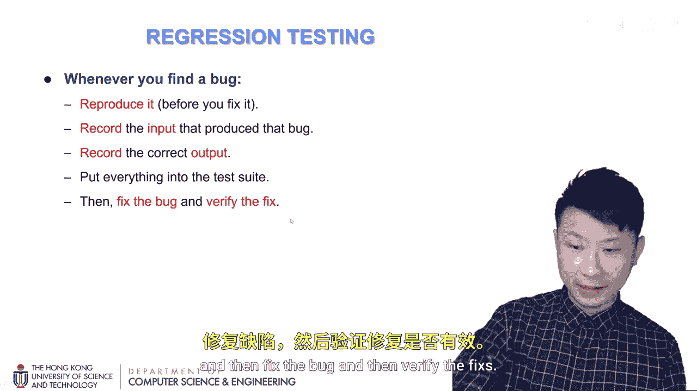

So why is it a good idea， we have already talked about it because once you make a mistake。

 it's possible that you make the same mistake again in the future。

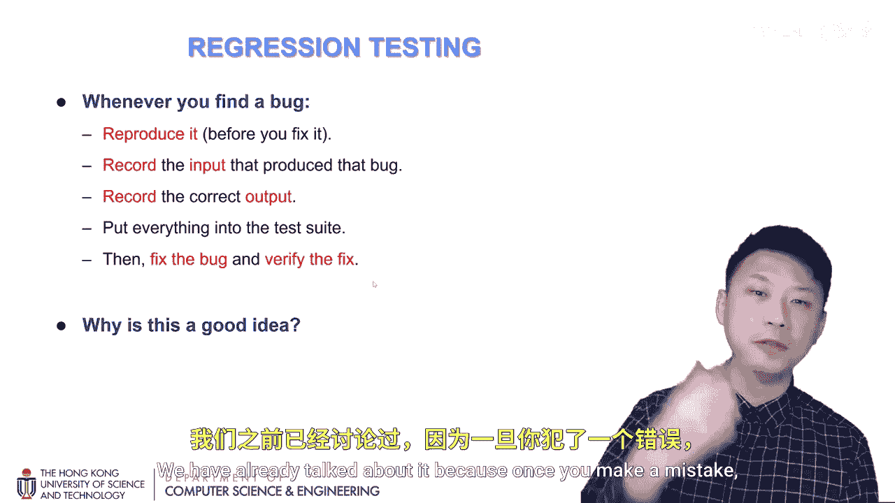

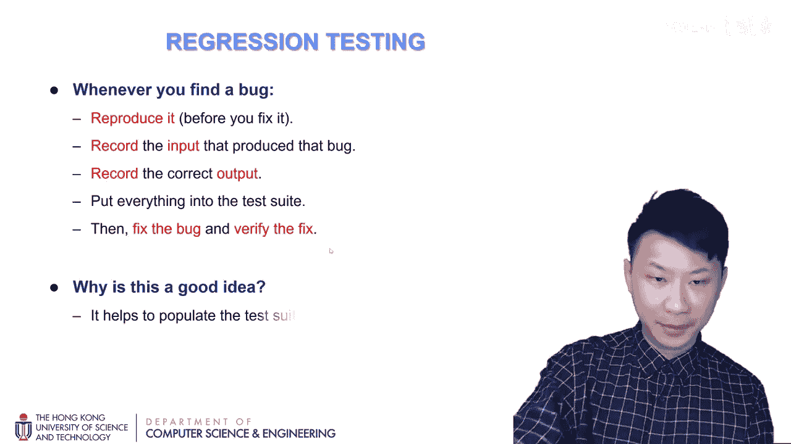

And it's a good idea to perform regression testing because it's helps to populate a set of good tasks。

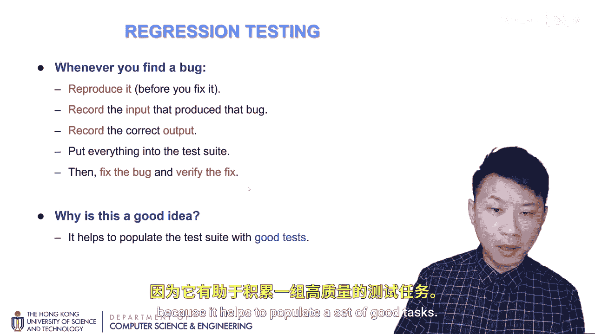

And it also protect against changes that may somehow reintroduce the bug。

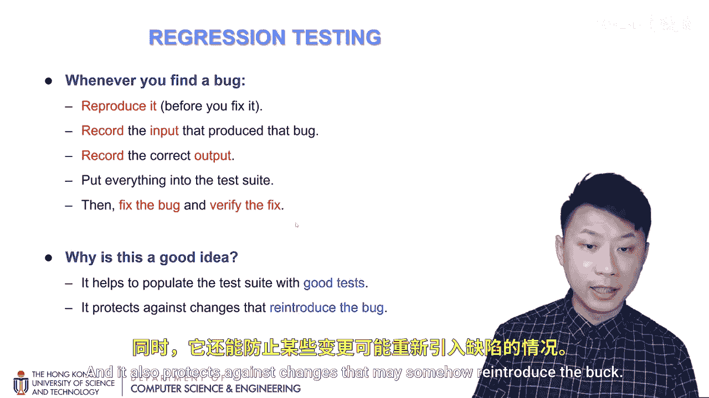

And the major reason that we want to perform request testing is that if a bug happened once。

 it may happen again in the future。

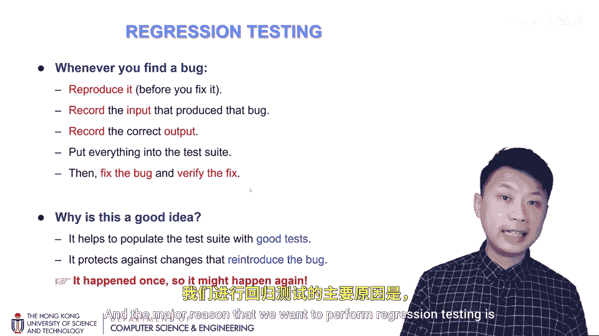

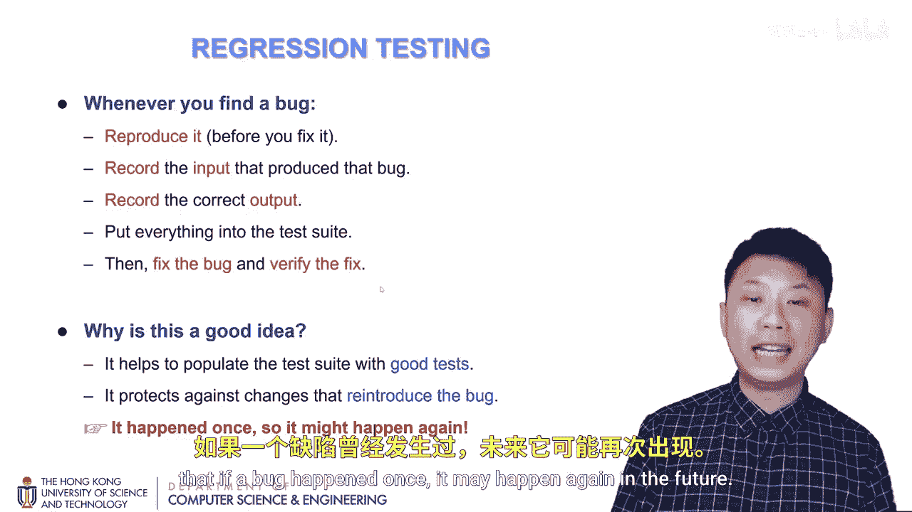

And by performing regression testing， we can always double check whether we have introduced the same bug again in the future。

 And that's what I want to cover in this lecture。

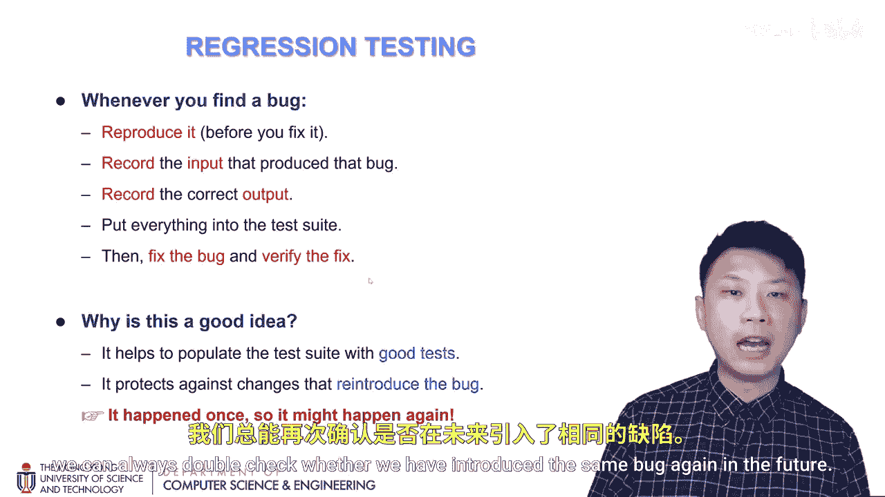

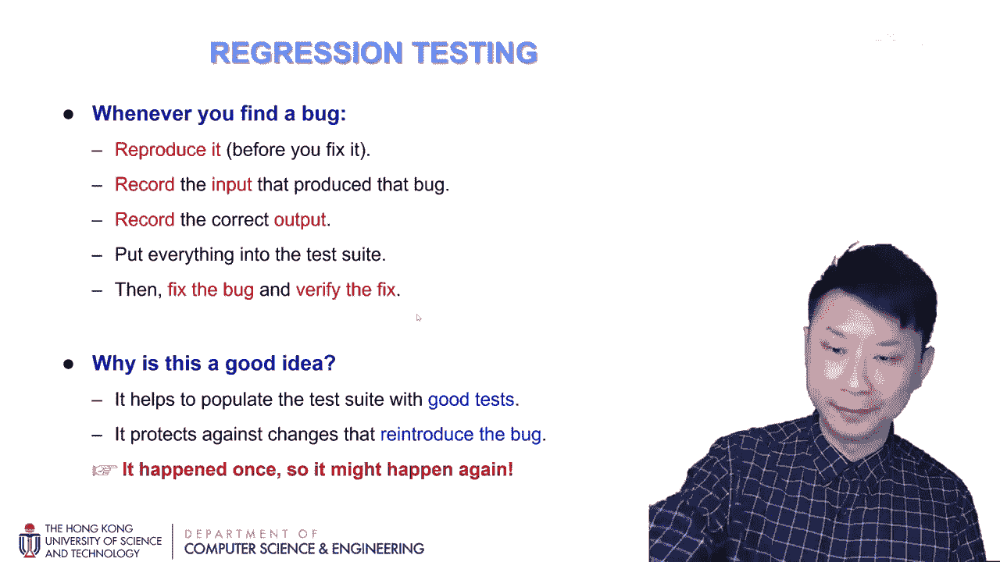