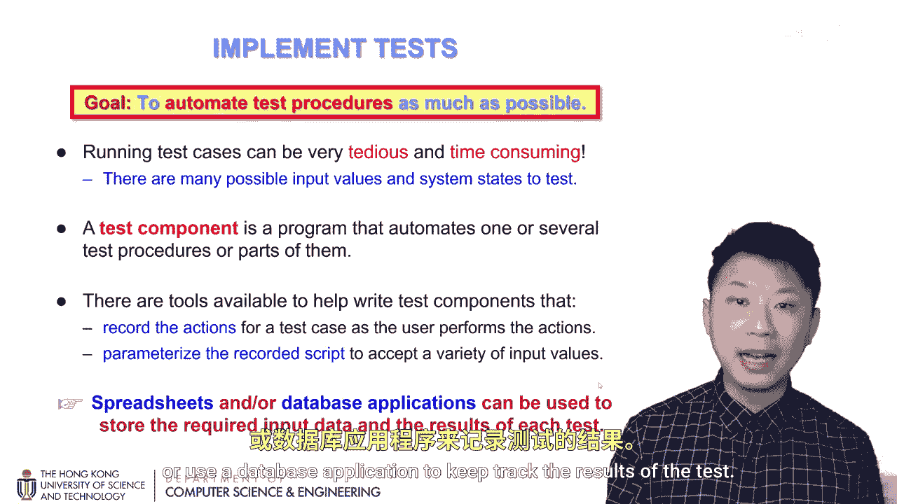
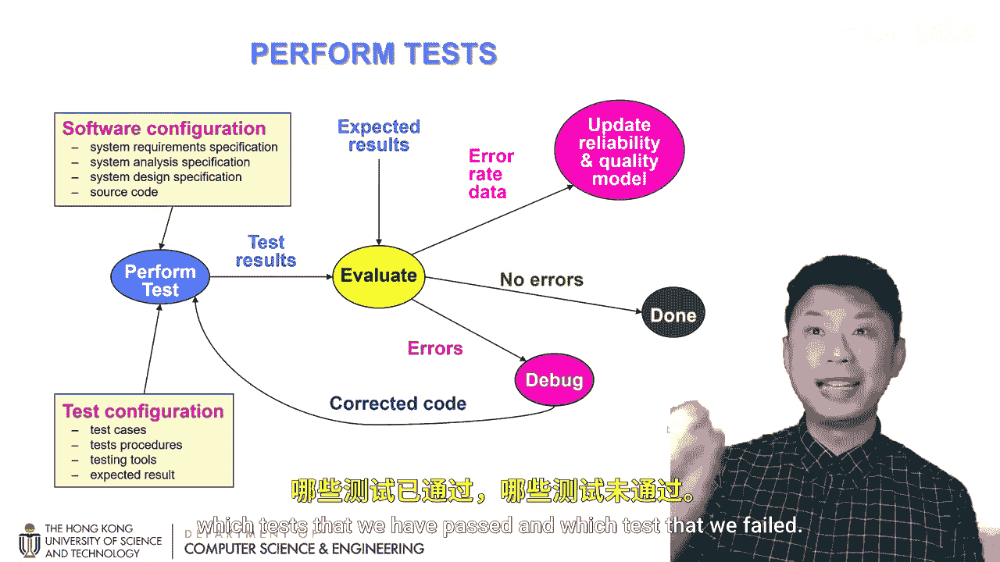
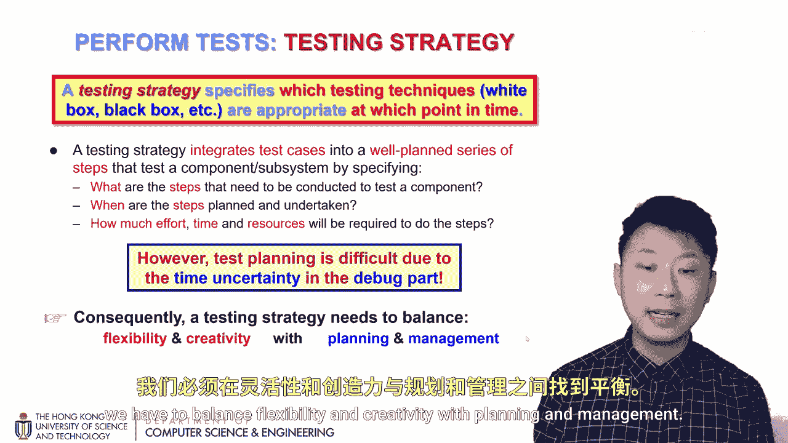
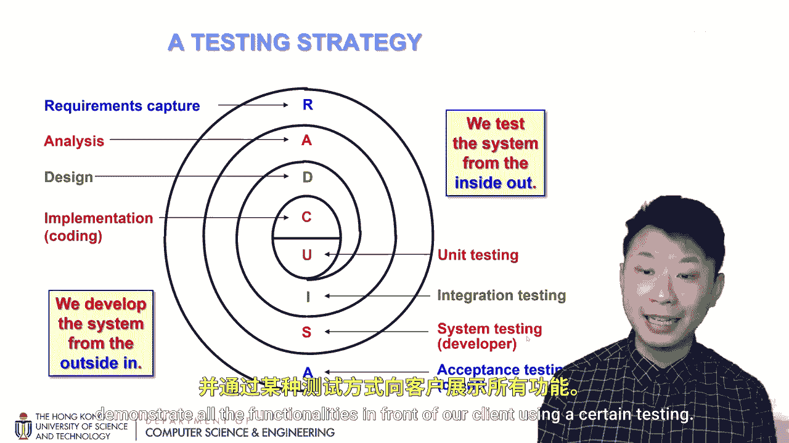
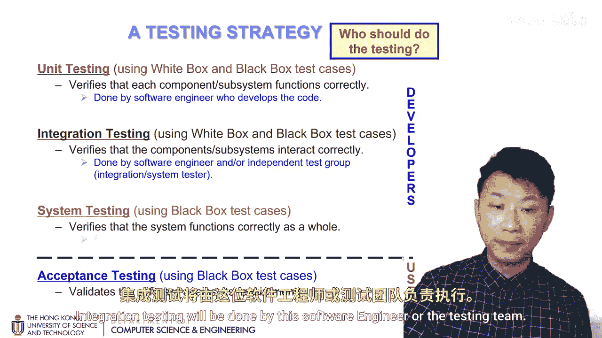

# 香港科技大学【中英⚡软件工程｜Software Engineering Specialization】 p38 P38 01_执行测试 -BV1MMEjzoEhg_p38-

Hi， this is the last lecture about testing。And these are the topics that we will cover in this lecture first we will talk about how to implement tests。

 then we will talk about how to perform different types of tests， for example unit testing。

 integration testing and system testing then finally we will talk about how to evaluate test。

So when we implement test， we want to automate the test procedures as much as possible。

Just because running test cases can be very tedious and time consuming because there may be many possible input values and also many system states that we have to consider when we perform testing。

And a test component is a program that automates one or several test procedures or parts of them that means it's going to be another program that we can use to perform the test cases。

So that's like an another program that we can use to run other the test cases。

And there are many tools available to help us write test components that record the action for a task case as the user performs the actions and also parameterized to record a script to accept a variety of input values and spreadsheets and also database applications can be used to store the required input data and also the results of each task so after we run all the tasks some of the tasks they may pass and some the tests they may file so we need to use a spreadsheet or use a database application to keep track the results of the task and now we talk about how to perform task so to perform task we have to first set up the system according to some software configuration and also some test configuration and we feed the input into the system then we get some results then we'll evaluate and compare the results against the expected results。

And if the results are the same， then there is no error and we are done。

 but if the results they are not the same， then we know that there must be some errors and we have to debug the system。

 and after debugging， we have to perform the same test again and then evaluate the result again and then finally we need to use some spreadsheet or a database application to keep track the error rate data that means some of the test they may pass and some of test they may file then we need to use an Excel file or a database application to keep track which test that we have passed and which test that we file and in the last and in the last lecture。

 we have talked about different types of test that we can perform on a software system， for example。

 black box testing， white box testing and also regression testing and a testing strategy is going to specify which testing techniques。

 for example， white box black box or regression testing are appropriate at which point of time and we have to specify the。

Followings when we specify the testing strategy So we have to specify exactly what are the steps that need to be conducted to test a component that means we have to specify exactly what we have to do in order to test a particular component within the software system。

And also when are the steps planneded and also undertaken and how much time。

 effort and resources will be required to do the steps but we say that test planning that means coming up with all the testing strategy is going to be difficult because of the time uncertainty in the debu part we don't know exactly how much time that we need for debuing and usually we perform testing after implementation before the deadline。

 so that means we have limited time for testing So given limited time we have to balance flexibility and creativity with planning and management So that's why we say here that testing often occurs when deadline pressures are more because we perform testing before we release the product and we should make progress measurable and when we have problems then we should identify them as soon as possible So when we develop a system we do it outside in so what do we mean by outside in means that we gonna first perform。

Requirements capture， then do analysis and design， and then finally implement the system。

But when we perform testing we do it inside out so we first start with unit testing that means we focus on the source code。

 then we integrate all the classes together and then perform integration testing and then once we have the entire system we perform system testing。

And then finally we perform accepted tasks and demonstrate all the functionalities in front of our client using acceptance testing。

 so when we perform unit testing， we focus on the source code of the system。

 so we need to see the source code so most of the test cases they will be white box test cases。

Together with some black box test cases。Then when we perform integration testing。

 we use a combination of white box and black box test cases。But when we perform system testing。

 we focus on the entire system without seeing the source scope， so most of test cases。

 they are black box test cases。And then finally， when we perform S tasks。

We are talking about black box testing again， we try to demonstrate something in front of the client。

 but not the Sosco， so that means we're going to use black box test cases。

So who should be doing the testing so for unit testing。

 integration testing and system testing they will be performed by the developers but for accept testing we do it in front of the client so it will be done by the users so that's why we say unit testing is going to be done by the software engineer integration testing will be done by the software engineer or the testing team and then a system testing will be done by the testing team and then finally as test we do it in front of the client that means the users or the client they will try it out the system。

