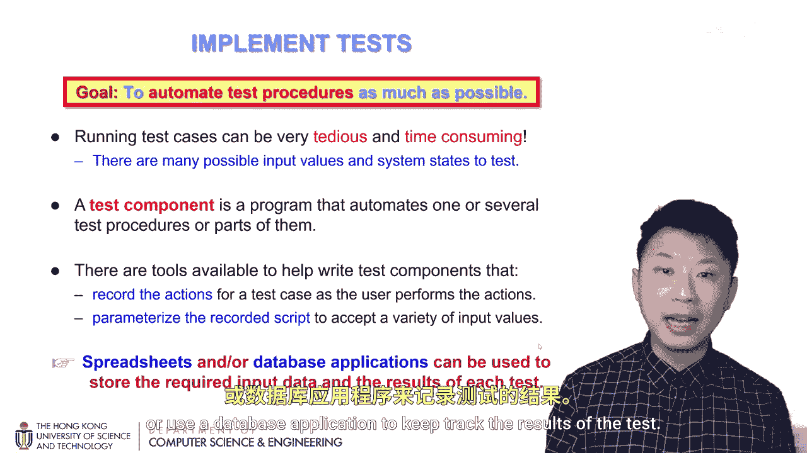
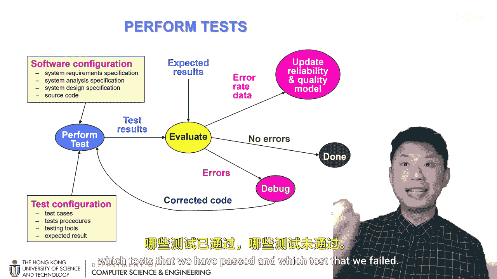
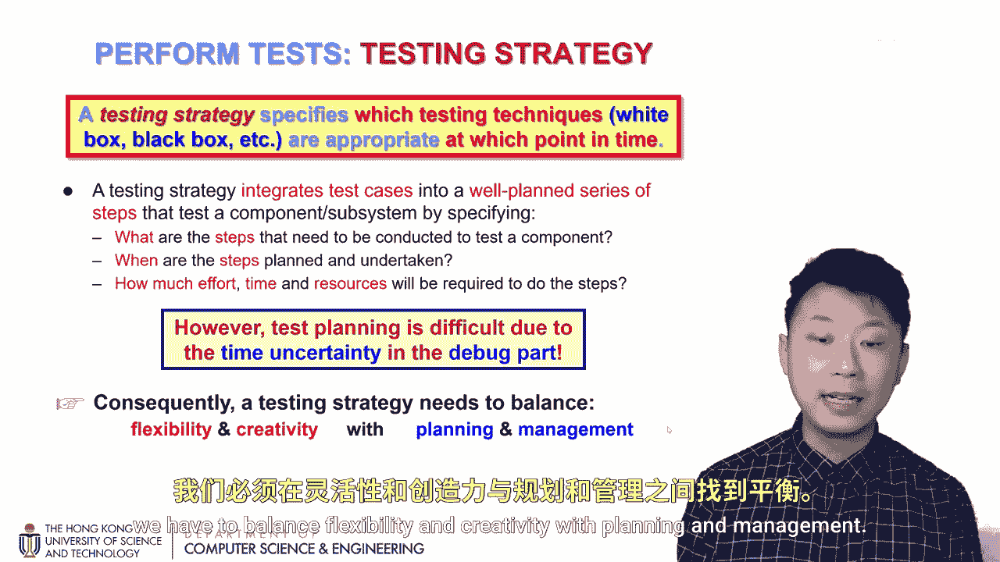
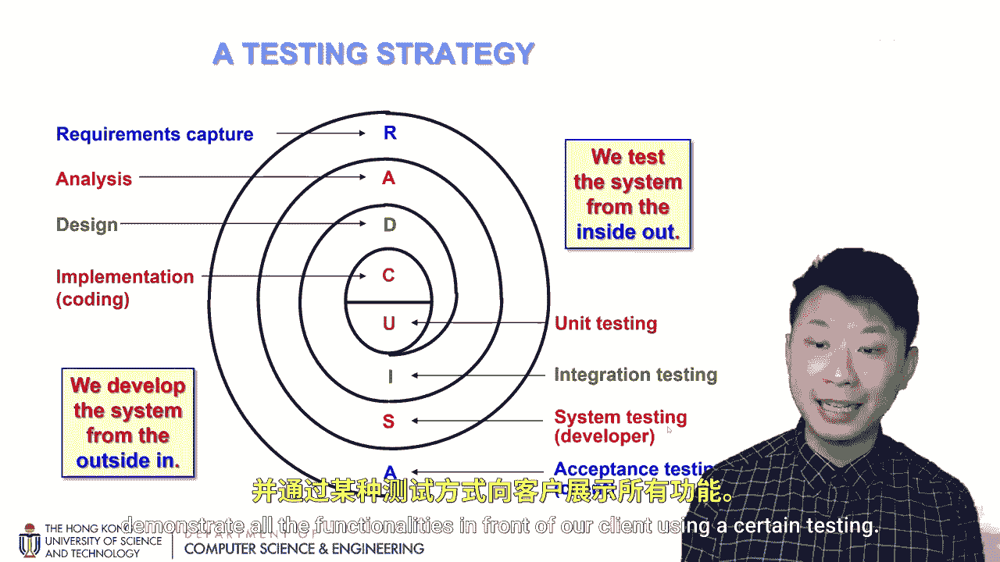
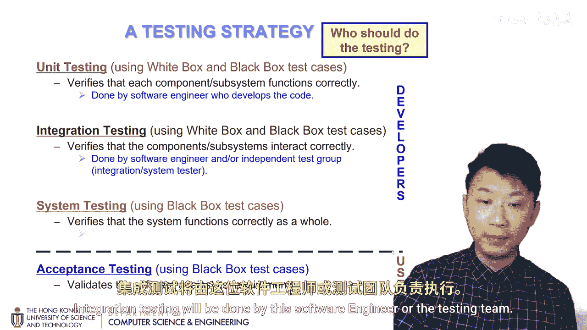

# 软件工程：P38：执行测试 🧪

在本节课中，我们将学习如何执行软件测试。我们将涵盖测试的实现、不同类型测试（如单元测试、集成测试和系统测试）的执行方法，以及如何评估测试结果。

## 实现测试

上一节我们介绍了测试的基本概念，本节中我们来看看如何实现测试。我们希望尽可能自动化测试过程，因为运行测试用例可能非常繁琐且耗时。这主要是由于需要考虑大量可能的输入值和系统状态。

测试组件是一个程序，它自动化一个或多个测试过程或其部分。这意味着我们可以使用另一个程序来执行测试用例。

以下是可用于帮助我们编写测试组件的工具：
*   记录用户执行操作时测试用例动作的工具。
*   参数化脚本，可接受各种输入值。
*   电子表格和数据库应用程序，用于存储所需的输入数据以及每个测试的结果。

## 执行测试

了解了如何实现测试后，现在我们来探讨如何执行测试。执行测试时，我们必须首先根据特定的软件配置和测试配置来设置系统，然后向系统输入数据，获取结果，最后评估并将结果与预期结果进行比较。

如果结果相同，则没有错误，测试完成。如果结果不同，则表明存在错误，我们必须调试系统。调试后，需要再次执行相同的测试并重新评估结果。最后，我们需要使用电子表格或数据库应用程序来跟踪错误率数据，即记录哪些测试通过，哪些测试失败。

## 测试策略

在上一讲中，我们讨论了可以在软件系统上执行的不同类型的测试，例如黑盒测试、白盒测试和回归测试。测试策略将指定在哪个时间点采用哪种测试技术（例如白盒、黑盒或回归测试）。

在制定测试策略时，我们必须明确以下内容：

以下是制定测试策略时需要明确的事项：
*   测试组件所需执行的确切步骤。
*   计划并执行这些步骤的时间点。
*   执行这些步骤所需的时间、精力和资源。

测试计划（即制定所有测试策略）之所以困难，是因为调试部分存在时间不确定性。我们通常不知道调试需要多少时间。测试通常在实现之后、截止日期之前进行，这意味着测试时间有限。因此，在有限的时间内，我们必须在灵活性与计划管理之间取得平衡。测试常常在截止日期压力较大时进行，因为我们在发布产品前进行测试。我们应该使进度可衡量，并在出现问题时尽快识别。

## 测试层次：由内而外

当我们开发系统时，我们采用由外而内的方法。这意味着我们先进行需求捕获，然后进行分析和设计，最后实现系统。

但是，当我们执行测试时，我们采用由内而外的方法。我们首先从单元测试开始，即专注于源代码。然后，我们将所有类集成在一起，进行集成测试。一旦我们拥有了整个系统，就进行系统测试。最后，我们进行验收测试，在客户面前演示所有功能。

以下是各测试层次的特点：
*   **单元测试**：专注于系统源代码，因此大多数测试用例将是白盒测试用例，辅以一些黑盒测试用例。
*   **集成测试**：使用白盒和黑盒测试用例的组合。
*   **系统测试**：专注于整个系统而不查看源代码，因此大多数测试用例是黑盒测试用例。
*   **验收测试**：再次涉及黑盒测试，我们尝试在客户面前演示功能，但不涉及源代码，因此将使用黑盒测试用例。

## 测试执行者

那么，应该由谁来执行测试呢？对于单元测试、集成测试和系统测试，将由开发人员执行。但对于验收测试，我们在客户面前进行，因此将由用户执行。

以下是不同测试的执行者：
*   **单元测试**：由软件工程师执行。
*   **集成测试**：由软件工程师或测试团队执行。
*   **系统测试**：由测试团队执行。
*   **验收测试**：由用户或客户尝试使用系统。

## 总结

本节课中，我们一起学习了如何执行软件测试。我们探讨了测试的自动化实现，详细说明了单元测试、集成测试、系统测试和验收测试的执行流程与策略，并明确了不同测试类型的执行者和侧重点。理解这些内容有助于我们更系统、高效地规划和执行测试活动。