# 香港科技大学【中英⚡软件工程｜Software Engineering Specialization】 p39 P39 02_单元集成系统测试 -BV1MMEjzoEhg_p39-

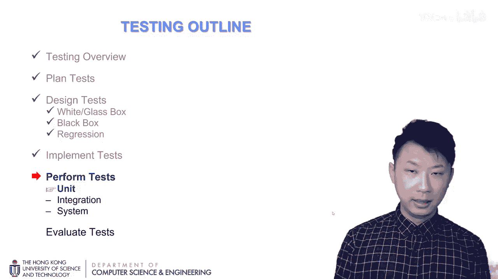

So now we start so now let's start with unit testing so when we perform unit testing we have a component to be tested usually a class or a part of the program then we have many inputs that we want to feed into the component that we want test and the types of test cases can be related to interface。

 independent paths， boundary conditions， local data structures or era handling paths etc etc and we emphasize on white box testing techniques because now we are talking about source code。

But notice that when we are testing a class or part of the system。

 the other parts of the system may not be ready yet。

 so how can we perform testing with the rest of the system So when we perform testing we need something called driver and stops in order to complete testing。

😡，So driver is going to help us feed the input that we want to use for testing and then feed it into the function that we want to test within this component to be tested。

 For example， if I have a function to get absolute value in this component。

 then this driver is going to help me feed the input into the function and then double check whether the output is going to be correct or not。

So this is what we mean by the driver and notice that this class or component to be tested may be calling some other classes to do something for this class。

But notice that the other classes they may not be ready yet。

 so how do we perform testing when the other classes they are not ready yet？

So that's why we need stops。 and they are components called by the component to be tested。

So this component may be calling another class to do something， for example。

 this component is calling another class to get some student information then instead of calling the actual class that is going to give me the student information I need some dumby class to complete the test and this dumby class may always just return the same student information to this component so that I can complete the test even with the student class so that's why I say a stop is simply a dummy class that is going to return some necessary information for the component to complete the test So in object oriented testing。

 what should we unit test so a unit test has to be at least a class so we have to test every class that we have within the software system。

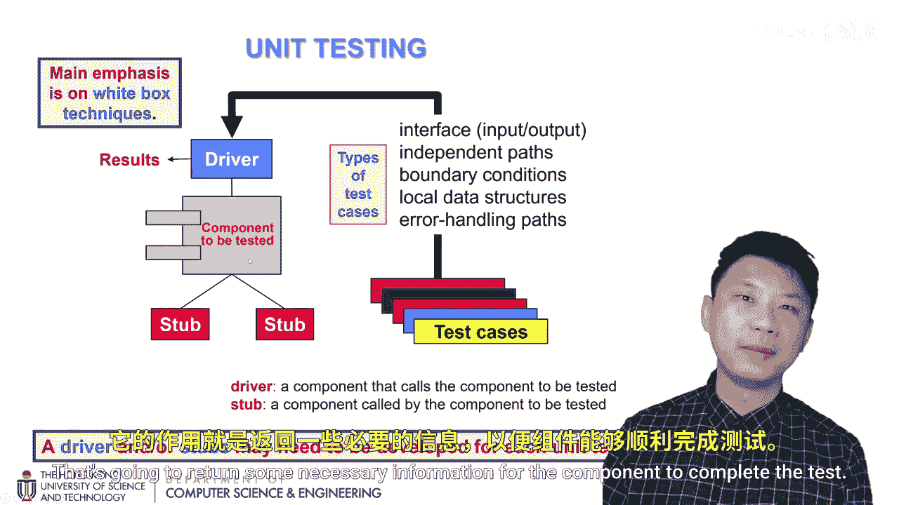

But somehow you know that for an object that we have within the system we can put it into different states just because right an object may have multiple states。

 then it's going to make testing difficult So this is what we have talked about in the last lecture。

 somehow you have to put every class into every single possible state before we perform testing。

Then how to deal with inheritance and polymorphism。

 that means when we have superclass and subclasses。

Then let's say if a subclass overrdes methods of an already tested superclass。

 then what needs to be tested。Should we only test the overwritten methods or should we test all the methods So how to deal with encapsulation What do we mean by encapsulation means that we try to perform information hiding We try to hide what's inside an object。

 So this is pretty common in object oriented programmingm。 So in order to perform testing。

 we may need to provide a method for testing only that's going to report all of an object state So we're going to use that method to get what's actually inside that particular object So normally when we implement a stack usually we only have two methods push and pop push you can push something into the stack and then pop you can get something from the stack。

But in order to perform testing， we may also need a method called peak in order to see what's actually inside the object or let's say a stack So if you peak on an empty stack。

 you should see nothing。If you push something into the stack and then peak。

 you should see the elements that you have just inserted into the stack。

And if you pop something out and then peak， then you should see something being removed from the stack。

 etcter， etc。 So we need this extra peak method in order to see what's exactly inside the object and the next topic that we're going to talk about is integration testing。

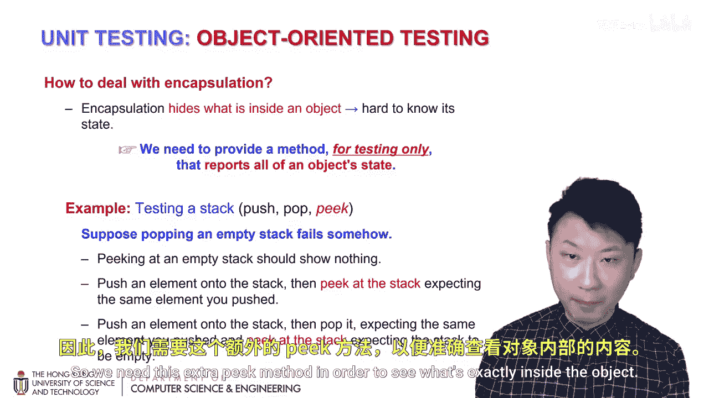

So some of you may ask if all the components they are working correctly after unit testing。

 why perform more testing？Why perform integration testing， The reason is that interactions。

 kind of errors cannot be anchor。The reason is that interaction kinds of errors cannot be uncovered by unit testing。

 for example， interface misuse， interface misunderstanding or timing errors。

 they cannot be discovered by unit testing。So that's why we have to perform integration testing to make sure that we don't have interaction errors。

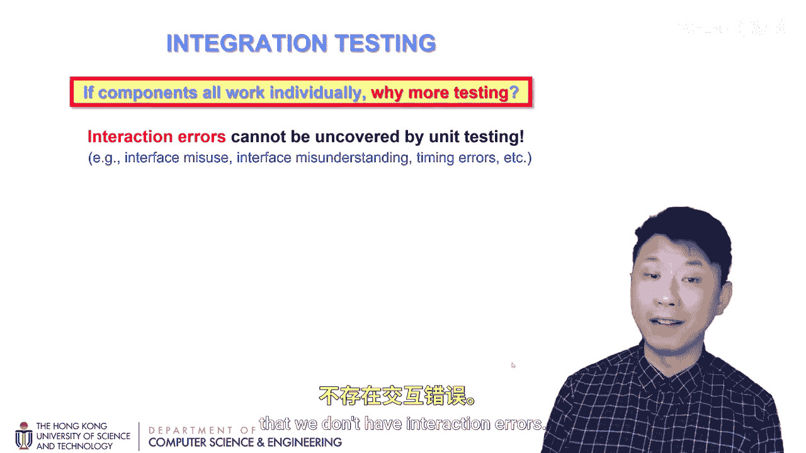

But when we perform integration testing， we are not going to do it F bang。

 that means we integrate all the classes together， then we get the entire system。

 then we simply test the whole system。Just because if we are testing the whole system is going to be the same as system testing。

 it's not integration testing， so to perform integration testing， we have to do it incrementally。

So incrementally means we're going to integrate the classes into the system one by one and then see what's going to happen。

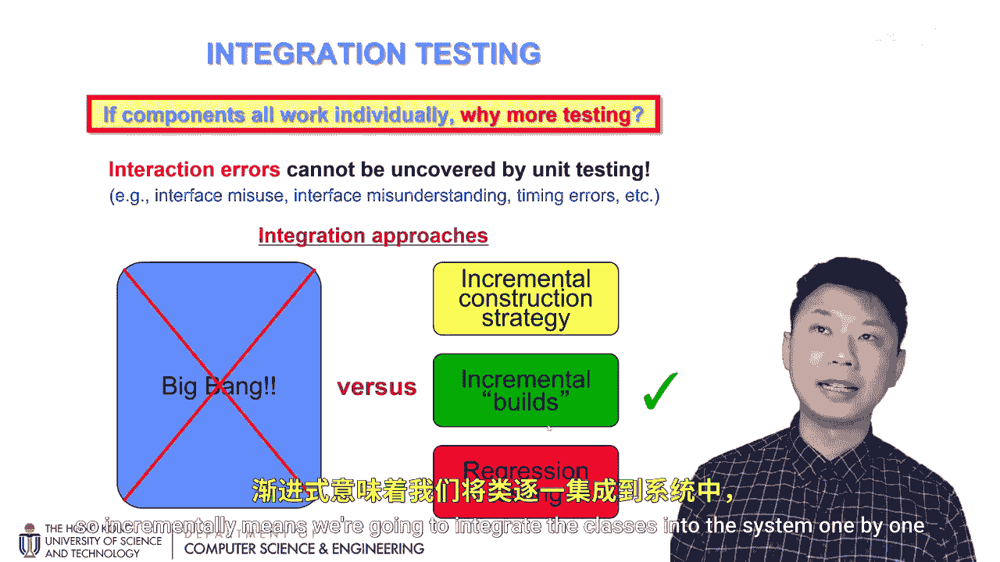

So for integration testing， we can do it top down and usually the top system is going to be the user interface component。

 So by using this top down approach， we first test the user。So when we perform integration testing。

 one approach that we can use is top down。 That means we。

So when we perform integration testing one approach that we can use is top down that means we're going to test the top subsystem first and then we're going to go downward and then test the out subsystems and usually the top subsystem is going to be the user interface component so using this approach we will test the user interface first。

So we test the tops of system， which stops。And then we will replace this stop one by one with the actual subsystem。

Using that first or breakfast。And then a new subsystem are integrated。

 some subset of previous tasks is rerun， for example， regression testing。

And the good thing about top down approach is that it's going to test the user interface components first。

And if the user interface components， they are critical within the software system。

 then using top down is going to be good because you test the critical components first。

But the bad thing is that it cannot do significant low level processing until late in the testing。

And we also need to write many stop when we perform testing。

And usually the lower levels sub systemsstems， they are controllers which control the behavior of the software system and using top down。

 that means we going to test them late in testing。

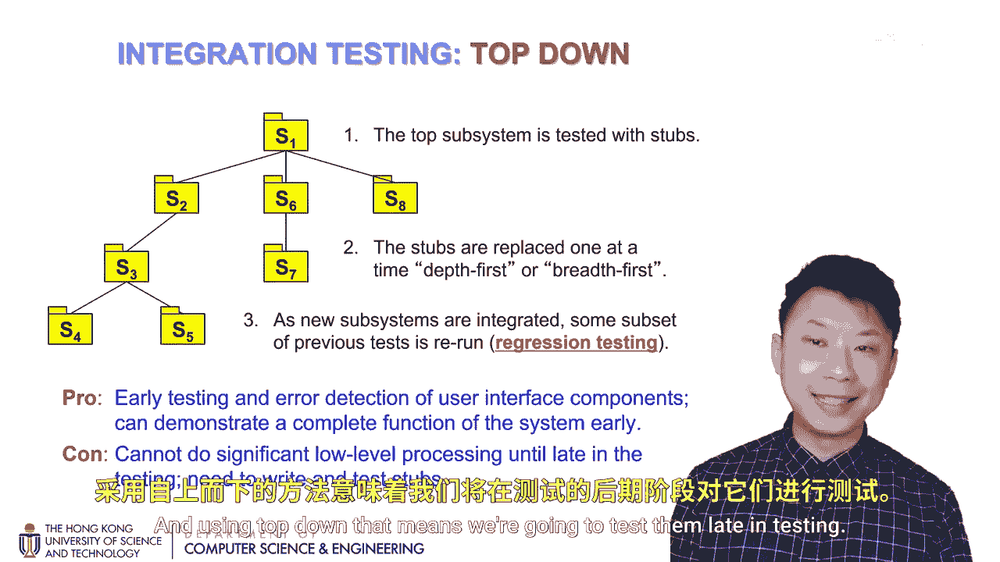

Another approach that we can use is what we call bottom up for bottom up。

 we test the bottom subystem first and then we're going to test the bottom subsystems using drivers。

And then once we complete the task for a particular sub system。

 then we can integrate that sub system with the top part of the system。

And the good thing about bottom up is that we're going to test the controller first。

And usually the controllers， they are critical within a software system。

 so it's a good idea to always test them first。And the bad thing is that we're going to test the user interface components late in testing。

Now we can see that if you are using top down， we're going to test using interface first。

 if you are using bottom up， we're going to test controllers first。

 then there is a method which is called sandwich that means we're going to test the top part using stops and then we're going to test the bottom part using drivers at the same time so we can do them in parallel。

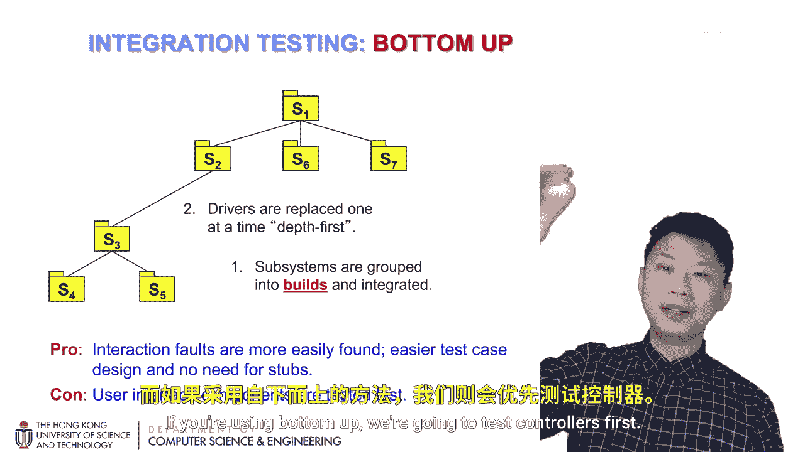

Then after we test the top part and the bottom part of the system， we can integrate them together。

 And this is what we call the sandwich approach。The good thing about sandwich is that now we perform testing on the user interface and the controller at the same time in paralleler。

But the bad thing is that we have to write many stop and drivers。

And the sandwich approach is very efficient because we can perform testing in parallel and it can shorten the total testing time。

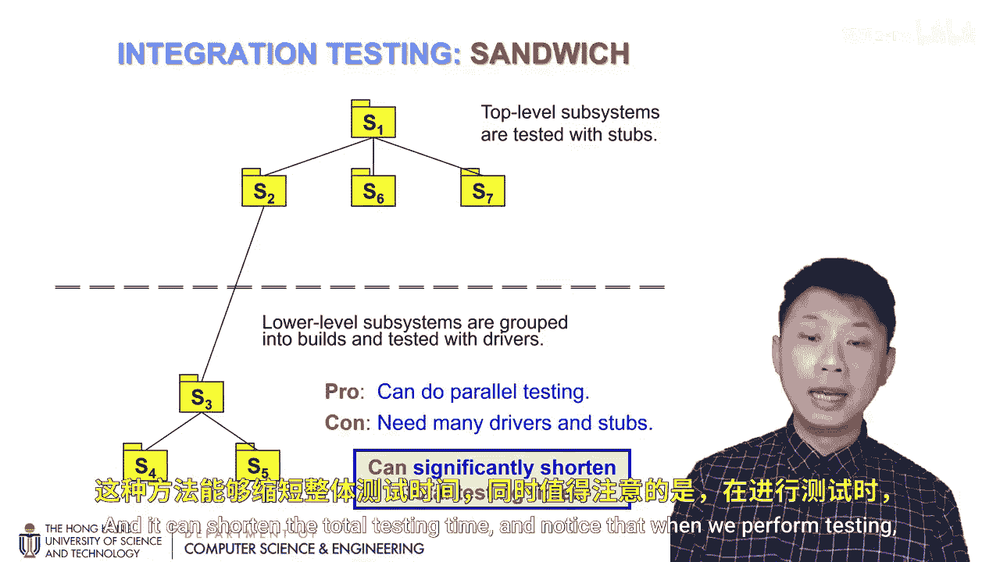

And notice that when we perform testing， critical subsystem should be tested as early as possible。

 Now， if the user interface is critical， then we test them first。

 if the controllers they are critical， then we test them first， etc cea， etc cea。

And also address several software requirements or have a high level of control that means having high psychometric complexity。

And also subsystem that are complex or error chrome。And have specific performance requirements。

 that means you need to satisfy some nonfunctional requirements on that particular subsystem。

Then they should be tested as early as possible。And notice that regression testing is required for critical subsystemence。

Why， because the subsystem is important， and we try to。

Why because the subsystem is important and if we make a mistake before。

 we try to avoid making the same mistake again on the same subsystem。

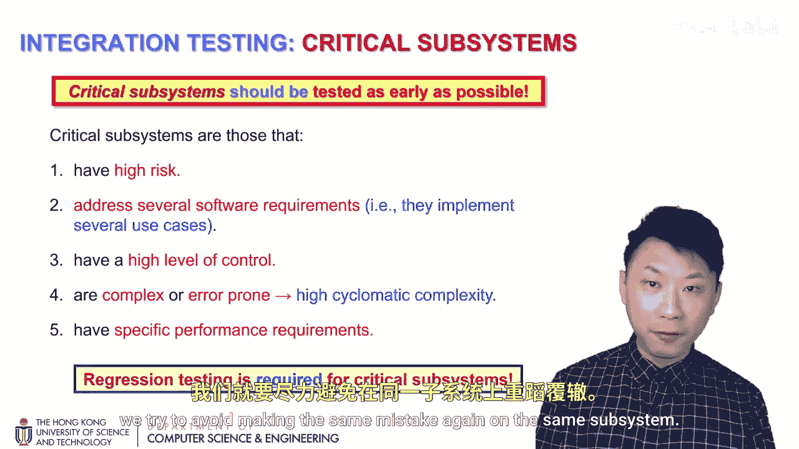

In system testing， what we're going to do is that we're going to test the system as a whole。

To ensure that the system functions properly when integrated。

And these are some specific types of tasks that you may want to perform when you do system testing。

For example， functional testing that means you want to verify all the functionalities specified in the system requirements specification。

And also performance testing。You have to verify the design goal that you have specified it in your non functional requirements。

And also pilot testing， you may select a group of end users to try it out the system。

And also acceptance test that means you let the client or user to use the system and then verify the usability and also validate all the functional and nonfunction requirements against the system requirement specification。

And also installation that means you try to verify usability and also validate functional and non functional requirements in view use。

And in this lecture， we focus on performance testing， pilot testing， and also acceptance testing。

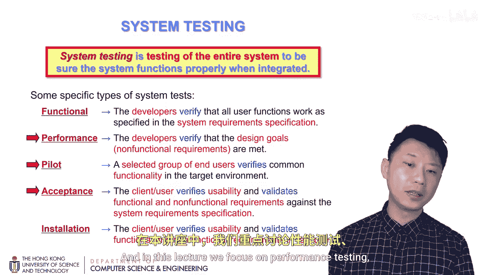

So in performance testing， we are talking about non functionalal requirements， for example， stressed。

 whether your system can handle many simultaneous requests at the same time。Or volume。

 that means whether your system can handle large amounts of data。

 high complexity algorithms or high disk fragmentmentation。

As security verifyify SS protection mechanisms。In timing。

 verify the system can meet some timing constraints。And also recovery。

 you have to verify that the system can recover when forced to fail in different ways。

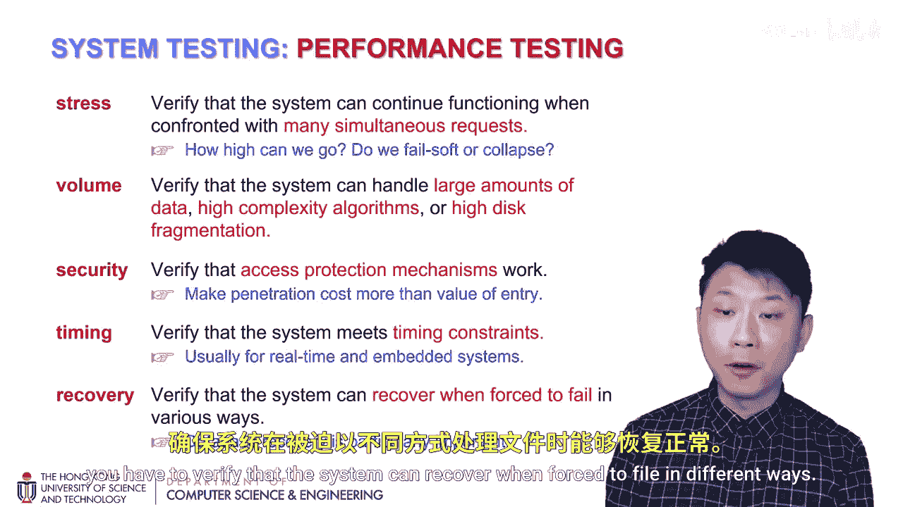

And you may also perform pilot testing that means you try to invite some end users to try it out the system。

And there are two types of pilot testing that we can perform。 One is what we call alpha testing。

In our testing， you will invite users to the developer。In other testing。

 you invite some users into the developer site and then test out in the developer site。

 So that's why we say that testing is performed in a controlled environment。

Within the developer site。And also， we can perform data testing。

 that means you release the software to the end users and in the end users。

 they will try it out the software in their own machines。So that's why we say that for beta testing。

 the test。So that's why we saved it。So that's why we say that for beta testing。

 the test is performed under client's site， under the client's machine。

And it's pretty common that we use beta testing in games。

So we release the games to the players to try it out and if they discover any bugs within the game。

 then they can report them to the developers and the developers they can fix the bugs。

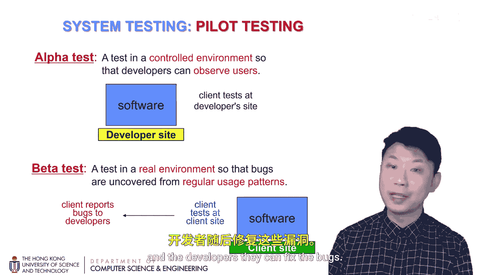

And in acceptance testing， we try to demonstrate to the client that a function or a constraint of the system is fully operational。

 That means we try to demonstrate something in front of the client。

And these are the things that you can do in acceptance testing， for example。

 validation of functionalities。 does the system provide the required functionality。

And also validation of interfaces， for example， whether the interface perform design functions and also follow required design standards。

And also， information content， let's say whether the system is going to store all the data correctly on the system。

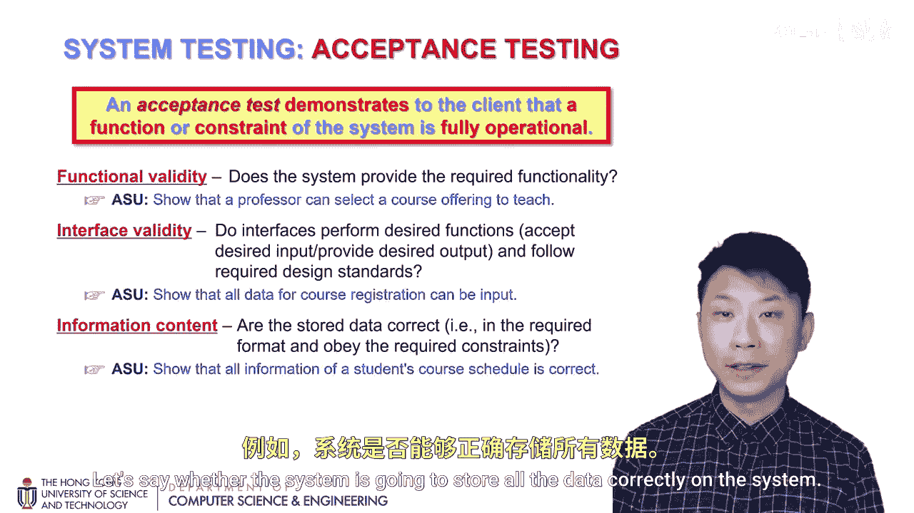

And in performance， does the system meet specific performance criteria， et cetera， et cetera？

And when you derive a certain test， you have written requirements in a concise。

 precise and also testable way by doing first， grouping related requirements together。

And then second， removing any requirementss that cannot be tested。

And then you may also add any additional requirements gathered from users by looking at the use cases。

 looking at the domain model， and also looking at the non functionalal requirements in your system requirements specifications。

And then for each requirement， you have to come up with an evaluation scenario that will demonstrate to decline that you have achieved the corresponding requirement。

And notice that since most of the evaluation scenarios， they depend on the user interface。

 so they cannot be completed or tested until the user interface is decided。

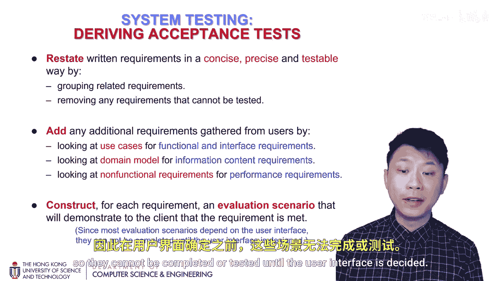