# 香港科技大学【中英⚡软件工程｜Software Engineering Specialization】 p40 P40 03_验收测试示例 -BV1MMEjzoEhg_p40-

So now let's take a look at this example and try to come up with the acceptance test for this particular problem statement。

And again， this is the prompt statement for DAU cost registration system。

And these are all the requirements that you can captured from the prompts statement。 For example。

 students can request cost catalogs containing cost offerings for the term。

 and then student decide which course to take， et cetera， et cetera。

 So now we get all the requirements from the prompts statement。

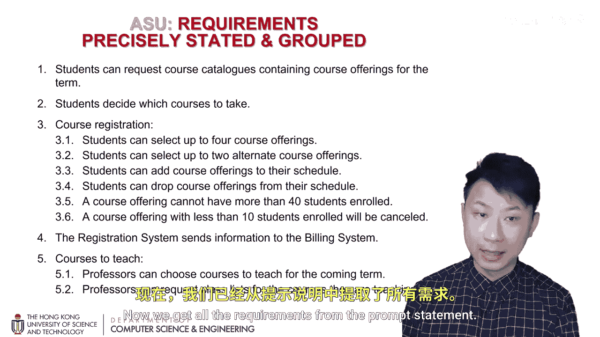

And then the next thing that we have to do is to restate all the requirements in a testable way。

For example， instead of saying that students can request cost catalog containing cost offering for the term。

 we simply say that the system must be able to produce a cost catalog containing cost offerings for the term。

Now， when we perform testing， we focus on what the system can do。

 So that's why we have to restate the statement and focus on testing the system。 and we start with。

So that's why instead of saying that students can do something on the system。

 we say that the system must be able to， for example。

 produce something and then show something to the user， etcter， etc ce。

And then for the next statement， students decide which courses to take。Again。

 remember that we are testing the system， but not testing this student。So is this statement testable？

No， because we are testing the system， but not the student。

So we cannot test whether the student can decide to take which courses or not。

So this one is deleted because it's not testable。And we have to do the same thing for the remaining requirements that means we have to。

And then we have to do the same thing for the remaining requirements。

 that means we have to rest all the requirements in a testable way。

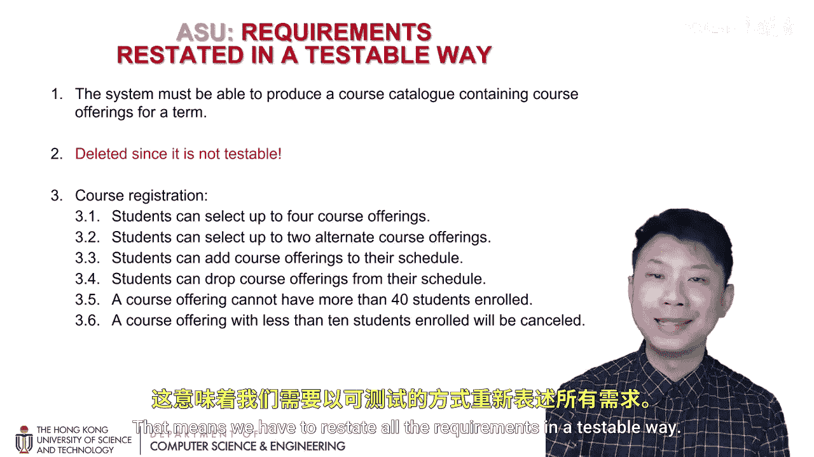

And notice that you have to include all the requirements when you perform testing。

 there may be other requirements that you have gathered from the users or from the system requirements specification。

 remember to include them in a second test。

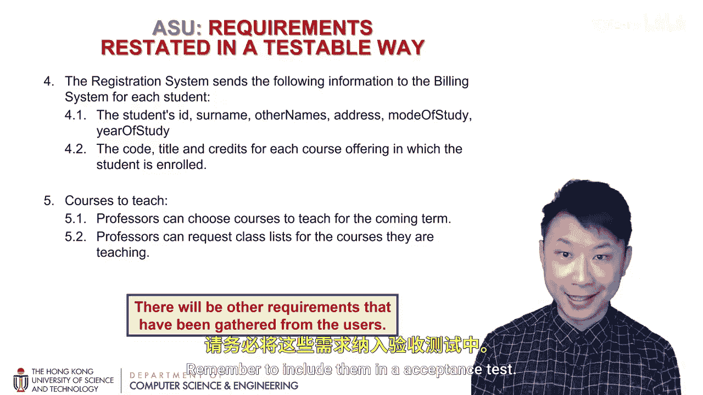

And then finally， when you come up with the acceptance test。

 make sure that you use the magic word demonstrate。For example first。

 we're going to demonstrate that the system can produce something。And then for cost registration。

 we can demonstrate that cost offering can be selected up to a maximum of four and then demonstrate that alternative cost offering can be selected up to a maximum of two。

 etc， etc。We're going to use the magic work demonstrate because we're going to demonstrate something in front of the client。

And this are audio something tests that we can come up with using the pro statement from AS U。

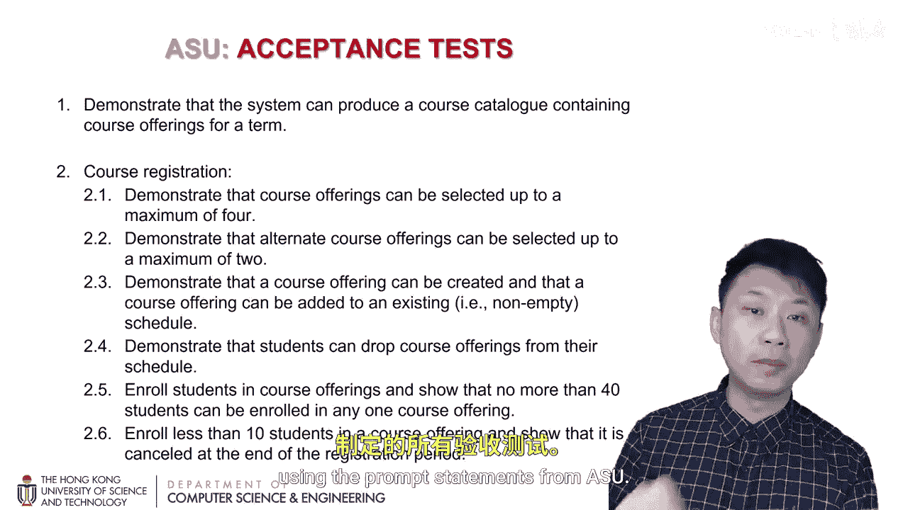

Again， the key word is demonstrate something in front of the client。

And notice that this test must be operational by devising test cases for use by the client。

 So that means the client is can to actually use the system to validate all the requirements。

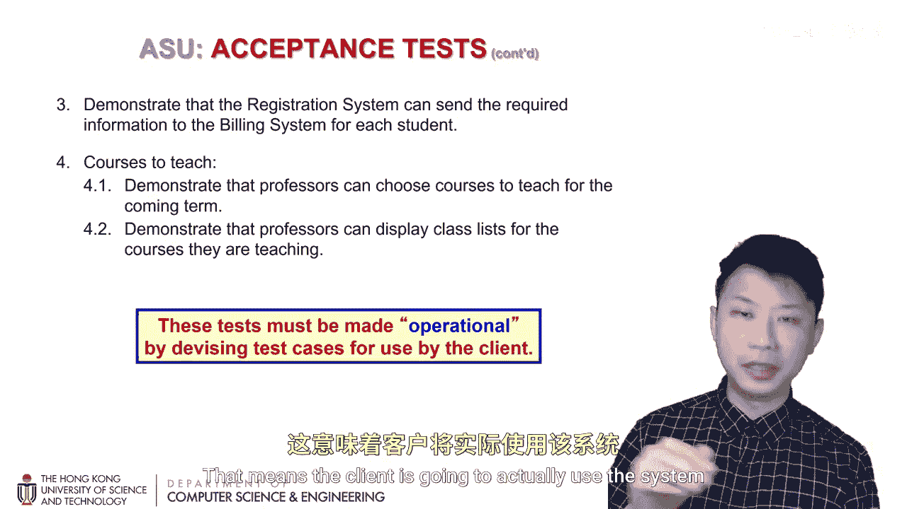

So finally， we will talk about how to evaluate test。

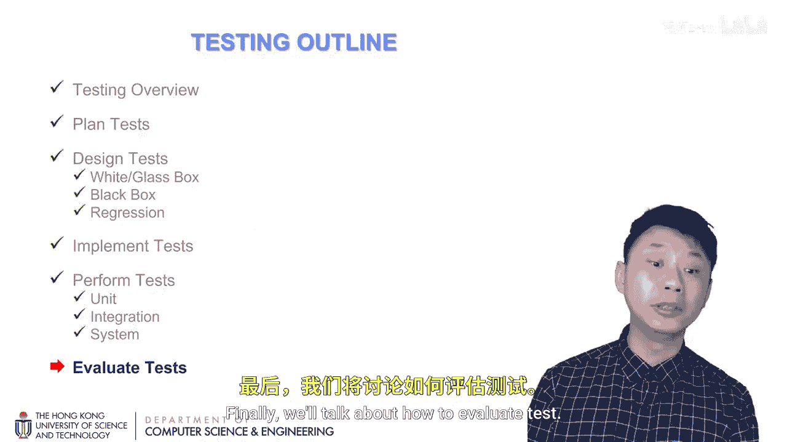

So when we evaluate test， the test engineer needs to evaluate the results of testing by doing the followings。

 comparing the results with the gold aligned in the test plan and also preparing metrics to determine the current quality of the software。

So how do we know when to stop testing？So how do we know when to stop testing。

 that means our software is good enough， and then we can release the software to our users。

We can consider the system task completeness and also coverage for example， if we pass 99% of tasks。

 then we can say that our system is kind of reliable and then we can release the software to our users。

Or reliability， based on the error rate， If the error rate is low。

 That means we don't have many mistakes in our system。 Then again。

 we can say that our system is kind of stable and we can release the software system to our users。

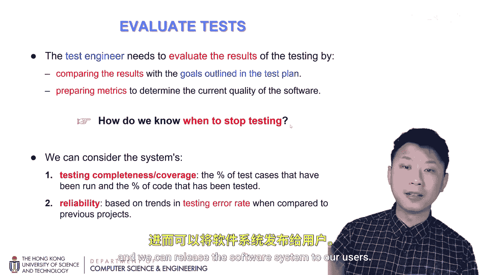

And within the project， we have to keep track the error rate。

Using Excel or using a database application。 And let's say。

 the actual failure rate is higher than expected。 What should we do。

 Then these are the things that we can do when we have a high failure rate。

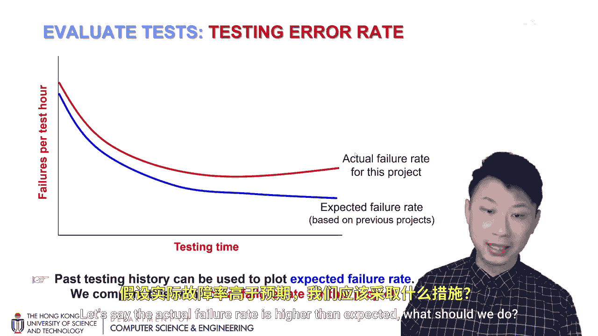

We can perform additional tests to find more defects， of course。Or we may release the test criteria。

 Maybe they were too high or too tough， or we may deliver acceptable parts of the system and continue revising and testing unacceptable parts of the system and then deliver them later on as。

 for example， the I C。

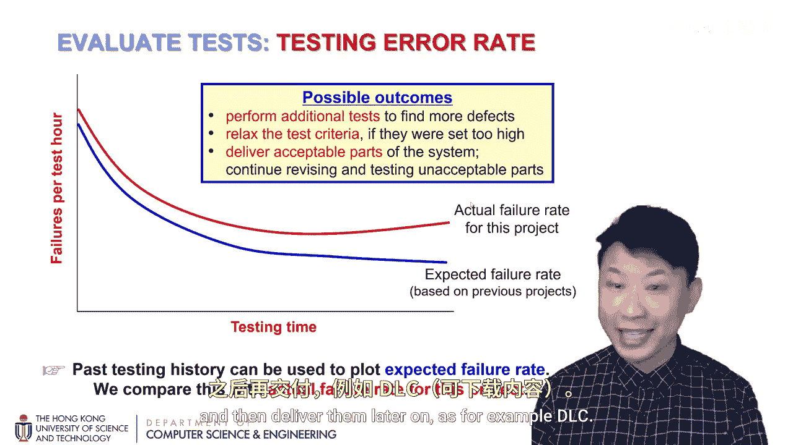

Notice that all tasks。 they are important。Notice that all tasks are important。

 but if you really don't have enough time， then these are the things that you should do。

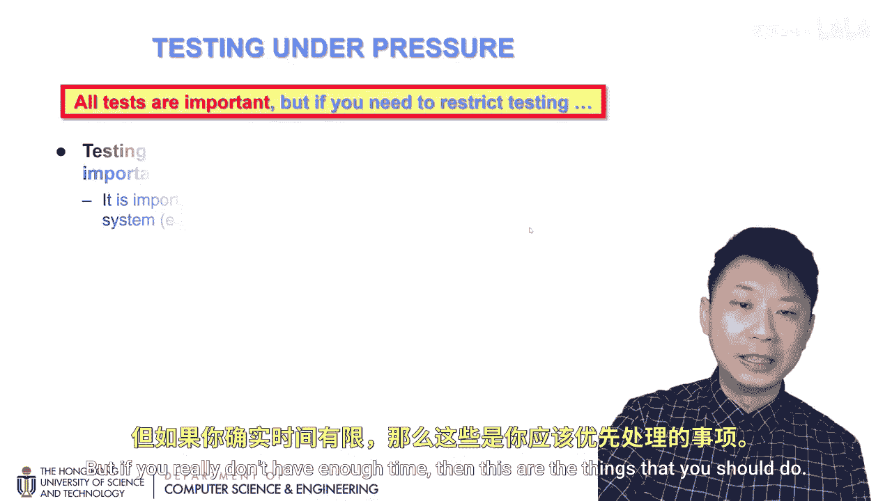

So testing a system capability is more important than testing is component， that means for example。

 blackB testing on the whole system is going to be more important than unit testing。

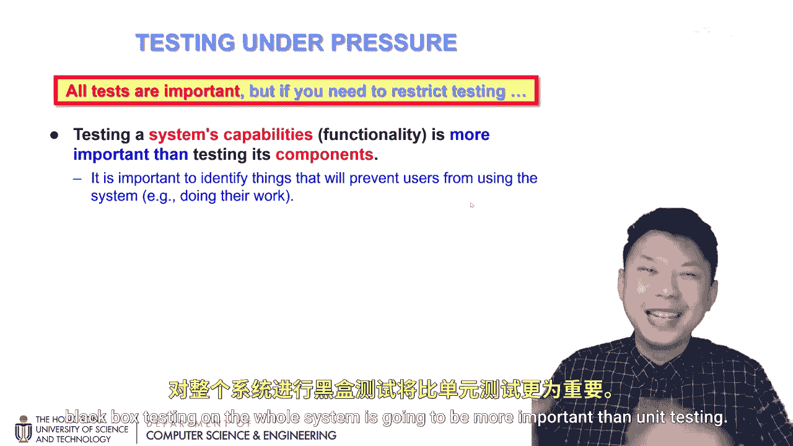

And testing old capabilities is more important than testing new capabilities。So for example。

 a particular function is working in an older version， then in the new version。

 that capability or that function should still be working。

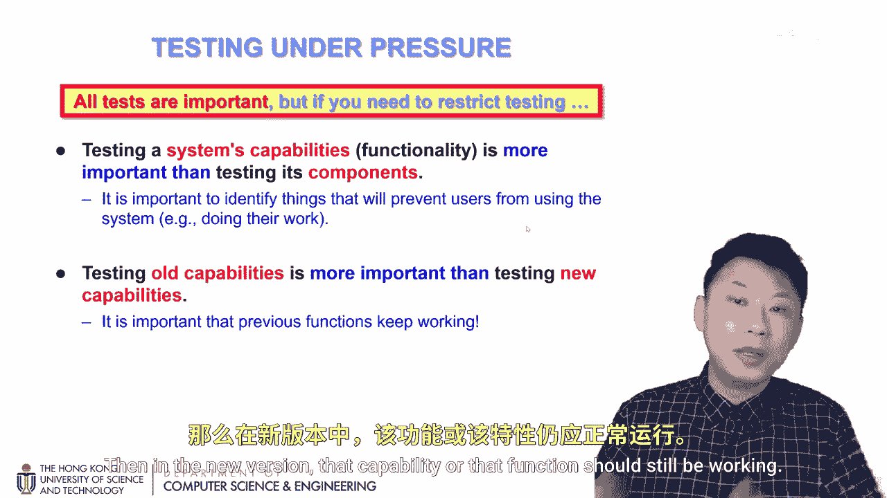

And testing typical situations is more important than testing boundary cases。

And these are the things that you can do when you don't have enough time。

And these are things that you could possibly do when you don't have enough time to perform testing。

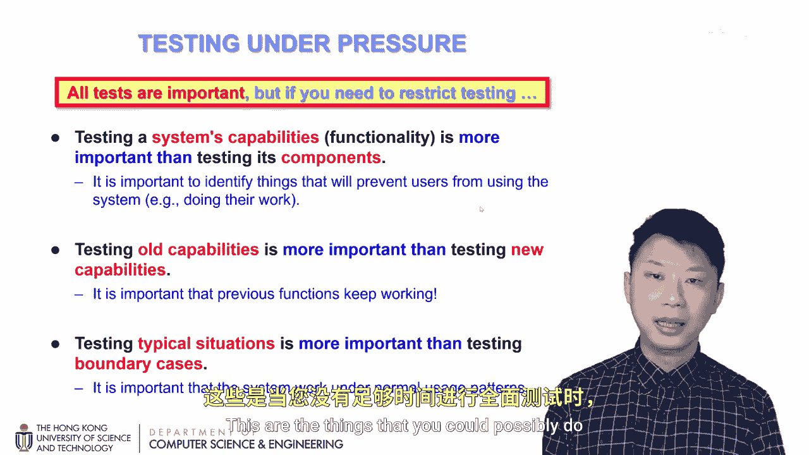

This is a little summary about testing to perform testing effectively。

 you need good planning that means you need to know exactly what you are trying to test。

And you need to use the right task in the right situation。And in this course。

 we have introduced three types of tests that you can perform on a software system。

 and they are white box testing， black box testing and also regression testing and perform testing early and frequently because you know that you perform testing mainly after implementation and usually you have time pressure after implementation so that's why it's a good idea to start testing early。

And also use a2 to help you run all the tests systematically and also thoroughlyly。 For example。

 if you are using Java， then you can use J unit to help you run all the unit test。

And you should have a clear criteria for stopping。Because you cannot wait for a perfect system so let's say if your system pass 99% of the test then you may say that your system is kind of stable then you may think about releasing the system to the end users and that's why I say you have to decide beforehand how many testing will be enough and that's all I want to cover in this lecture。

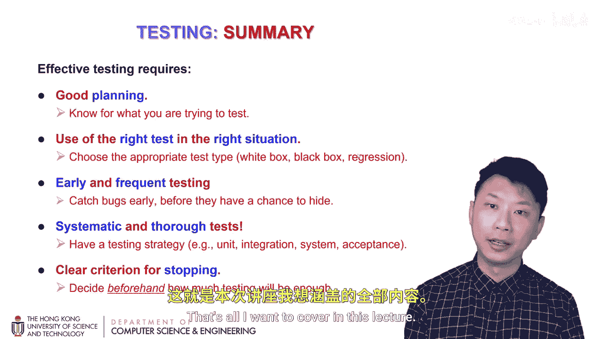