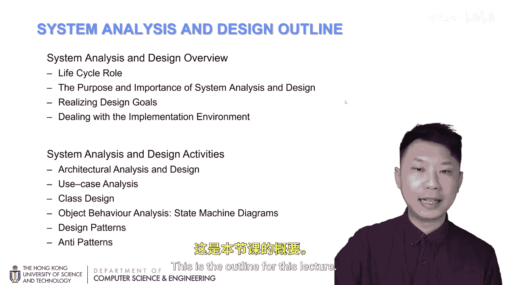
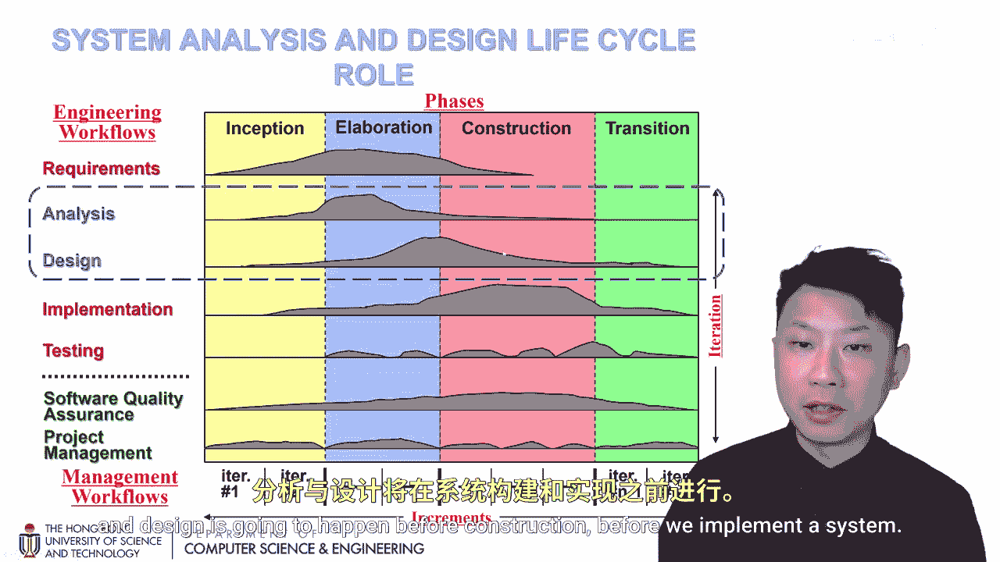
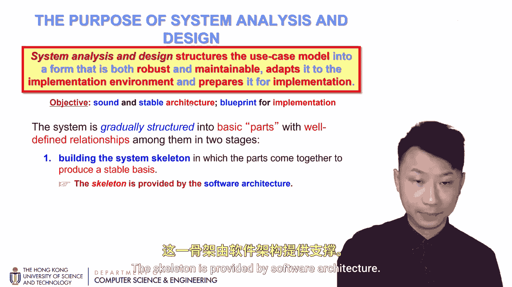
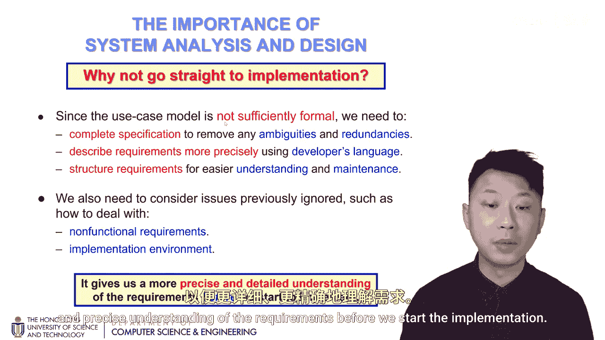
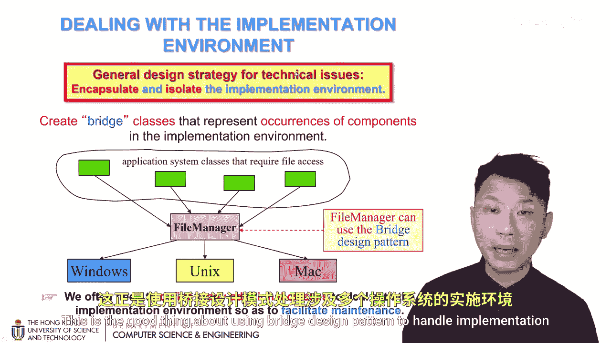

# 香港科技大学【中英⚡软件工程｜Software Engineering Specialization】 p41 P41 01_系统设计与分析简介 -BV1MMEjzoEhg_p41-

Hi， in this lecture we talk about system analysis and design That means after we capture all the requirements in our SRS。

 how can we convert all the requirements into a model that we can actually use for implementation。

And these are the learning objectives of this lecture。 After this lecture。

 you will understand the purpose and importance of system analysis and design in software development。

And you will also know the major activities that take place during system analysis and design。

And you also know how to realize design goal and deal with implementation environment at the very beginning of the course。

 we have said that at the very beginning of the project。

 you have to choose a field design goals that are actually relevant to the project and then now。

When we perform system analysis and design， we will deal with all the design goals and also all the non functionalal requirements that we have captured in our SOS。

And then finally， you will also know what are architectural patterns and design patterns and when to use them。

So this is the outline for this lecture in this lecture it's going to be just an overview about system design。

So when we talk about analysis and design， we try to come up with。

So when we talk about analysis and design， we try to come up with a model that we can actually use for implementation。

 so that's why analysis and design is going to happen before construction before we implement the system。

And in system analysis and design， we try to structure the use case model into a form that is robust and maintainable。

 and we try to adapt it to the implementation environment and then prepares it for implementation。

So that means we try to come up with some sound and stable architecture and also some blueprint for implementation。

And we try to build a system by gradually structure into basic parts with well defined relationships among them in two stages。

In the first stage， we try to build a system skeleton in which the parts come together to produce a stable basis。

And the skeleton is provided by software architecture。

And then in stage number two， we try to grow the system in which the parts aggregate around the skeleton to produce a finer system structure。

And growing is accomplished by the analysis and design workflows。

And we may also have to consider technical solutions that can be applied from the solution domain when we come up with a model that we can actually use for implementation。

So some of you may ask， after we capture audit requirements。

 why don't we simply go straight to implementation？

The reason is that when we try to build the use case model。

 the information that we have within the use case model is not sufficiently enough for implementation。

So that means we have to complete the specification to remove any ambiguity and redundancy before we go into implementation。

And also describe requirements more precisely using developers language now we can describe all the classes and try to come up with a model。

Using developers language that means using programming language and then also structure requirements for easier understanding and maintenance。

So that means we have to gather So that means we have to gather all this importanted information before we go into implementation and we may also have to consider some of the issues that we may have previously ignored。

 for example， nonfunctional requirements and implementation environment。

 Now we have to come up with a model that tackle all these issues before we go into implementation。

 That means we have to come up with a model that is going to provide us a more detailed and precise understanding of the requirements before we start implementation。

 And this is an example on how to deal with the implementation environment。

 So now let's say that we have to build a system and the system has to be compatible on different O。

Then we may have to use a bridge class， which is the file manager to handle file assess on different operating systems。

 and this is what we call the bridge design pattern and we will cover the bridge design pattern in one of the upcoming lectures。

So that's why I've said that when we try to come up with a model for implementation。

 we also have to consider the implementation environment in our design and in our model and we often need to define many additional classes to deal with the implementation environment so as to facilitate maintenance just to make sure that later on when we have to maintain the system is going to be easy for example。

 if we need to include another operating system then we simply have to modify the file manager with modifying the entire system and this is the good thing about using bridge design pattern to handle implementation environment which involves multiple operating systems。

