# 香港科技大学【中英⚡软件工程｜Software Engineering Specialization】 p42 P42 02_架构设计与分析 -BV1MMEjzoEhg_p42-

So in architectural analysis and design， we focus on understanding how a system should be organized in terms of subsystems and we try to design the overall structure of the system and the main structural components and the relationship between them are identified it in terms of subsystems。

 So we've tried So we focus on how to organize the subsystems together to form the entire system and a subsystem encapsulates its contents and provides services to other subsystems via inters and also a subsystem provides information hiding and this is what we have covered before since we have a large software system and that's why we have to use divide and concorr and then chunk the large software system into many smaller subsystems and then we're going to handle one smaller subsystem at a time。

 and each subsystem provides its own surfaces via and inters and each subsystem provides。

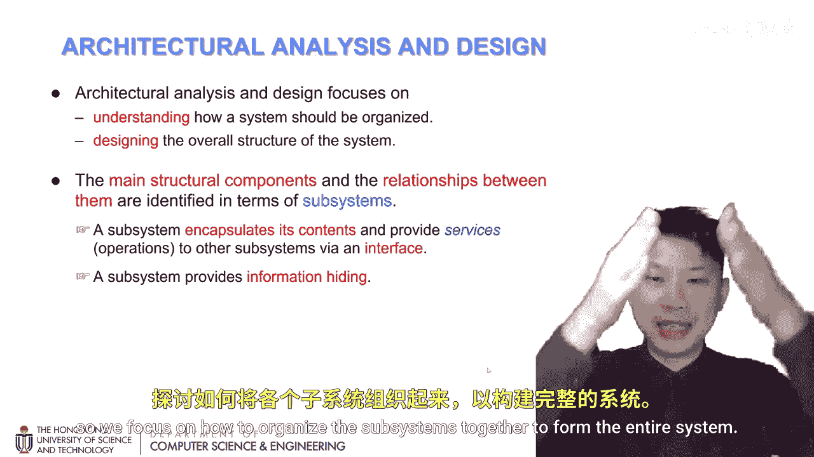

That means you don't have to actually know how to implement that subsystem。

 You just need to know how to use that particular subsystem using the ins。

And usually nonfunctional requirements are highly dependent on the system architecture。

 So how we arrange the subsystems together to form the entire system and architectural analysis and design is an essential tool for managing complexity because instead of thinking about the large software system Now we simply have to design and organize the subsystem together to form the entire system。

 Now when we try to connect the subsystems together to form the entire system。

 the connections can be either close layer or open layer。 for close layer。

 that means each layer can depend only on the layer immediately below it。 and for open layer。

 that means each layer can depend on any layer below it。 So let me show you some examples。

 So in this example， you can see that this green subsystem is connected to another subsystem。

 which is immediately below it。 So this is an example of a close layer subsystem。 and for this。

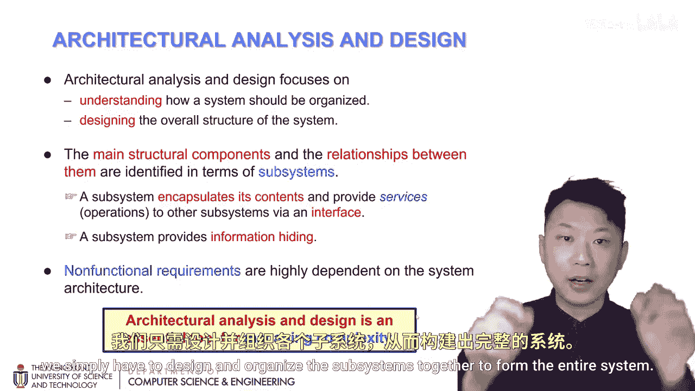

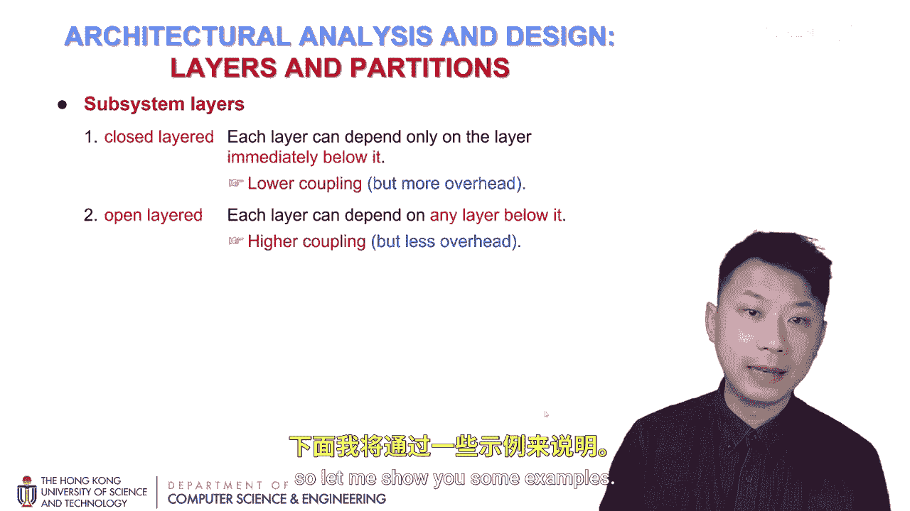

one，You can see that it depends on another subsystem， which is not immediately below it。

 So this is an example of an open layer subsystem and usually within a system。

 we will have three to5 subsystem layers in practice。

 and the partitions will organize subsystem in one layer to provide different surfaces。

 And this result in peer to peer surfaces within a layer and partitioning and also layering will produce a system hierarchy。

 And you can see that some of the subsystems， they are open layered。 For example， this green one。

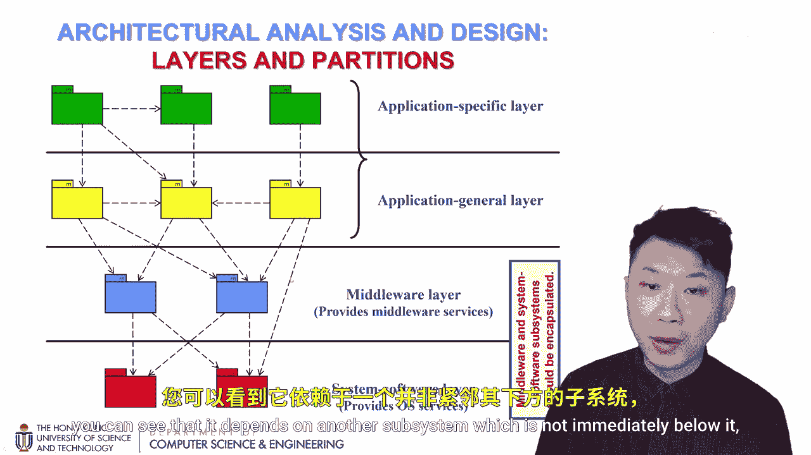

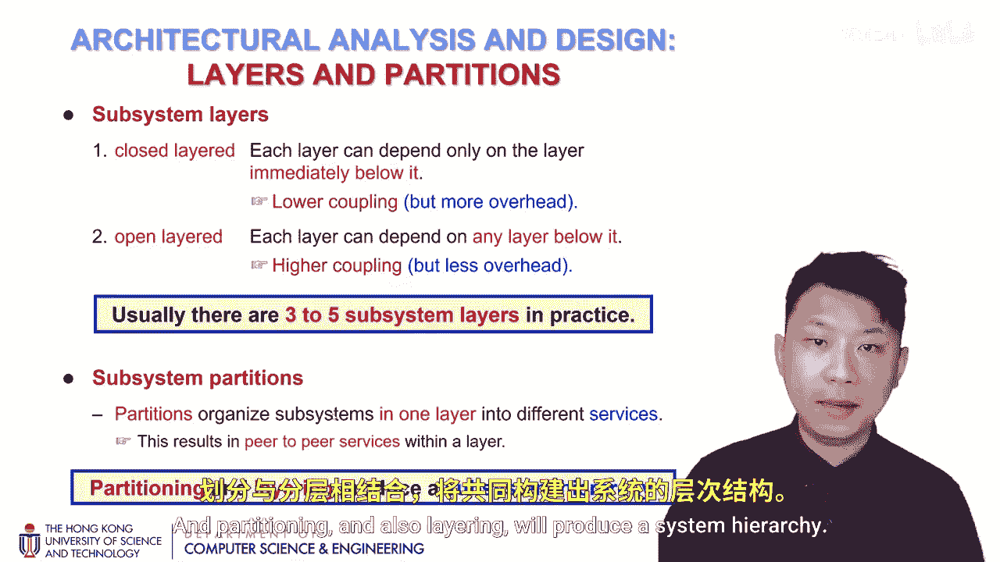

And you will see that some of the subsystems stay are close layer。 for example。

 this one depends on another subsystem， which is immediately below it。

 and some of the subsystems they are open layer。 for example， this one depends on another subsystem。

 which is not immediately below it。Et cetera， et cetera。And usually the top layers。

 they are related to user innovates Okay， so somehow and usually the top layers。

 they are subsystems related to user innovates。And the inner layers。

 they are more critical subsystems which control the behavior of the software system and we call them controllers So based on all the nonfunctional requirements that we have captured in our SOS。

 we can somehow come up with a hierarchy that we can use for building the system if we want to achieve performance then one architecture that we can use is to use a small number of subsystems to localize critical functions then when we try to perform some functionality within the system we simply have to refer to a small number of subsystems and if we want security we can use a layered architecture with most critical subsystems in the most layer。

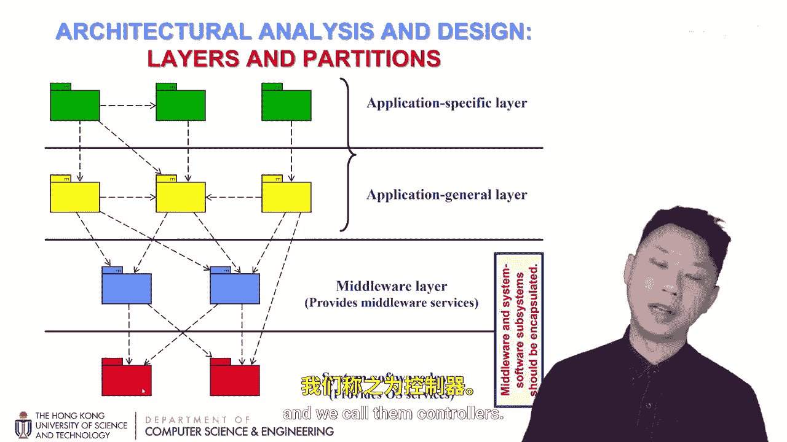

And we can also make it close layer so that if we want to assess something critical。

 we have to go through multiple layers before we can go into the innermost layer to assess those most critical subsystems。

 And if we want safety， then you may want one subsystem or its vulnerable subsystems to localize safety related functions if you want to make sure that your system is going to be always available。

 then you may include redundant subsystems to allow replacement or update with those stopping the system。

 So now what should we do if we want to achieve maintainability。

Then we should use small and self-contained subsystems that can be easily changed。

 That means if we want to change a particular functionality within the software system。

 we only have to touch one of the subsystems but not the other subsystems and that's going to make our system more maintainable and we may also use some existing architectural pattern to design our software system and in an architectural pattern it's going to specify how to organize and connect a set of software components together to form the entire system and it is a blueprint for system organization that defines the software architecture of a system and it includes the specification of how we decompose the system into different subsystems and also global control flow。

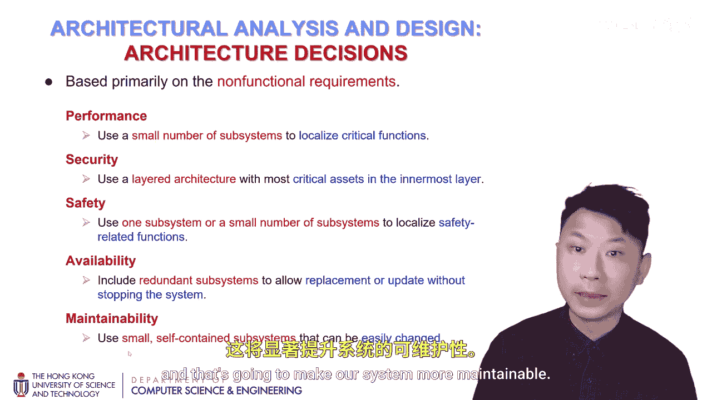

Arrra handling policies， inter module， component， communication protocols， etc cetera， etc cetera。

 And notice that most large software system utilize several architectural patterns together in different parts of the system。

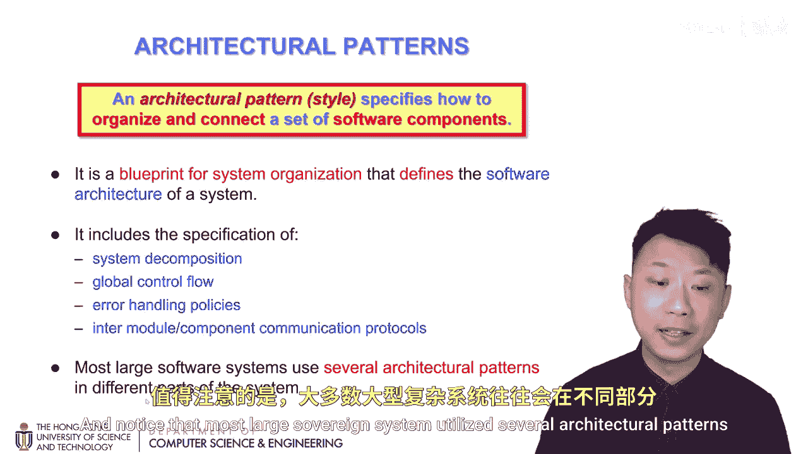

And the first architectural pattern that we're going to talk about is multi layerer architectural pattern。

And this is what we have already covered。 We're going to put subsystems in different layers。Okay。

 and then we may connect the subsystems together using close layered or open layered。

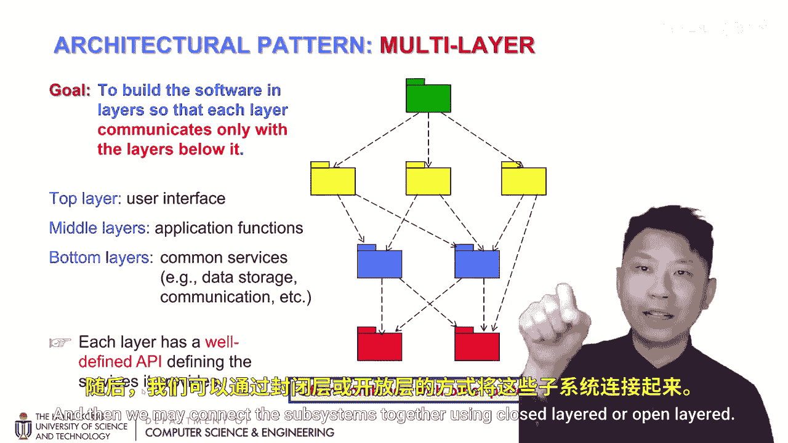

And we may also use the repository architectural patterndding in the repository architectural pattern。

 we're going to have many clients。 And then this clients。

 they will depend on a repository for data management。 So if this clients。

 they want to access Tm sum。So if these clients they want to access some data。

 it has to be done through this repository， this centralized repository and this is the typical architectural pattern that we use for database management system and the drawbacks of this pattern is that the repository can be a performance and modfiability bottleneck because many clients depends on this repository in order to retrieve and get some data and there is a high component between the repository and the subsystems again we may have many subsystems depending on this repository then the repository may becomes the performance bottleneck for the entire system and the next pattern that we're going to talk about is the client server pattern in the client server pattern we're going to have many clients and then we have a server and then underneath the server we're gonna to have a database server and this is the typical pattern that we use for building web applications because when we talk about web applications we may have many clients。

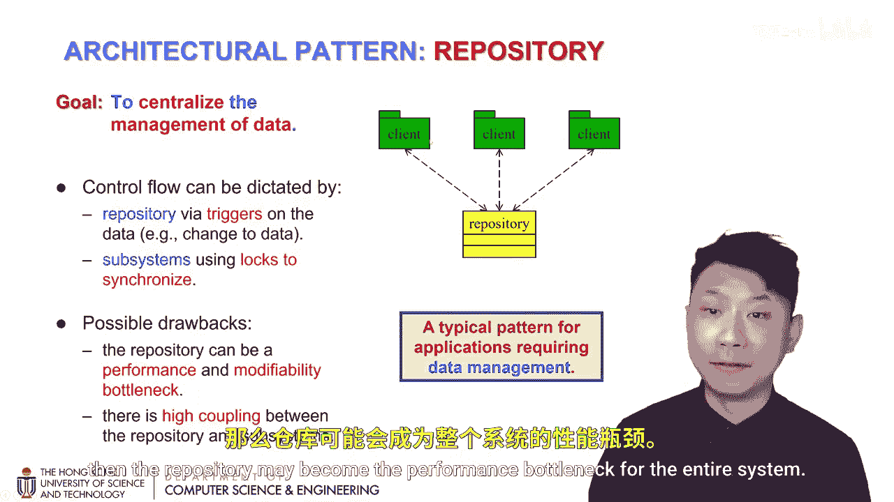

Using， for example， their browsers to get something from a server and the server will keep track all the information within a database server。

 It may be free tier。 That means we have client and server and database server。Or P2 P。

 that means client， they can communicate with each other directly in order to get some information。

 and the next pattern that we can cover is what we call the broker pattern。

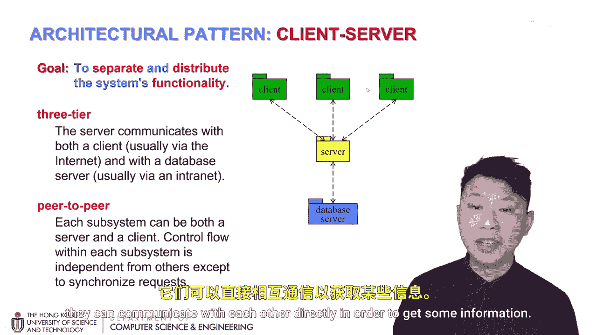

In the broker pattern， we will have a client that tries to access something remotely。

Then we have to implement a proxy on the client so that somehow when we try to get something remotely。

 it has to be assesseded through this proxy。And then we have the broker which is going to handle the communication between the client and the remote object。

 and the remote object is going to store the information。

 which is the information that the client wants to assess。

And the good thing about this pattern is that when you try to assess something remotely。

 the request will be handled by the proxy and the communication will be handled by the broker So when the client try to assess something remotely it will be automatically done by the proxy and the broker。

 So somehow when you try to access something remotely is going to be like assessing something locally because all the things will be handled by the proxy and the broker So this are some examples。

 applications that utilize the broker pattern and we can use the proxy design pattern to implement the broker architecture and we will cover proxy design pattern in one of the upcoming lecture and this is the transaction processing pattern in this pattern。

 we have a subsystem to handle all the transactions and in those transactions they will be fittedd into a transaction dispatcher which will eventually dispatch this transactions into different handlers。

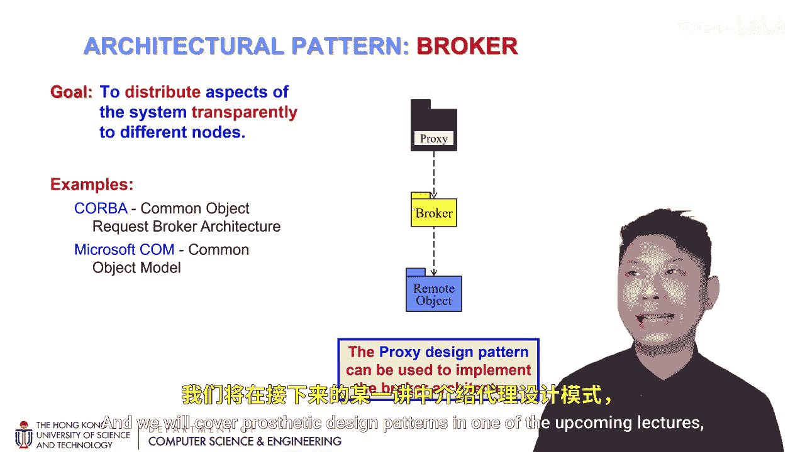

To process the transactions and an example application that utilize this transaction processing pattern is a database engine because within a database management system。

 we have many transactions Then the DBMS is going to utilize this pattern to dispatch the transactions into different handlers to process the transactions and the next pattern that we can cover is what we call the pipe and filter pattern in this pattern a stream of data is passed through a series of filters and you have a series of images that you want to process then you may feed the first image into the green subsystem to process something。

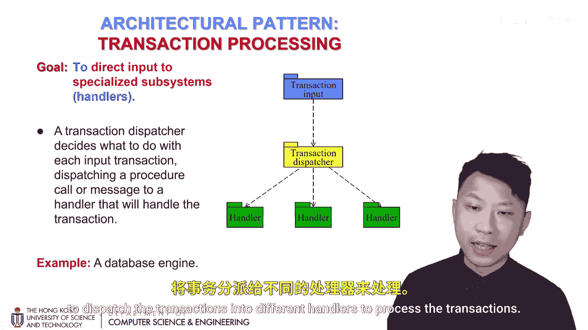

Okay， for example， converting the image into grayscale。 then after it's done right。

 then the first image will be will be passed into the second subsystem， maybe for Nalliasing。

 Then now the first subsystem is not processing anything。

 then we can feed the second image into this green one。

 Now the green one is processing the second image and converting the image into grayscale while the second subsystem is now doing Nalliasing on the image etc。

 etc ce。 So that's why here we say that we try to do pipe lining with a stream of data。

 if we talk about image processing， then we can feed some image into a subsystem after the processing is done。

 then we fit it into the next subsystem。And then after it's done， we feed it into another subsystem。

 so on and so forth。 And this is what we call pipe liing。

 And the good thing about pipe liing is that each filter or each subsystem can handle some image concurrently。

😊，So that means difference of systems will be handling or processing different images at the same time。

 an example application that utilize pipe and filter pattern is the Uni cell。

 and the last architectural pattern that we're going to cover today is what we call the MVC。

 the model view and controller pattern。

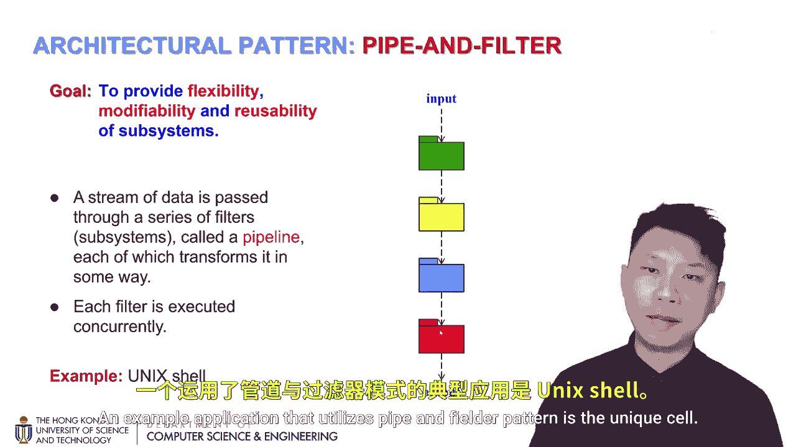

And this is a very popular pattern that we can use to develop a system which involves some use interface。

 some data and also some controllers。 And when we talk about model。

 we are talking about subsystems that is gonna handle data within the system。

 And if we are talk about view， we are talking about subsystems that handle the Us within the system。

 And if we are talking about controller， then they are the subsystems which control the behavior of the software system。

 And now we split the large software systems into this three types of subsystems。

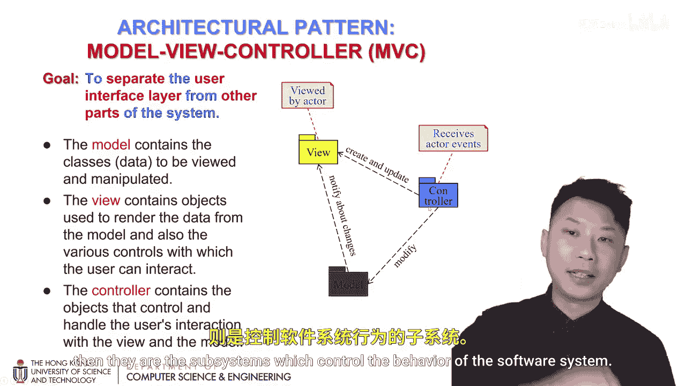

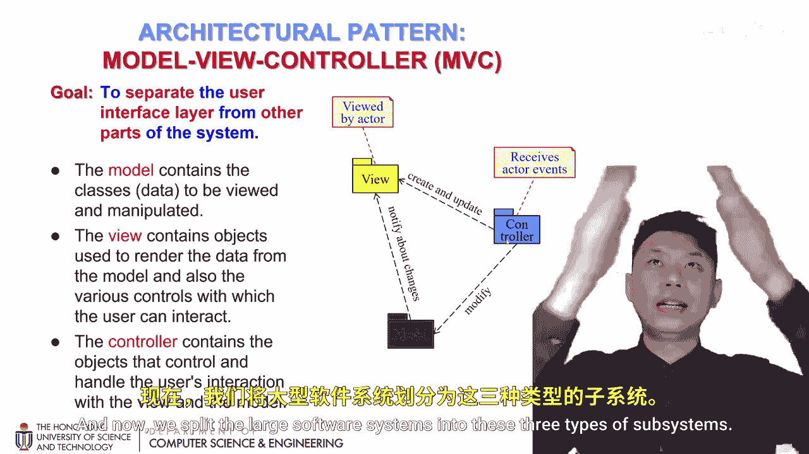

Just because for example， if you want to modify the UI。

 then we simply have to modify the view subsystems。

 we don't have to touch the other two subsystems or if we want to modify data。

 then we simply have to modify the model subsystem without touching the other two subsystems etca。

 etc and this is the good thing about the MVC model we try to separate the user interface layer from the other parts of the system and we can use the observer design pattern to separate the model from the view and we will cover the observer pattern in one of the upcoming lectures。

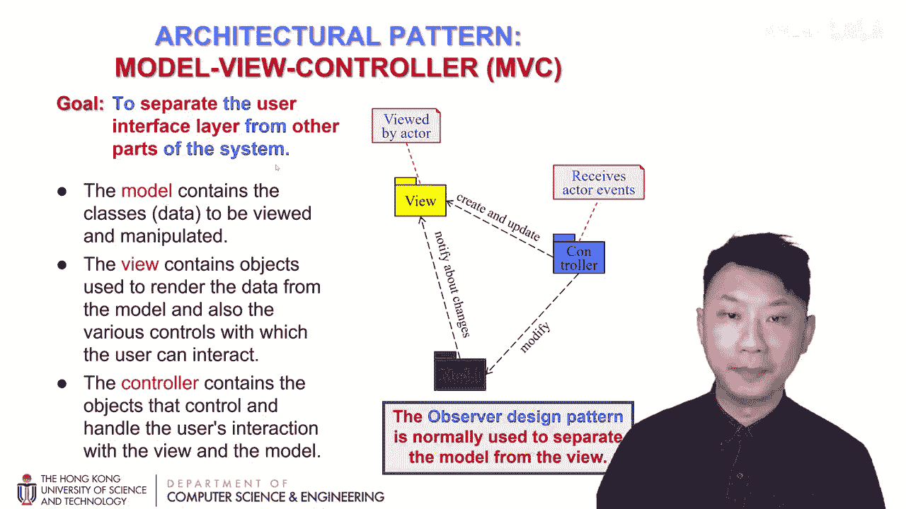