# 软件工程：P42：架构设计与分析 🏗️

在本节课中，我们将学习软件架构设计与分析的核心概念。我们将探讨如何将大型软件系统分解为子系统，理解子系统之间的连接方式，并介绍几种常见的架构模式。这些知识对于构建可维护、高性能且安全的软件系统至关重要。

## 子系统与架构设计

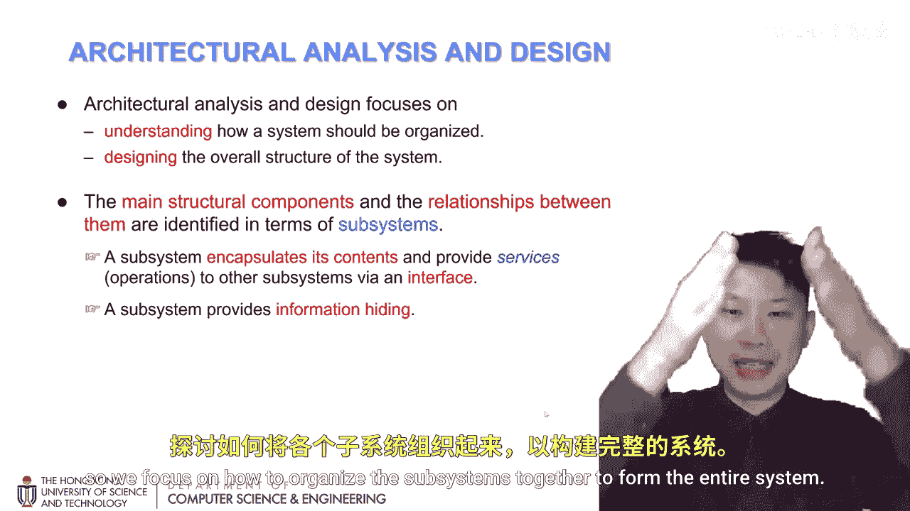

在架构分析与设计中，我们专注于理解系统应如何以子系统的形式进行组织。我们尝试设计系统的整体结构，识别主要的**结构组件**以及它们之间的关系，这些关系通过子系统来定义。

我们关注如何将子系统组织在一起以形成整个系统。一个子系统封装其内容，并通过**接口**向其他子系统提供服务。子系统还提供信息隐藏，这是我们之前讨论过的概念。由于我们处理的是大型软件系统，因此必须采用“分而治之”的策略，将大型系统拆分为许多较小的子系统，然后一次处理一个较小的子系统。

每个子系统通过其接口提供服务。这意味着你无需知道如何实现该子系统，只需知道如何使用其接口来调用该子系统。

## 子系统连接：封闭层与开放层

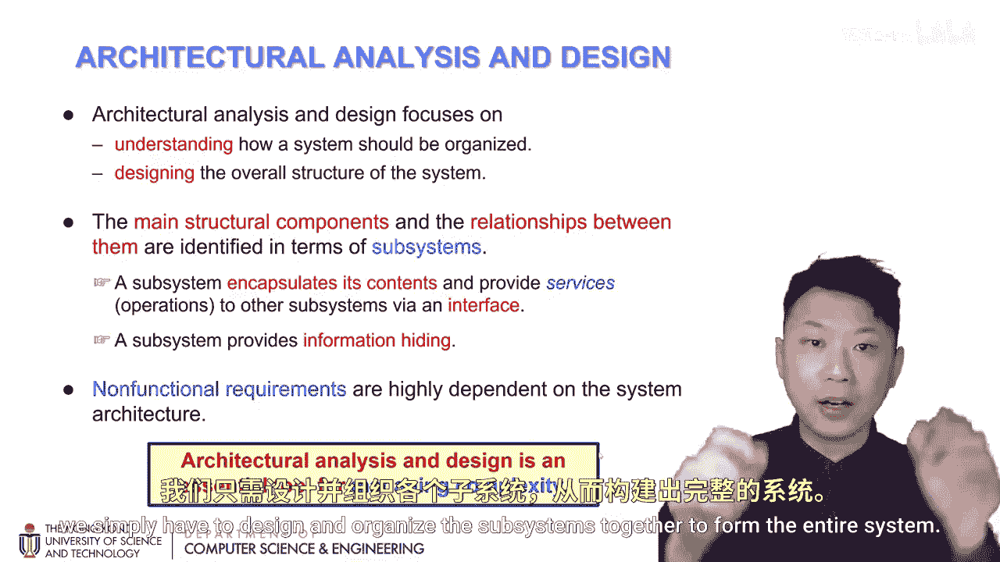

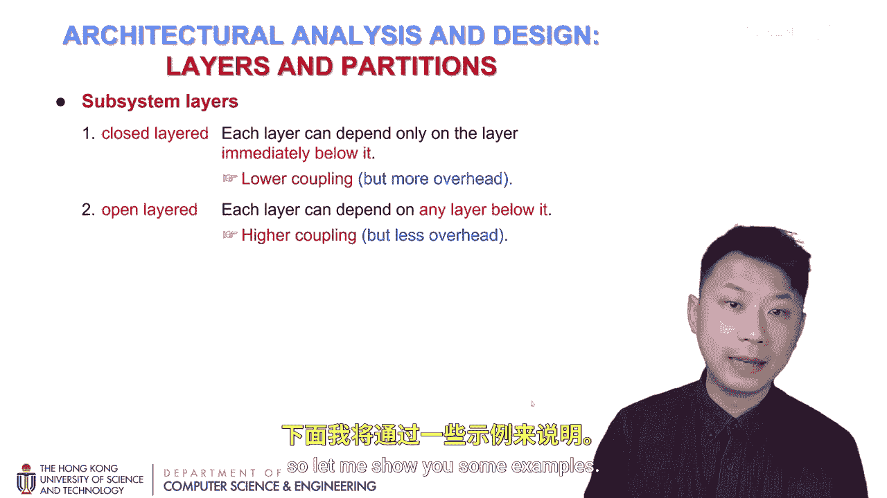

上一节我们介绍了子系统的概念，本节中我们来看看如何将子系统连接起来形成整个系统。通常，非功能性需求高度依赖于系统架构，即我们如何安排子系统以形成整个系统。架构分析与设计是管理复杂性的重要工具，因为我们无需再思考整个大型系统，只需设计和组织子系统即可。

当我们将子系统连接起来时，连接方式可以是**封闭层**或**开放层**。

*   **封闭层**：每一层只能依赖于紧邻其下的那一层。
*   **开放层**：每一层可以依赖于其下的任何层。

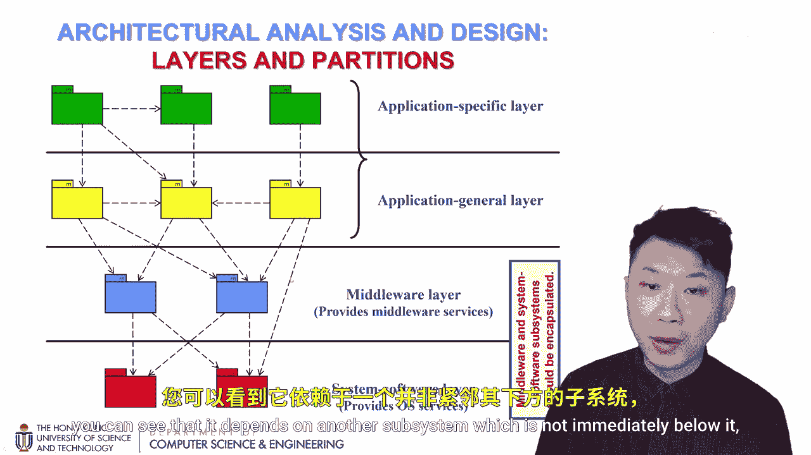

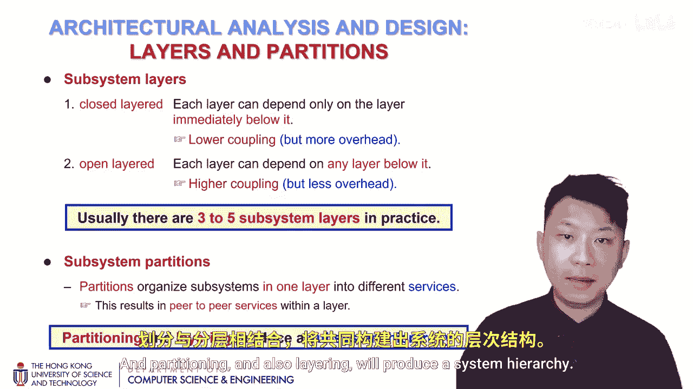

以下是两种连接方式的示例：

*   **封闭层示例**：一个绿色子系统连接到紧邻其下的另一个子系统。
*   **开放层示例**：一个子系统依赖于一个并非紧邻其下的子系统。

在实践中，一个系统通常包含3到5个子系统层。同一层内的分区将子系统组织起来以提供不同的服务，这导致了层内的点对点服务。分区和分层共同产生了系统层次结构。

通常，顶层子系统与用户界面相关，而内层则是控制软件系统行为的更关键子系统，我们称之为**控制器**。

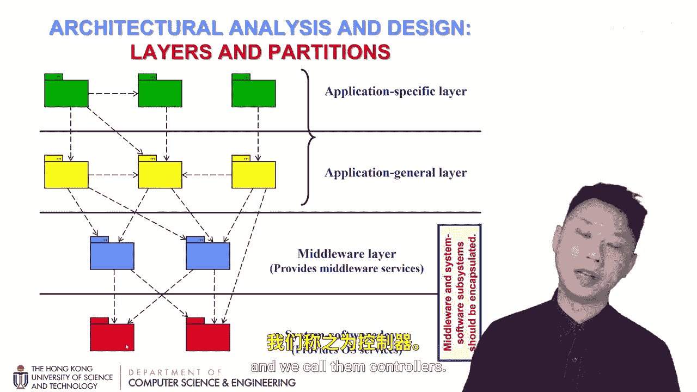

## 非功能性需求与架构选择

基于我们在软件需求规格说明书中捕获的所有非功能性需求，我们可以设计出用于构建系统的层次结构。

以下是针对不同非功能性需求的架构设计考量：

*   **性能**：可以使用少量子系统来**定位关键功能**。当执行系统功能时，只需引用少量子系统。
*   **安全性**：可以使用**分层架构**，将最关键的子系统置于最内层，并采用**封闭层**设计。这样，要访问关键内容，必须经过多层才能到达最内层。
*   **安全性（Safety）**：可以将一个子系统或其易受攻击的子系统**定位安全相关功能**。
*   **可用性**：可以包含**冗余子系统**，以便在不停止系统的情况下进行替换或更新。
*   **可维护性**：应使用**小型且自包含的子系统**，这些子系统易于更改。这样，当需要修改特定功能时，只需改动一个子系统，而不会影响其他子系统。

## 架构模式介绍

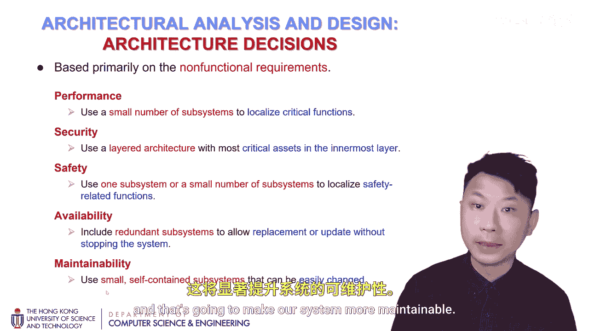

我们也可以使用一些现有的**架构模式**来设计软件系统。架构模式规定了如何组织和连接一组软件组件以形成整个系统。它是系统组织的蓝图，定义了系统的软件架构，包括如何将系统分解为不同子系统、全局控制流、错误处理策略、模块间组件通信协议等。

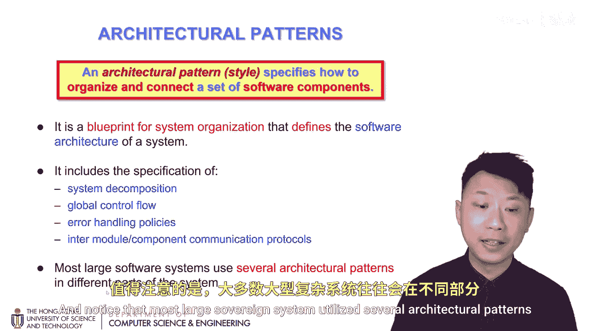

请注意，大多数大型软件系统在不同部分会同时使用多种架构模式。

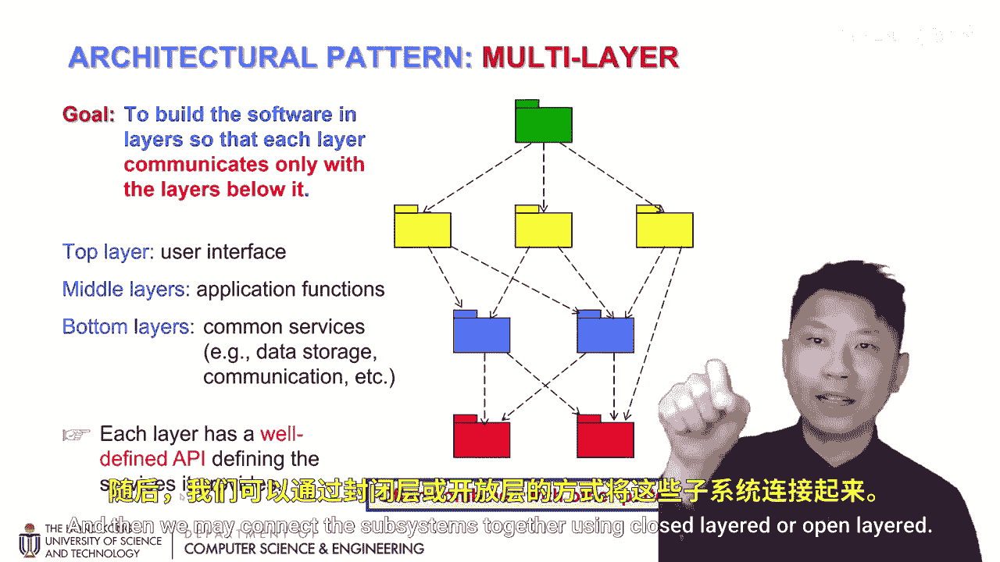

以下是几种常见的架构模式：

### 多层架构模式

这是我们已涵盖的模式。我们将子系统置于不同层中，并使用封闭层或开放层方式连接它们。

### 仓库架构模式

在仓库架构模式中，有许多客户端，这些客户端依赖于一个仓库进行数据管理。如果客户端想要访问某些数据，必须通过这个集中式的仓库进行。这是数据库管理系统使用的典型架构模式。

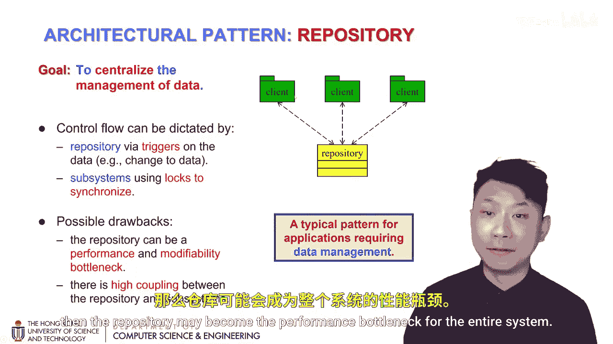

该模式的缺点是，仓库可能成为性能和可修改性的瓶颈，因为许多客户端都依赖于此仓库来检索和获取数据，仓库与子系统之间存在高度耦合。

### 客户端-服务器模式

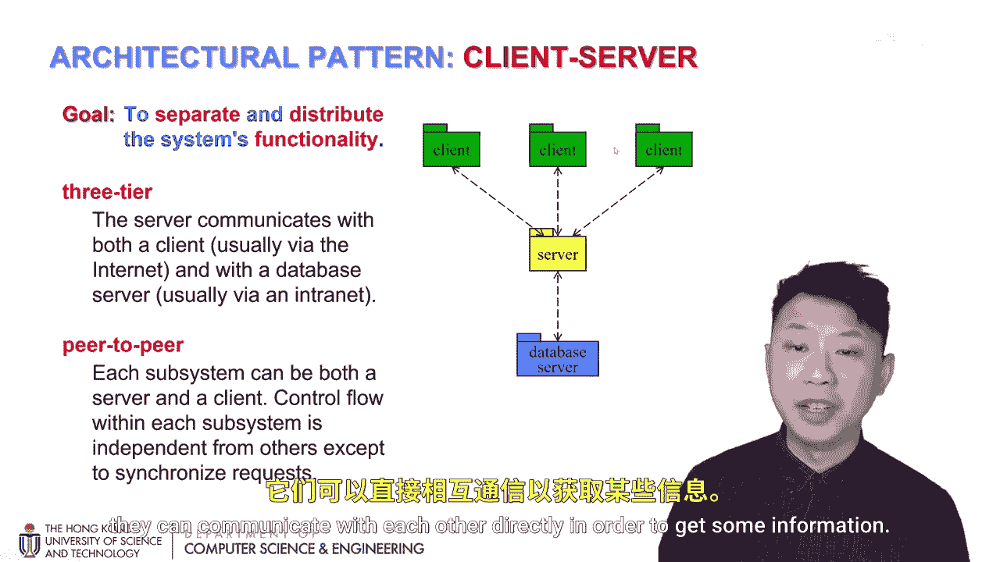

在客户端-服务器模式中，我们有许多客户端和一个服务器，服务器之下有一个数据库服务器。这是构建Web应用程序的典型模式，因为Web应用程序可能有许多客户端（例如使用浏览器）从服务器获取内容，而服务器则在数据库服务器中跟踪所有信息。

它可以是三层架构（客户端、服务器、数据库服务器），也可以是P2P架构（客户端可以直接相互通信以获取信息）。

### 代理模式

在代理模式中，有一个客户端试图远程访问某些内容。我们必须在客户端上实现一个**代理**，这样当尝试远程获取内容时，必须通过此代理进行访问。然后有一个**代理器**来处理客户端与远程对象之间的通信，远程对象存储客户端想要访问的信息。

该模式的好处是，当尝试远程访问时，请求由代理处理，通信由代理器处理。因此，客户端远程访问就像本地访问一样，因为所有事情都由代理和代理器自动处理。

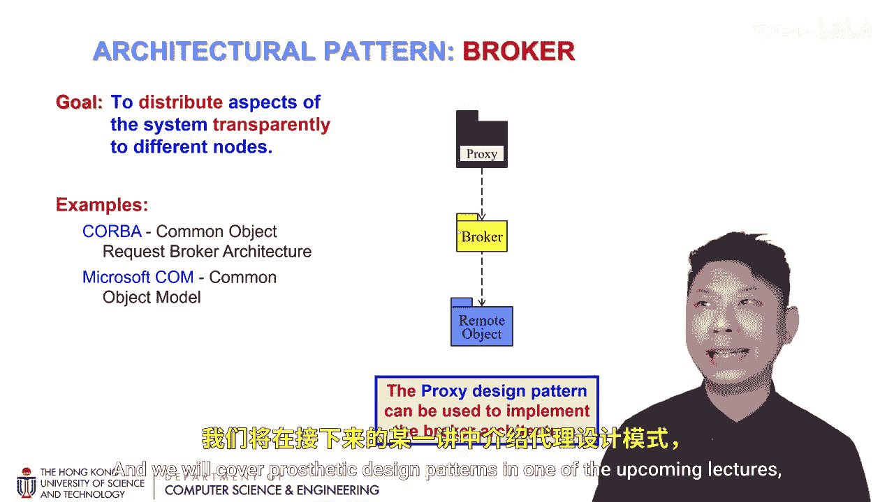

我们可以使用**代理设计模式**来实现代理架构。

### 事务处理模式

在此模式中，有一个子系统处理所有事务。这些事务被输入到一个**事务分发器**中，该分发器最终将这些事务分发给不同的**处理器**进行处理。

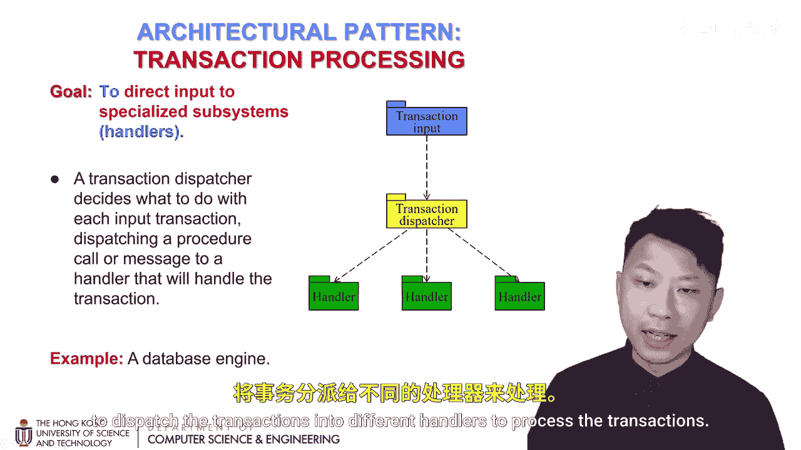

使用此模式的应用示例是数据库引擎，因为在数据库管理系统中存在许多事务，DBMS利用此模式将事务分发给不同的处理器进行处理。

### 管道-过滤器模式

在此模式中，数据流通过一系列过滤器传递。例如，如果你有一系列图像需要处理，可以将第一张图像输入第一个子系统（如转换为灰度图），处理完成后，将其传递给第二个子系统（如进行抗锯齿处理）。此时，第一个子系统空闲，可以开始处理第二张图像。这样，不同的子系统可以同时处理不同的图像，这就是**流水线**处理。

该模式的好处是每个过滤器或子系统可以并发地处理数据。使用管道-过滤器模式的应用示例是Unix Shell。

### 模型-视图-控制器模式

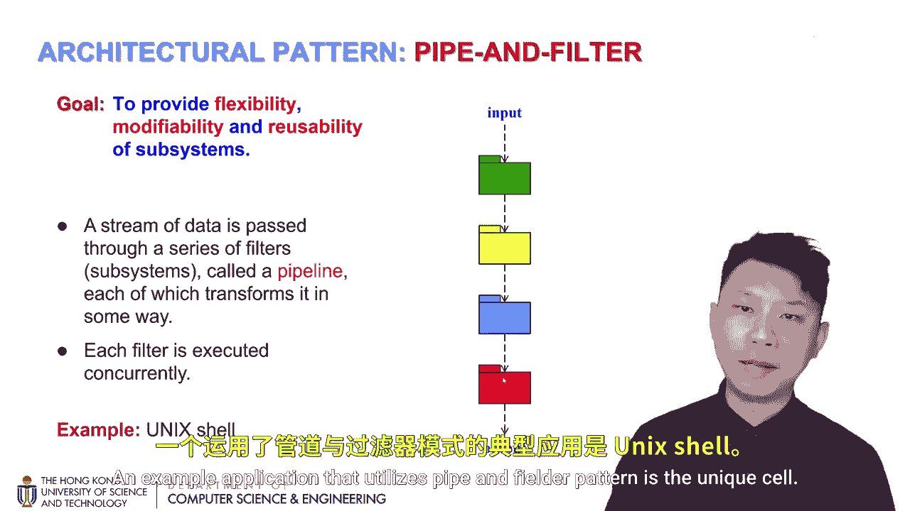

MVC是一种非常流行的模式，用于开发涉及用户界面、数据和控制器系统。**模型**指处理系统数据的子系统，**视图**指处理用户界面的子系统，**控制器**指控制软件系统行为的子系统。

我们将大型软件系统拆分为这三种类型的子系统。这样做的好处是，例如，如果你想修改用户界面，只需修改视图子系统，而无需触碰其他两个子系统；如果你想修改数据，只需修改模型子系统。MVC模型试图将用户界面层与系统的其他部分分离。

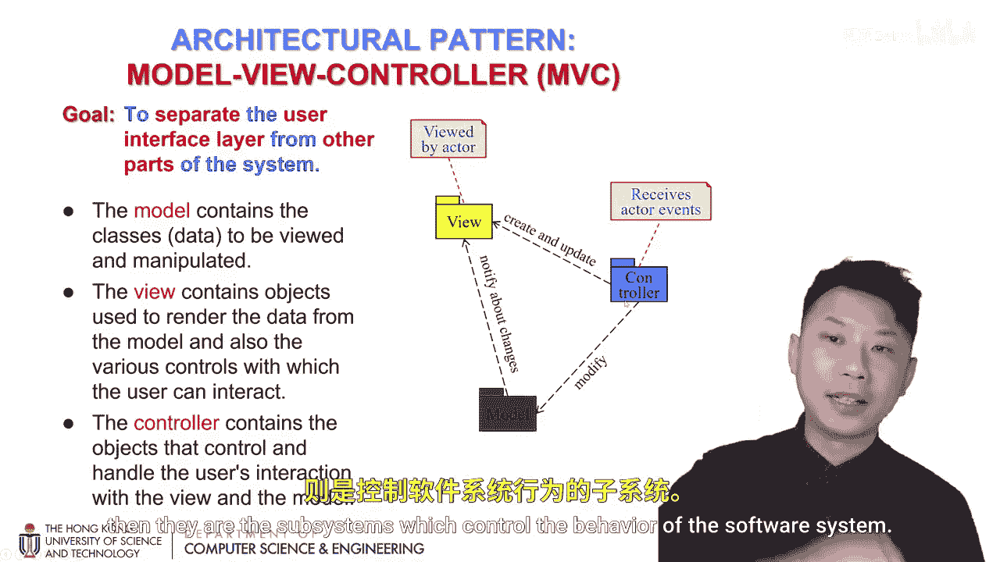

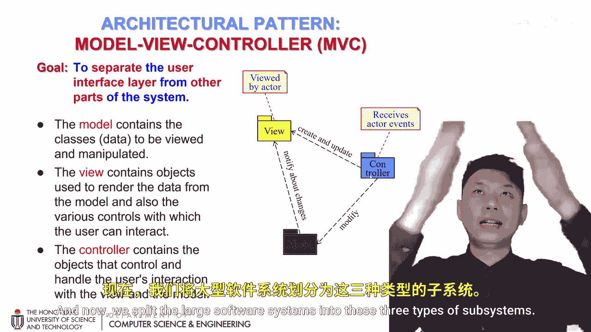

我们可以使用**观察者设计模式**来分离模型和视图。

## 总结

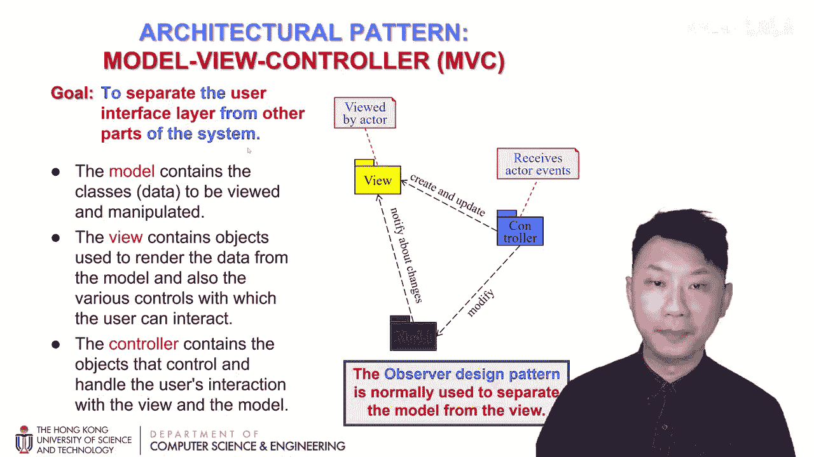

本节课中，我们一起学习了软件架构设计与分析。我们理解了如何通过子系统来组织系统，区分了封闭层与开放层的连接方式，并探讨了如何根据不同的非功能性需求（如性能、安全、可维护性）来选择合适的架构策略。最后，我们介绍了几种关键的架构模式，包括多层、仓库、客户端-服务器、代理、事务处理、管道-过滤器和MVC模式，这些模式为构建复杂软件系统提供了经过验证的蓝图。掌握这些概念对于设计出结构清晰、易于维护且满足非功能性需求的软件至关重要。