# 香港科技大学【中英⚡软件工程｜Software Engineering Specialization】 p43 P43 03_用例分析 -BV1MMEjzoEhg_p43-

Then the next topic that we're going to cover is use case analysis an analysis classes an abstraction of one or several classes in the final system implementation。

 so by coming up with all the analysis classes somehow you can estimate eventually how many classes that you need for implementation。

 but still it's a good idea to come up with all the analysis classes before you go to implementation because by knowing what are the analysis classes。

 you know roughly the classes that you need in order to fulfill all the functional requirements。

 So that's why here I say we focus on functional requirements and notice that the class descriptions that we use for analysis classes are conceptual but not implementation oriented。

 So that's why I say right。

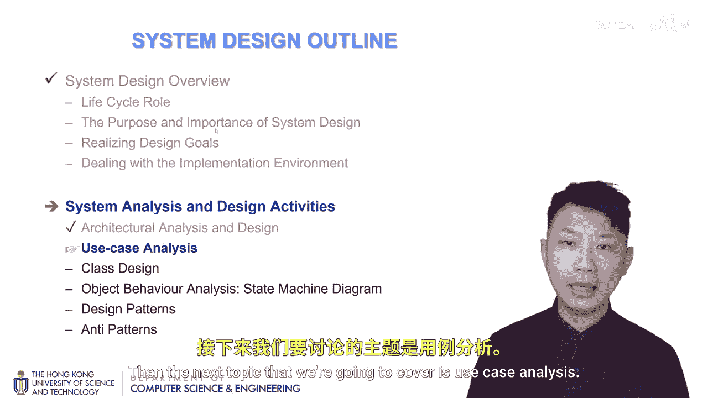

And notice that class descriptions that we use for NS classes are conceptual。

 but not implementation orientiented。Because we are doing abstraction。 We try to skip details。

And attribute types are conceptual， not programming language types。

 behavior is defined by testual descriptions of responsibilities and relationships are conceptual。

 not implementation oriented and analysis classes are one of the following stereotype they can be either boundary。

 entity or control analysis classes。

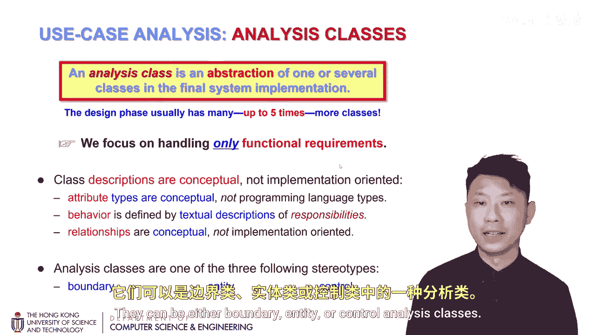

So if we are talking about boundary classes， then we use this notation to denote a boundary class。

And a boundary class models the interaction between the system and its actor。

And it represents an abstraction of UI elements or device。

 and it represents an abstraction of UI elements or devices that we need for a particular functionality and it interacts with actors outside the system as well as objects within the system and the description should be a fairly high conceptual level。

 For example， you're going to say that for a particular functionality。

 we need some UI but not describe every single button， every single item。

 the menu that we have within the UI again here we try to perform abstraction to skip details because we try to deal with the complexity of the design。

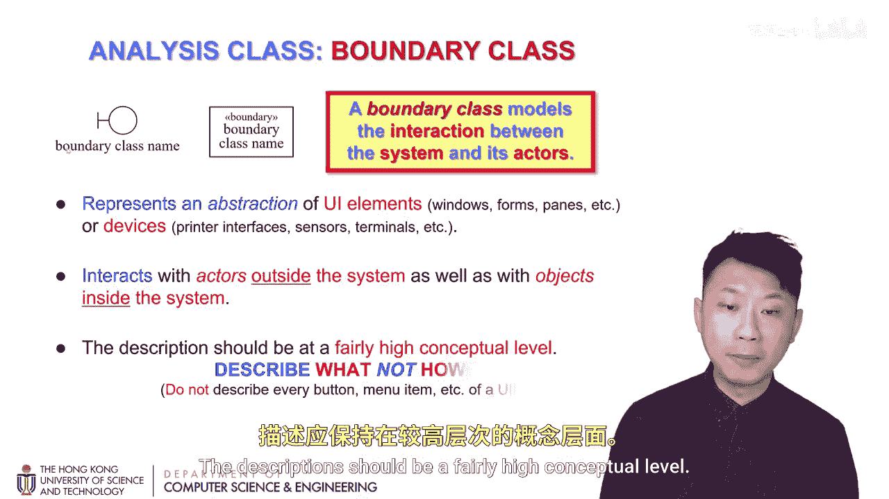

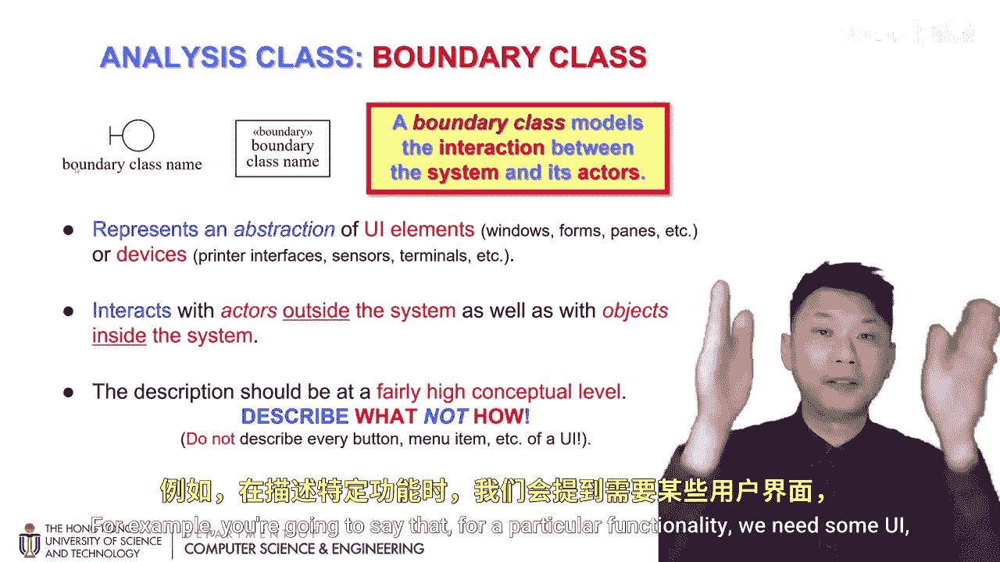

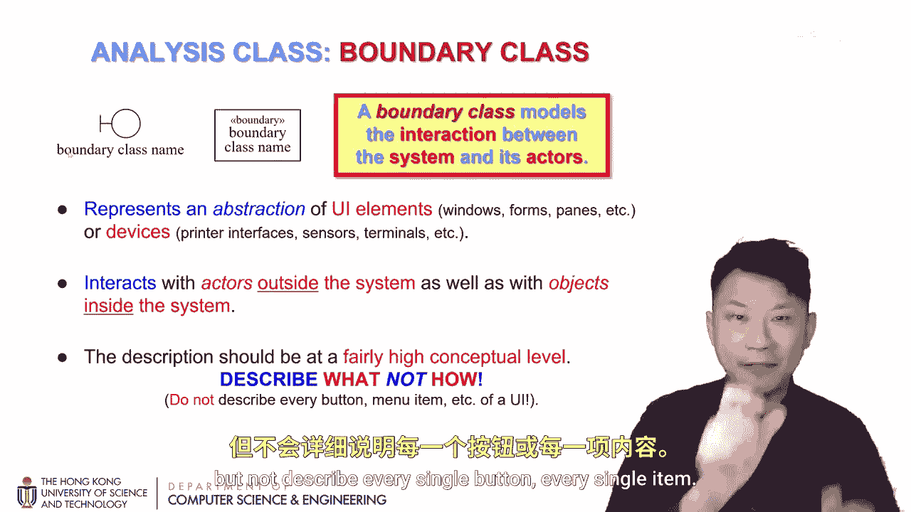

And why do we want to have battery class in our design because we want to encapsulate and isolate changes in the systems interface。

 So if we want to modify the UI of a particular functionality。

 then we simply have to modify the battery class。

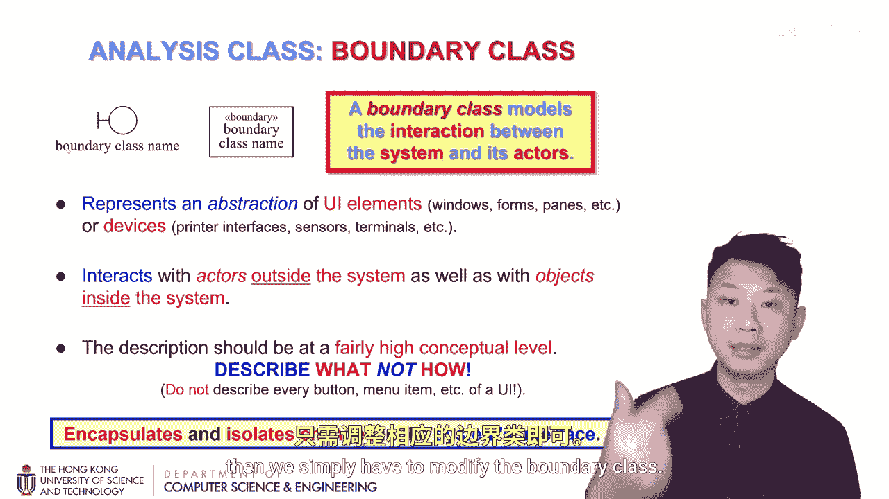

So how to identify boundary classes。Usually they are find from the useK descriptions。

 starting from the actors， you try to identify the forms and windows needed to enter data into the system or identify notices and messages that the system uses to response and notice that you do not model the visual aspects of the interfaces that means you don't specify every single button。

 every single icon every single menu that you have within the interfaces and we always use the user's terms for describing interfaces。

And initially， we will identify one boundary class instance for each actor use case pair that we have within our use case diagram。

For human actors， it represents the U I window with which the actor interacts with the system。

 for external system actors， it represents the communication interface to the external system。

 So now， let's take a look at this example use case model for the As U cost registration system。

 And the focus on the functionalities that a professor can perform on the system。

 So from the use case diagram， we know that we need some professor U I for the professor to select course to teach and also request enrollment information。

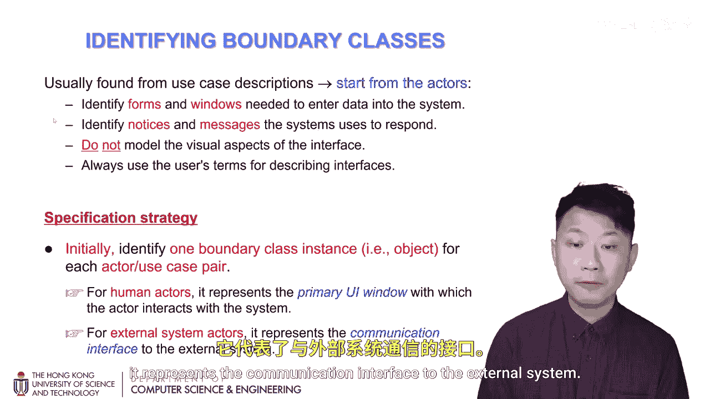

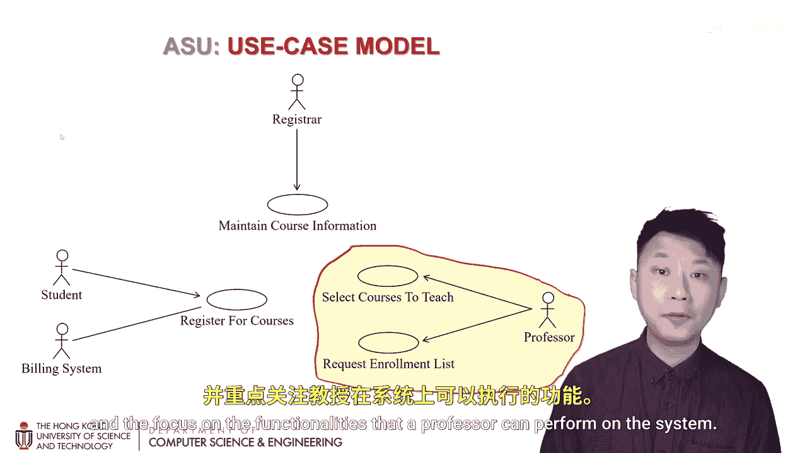

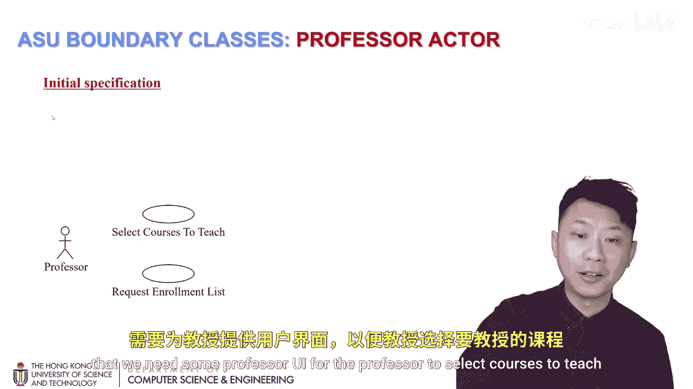

So now that means we need a boundary class， Profes UI， or Profess to do something on the system。

 and then notice that the initial boundary objects can later be aggregated to or become aggregations of other boundary objects。

For example， we may have other UI which is select course to teach UI。

 which is part of the Profesor UI， and also we enrollment UI， which is also part of the Profe UI。

And then within Sla courses to teach， we may have some further UIs， for example， create schedule UI。

 we will schedule UI and modify Sch UI， they are part of the Sla courses to teach UI。

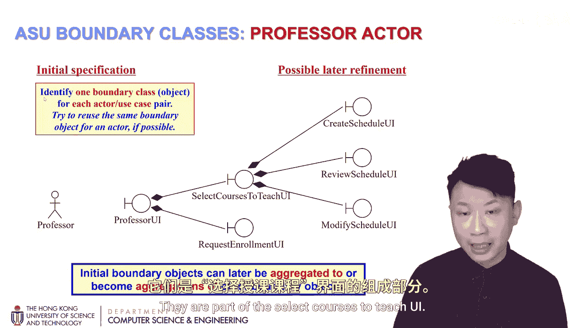

And another type of analysis class is what we call entity class。

And entity class models information that is long lifted and often persist within the system。

 so we focus on data that persists within the software system and it's not difficult to identify entity classes from the domain model that we have built for the software system so again we focus on data that persist within the software system。

And an entity object we will likely get is data from a database and why do we want to have entity class because we try to encapsulate and isolate changes to the information it represents。

 So if we want to modify some information on the system， we simply have to modify entity classes。

In how to identify entity classes， we will examine the scenarios of a use case and determine what domain model classes are needed to carry out the use case。

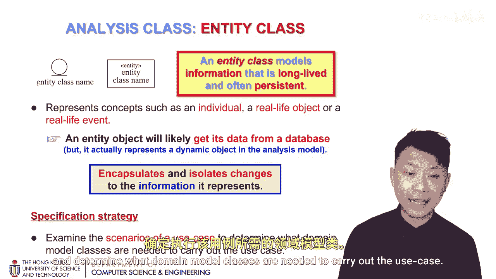

So we have to go back to our domain model。And identify objects that are relevant to a particular use case scenario for example。

 for the create schedule scenario， we can see that somehow we need to get the term year and the cost information and also the teaching schedule and these are the things that persist on the software system。

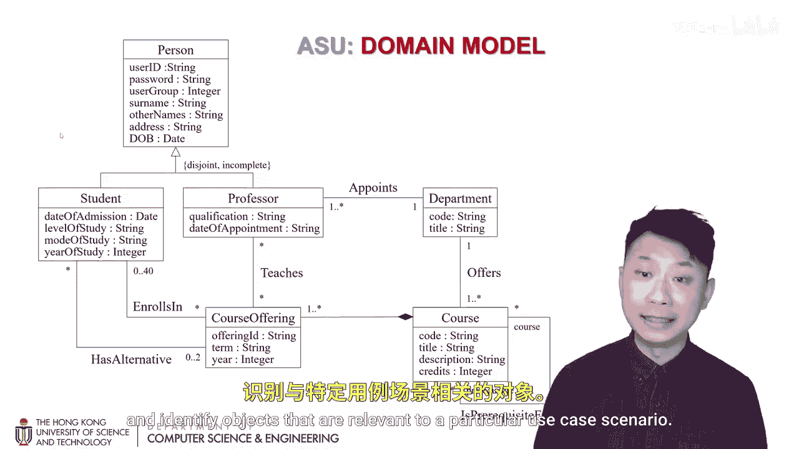

And now you can see that somehow we need these free entity classes for the C schedule scenario。

 and they are courses， cost offering and professor。

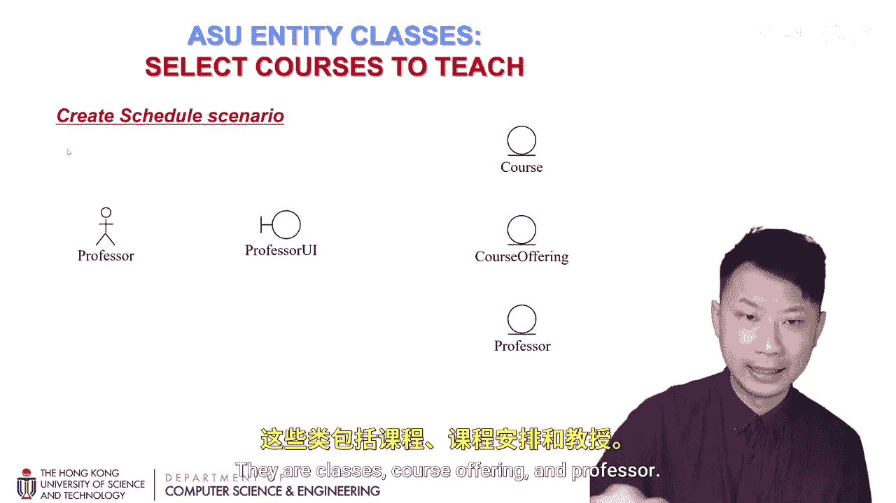

And then within this scenario， we also need the professor UI。

And the last type of analysis class is control class， a control class models， coordinate sequencing。

 transactions and control behavior。 So that means control classes they going to control the behavior of the software system。

And notice that a control class instance usually does not have a correspondence in the application domain。

And a control object provides the glue that ties other classes together in one use case realization。

 so we use control class to poll different classes together within a use case scenario and a control class instance is used to represent control related to a specific use case or business logic and by using control class we can encapsulate and isolate changes to control or business logic that means if we want to change the logic of the behavior of the program we simply have to modify control classes。

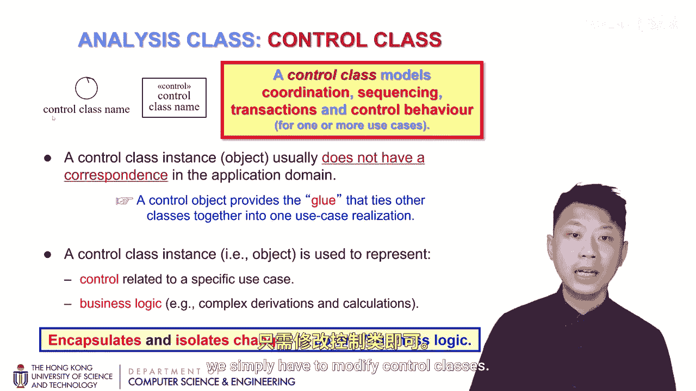

And how do we identify control classes Initially， we assign one control object for each actor and use case pair。

 and this object is responsible for the flow of events within the use case。

 If we have some complicated behavior within a use case， then we may need several control classes。

And it's also possible that we can combine several control objects together or eliminate some of the less important control objects。

And notice that a control object should only be tied to atmost one actor why。

 because changes in system requirements are often initiated from actors and also by associating a control object with at least one actor we isolate changes required to only the functionality needed by that particular actor So that's why for simplicity we tie the control object to atmost one actor So now for the functionality select causes to teach and we can see that we need some professor UI and we also need a select causes to teach manager to control the behavior within this use case and this are the entity classes that we need the data objects that we need for this particular use case。

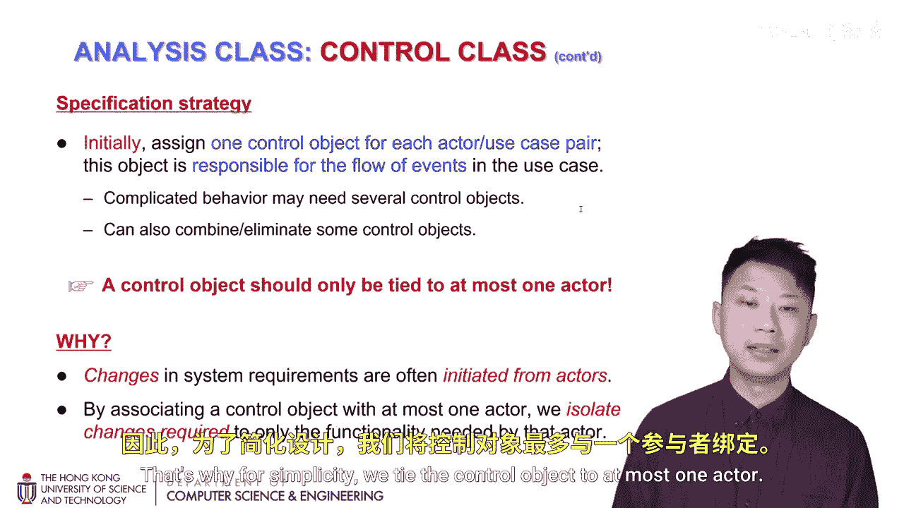

Then now you may ask， how do we connect the boundary control and entity objects together。

 These are the rules that you can use for connecting different objects together within a use case。

 Notice that actors， they can interact only with boundary objects。

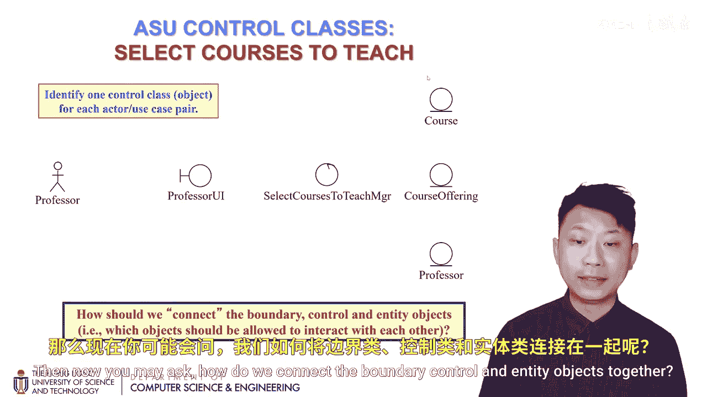

And boundary objects they can interact only with control objects it's not possible for one UI to interact directly with another UI if you want one UI to interact with another UI。

 it has to be done through a control object and entity object can interact only with control objects that means for example。

 one data object cannot interact directly with another data object it has to be done through a controller and control objects can interact with boundary entity or another control objects and this are rules that we can use for connecting analysis objects together and now you can see that a professor is going to use the professor UI which is connected to the select courses to teach manager the controller。

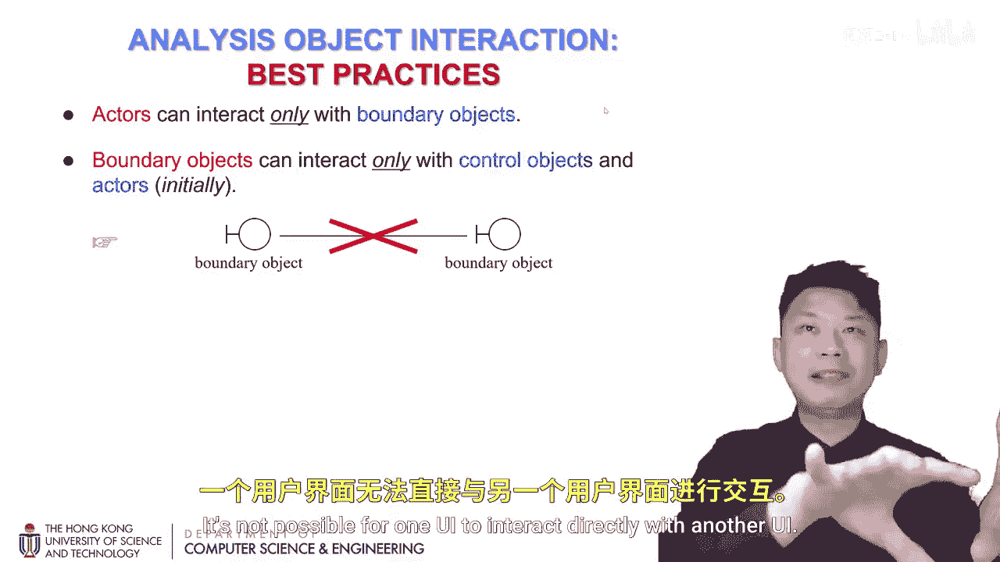

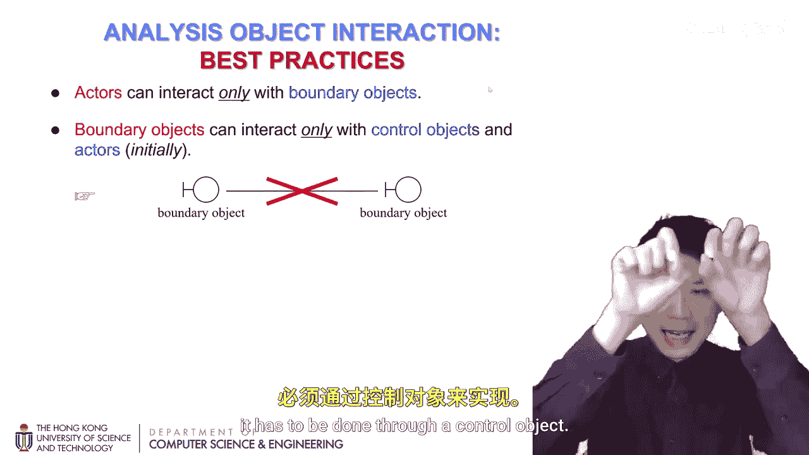

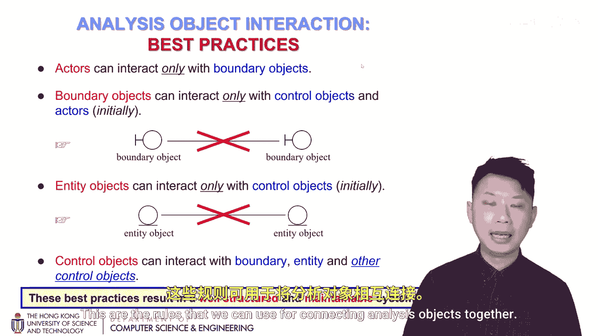

To modify the data that we have within this use case。

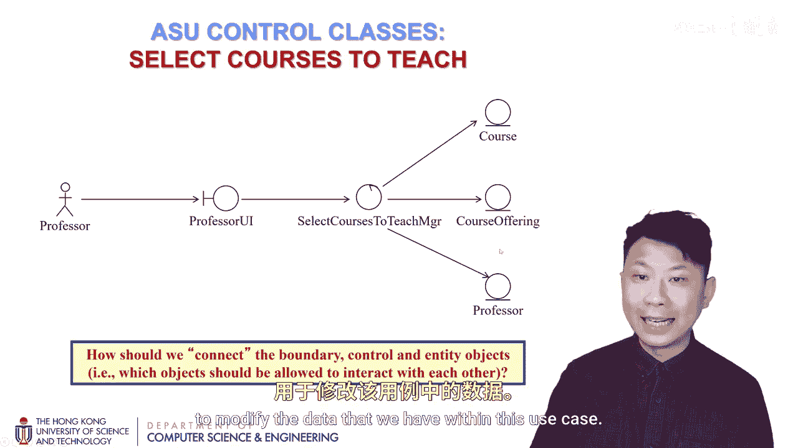

So why do we want to partition a use case into these three types of classes Because for each functionality we will need some UI。

 we will need some controller and also we will need some data。

 so that's why we partition the use case into these three types of classes and the goal is that we try to achieve localization of changes and try to achieve a stable system why because let's say if we want to modify the UI then we simply have to modify the boundary classes without touching the other two types of classes or if we want to modify the behavior of or if we want to modify the behavior of a functionality。

 we simply have to modify the controllers without touching again the other two types of classes。

But in reality， we may need to make many judgments about where to place the functionality。

 and we will talk about different design patterns that can help guide the decisions and we will cover design patterns in the upcoming lectures。

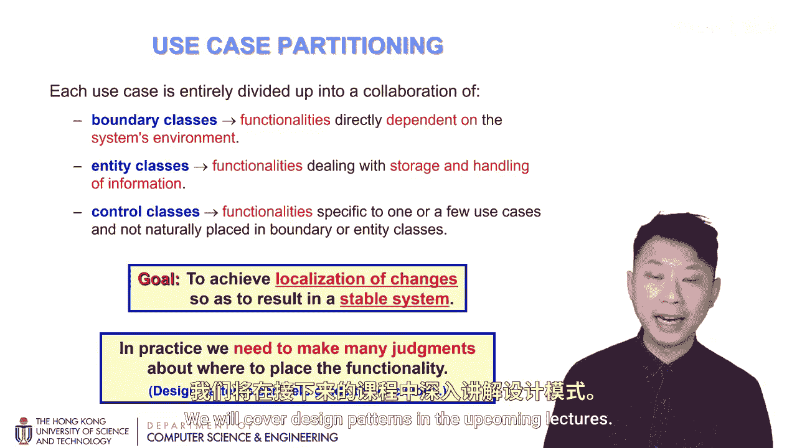

So now for this use case select causess to teach we're going to have this analysis analysis classes and then they trace back to this use case in our use case model and they trace relationship facilities future system maintenance and now let's say we want to modify or maintain this particular functionality select causess to teach then we can always trace back to our use case documentation and then get more details about this particular functionality。

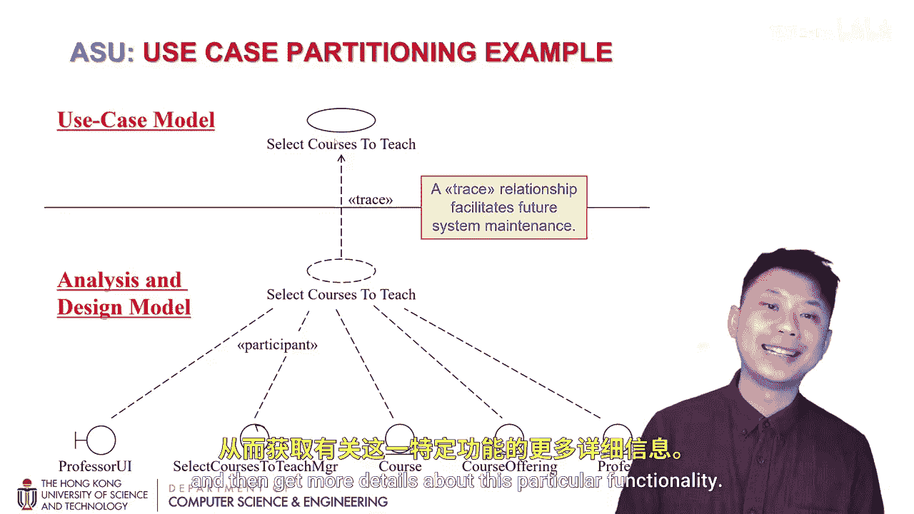