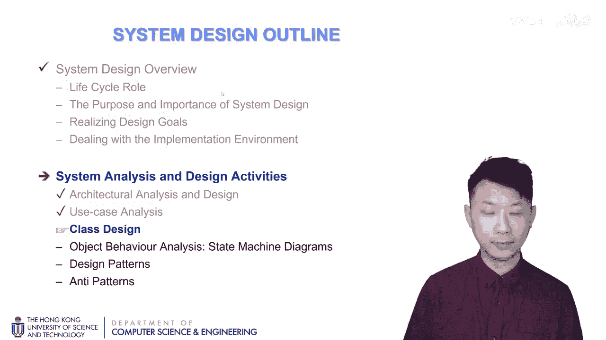
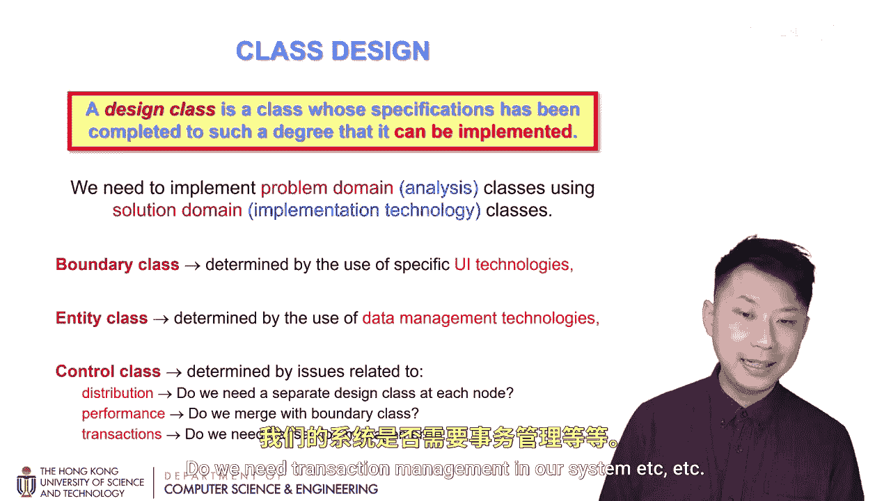
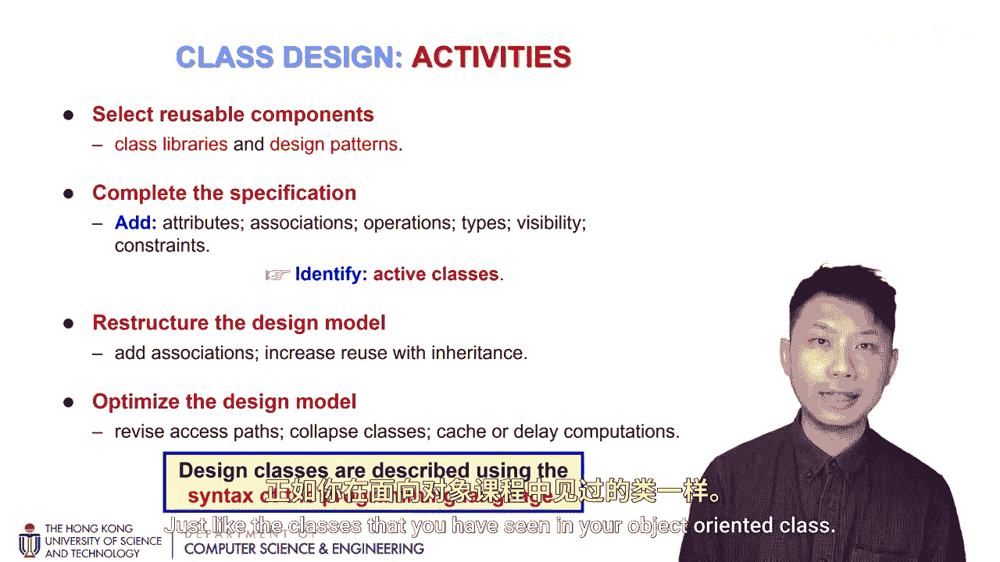
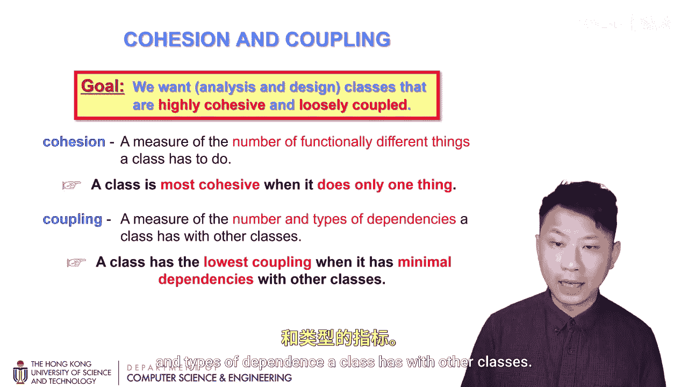
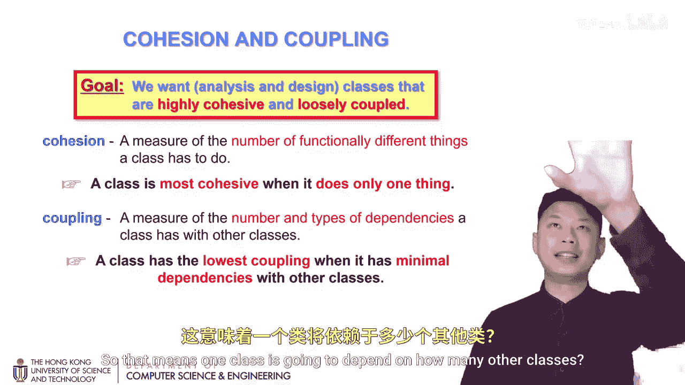
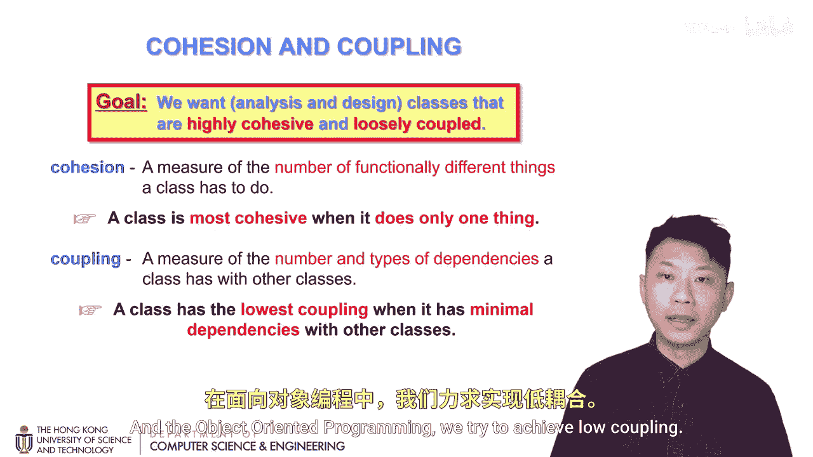
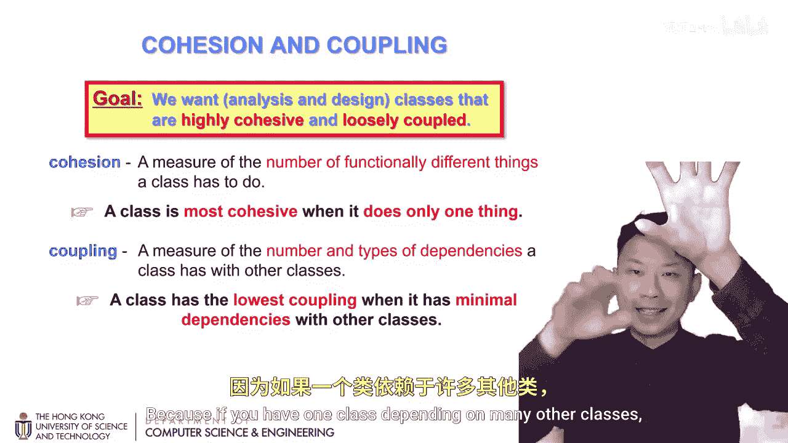

# 香港科技大学【中英⚡软件工程｜Software Engineering Specialization】 p44 P44 04_类设计 -BV1MMEjzoEhg_p44-

And the next topic that we're going to talk about is class design。So in class design。

 we try to come up with all the classes that we're going to use for implementation。

 and we need to implement prong domain classes using solution domain classes。So boundaryary classes。

 they are about the UI teleologies。Entity classes， we have talk about data management technologiesologies。

And then control classes， they will control the behavior of the software system and when we try to come up with the control classes。

 we may have to tackle issues related to distribution， performance or transactions。For example。

 do we need a separate design class at each node？Do we merge with boundary class in order to achieve performance。

 do we need transaction management in our system， etc cetera， et cea？

And then when we come up with classes that we're going to use for implementation。

 we have to select reusable components， for example。

 whether there are some libraries that we can be used or some design patterns that we can actually reuse and also complete the specification。

For each class you have to add attributes， associations， operations， types。

 visibility and also constraints whenever possible， and also you have to identify active classes。

And the definition of active class is a class that has its own f of control。

And they are usually controlled classes or boundary classes。

 and also we have to restructure the design model， for example。

 associations and increase reuse with inheritance。And you also have to optimize the design model。

 for example， whenever you have a cycle in your class diagram， then you may have to revise DSS paths。

or collapse multiple classes into a single class， or catch or delay some of the computations。

 etctera， etc ce， and notice that this design classes they are described using the syntax of the Poming language。

Just like the classes that you have seen in your object oriented class。

And when you come up with all the classes， you should also make sure that the classes they are highly cohesive and loosely coupled。

 so what do we mean by cohesion and coupling cohesion means a measure of the number of functional different things that a class has to do。

And a class is most cohesive when it only does one thing。

So that means each class should be responsible for just one thing。

 and you should not merge multiple classes together as a big class。

 and that big class is going to be responsible for multiple things。

So that's what we mean by having high cohesion， one class should be responsible for one thing and if we have a class which is responsible for many things within a system。

 then it will become a God class。And God class okay should be something that we should avoid okay within a software system because a got class is difficult to maintain and also difficult to update and coupling is a measure of the number and types of dependence a class has with other classes so that means one class is going to depend on how many other classes。

And a class has the lowest coupling when it has minimal dependence with other classes and in object oriented programming。

 we try to achieve low coupling because if you have one class depending on many other classes that class is going to be difficult to maintain and also update so that's why we want to achieve minimal dependence between classes in object oriented programming and that's all I want to cover today。

