# 香港科技大学【中英⚡软件工程｜Software Engineering Specialization】 p45 P45 01_状态机图 -BV1MMEjzoEhg_p45-

Hi students in this lecture we're going to talk about how to draw a ST machine diagram to capture all the important states and transitions within an object that exist in a software system and this lecture is about drawing ST machine diagrams So this is an example of a machine diagram within a steam machine diagram you have to specify all the states for example。

 this is a steam machine diagram for bank account for a bank software system then for a bank account then we may have states like in credit。

Ophic drawn， flowten or closed。And we also have to specify all the transitions between the states。

 For example， when the balance becomes negative， we're going to move from the ined state to the overdrowone state and let's say the account balance remains negative for three months then we gonna to ask the bank manager to frozen the account and if we are in the ined state and we call this operation close account to close the account。

 then we're going to move from the incred state to the closed state and then after closing the account for five years。

 then we move into the final state So this is a special So this is a special state within our state machine diagram when we destroy the object。

 when we delete the object， we're going to move into the final state another special state that we have within the state machine diagram is what we call the initial state and we specify it using a dot So when we create the object using a constructor we go into this initial state。

Then once the object is being created， it will be moved directly into the in state so on and so forth。

 and a stay machine diagram describes the behavior inside an object and we have to specify all the possible states and all the possible transitions between the states within the stay machine diagram and is a directed graph that shows the states of a single object using nos and also the events that cause stage changes the arts it shows all the messages that an object can send and receive and it also describes all the possible states that an object can go into and it also describes all the possible states that an object can get into during its lifetime lifetime means after we construct the object and before we destroy the object that means the lifetime and is drawn for a single class to show the lifetime behavior of a single object So this is a more detailed version of a stay machine diagram。

 let's say if we know all the operations that we can perform within a class。

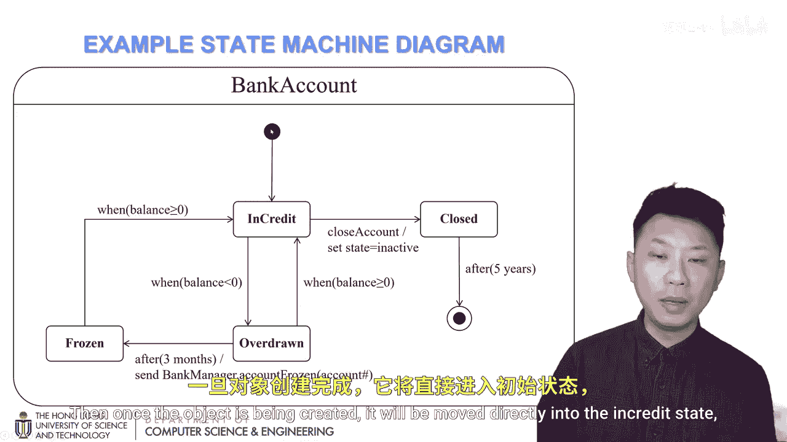

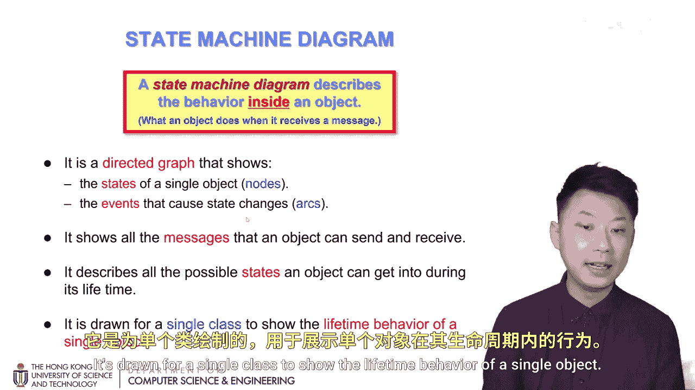

We can also declare the activities that we can perform within a state for example， in the in state。

 we can deposit money or withdraw money using these operations and under the overdrawn state。

 we can also withdraw money and also deposit money using these two operations and then when the balance is less than the overdrift limit。

 we can notify the manager so now we can also specify all the details within a state。

 if we know all the operations that we can perform within a class。

And that's why I say that this is a more detailed version of a same machine diagram because we provide more details within a state。

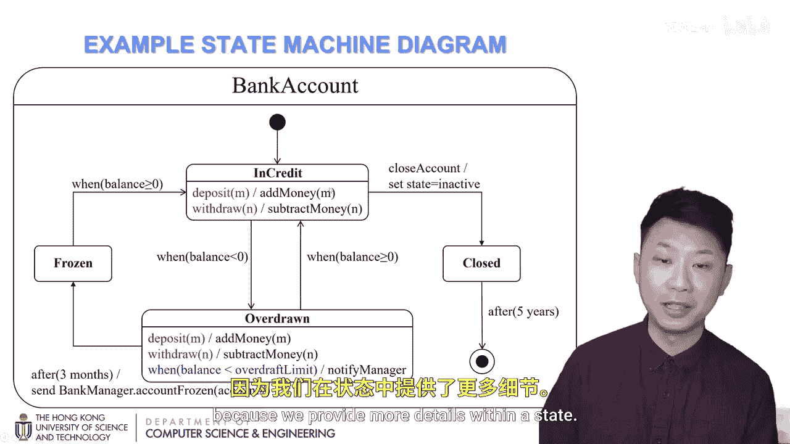

And this is how we specify a state okay， we use a rectangle to specify a state and notice that a state has duration that means once you go into。

 for example， the incrit state， you can stay within the in credit state for some time。

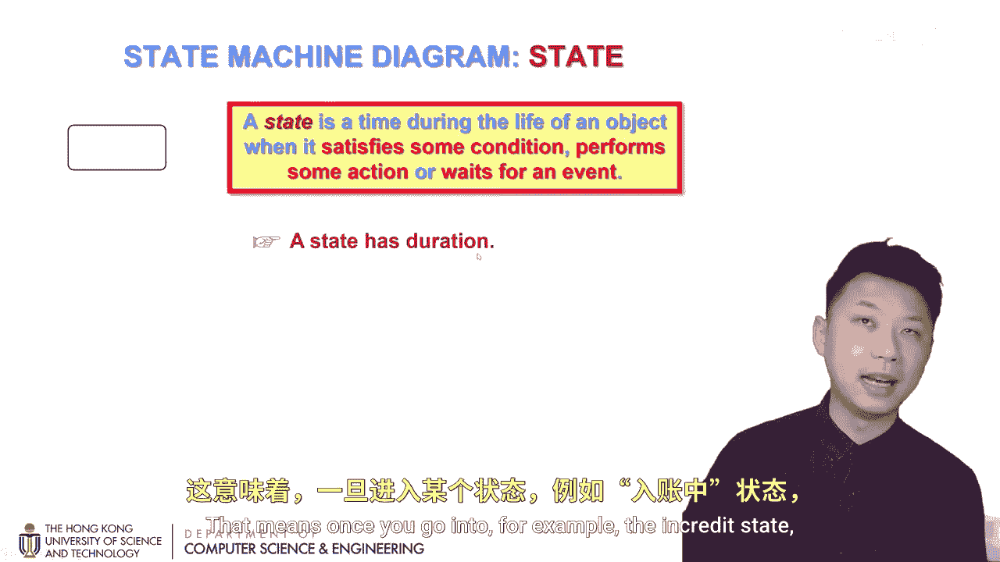

As long as the balance is positive， you will remain in this incredible state。

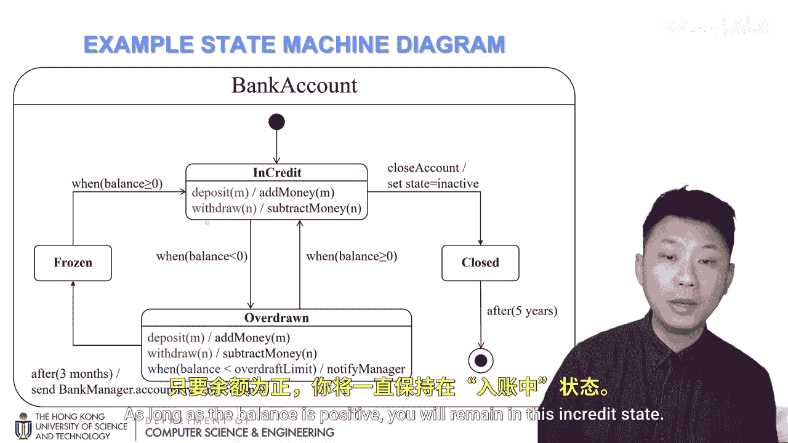

And we define a state as a time during the life of an object when it status some condition。

 performs some action or wait for an event。So a state may be characterized by， for example。

 the value of one or more attributes。 For example， we can determine whether a bank account is overdran or not based on the balance。

 the attribute balance that we have within the class or existence of a link to another object For example。

 if you talk about the rental copy that we have within a movie shop a rental copy is being reserved by a customer。

 then we put a link from the rental copy to a particular customer In that sense。

 the rental copy is being reserved by someone is no longer available So we can determine the state of a rental copy by double checking whether So that means we can determine the state of a rental copy by double checking whether we have a link between a rental copy and a customer if there is a link between the rental copy and the customer。

 that means the rental copy is no longer available and this are the two special states that we have within a St machine。

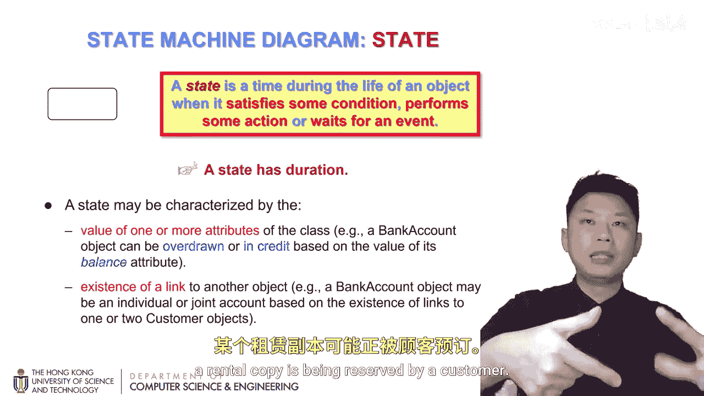

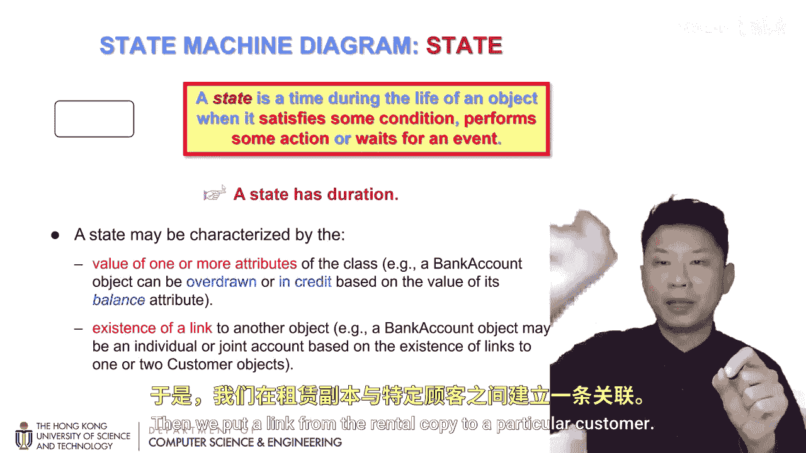

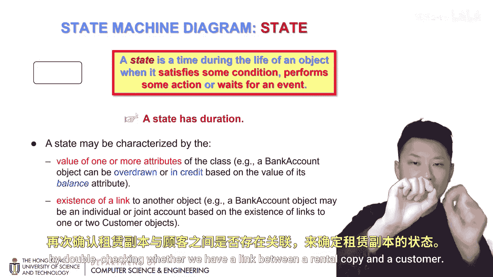

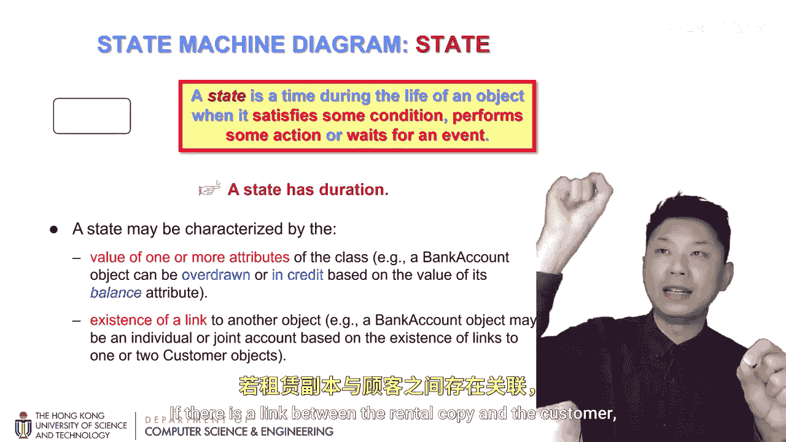

We use a dot to denote an initial state that means when we construct the object using the constructor。

The object will go into the initial stage。And then we also have the final state。

 which is a dot within a circle， and when we destroy the object or when we delete the object。

 then we go into the final state。And if we have a steam machine diagram with the initial state or final state。

 that may indicate looping behavior that means you never go into the final state。

Notice that state may be named it， that means within the state you have to provide the name of the state or unnamed it。

 Those are what we call anonymous states。In this course， whenever possible。

 we have to name the states because we have to make sure that all the stakeholders。

 when they read the same machine diagram， they will understand the meanings of the states。

So that's why I always recommend students to always name all the states。

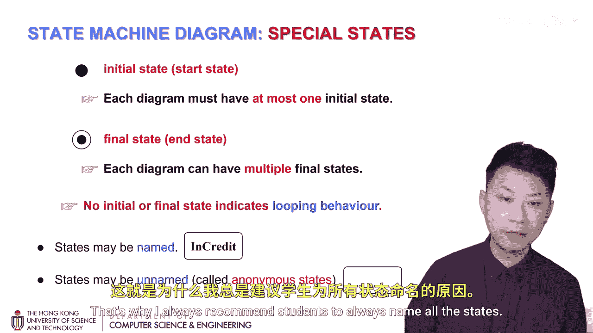

And the definition of a transition is a change of state from an originating state to a successor state。

 And notice that the sauce and target states， they may be the same。

 so we may go back to the same state。And a transition takes zero time， and cannot be interrupted。

Why do we have this restriction Because we want our steam machine diagram to be always deterministic deterterministics means you can always determine the stage of a particular object that exists in a particular time。

 and it's not possible for an object to exist in more than one states at one time。

 So that's what we mean by deterministic。And notice that without this restriction。

 then we may fire more than one transitions at a time。

 and eventually we may have an object that exists in more than one states at one time。

 and this is not what we want。 So that's why we need this restriction to make sure that a steam machine diagram is going to be always deterministic。

And this is how you specify a transition， you have to specify the event trigger， the guard condition。

 and also the effect list。So event triggerer means when an event happened。

 we're going to move from one state to another state。

 God condition means the condition that you need to satisfy before you can fire the transition。

 and event list is some。An effectless is an automatic procedural expression that should be executed when a transition fires。

 So something that has to be done when we fire a transition。 So now let's first talk about event。

 An event is something that happens at an instantaneous point of time。

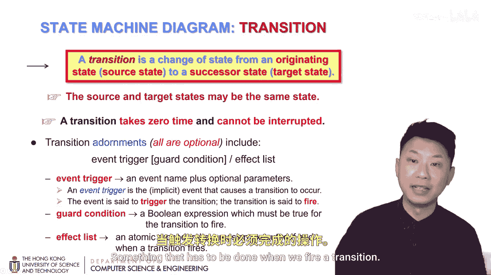

And there are different types of events that may happen within a same machine diagram。 for example。

 call event。You're going to cause some operations that you have within the class to perform something。

Or change event。 That means once you achieve some condition。

 then you're going to move from one state to another state。Or time event。So for example。

 after 10 seconds or when the date is equals to some date， okay。

 then you're going to move from one state to another state。For a signal event。

 that means the receive of an asynchronous communication from an object。 In this course。

 were going to focus on core event， change event and time event only。

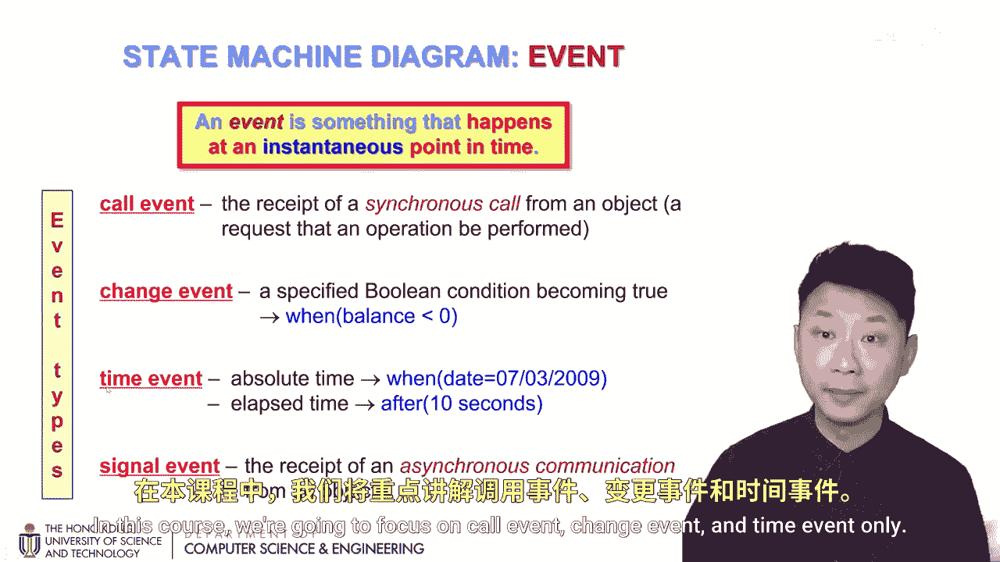

So these are some examples of core event， change event and time event。

Call event means when you call the operations that we have within the class to do something。

So for example， you can call deposit the operation to deposit some money into the account or call this withdraw operation to withdraw money from the account。

 so these are what we call call events。Change events means when some condition is being changed。

 For example， when balance is negative， then you're going to move from the incr state to the overdone state。

 Time event is， for example， after three months。You're going to move from the overdraone state into the frozen state。

So these are the three major types of events that we have within a steam machine diagram and notice that events they are processed one at a time if the event does not trigger any transition。

 then it's going to be ignored and only one transition within a steam machine diagram may fire just because we want our steam machine diagram to be always deterministic。

And there are two ways to get out of a state。 either automatic。

 That means once you finish all the activities within a state， then you move to the next state。

Or non automatic， that means it's caused by an event。 then once an event happened。

 you're going to move from one state to another state。

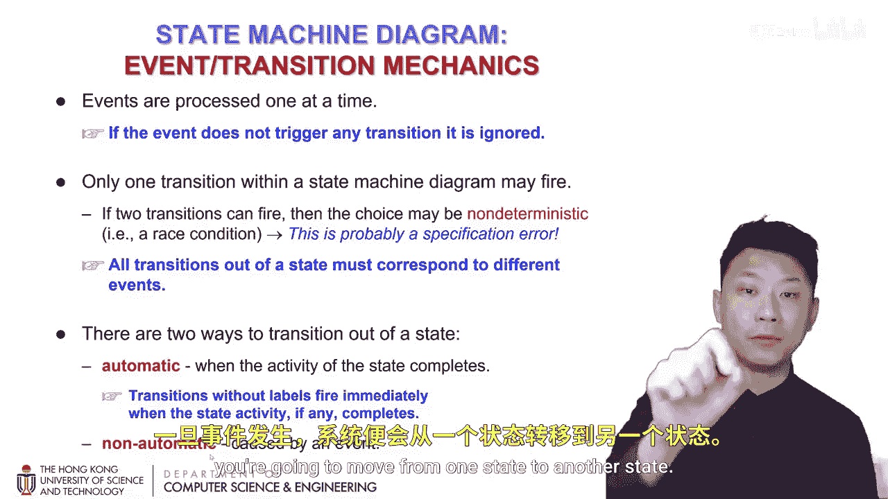

And we may have different actions and activities within a state machine diagram if we are talk about an action its going to be instantaneous and cannot be interrupted as mentioned before。

 for example， a transition is going to be instantaneous。

 so it's going to be an action between statess。And we may also have activity。

 which is going to take some time to complete and can be interrupted。 For example， within a state。

 you have different activities that you're going to perform within in the state。

 Then those are what we call activities that we can interrupt and。

It's gonna take some time to complete。

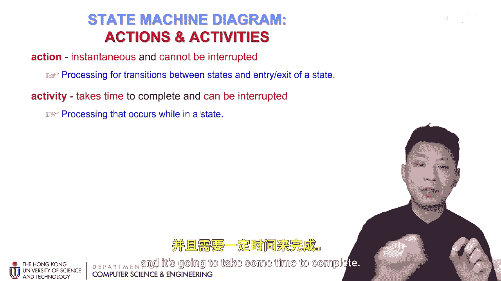

And these are the possible forms of state behavior。 It may be no behavior。

 That means you stay within a state until something happened。Or you trigger an event。

 and then you go from one state to another state。Or you going to do something with any state。

Or perform some entry activity within a state。Or perform some exit activity within a state。

 So what do we mean by do activity， entry activity and exit activity。 Let me show you some examples。

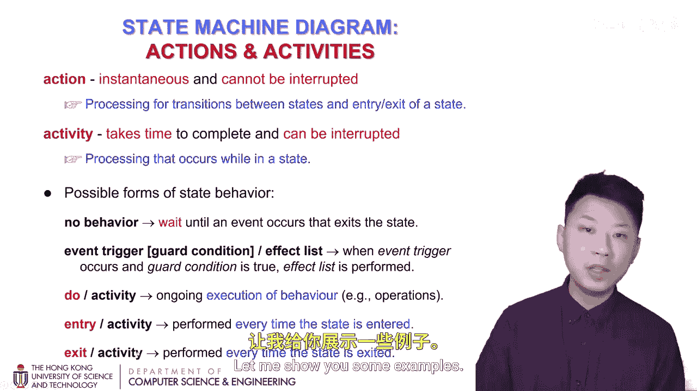

So this is an example same machine diagram for enter password。 Then when we enter this date。

 these are the things that we have to do。So these are the entry activities you have to set Echo to star and then clear the password。

 these are the things that you have to do when you enter the state。And when you exit the state。

 this is the thing that you have to do。 You have to set echo back to normal。

And then when you are within the enter password state， These are the things that you can do。

 For example， you can do key press to enter password or you can clear the password or you can press on the help button to display the help menu。

 etc cetera， etc cetera。 So these are the things that you can actually do within the state。

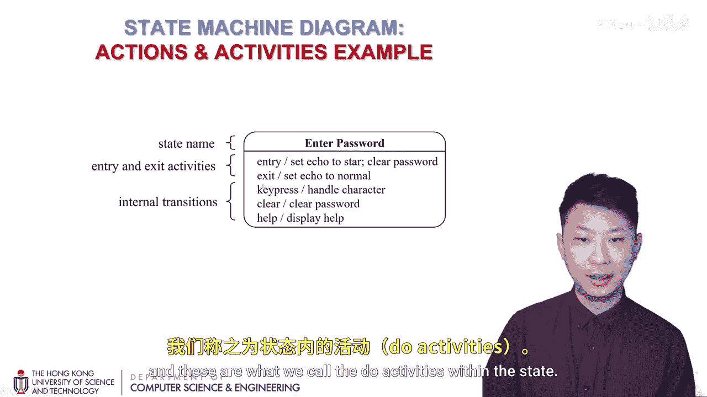

And these are what we call the two activitiess within the state。

