# 软件工程：P45：状态机图 📊

在本节课中，我们将学习如何绘制状态机图，以捕捉软件系统中对象所有重要的状态和转换。状态机图是描述单个对象在其生命周期内行为的有力工具。

## 概述

状态机图用于描述软件系统中单个对象的行为。它展示了对象在其生命周期内（从创建到销毁）可能经历的所有状态，以及触发状态之间转换的事件。通过绘制状态机图，我们可以清晰地理解对象的动态行为。

## 状态机图的基本概念

上一节我们介绍了状态机图的目的，本节中我们来看看它的基本构成元素。

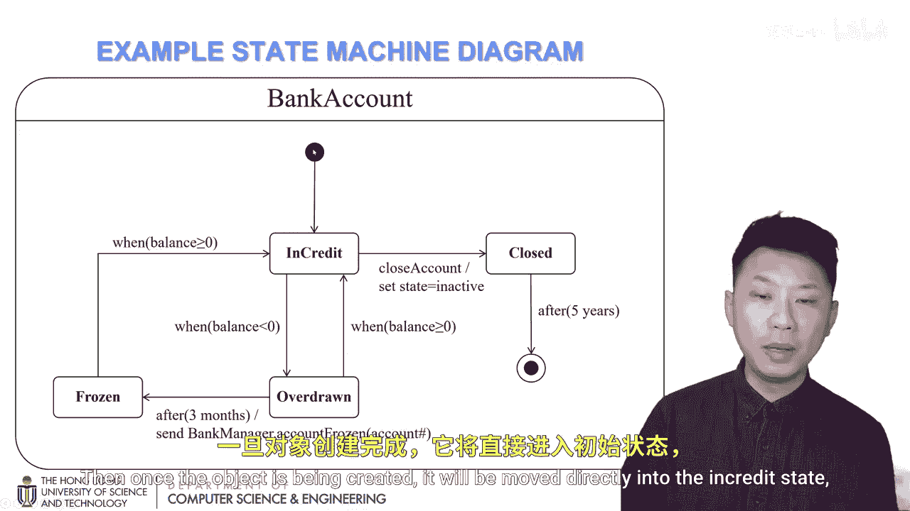

状态机图是一个有向图，它使用节点表示对象的状态，使用边表示状态之间的转换。它展示了对象可以发送和接收的所有消息，以及对象在其生命周期内可能进入的所有状态。

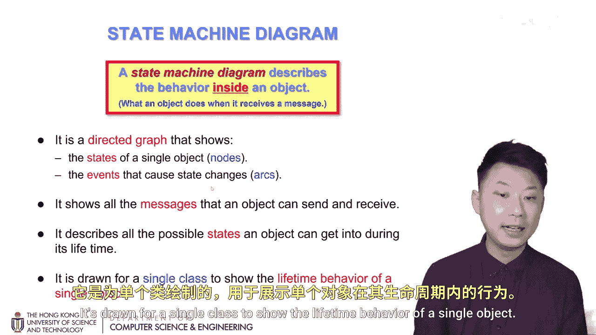

以下是状态机图的核心组成部分：
*   **状态**：对象在满足某些条件、执行某些活动或等待某个事件时所处的状况。状态具有**持续时间**。
*   **转换**：从一个状态（源状态）改变到另一个状态（目标状态）的过程。转换是**瞬时**且**不可中断**的。
*   **事件**：在某个时间点发生的、可能触发状态转换的事情。
*   **初始状态**：对象被创建后进入的第一个状态。
*   **最终状态**：对象被销毁前所处的状态。

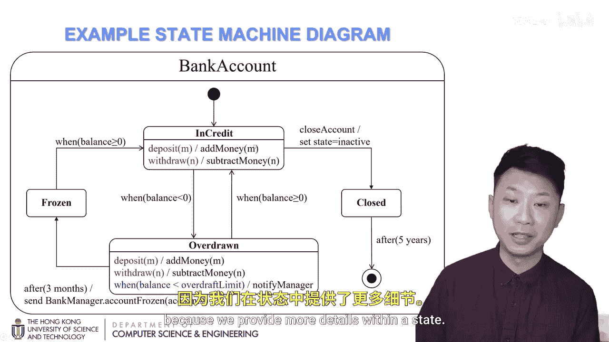

## 如何绘制状态机图

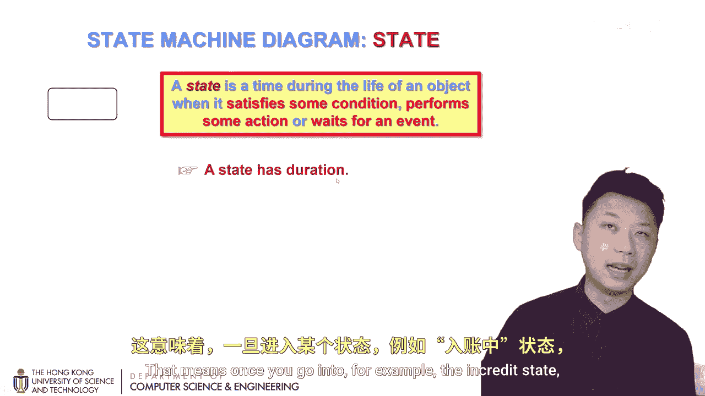

现在，我们来看一个具体的例子，学习如何绘制一个状态机图。

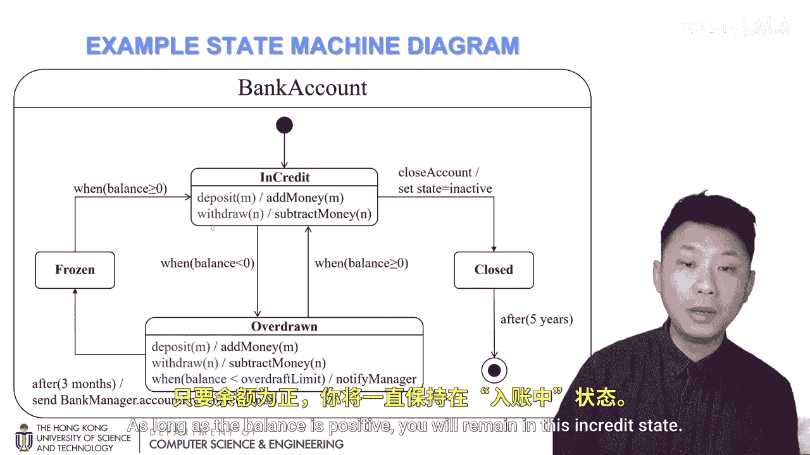

这是一个银行账户的状态机图示例。对于银行软件系统中的账户，我们定义了以下几个状态：`In Credit`（余额为正）、`Overdrawn`（透支）、`Frozen`（冻结）和 `Closed`（关闭）。

我们还需要指定状态之间的所有转换。例如：
*   当余额变为负数时，对象从 `In Credit` 状态转换到 `Overdrawn` 状态。
*   如果账户透支状态持续三个月，则转换到 `Frozen` 状态。
*   在 `In Credit` 状态时，如果调用 `closeAccount` 操作，则转换到 `Closed` 状态。
*   账户关闭五年后，转换到最终状态。

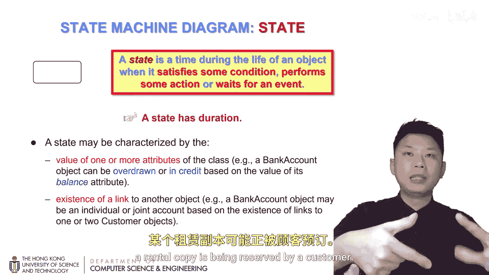

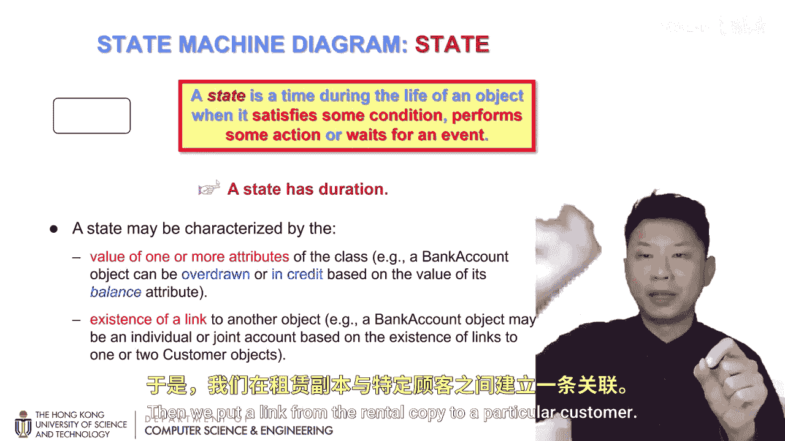

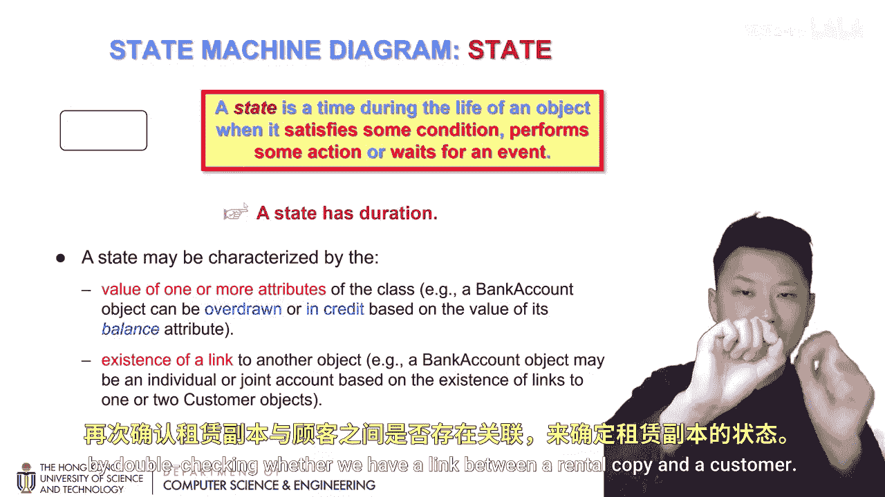

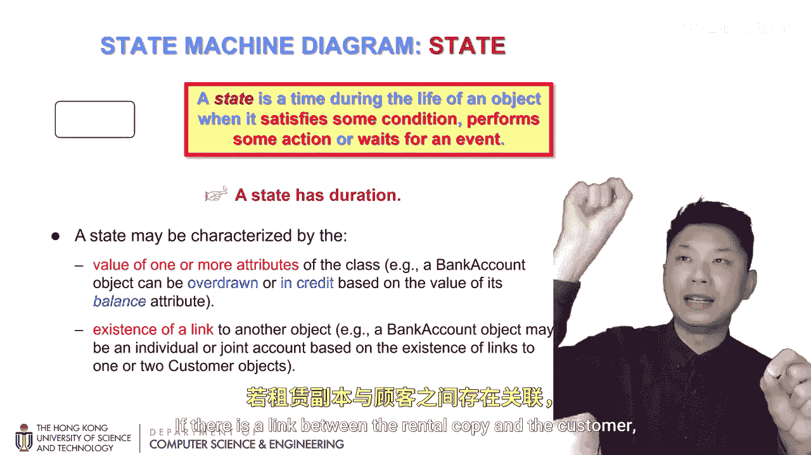

状态机图中还有两个特殊状态：
*   **初始状态**：用一个实心圆点表示。当通过构造函数创建对象时，对象进入此状态，随后立即进入第一个实际状态（如 `In Credit`）。
*   **最终状态**：用一个圆圈包围的实心圆点表示。当对象被销毁或删除时，进入此状态。如果状态机图没有最终状态，可能表示循环行为。

## 状态的详细描述

上一节我们看到了状态的基本表示，本节中我们来深入了解状态的内部细节。

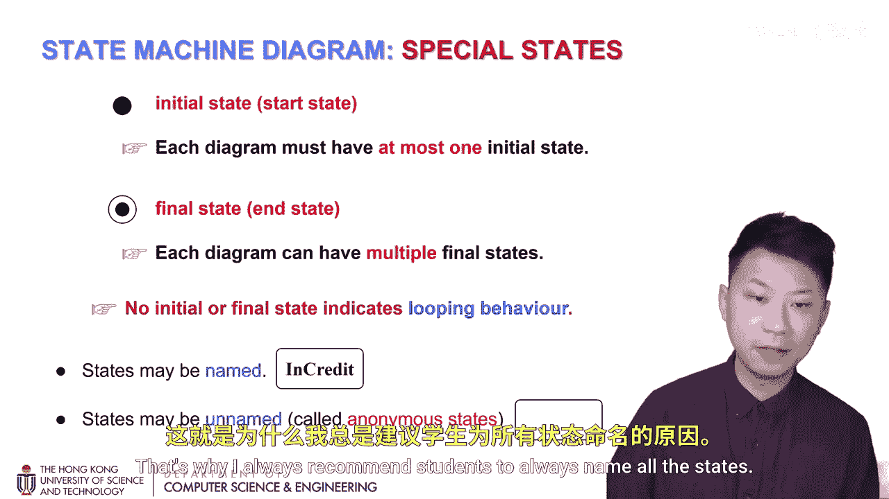

状态可以用一个矩形表示。我们可以为状态命名（推荐做法，便于理解），也可以使用匿名状态。状态的特征可以通过对象的属性值（例如，银行账户的 `balance` 属性决定是 `In Credit` 还是 `Overdrawn`）或与其他对象的链接关系来确定。

一个更详细的状态机图可以在状态内部声明可执行的活动。例如，在 `In Credit` 状态下，可以执行 `deposit`（存款）或 `withdraw`（取款）操作；在 `Overdrawn` 状态下，也可以执行这些操作，并且当余额低于透支限额时，可以执行 `notifyManager`（通知经理）活动。

## 转换的定义与事件类型

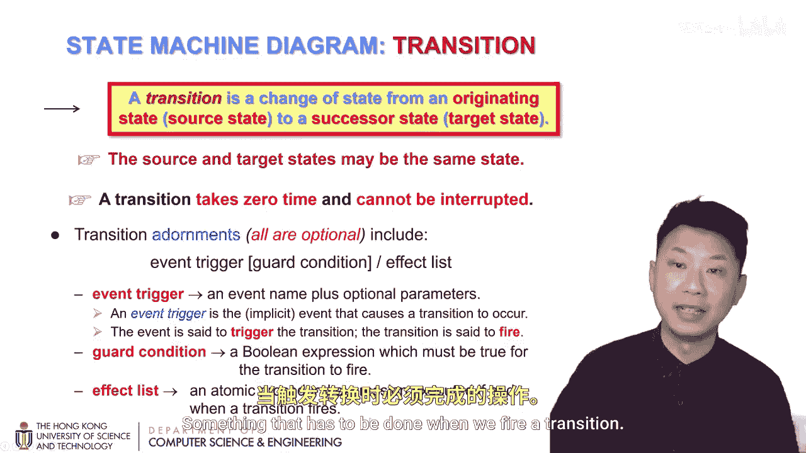

我们了解了状态，现在来看看驱动状态变化的转换和事件。

**转换**的定义是从一个源状态到目标状态的变化。源状态和目标状态可以是同一个，这意味着对象可以回到原状态。转换的触发需要三个要素：
1.  **事件触发器**：发生了什么事件。
2.  **守卫条件**：必须满足什么条件。
3.  **效果列表**：转换触发时要自动执行的操作。

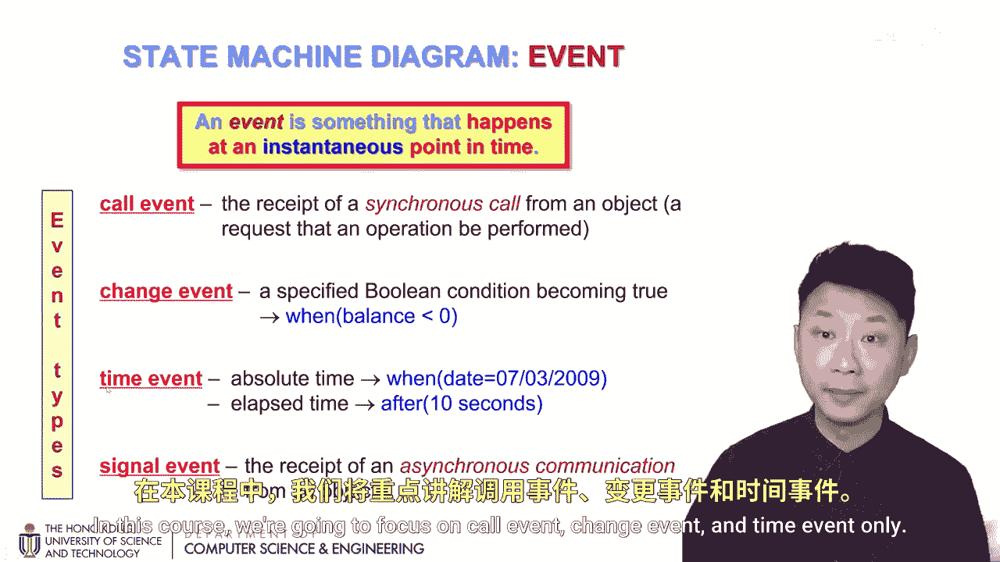

**事件**是在某个瞬时时间点发生的事情。在状态机图中，主要有三种事件类型：
*   **调用事件**：调用对象类中定义的某个操作。例如：`deposit(amount)`, `withdraw(amount)`。
*   **变更事件**：当某个条件变为真时发生。例如：`when (balance < 0)`。
*   **时间事件**：在某个时间点或经过一段时间后发生。例如：`after (3 months)`。

事件被**逐个处理**。如果一个事件没有触发任何转换，它将被忽略。同时，**一次只能触发一个转换**，这是为了保证状态机图的**确定性**，即一个对象在任一时刻只能处于一个明确的状态。

## 状态内的行为与活动

最后，我们来探讨对象在某个状态内部可以执行哪些行为。

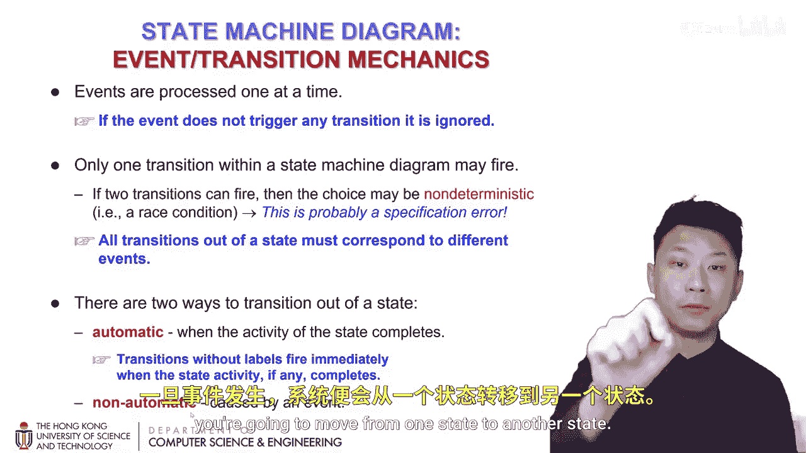

对象离开一个状态有两种方式：**自动的**（完成状态内所有活动后自动转换）或**非自动的**（由外部事件触发转换）。

在状态内部，可以定义多种行为：
*   **无行为**：停留在该状态，直到有事件发生。
*   **执行活动**：需要花费时间完成，并且**可以被中断**的操作。
*   **进入活动**：在**进入**该状态时**立即执行**的动作。
*   **退出活动**：在**离开**该状态**之前执行**的动作。

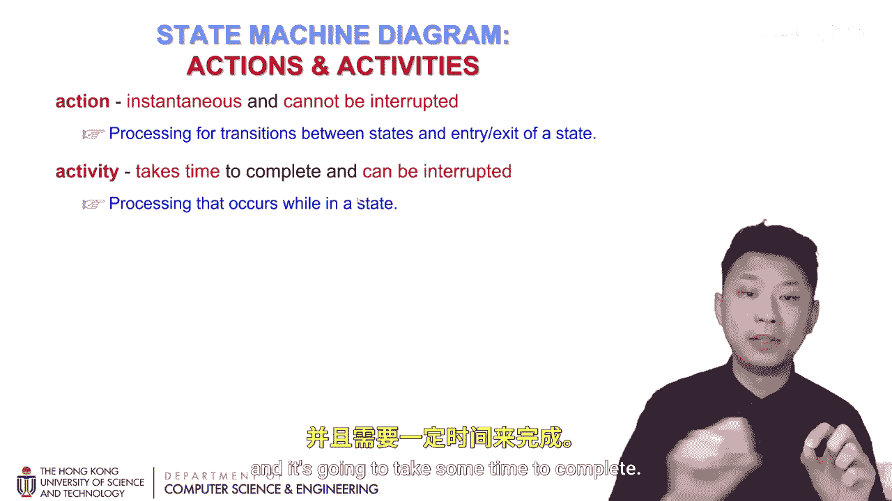

例如，在一个“输入密码”的状态中：
*   **进入活动**可能是：`set echo to ‘*’`（将回显设置为星号），`clear password`（清空密码）。
*   **退出活动**可能是：`set echo to normal`（将回显恢复为正常）。
*   **状态内活动**可能是：`do: key press`（处理按键输入），`do: clear password`（处理清空密码操作）。

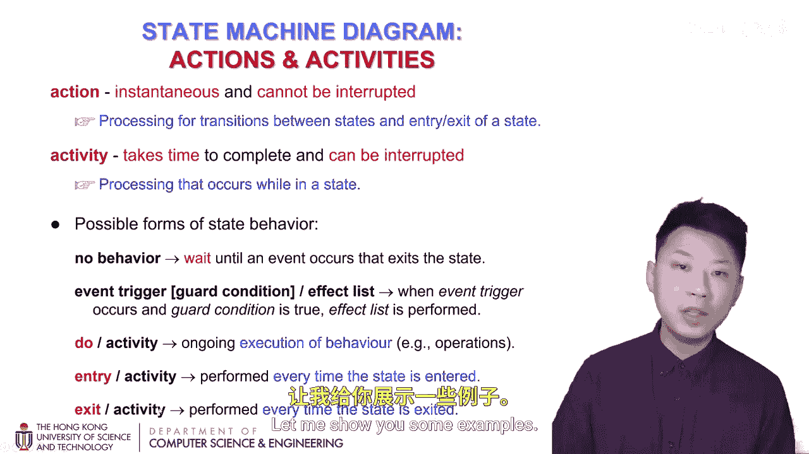

## 总结

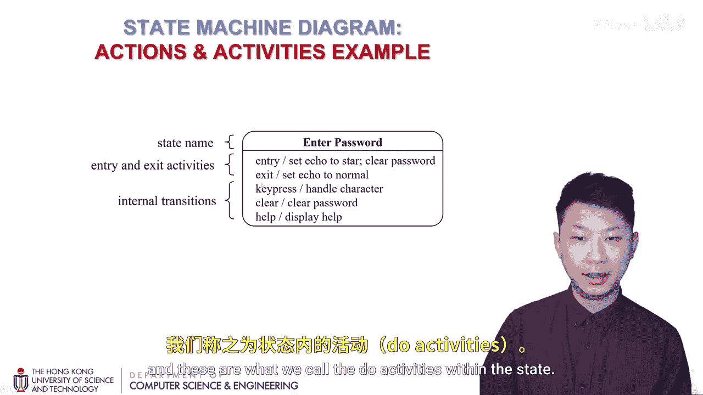

本节课中，我们一起学习了状态机图的核心知识。我们了解到状态机图是描述单个对象生命周期行为的强大工具，它由状态、转换、事件等核心元素构成。我们学习了如何识别和绘制状态，包括初始状态和最终状态；理解了转换的触发机制（事件、守卫条件、效果）；区分了不同类型的事件（调用、变更、时间事件）；并探讨了状态内部可以定义的活动（进入、退出、执行活动）。掌握状态机图有助于我们精确地建模和设计软件系统中对象的动态行为。