# 香港科技大学【中英⚡软件工程｜Software Engineering Specialization】 p46 P46 02_状态机图示例 -BV1MMEjzoEhg_p46-

So now we have talked about all the necessary components for drawing a steam machine diagram。

 Now let's take a look at this problem statement and try to come up with a steam machine diagram for this object section in this ASU cost registration system Now to construct a steam machine diagram。

 you have to ask yourself the following questions what are the possible states that the class can be in what determines the state that the class is in and also to what events does each state respond and what happens when the event occurs etc ce。

 etc。

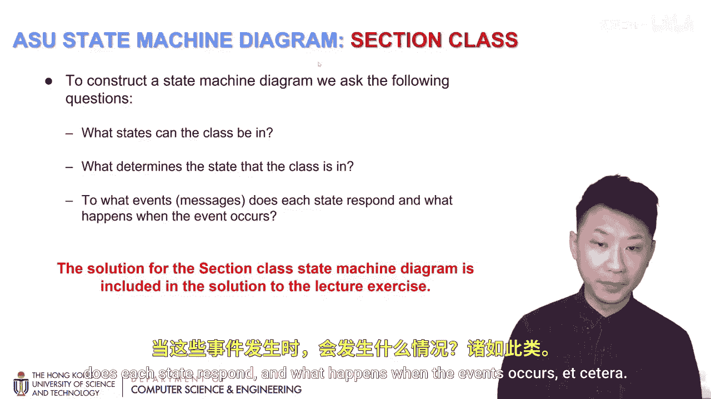

Okay， so in this day machine diagram4 section we will need an initial state and also a final state now we have to think about what are the possible dates that we can have within this class section。

So for a particular cost section may be either available， so we will have the state call available。

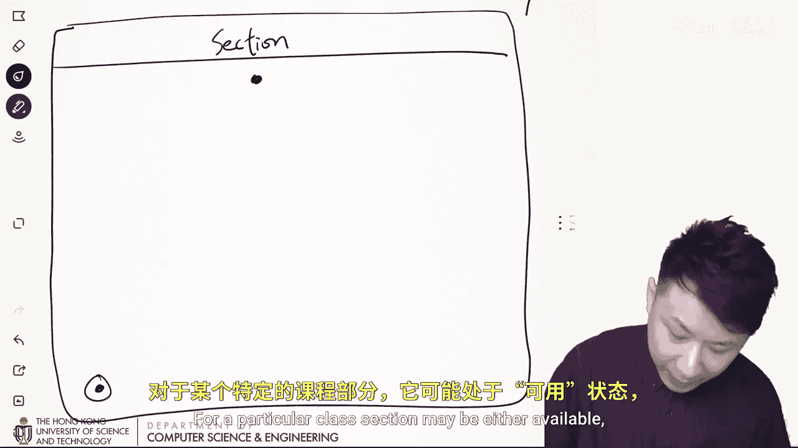

Or it may be food， right， That means we don't have any seat available within the section。

Or eventually， the cost or the section may be over。After the a period。

 if we have enough students in the class， then we can offer the class。And then finally。

 if we don't have enough students， then we may cancel。We may cancel the class。

 So these are the possible states that we can have within this staing diagram。

Then when we construct a section。We're going to go from the initial state to available and we will set。

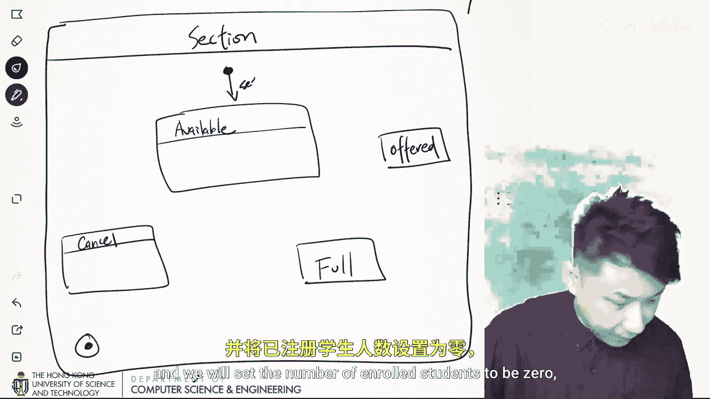

The number of enroded students to be 0。

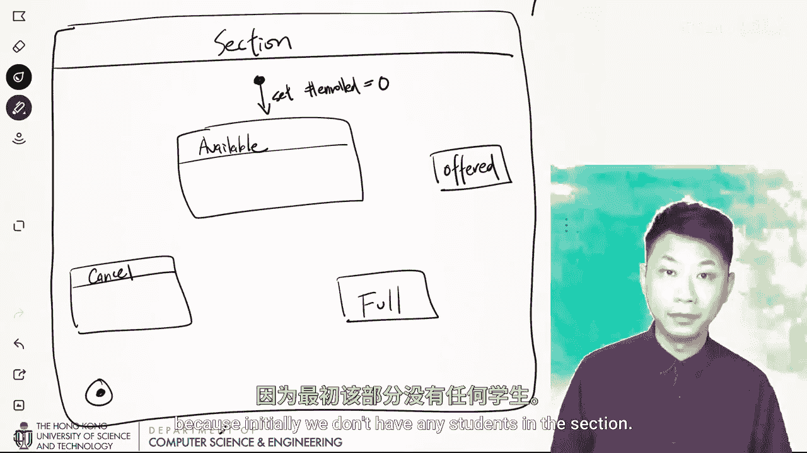

Because initially we don't have any students in the section。

 so that's why we initial lights deliver to zero。Then according to the prompt statement。

 when we have 40 students in the class， then the class becomes full。

 So now we may move from available to full and we have。

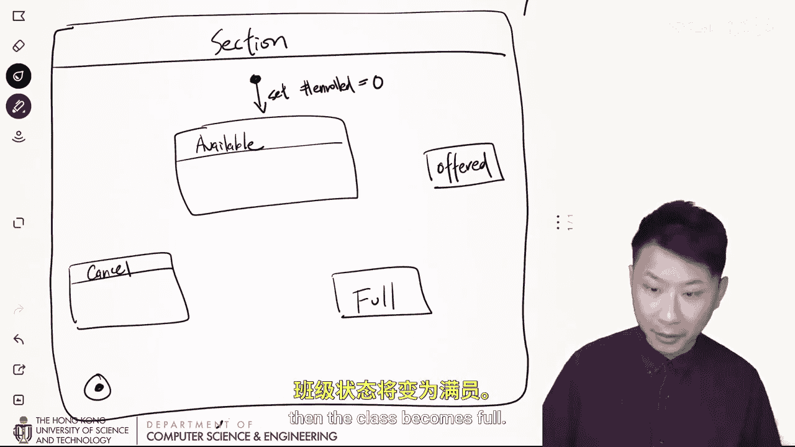

A change event。

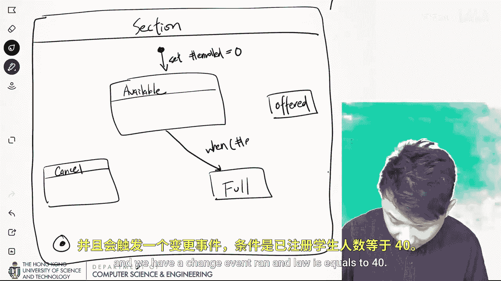

Rand and low is equals 2 40， then we're going to move from available to full。

Then when the cost section is full， we may go back to available。 It's possible。

And this is going to happen when we drop student。

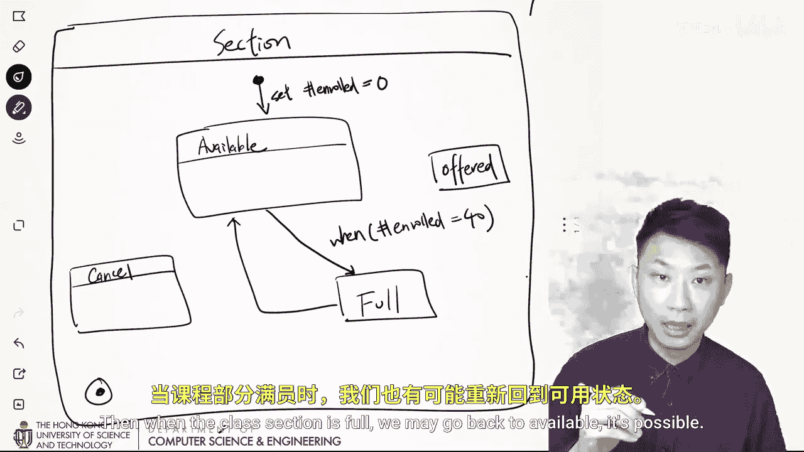

When we call this operation to to drop student， then we have to unreg。

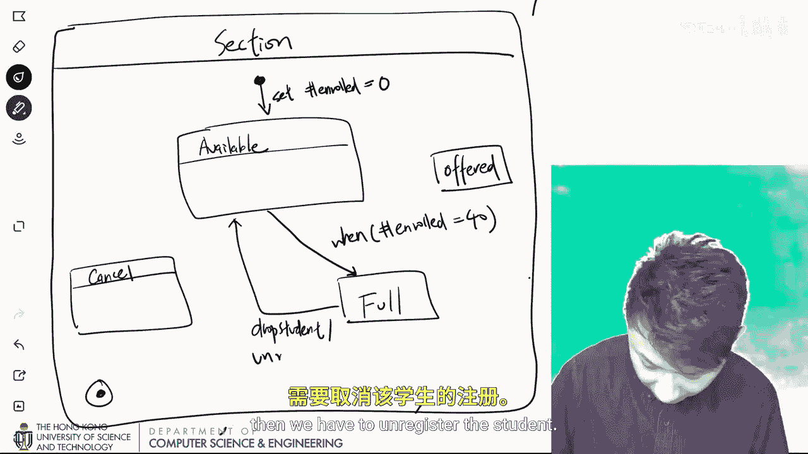

This student。And then we go back to the available state。

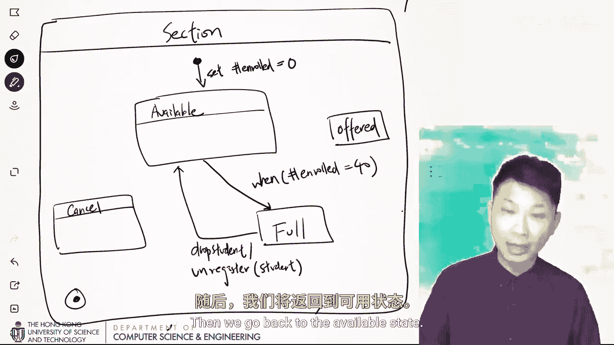

And then when a course is available， notice that when registration。Po。

And the number of students that we have within this section is bigger than or equals to 10。

 then we're going to offer that cost section。And then when do we go into cancel。Okay。

 when registration。

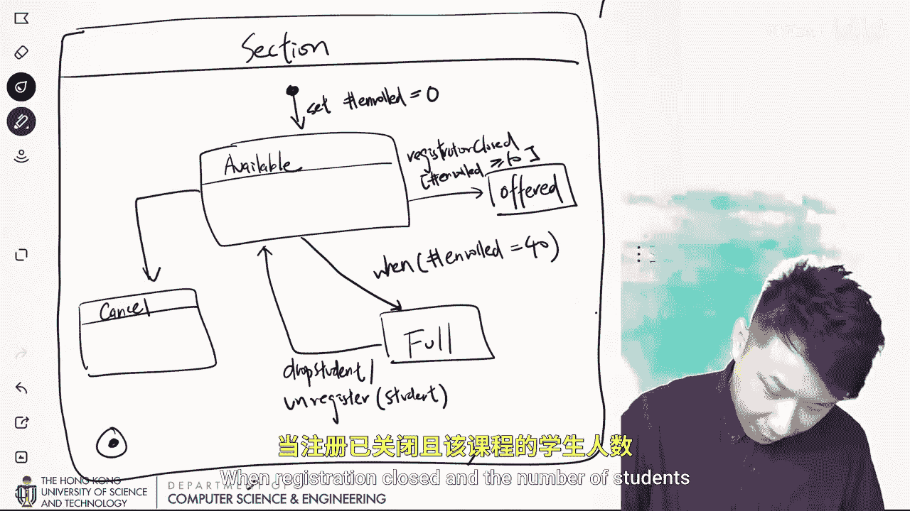

Closed。And the number of students that we have within the class is less than 10。

 then we will cancel the section。And then finally， after we cancel the session， we have to destroy。

The second。And this is the stain machine diagram that we have for this class section within the ASU cost restoration system。

AndNow let's say we know exactly what operations that we have within the class。

 then we can include more information within the states that we have within this same machine diagram。

For example， under the available state， we may add student。

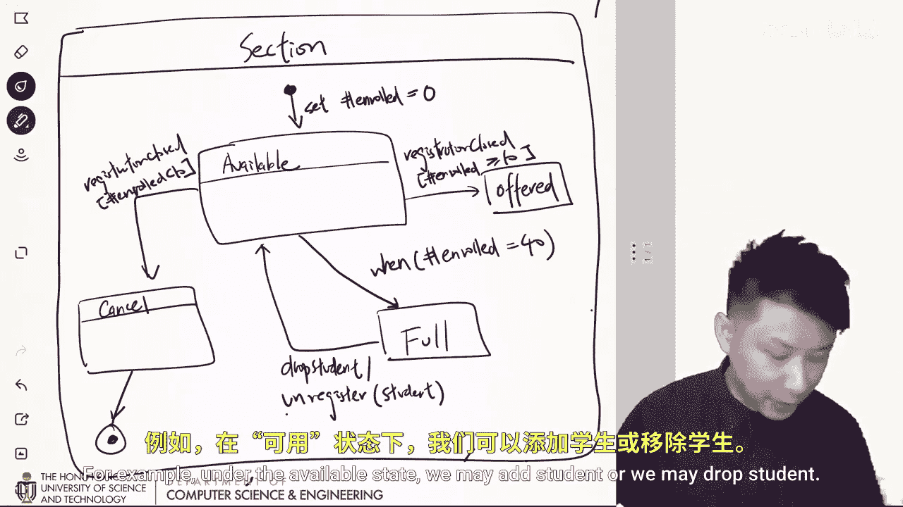

Or we may drop student。And when we ask student， we have to register the student。

And when we drop student， we have to unre。The student。Okay， and also when we cancel， Okay。

 when we cancel the second， these are the things that we have to do。 For example。

 we have to un register。All the students。And also， we have to delete the schedule。

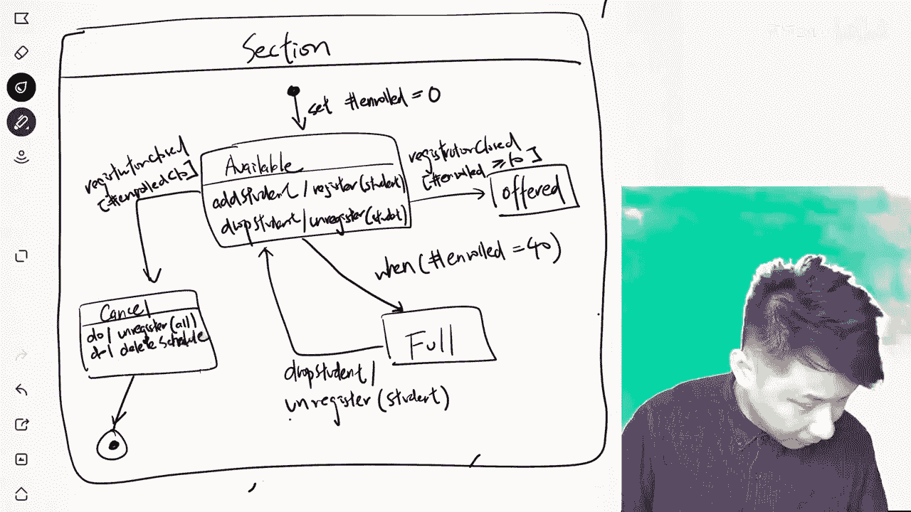

And finally， you also have to lead the section itself。

And this is the same machine diagram for the section class in the ASU application domain。

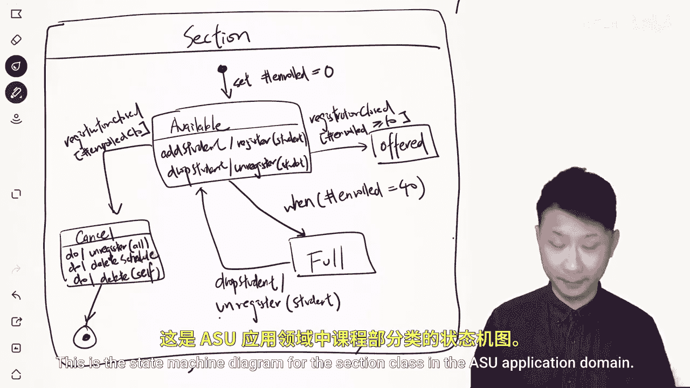

And it's also possible to have composite steam machine diagram that means it's nested and we have a steam machine diagram within another steam machine diagram。

We may have sequential composite steam machine diagram。

 That means an object is in exactly one's day in one of the nest steam machine diagrams。

Or concurrent composite steam machine diagram， that means an object is in exactly one state in each of the regions of the steam machine diagrams。

 and I'm going to show you some examples。

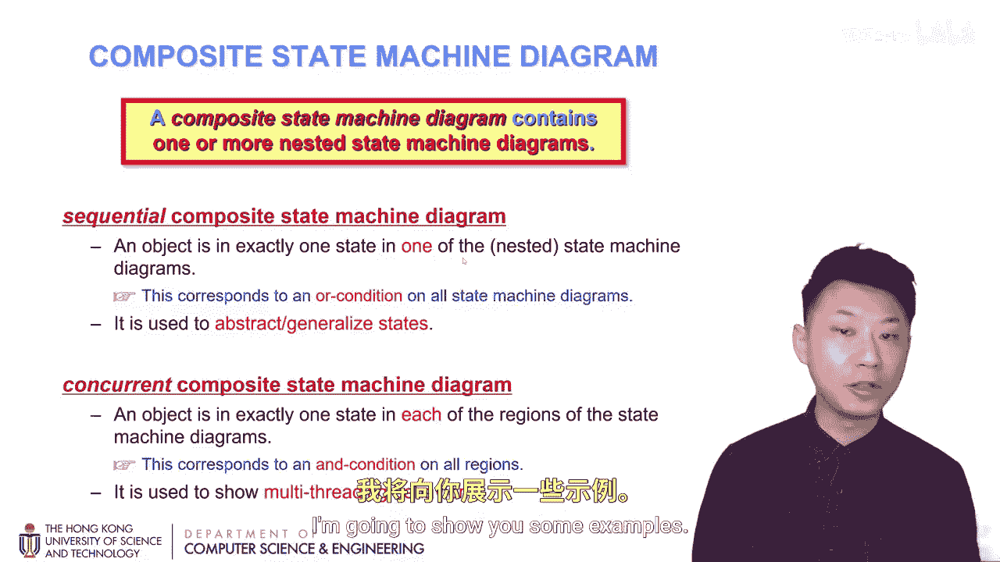

So this is an example of sequentialial composite this steam machine diagram。

 and you can see that under this state， we're going to have another ST machine diagram。

And this icon indicates that this is a composite state that means within this state。

 we're going to have another steam machine diagram。And this is what we call the superstate。

 And this is a substate。And we may have transition going from the superst。

 a stay from the superst into the boundary of the subt。

 that means we're going to go into the initial state of the composite machine diagram。

We may also have a transition going out from the substrate that means we're going exit this compositey machine diagram and then go into a particular state within the supersstate。

So now using this composite steam machine diagram， we can capture the more complicated behavior within the state forward。

So what do we mean by having a transition going from the boundary of this forest state to the first gear？

That means no matter we are in the first gear， second gear or first gear， whenever we stop。

 whenever we stop the car， we are going to go back to the first gear。

And then we can shift up or shift down and then go to different gear within this forward state。

And this is what we mean by Comps Ste machine diagram。

 so we have one steam machine diagram within another stay machine diagram。

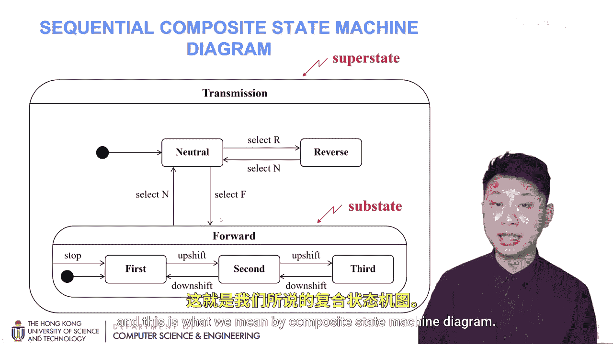

We may also have concurring composite steam machine diagram。 Again， this incomplete stay。

 we have an icon here and this icon can denote that this is a composite stay machine diagram。

And now you can see that within this incomplete state， we have to do several things at the same time。

 concurrently， in order to， for example， pass the course。Okay。

 let's say while you are in this incomplete state， you have to complete odd labs。

 you have to do the term project and also you have to take the exam。

 you have to get all these things done before you can go into the past state。Otherwise。

 if you cannot get some of them done， then you will fail the cause。

 And this is what we mean by concurrent comping machine diagram。

And notice that in this compositeing machine diagram， we have different regions。

 one region for the lab， another region for term project and then another region for taking exam。

So that means an object will take one of the states within each region。So for example。

 for the lab part， it's going to be at lab one for term project and taking exam is's going to be at the initial stage。

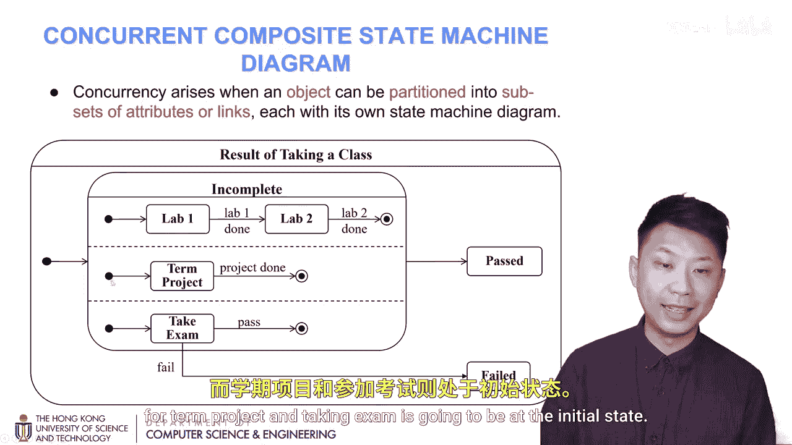

And this is what we have talked about in the example。

 we may have a transition going into the boundary of a composite state or going out from the boundary of a composite state。

And it's also possible that we may have transitions that go directly from within a composite state region to an outside region。

 so that means we go directly from the substate to the superstate。

And a transition may have multiple source or target state。

And this represents a synchronization or spreading of control。

 and I'm going to show you an example of a transition that have multiple source and target states。

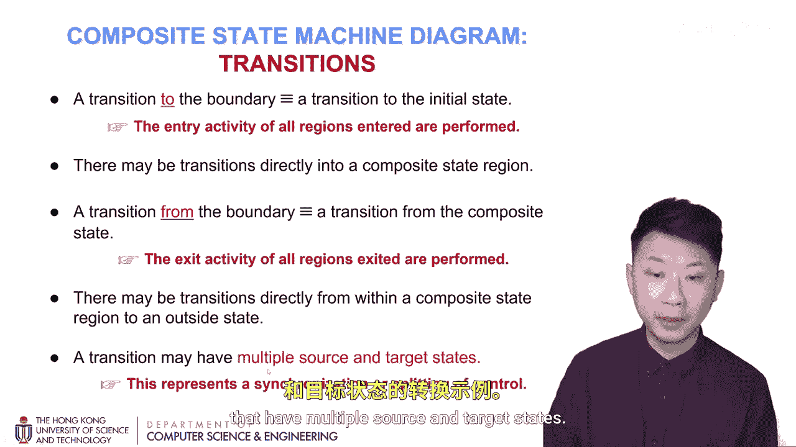

And this is an example of concurin composite。And this is an example of concurring composite machine diagram with synchronization and when we have a bar。

Then that means we have synchronization。So what do we mean by having a bar with multiple target statess。

 For example， this bar is going to point to A1 and B1 at the same time。

This bar actually means that we're going to go into A1 and B1 at exactly the same time。

 So that means synchronization。And we have a part here with multiple source statess that means we have an arrow going from A2 and also from B2 at the same time。

And again， this means synchronization。 That means we have to wait until both A 2 and B2 have finished。

Before we go into cleanup。So this bar here just means synchronization。

 they have to start at the same time and finished at the same time。

So now what if we don't have their bar。Then that means we are not doing synchronization。

We've done synchronization， then that means we will either follow this path or the other path。

 but not both at the same time。 why， because a same machine diagram is going to be always deterministic。

That means we can always determine the stage that they。

That means we can always determine the states that an object is in at a particular time。

And we know that a transition is instantaneous and cannot be interrupted。

 That means we're going to follow one of the transitions at one time。

So that means we're going to follow either this path or the other path but not both at the same time。

 so we've done synchronization， that means we will either go into this path or the other path。

 but not both at the same time， but using synchronization it's possible that we're going to go into the two regions at the same time。

And that's why here I say that only one of the two transitions will be taken if we don't have synchronization。

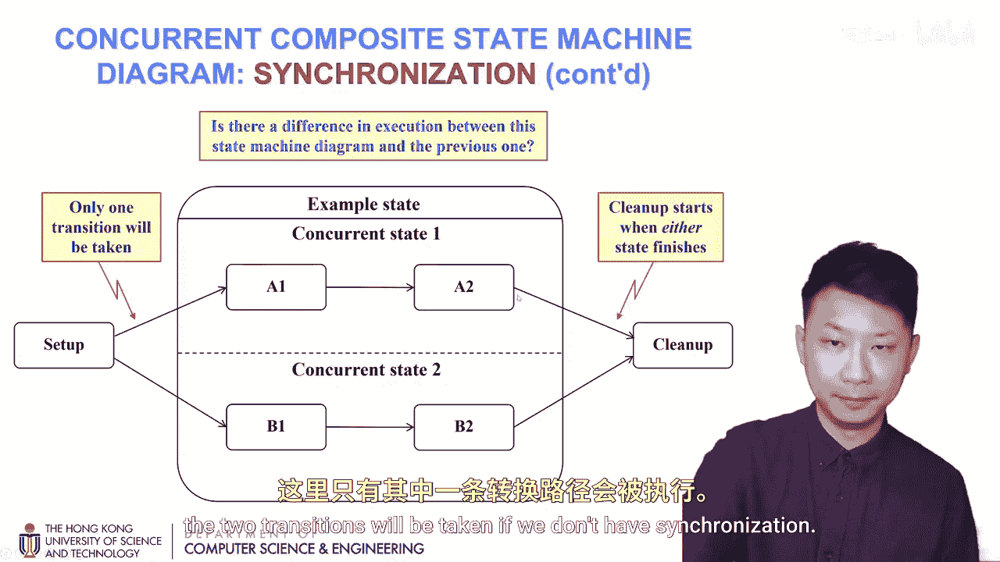

So some of you may ask， do we have to draw a steam machine diagram for every class that we have within the software system。

 yes or no？I would say no because we have so many classes within the software system。

 if we draw a steam machine diagram for every single class that we have within the software system。

 it's going to take a long， long time。So that's why hear I say that its not necessary to produce a steam machine diagram for every class within the program。

 but we should draw a steam machine diagram for classes with significant dynamic behavior if the behavior within the object is kind of complicated then we may have to draw a steam machine diagram to clarify the behavior within the object and that's all I want to cover in this lecture。

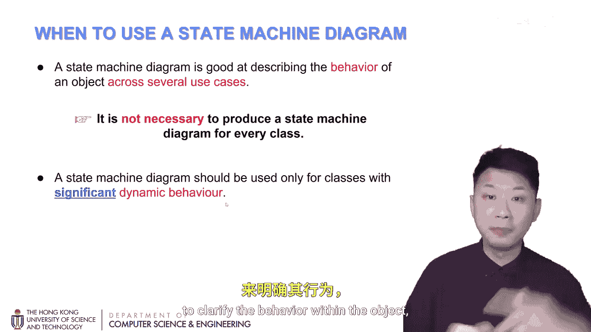