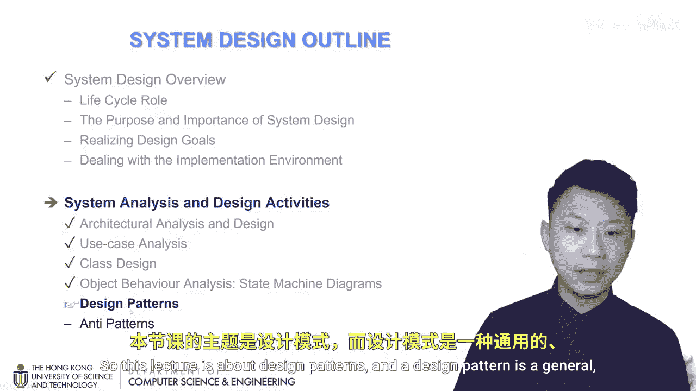
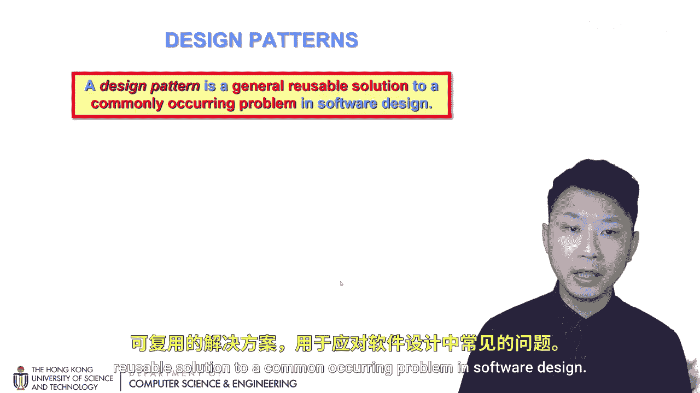
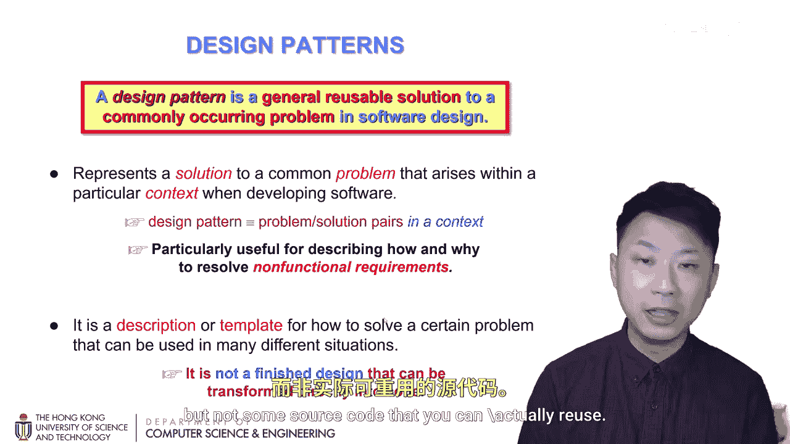
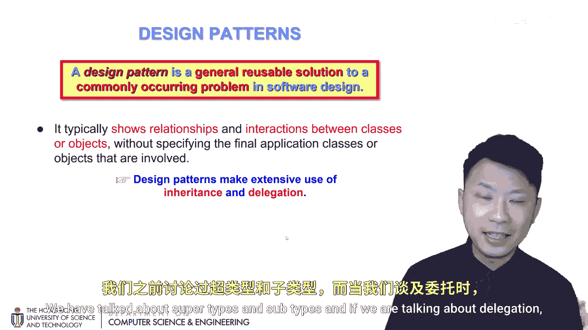
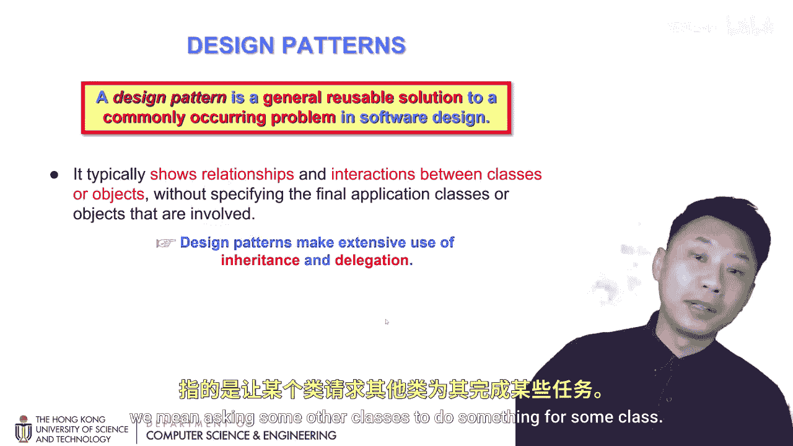
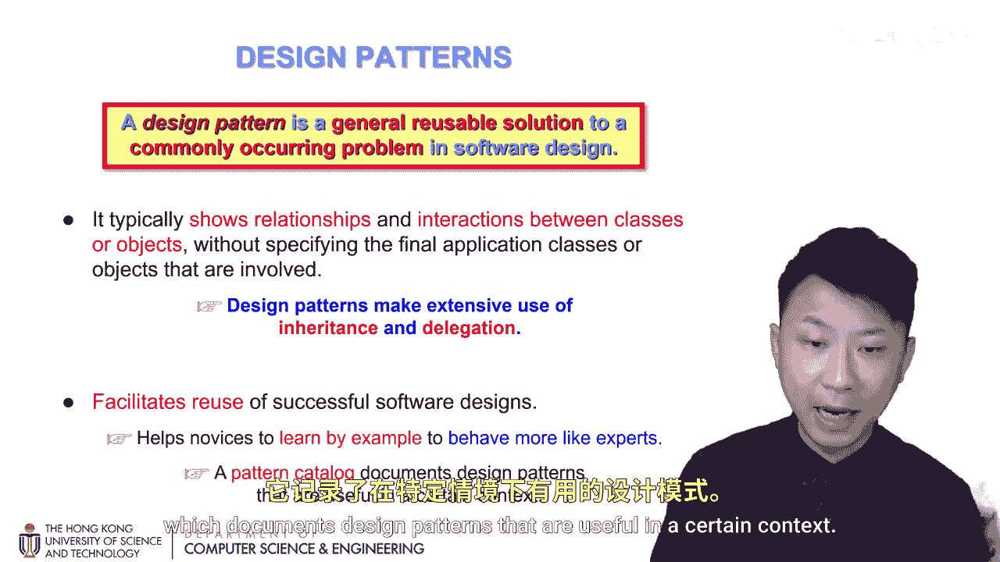
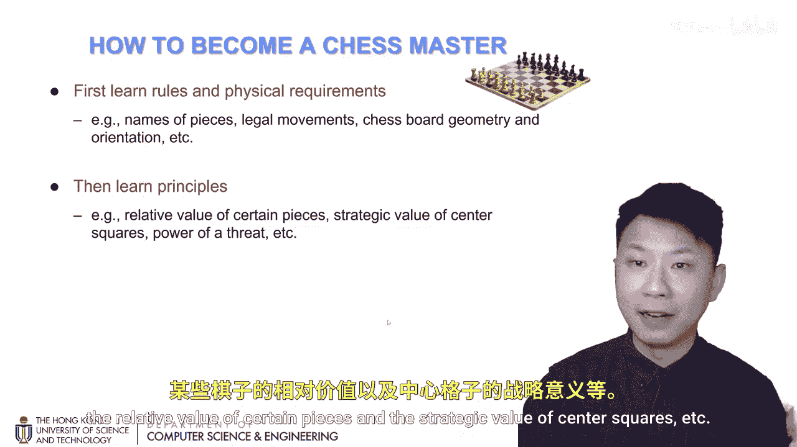
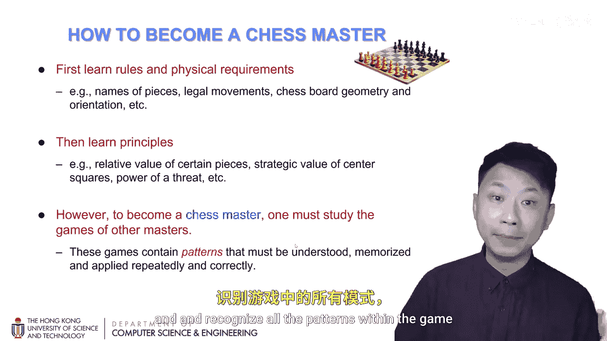
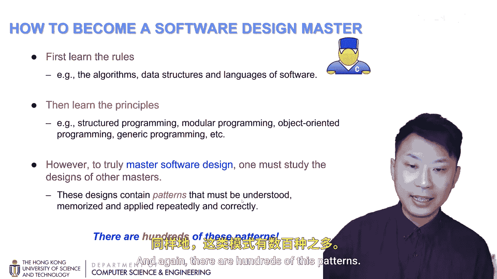

# 香港科技大学【中英⚡软件工程｜Software Engineering Specialization】 p47 P47 01_设计模式 -BV1MMEjzoEhg_p47-

Hi， in this lecture， we're going to talk about design patterns。

 which are re usable solution for some company occurring problems in software engineering。

 so this lecture is about design patterns。

And a design pattern is a general reusable solution to a company occurring problem in software design。

And it represents a solution to a common problem that arises within a particular context when developing a software system。

When we talk about design pattern， we are talking about a problem and solution pairs in some context。

And design patterns， they are particularly useful for describing how and why to resolve non functional requirements。

So we may be able to tackle some of the non functional requirements using design patterns。

But notice that a design pattern is simply a description or a template for how to solve a certain problem that can be used in many situations。

 but is not a finished design that can be transformed directly into some source code。

So that means it's only some template that you can follow to solve some problem。

 but not some source code that you can actually reuse。

And when we describe a design pattern， we usually describe the relationships and interactions between classes and objects without specifying the final application classes or objects that are involved。

 so we describe a design pattern using a class diagram。

And design patterns make extensive use of inheritance and delegation and I guess you guys know what is inheritance we are talk about supert and subtypes and if we are talking about delegation。

 we mean asking some other classes to do something for some class。

And if we can reuse some of the successful software designs。

 then it's going to help some new programmers to learn by example and behave more like experts。

And there is a patent catalog which documents design patterns that are useful in a certain context。

So now think about how to become a chess master。 So first you have to learn the basic rules and the physical requirements。

 for example， N。So first you have to learn the ruless and fiscal requirements， for example。

 the names of the pieces， legal moves， etc， etc。And you have to learn the principles， for example。

 the relative value of certain pieces and the strategic value of center squares， etctera， etc。

But to become a chess master， you must have to study the games of other masters。

 This is like playing video games in order to be an expert in playing a particular game。

 you have to study how the others they play the same game or how the other experts they play the same game。

In this games， they contains patterns that must be understood。

 memorized and applied repeatedly and correctly。So if you want to be a master in playing a particular video game。

 you have to watch many videos on YouTube and then recognize all the patterns within the game。

And how to become a software design master。First you have to learn the basic rules， for example。

 the algorithms， data structures， and also languages of software， etc， etc。

Then you have to learn the principles， for example， structured programming， modular programming。

 object oriented programming， etc， etc ce。But to become a master in software design。

 one must study the design from other masters， from other experts。And again。

 there are hundreds of these patterns。

