# 香港科技大学【中英⚡软件工程｜Software Engineering Specialization】 p48 P48 02_策略模式 -BV1MMEjzoEhg_p48-

So now let's start with an example which is the duck simulation game。

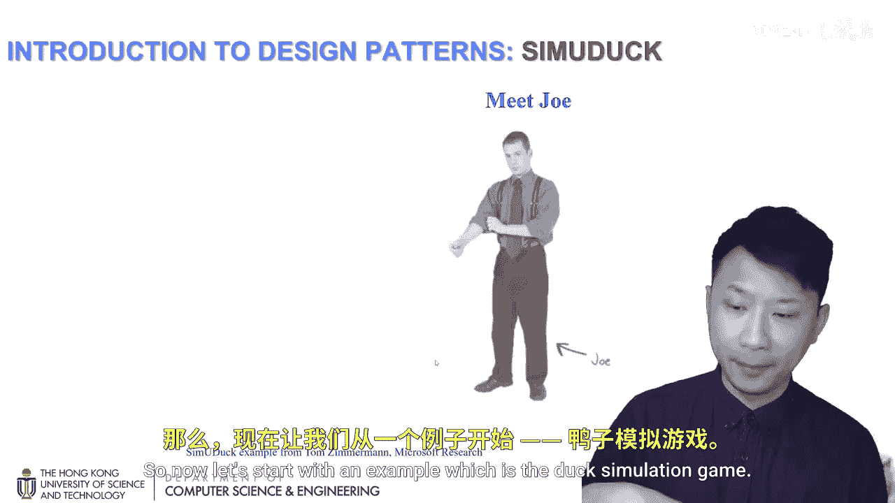

In this game， you're going to assimilate the behavior of different dos within the game。

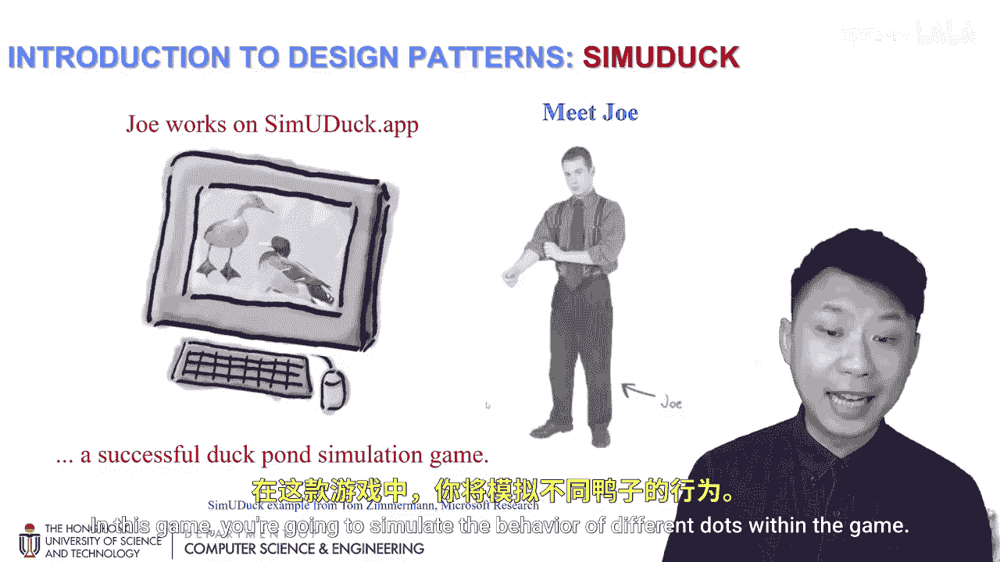

And within game， we're going to utilize inheritance because we have dots。

 and we have different types of dots within the game。 For example， Mak duck and Rahead duck。

And duck is an abstract class。Then all Dutch day can crack and swim。

 then we'm going to implement these operations under the supert。

And because each do is going to have a different look。

 then we're going to implement display under the subtit。

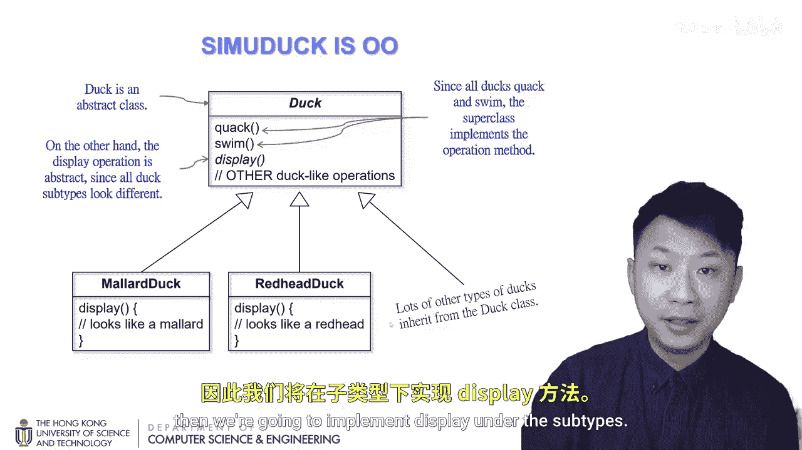

When now prepare for the big innovation now， dos can fly。

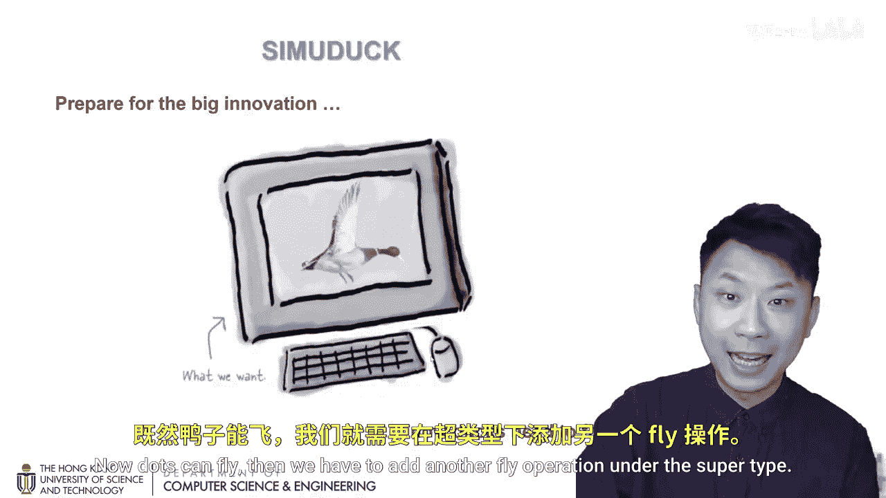

Then we have to add another fly operation under the supert。

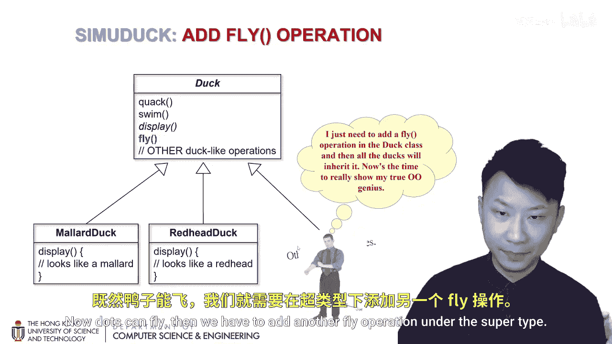

And then we're going to implement this fly operation under the supertype。

 But then something goes wrong because later on， we have to add another type of duck。

 which is rubber ducks。 And you know that rubber duck， they cannot fly。

 And if we implement the operation fly under the super type， it will be utilized by all the subtypes。

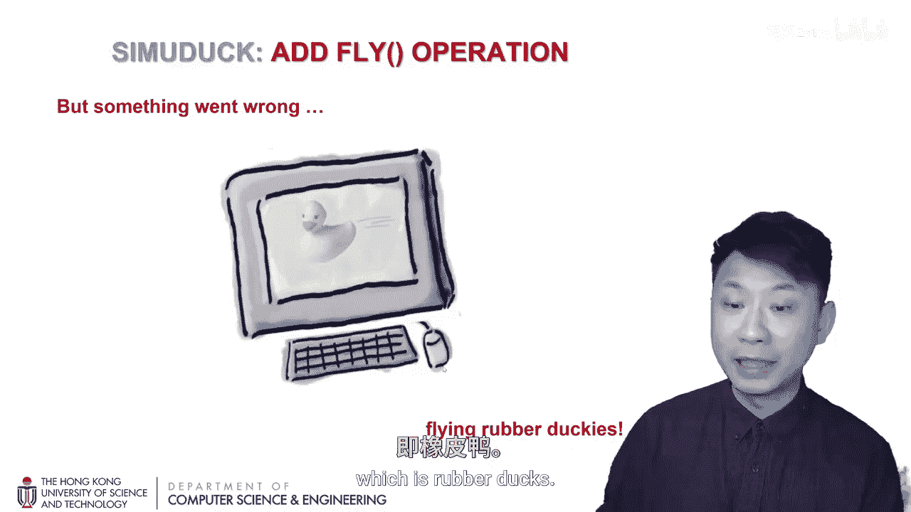

But now， since rubber duck does not quack， then we have to override this quack operation to squeak instead of doing quaing and also since rubber duck does not fly。

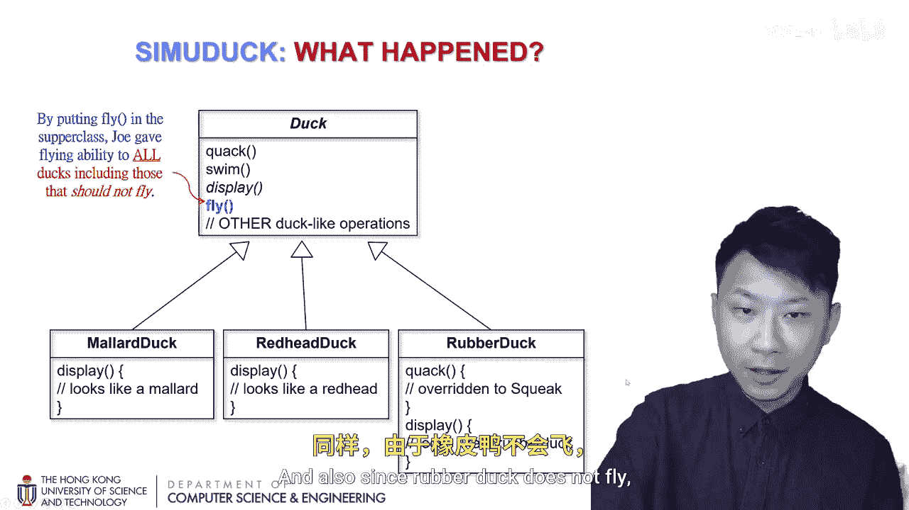

We also have to override the fly method to do nothing because rubber duck does not fly。

 But then later on， we plan to also include another type of duck， which is wooden decoy ducks。

 Then we know that wooden decoy duck does not qua and does not fly。

 So we have to override qua to do nothing and also fly to do nothing。 So initially。

 Joe thought that it would be great to use inheritance for the purpose of reuse。

 but eventually it has not turned out so well because we have different types of ducks and then they have different behavior。

 and they becomes difficult to maintain。 if we simply use inheritance to implement ducks and different types of ducks。

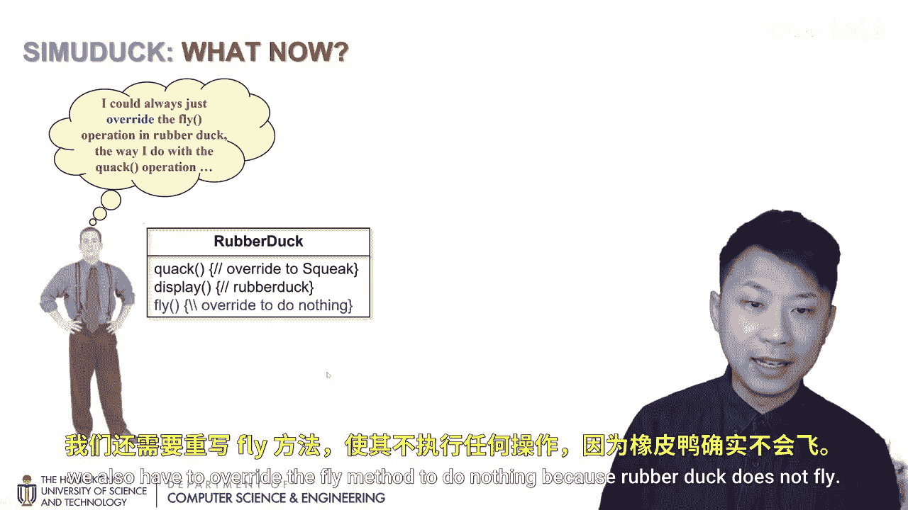

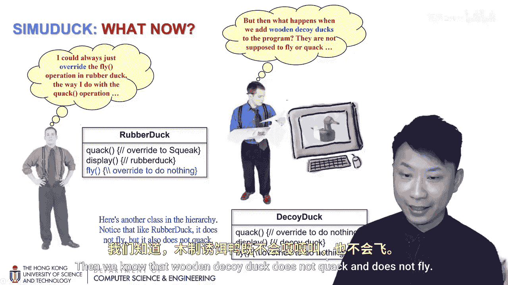

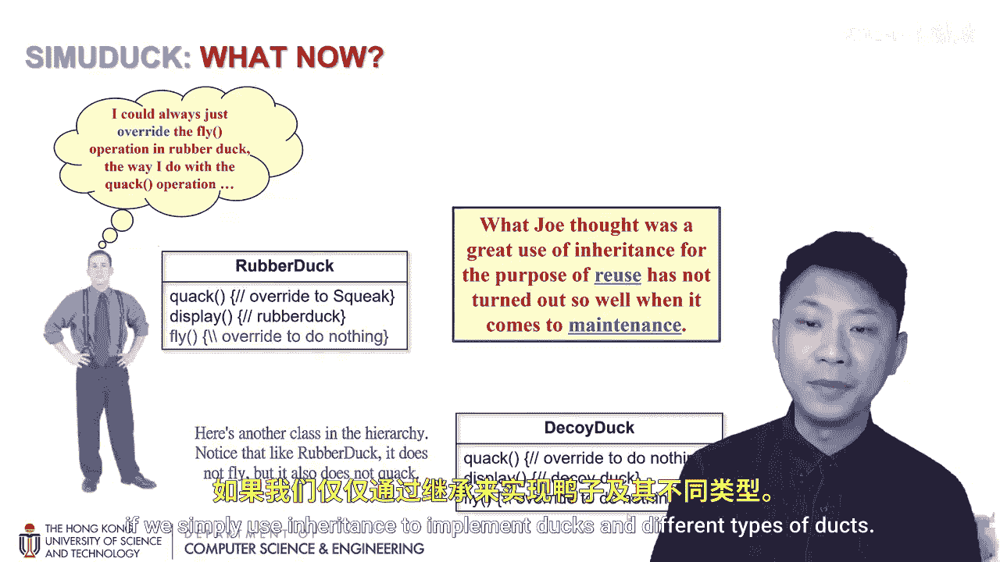

So now think about what are the disadvantages of using inheritance to provide that behavior。Tle a。

 code is duplicated across subclasss。Yes or no。No， because we only have to define， for example。

 fly in the super type one then it's going to be used by audit sub times。

 so we don't have to duplicate across the subclasses。

How about runtime behavior changes are difficult。Yes， right， because during the game。

 if we want to change， for example， rubber duck to quack instead of sququeak。

 then it's going to be difficult we have to because we hardco the behavior under the subtype。

We can make ducks dance， so this one is true。How about we can make duck stands。

We can actually make duck dance by including another operation called D under the supert。

How about how to gain knowledge of all the duck behavior？😡，This one is yes。

 right because in our example， in order to see that rubber duck cannot qua。

 it's going to squeak instead and also rubber duck cannot fly。

 we have to actually go into the subt and take a look at the sourceco and double check those operations and see that they are overriden by the operations that we define under the subt。

 so it's difficult to gain knowledge about all ducks。

How about ducks can't fly in qua at the same time。Ducks can fly in crack at the same time。

 Gu we can simply call those two operations at the same time。

How about changes can unintentionally affect other duck。This one is， yes， right。

 Because if you change something in the supertype， it's gonna to affect all the subtypes。

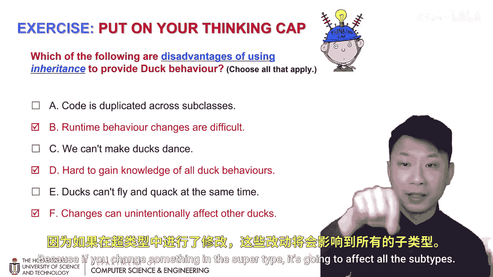

How about if we implement the duck's behaviour using an interface。

So we have an interface called Fable and also have an interface called quaable and we have the operation fly and the operation crack and they are abstract operations。

 That means were going to implementcrement these operations under the actual implementation。

 Is this a good design。No， because the fly operation that we have under Maaduk and the fly operation that we have under Rahead duck。

 they are exactly the same。That means we're going to have duplicated code under the implementation for malla duck and rahe duck。

So it's not a good idea。

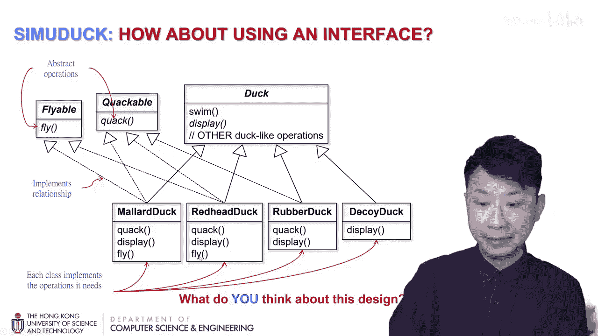

And the reason is that we're going to have duplicated code。

So how to come up with a better design now we're going to utilize a design principle。

 which is we' are going to identify the aspects of your application that vary and separate them from what stays the same。

 So what we're going to do is that we're going to take what varies and calculates it so that it won't affect the rest of your code。

 So what are we going to achieve if we utilize this design principle。Eventually。

 we're going to get fewer unintended consequences from code changes and also more flexibility in your systems。

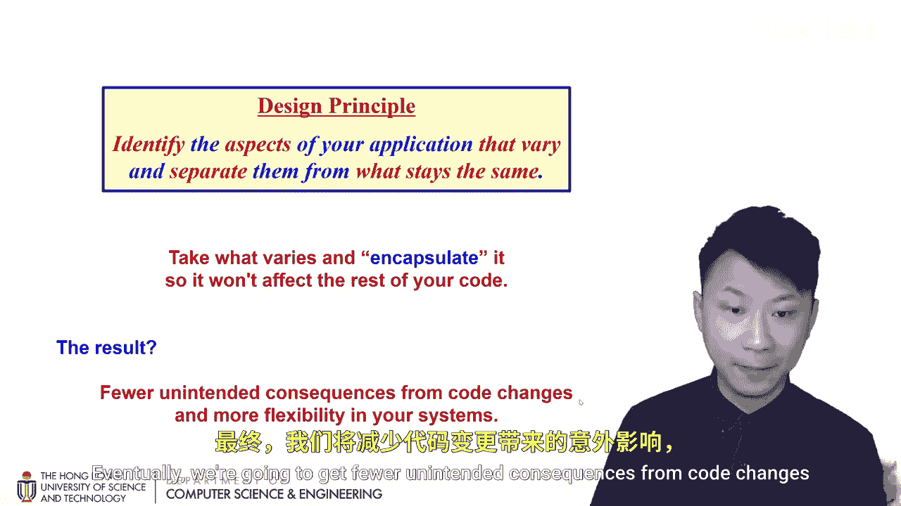

So now let's go back to the doimulation game。What varies are actually the flying behaviors and cracking behaviors。

 so we're going to pull them out and then put them somewhere out so now the duck class is still the super class of autods。

 but now we're going to pull out the flying behavior and cracking behavior and then put them somewhere out。

And now flying and correct behavior each get their own set of classes and various behavior implementations are going to live here within the flying behaviors and correct behaviors。

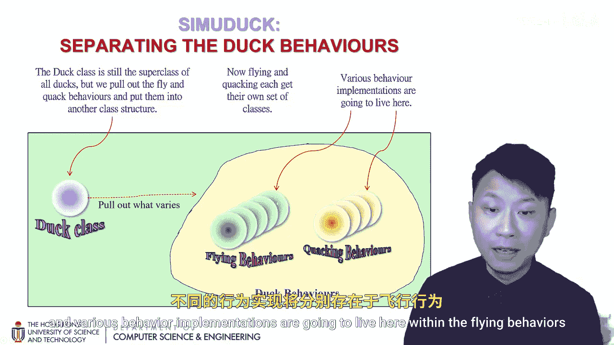

Another design principle that we can utilize in the dark simulation game is this one。

We try to program to an interface， but not an implementation。 So by doing it this way。

 the duck classes won't need to know any of the implementation details of their behaviors。

 So what do we mean by programme to an interface， but not an implementation。 Now。

 let's take a look at an example。

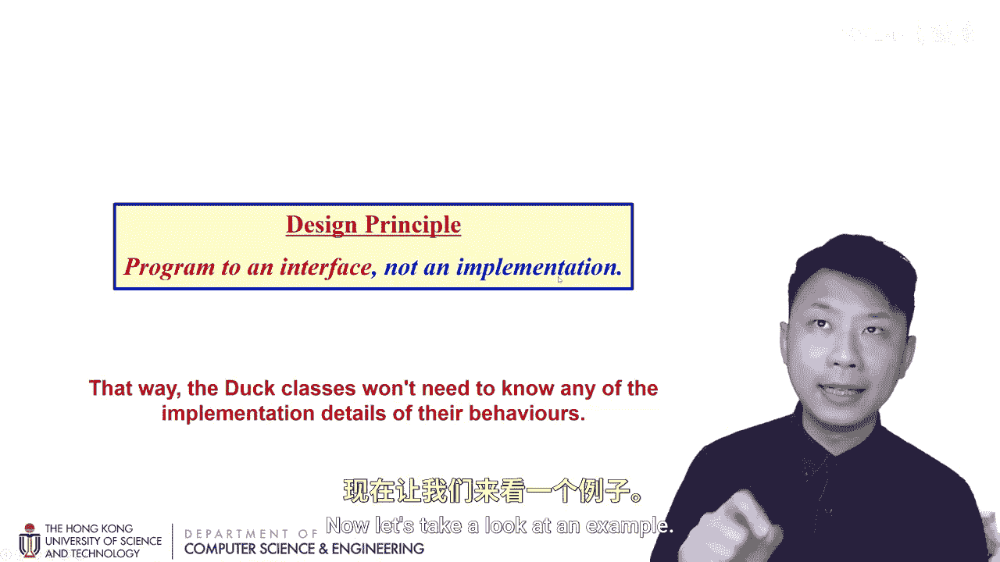

Now， let's say we have the supert animal， and then we have the concrete implementations， for example。

 dog and cat。Then programming to an implementation to a typical implementation would mean that we're going to initialize the doc as a doc。

And then we're going to make the dock bark。 Okay， this means that we're going to high code the verbal D as a dock。

 And it's not flexible because later on， if we want to change the dock into a cat， for example。

 it's not possible。 So that's why it's better to program to an interface or to the supert。

That means we're going to create an animal， and then we're going to initialize the animal as a dog。

 and then we're going to call the animal to make sound。And this is a better way to define an animal。

 because later on in the game， we can change the animal into another type。 for example， a cat。

 And rather than hack coding the subtype into the code。

 we should assign the concrete implementation object at runtime。

That means we can create an animal and then we can use an operation to create the animal。

 For example， if we want the animal to be a dog， then this operation will return a dog。

 if we want the animal to be a cat， then this operation will return a cat and then assign a cat to this variable a and then eventually we can call the animal to mix sound。

And by doing this， we achieve more flexibility because we can create any type of animal during the game。

And also， we can call this mix sound operation to make。Sk。

 according to the type of animal that we have created。

 So now we're going to do the same for duck behaviors。

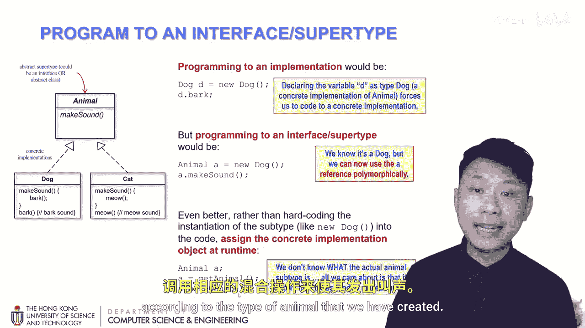

Now， we're going to have an interface called fly behavior。

 and then we're going to have different implementations of fly behavior under the subject。

 For example， fly with wings or fly no way。 So fly with wings is the implementation of flying for other types that have wings。

And fly no ways they are for， for example， rubber duck or wooden decoy duck。

 those dots that cannot fly， and then we will also have a crack behavior interface。

 and then we're going to implement the concrete cracking behavior under the subtypes， for example。

 crack， squeak or mute。

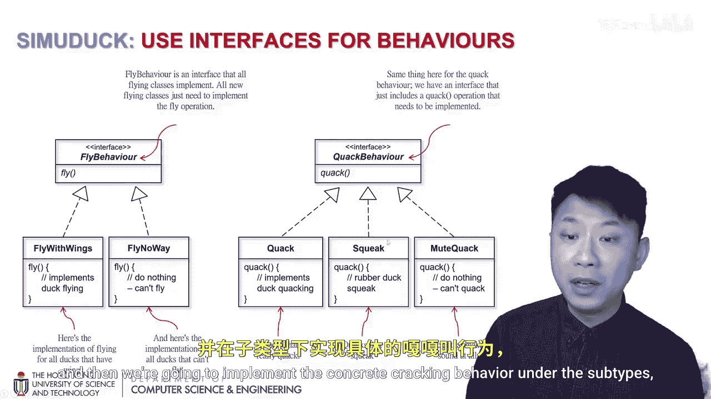

So now by using this design， we can reuse the fly and crack behavior for different types of ducks。

 and we can also easily add new behaviors into these two interfaces。

 So now the dark simulation gain has the benefit of reuse while still being maintainable。

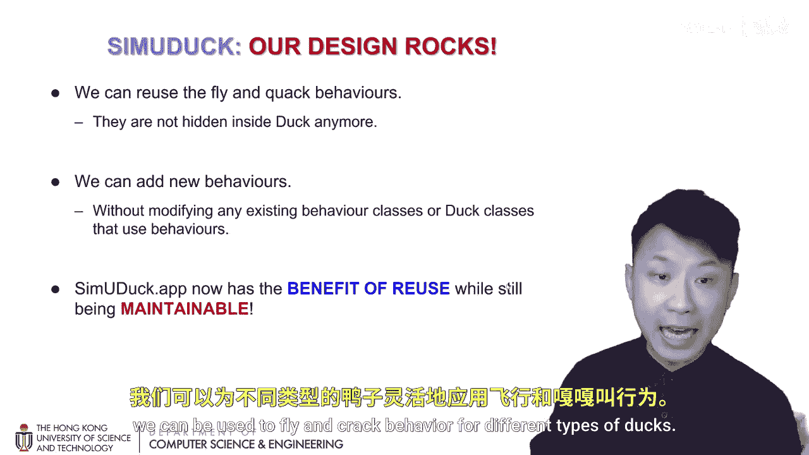

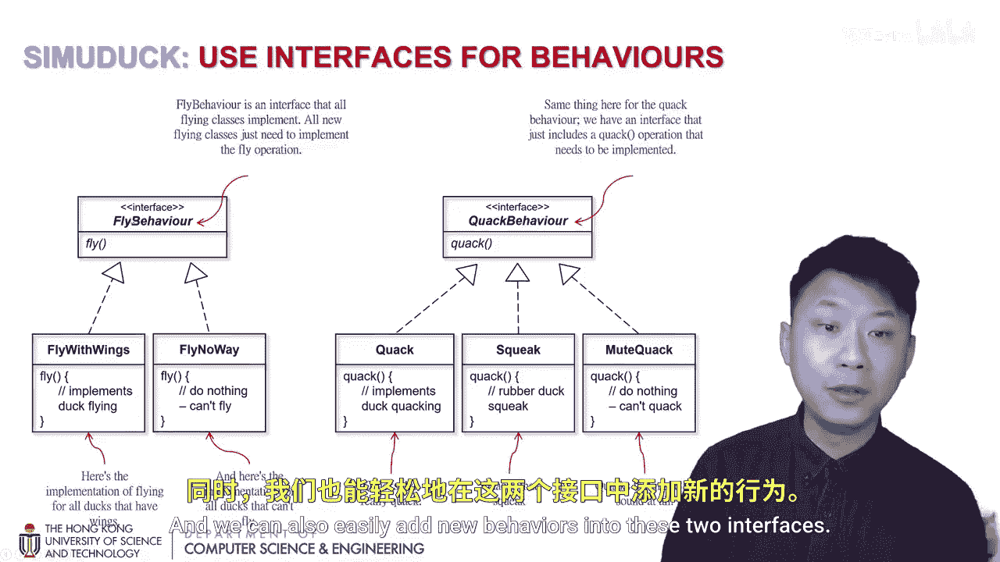

Because if we want to maintain the cracking behavior and flying behavior。

 we simply have to modify the interface for flying behavior and also the interface for crack behavior。

 So now using the new design， what would you do if you need to add rocket powered flying to the dark simulation game it's going to be easy right under。

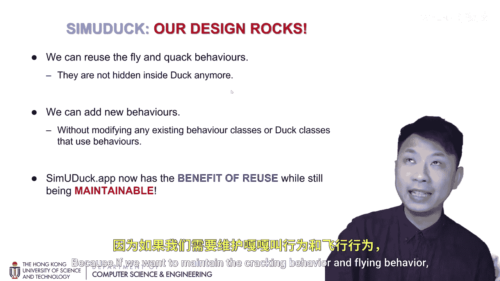

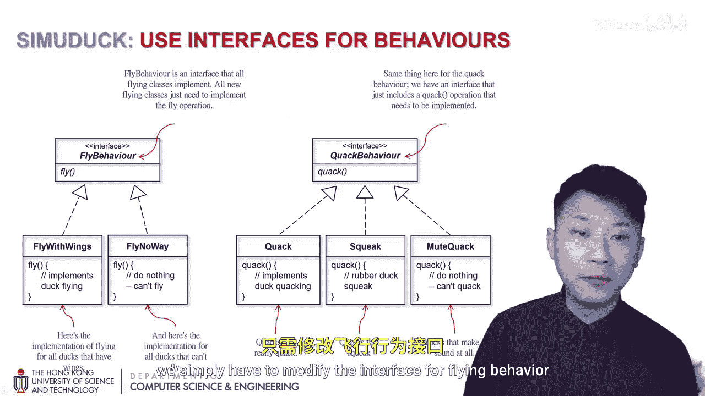

It's going to be easy under the flying behavior。 we're going to have another implementation。

 which is called fly rocket powered。And can you think of a class that may want to use the cracking behavior that' is not a duck。

For example， in your game you may have a duck core to try to pretend to be a duck so this duckal object may utilize the cracking behavior in the game and now we also need to add two variables to keep track the frying behavior and cracking behavior of each duck and this variables they are declared as the behavior interface type。

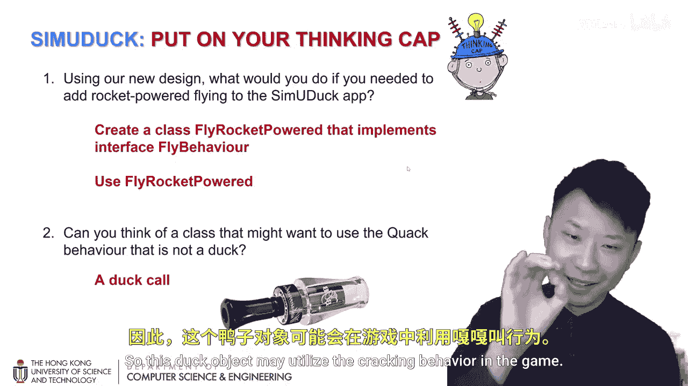

And then we're going implement some further operations to perform cracking and perform flying。

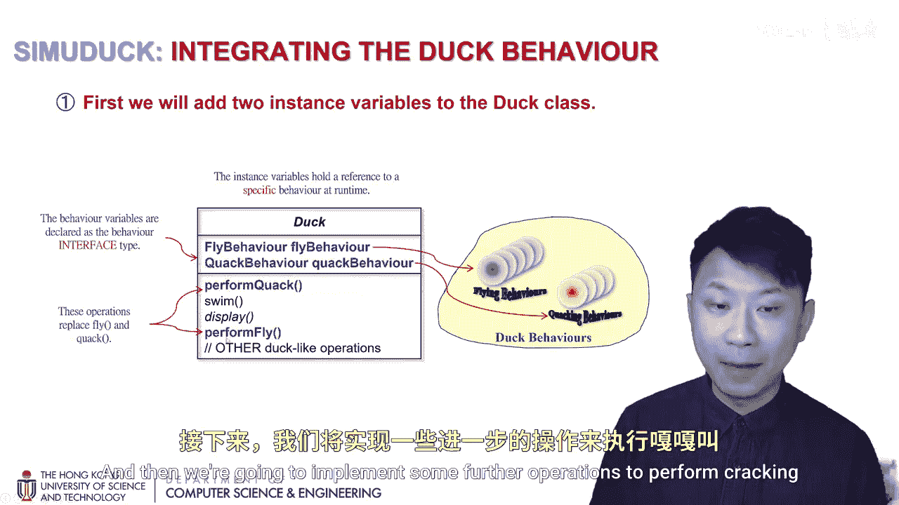

Now each duck has a reference to something that implements the flying behavior and crack behavior interfaces and then when you try to perform flying and try to perform cracking。

 you're going to call these two operations and utilize the flying behavior to perform flying and also utilize the specified it as cracking behavior to perform cracking for example。

 for Maloduct， cracking behavior is going to be crack and flying behavior is going to be fly with wings。

How about a rubber duck？For a rubber duck， the cracking behavior should be squeak。

 and the flying behavior should be fly no way because rubber duck cannot fly。

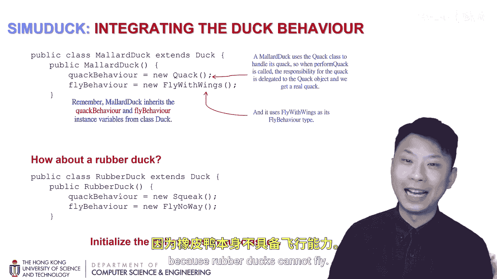

And this is the whole picture now each duck is going to have some flying behavior and cracking behavior and we're going to define the exact cracking behavior and flying behavior under the subt。

 for example， cracking behavior for Maaccl， we're going to utilize this particular implementation。

Quracking and fly behavior， we're going to utilize this particular implementation。

 which is fly with wings。

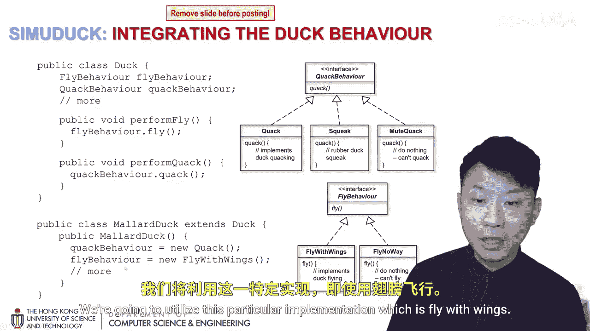

So to make the game even more flexible， we're going to implement this two operations。

 set flying behavior and set cracking behavior so that we can dynamicically change the flying behavior and cracking behavior while we are playing the game during runtime。

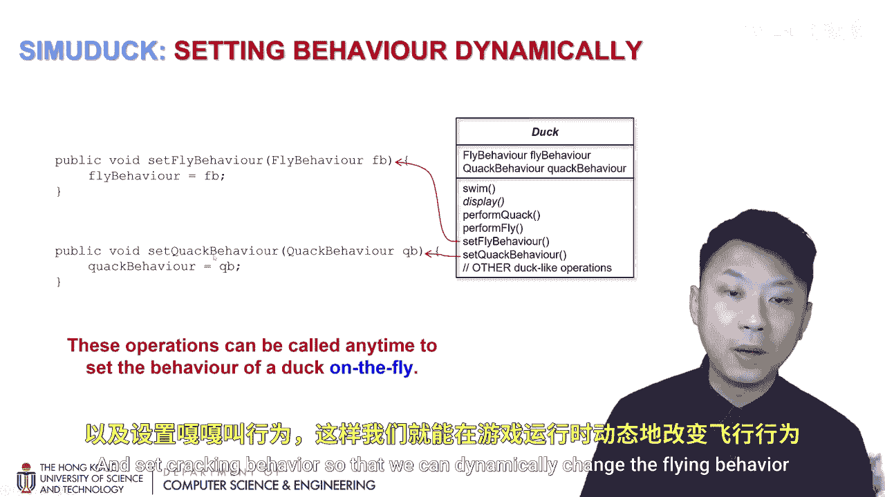

And this is the whole picture under the supert do。 We have to declare the flying behavior and quacking behavior。

 and then we have different types of duck。Then we define the flying behavior and cracking behavior using an interface under each interface were going to have。

Under each interface， we're going to have the concrete implementations for flying behavior and also the concrete implementations for cracking behavior。

And now you can see that flying behavior is encapsulated within this interface。

 Fly behavior and cracking behavior is encapsulated within this interface， crack behavior。

And then under the supertype， we have different types of ducks。

 So that's why we say that here we have some is a relationship， super tight and subtight。

And then under the interface， we have different concrete implementations。And in each duck。

 you can see that each duck is going to have some flying behavior and cracking behavior。

 so that's why we say that each duck has some flying behavior and has some cracking behavior。

So now think of each set of behaviors under an interface as a family of algorithms。

 so we have different algorithms for flying and also different algorithms for cracking。

In this behaviors or algorithms， they are interchangeable。And also clients。

 they're going to make use of an encapsulated family of algorithms for both flying and quaing。

So encallation means you don't have to know exactly how we implement defineding behaviors and cracking behaviors。

 you simply have to use the behavior in your game， that's it。

And this is known as the strategy paddding because we are using different strategies or different algorithms for doing something。

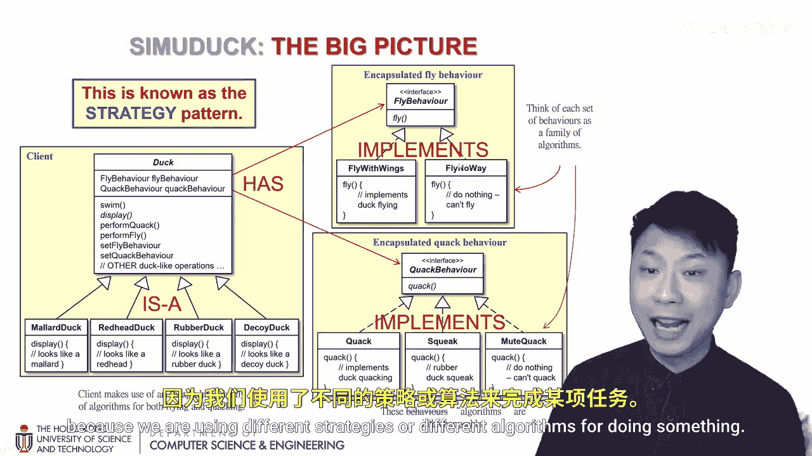

And this is the class diagram that we use for strategy pattern。 In strategy pattern。

 we have a client， for example， duck。 then each duck has a reference。

 This arrow means has a reference to different strategies that butts can use for flying and quaing。

 And then the flying and quacking strategies they are part of the duck。 or it gets under the duck。

We have to declare def flying behaviour and cracking behaviour。

And now we say that this client has a reference to the strategy object。

And this strategy class is going to declare a common interface to all supported algorithms。

 so we're going to have different algorithms under different implementations of strategy。

And then these are the concrete implementations of the different algorithms。

And this is an other design principle that we utilize in strategy pattern。

 We try to favor has a relationship， rather than inheritance。

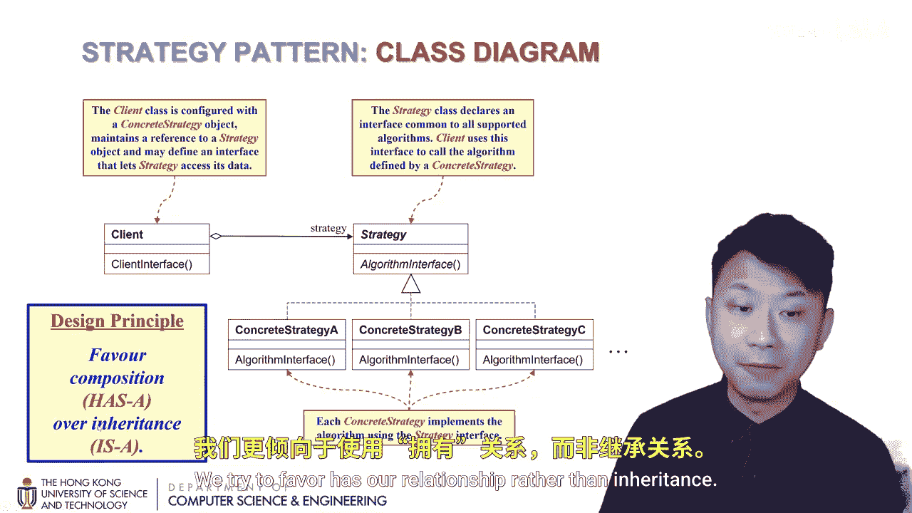

So inheritance means we have supert and then we have subtypes。

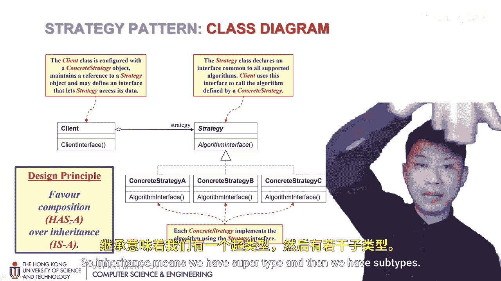

But has a relationship means each client， they're going to have different strategies for flying and cracking。

 for example。So that means in our class diagram， we favor this horizontal line。

 that means the client going to have different strategies on doing something。Rather than inheritance。

And in the dark simulation game， we also favor has a relationship because each duck is going to have different flying behavior and also different cracking behavior。

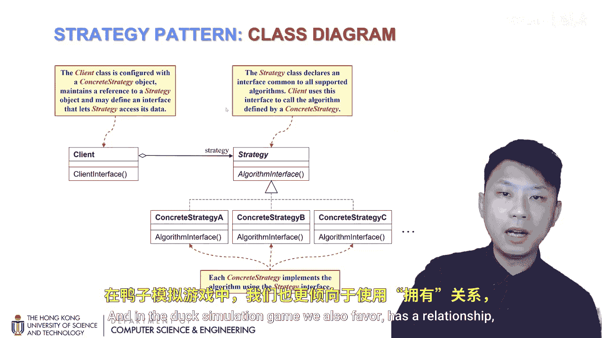

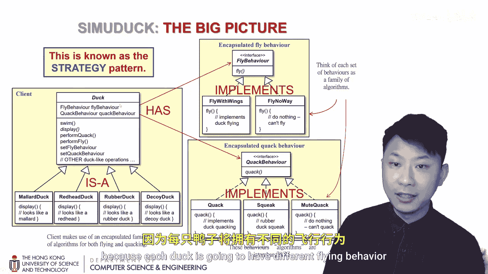