# 香港科技大学【中英⚡软件工程｜Software Engineering Specialization】 p49 P49 03_观察者模式 -BV1MMEjzoEhg_p49-

So if you want to learn more different design patterns that you can use in different software engineering projects。

 this is the Bible of design patterns。So in this design pattern Bible。

 you can learn about different types of design patternss， for example， creational patterns。

 structural patterns， behavioral patterns or concurrency patterns， etcter。

 etc When we describe a design pattern we usually describe a design pattern using a class diagram。

 but apart from the class diagram， we also have to specify all these things。

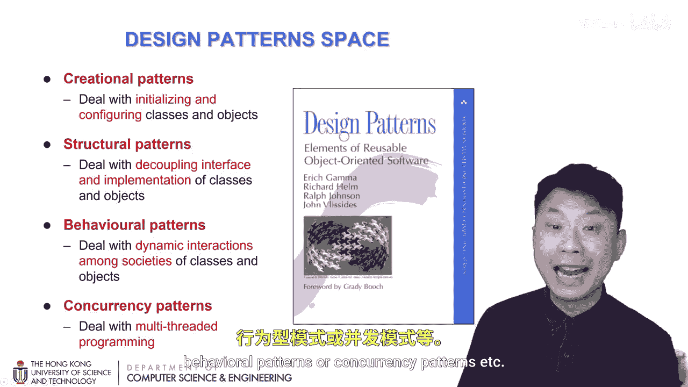

For example， the name of the design pattern， what is the problem that you try to tackle， the context。

 the concerns， the solution， etctera， etc， so these are all the things that you have to specify for a particular design pattern。

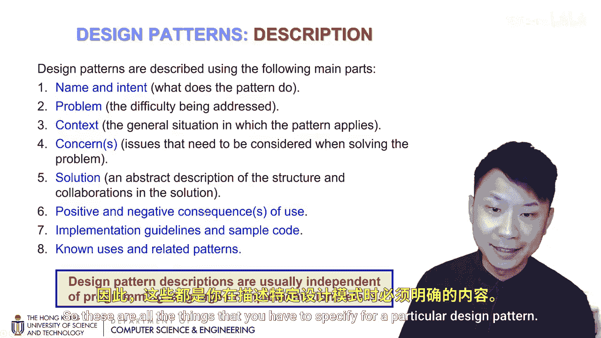

Ton now we have already covered strategy pattern， which is a behavioral design pattern。

 The next one that we're going to cover is what we call observer pattern。

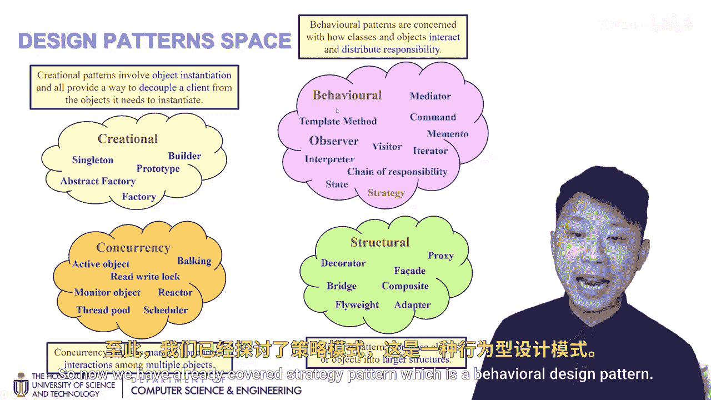

Now， the idea behind observer panel is simple。 Now， let's take a look at this example。

Let's consider a spreadsheet application。Then under the application， you may have a set of data。

And also multiple charts。 So you're going to draw different charts based on one set of data。

But in observer pattern， we don't call them data and charts。

 we call them one single subject and we have multiple observers and this is what we call observer patterndding。

😡。

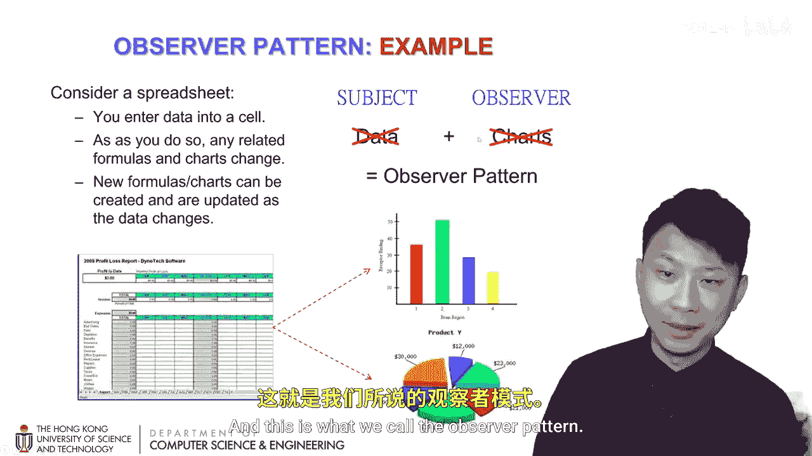

And this is how the observer pattern works。 Let's say we have a single subject and multiple observer objects。

And this observer objects， they are subscribed to this subject。

 and this one object D is not being subscribed to the subject。😡，Then we assume that for example。

 the subject may manages some data。😡，In these observers。

 they may be charged under a spreadsheet application。Then once the data is updated。

 then it's screen to notify all the observers being subscribed to this subject to update the charts。

And then all the observer objects， they will be notified about the update and then update the charts accordingly。

Now this object D is not being subscribed to the subject。Then later on。

 it may be subscribed to this subject。😡，And then it will be under the set of observer objects that we have for this subject。

 Then later on， when we update this subject。All the observer objects。

 they will be updated accordingly。And then you may unsubscribe a particular observer objects at any time。

Then once says unsubscribed it， then it will no longer get the update。

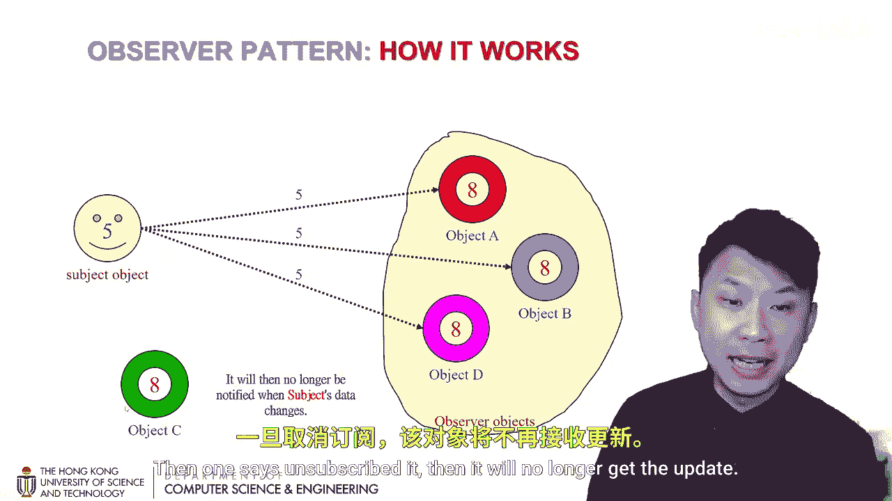

And under the observer pattern， we are talking about a one to many dependent， right。

 because we have one subject and multiple observers。And once the subject is updated。

 it will notify the observer objects to update themselves。So the subject holds the state。

And these are the dependent objects。And they will be notified about the updates。

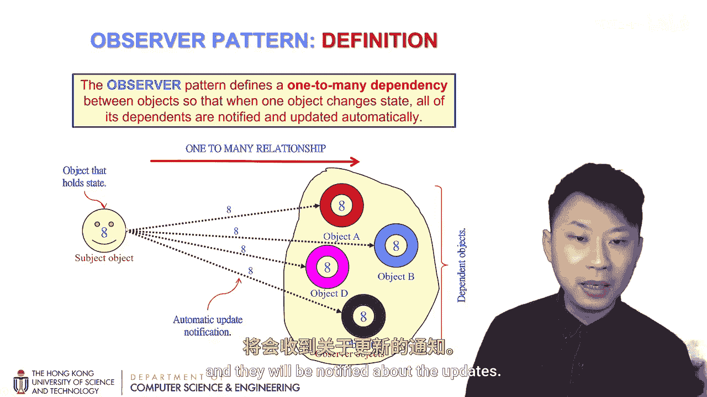

And this is the class diagram that we use for observer pattern。Under the observer pattern。

 we have the subject and also the concrete implementation of the subject。

Then the subject has a reference to the observers and under the observer interface。

 we have different concrete implementation of the observers。And the concrete observers。

 they have a reference to the concrete subject。😊，And now this class define the subject interfacefades。

 and then each subject may have multiple observers。And in all the observers。

 there becomes concrete implementations under this observer innovates。

And the concrete subject is an implementation under the subject interfaces。

And the concrete observers， they are the implementations under the observer interfaces。

And each observer registers with a concrete subject。

 register with a concrete subject to be notified of and to receive updates。

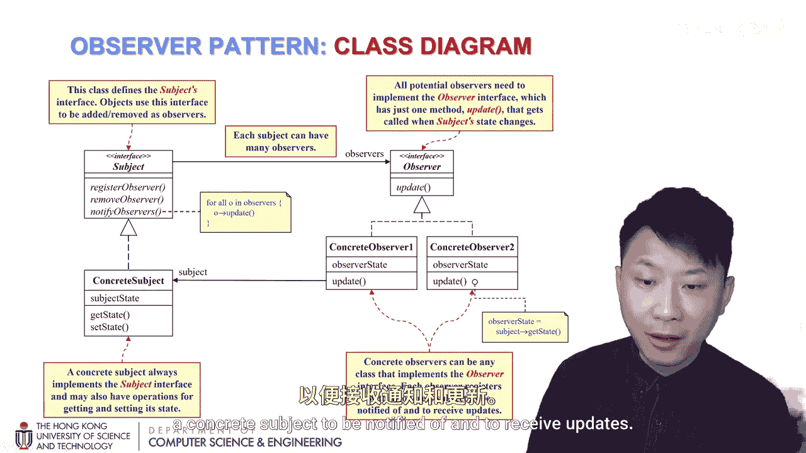

In the observer pattern， we say that we have one too many dependents， but still。

 we say that the subjects and the observers， they are loosely coupled， why。Just because right。

 the subjects they know it。Just because the subjects they know about the observers via and inters。

And we can add new observers at any time， under the observer interfaces。

And changes to either the subject and the observer will not affect each other。So in general。

 we say that subjects and observers they know each other via interfaces。

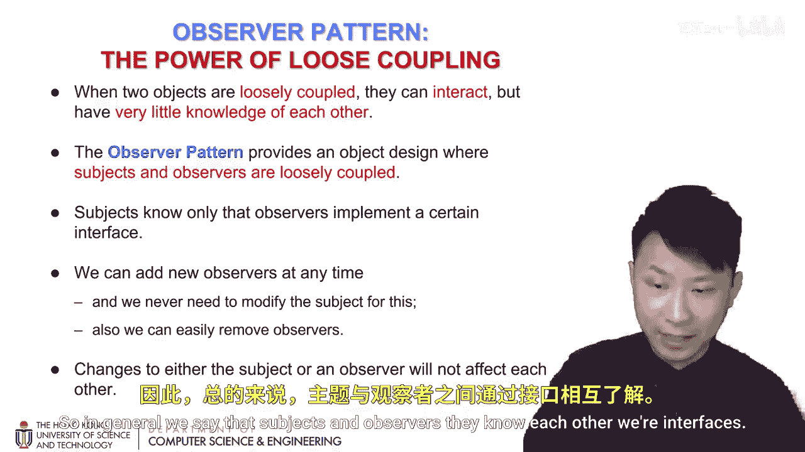

So that's why we achieve this design principle。 We try to strive for loosely coupled design between objects that interact。

And is good because loosely coupled the sign minimized the interdependence between objects。

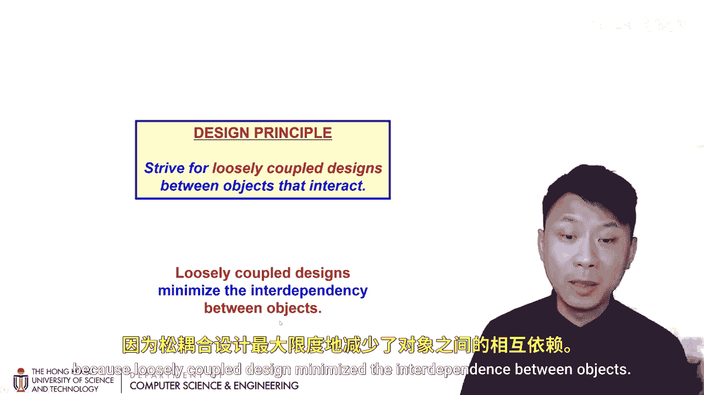

Now when we describe the observer pattern， it's pretty simple， right。

 we are simply using this class diagram and we say that we have some subject and then the subject is going to have multiple observers。

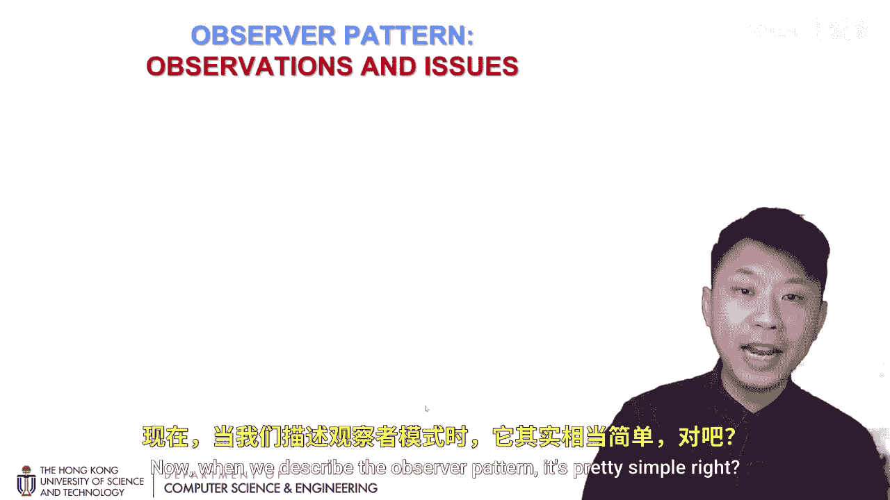

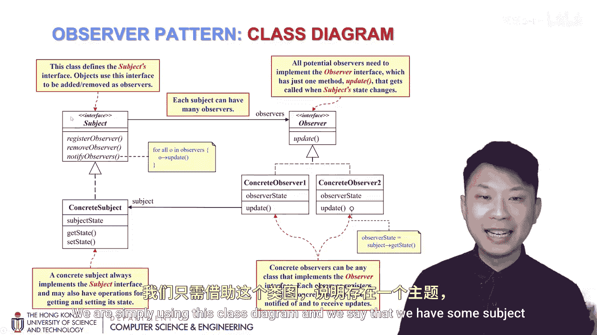

But now when we implement the observer pattern， it can be quite complicated。

Because the observer pattern has to support broadcast communication for the subject to update all the observers。

And we also need to handle events notification protocol， for example。

 what events should the subject announce， should every event be announced to every observer。

 should the subject define different kinds of events and allow the observers to subscribe selectively。

 etca， etc。 So that's why we say that when we describe the observer pattern iss kind of simple。

 we simply have some subject in our class diagram and we have multiple observers。

 But when we implement the observer pattern， it actually can be quite complicated。

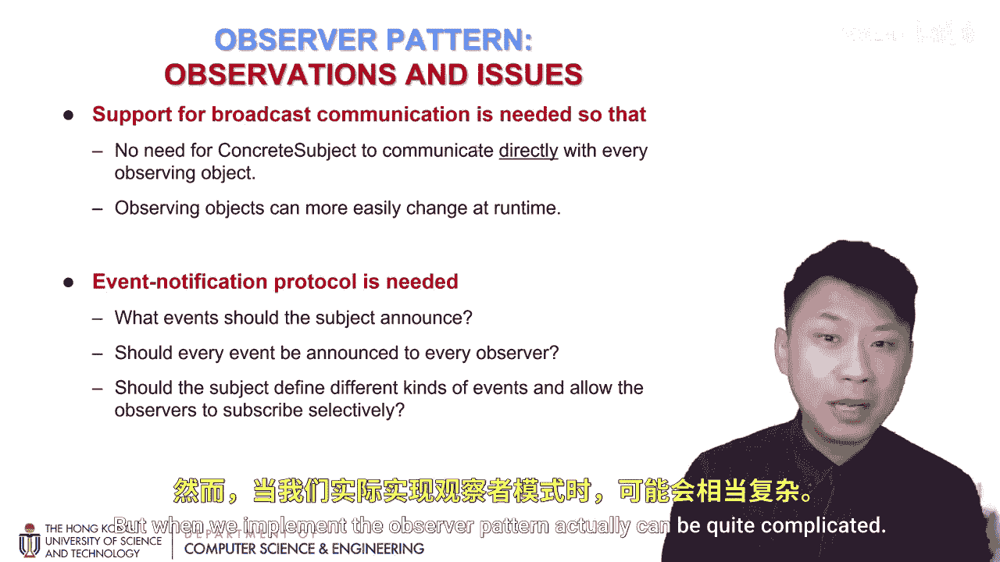

And that's all I want to cover in this lecture。