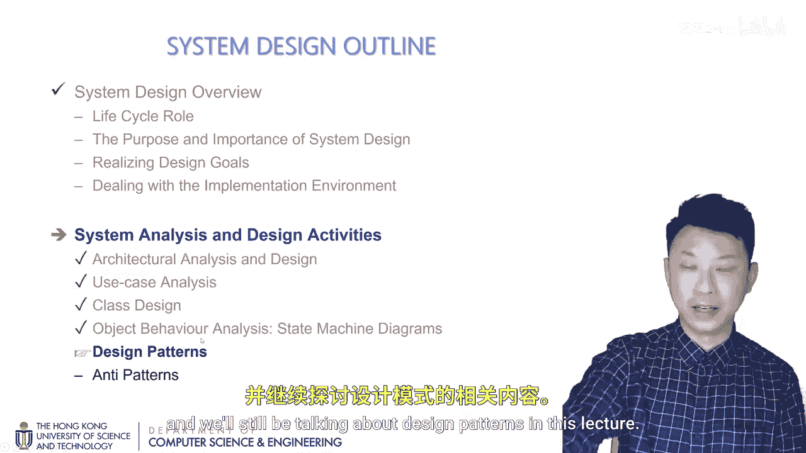
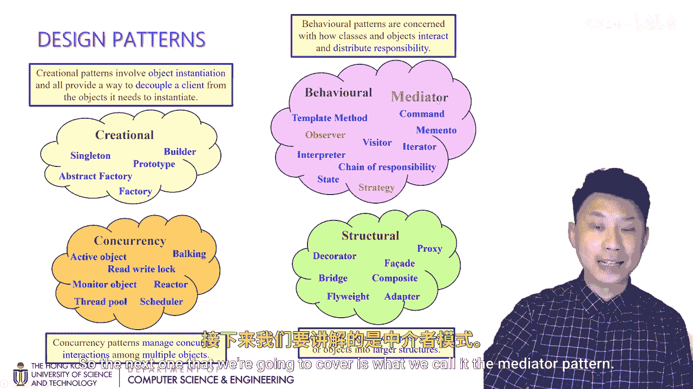
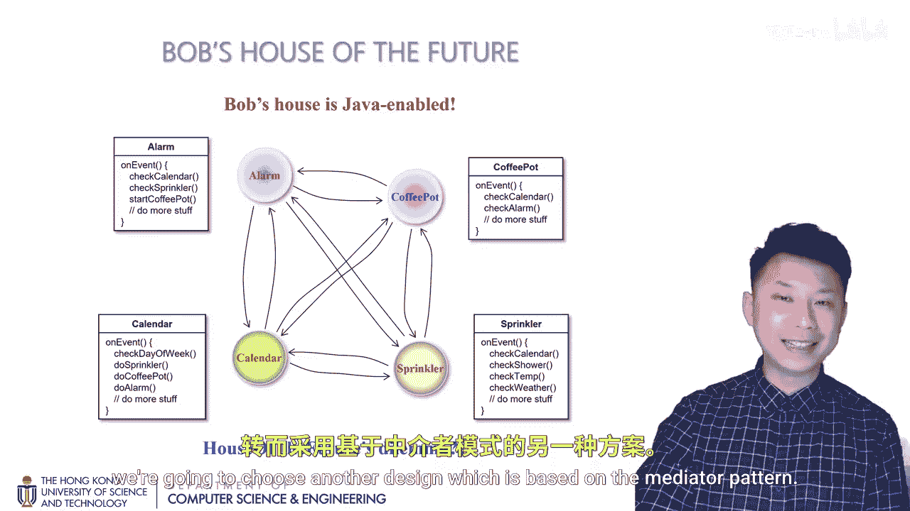
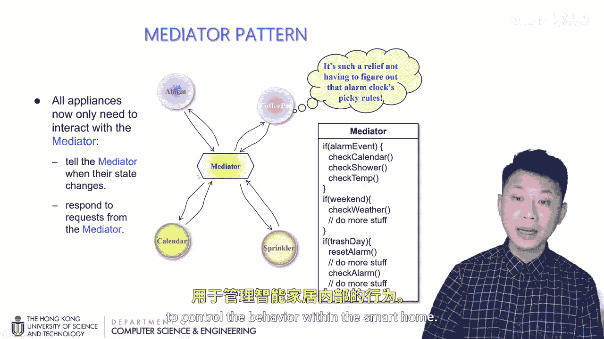
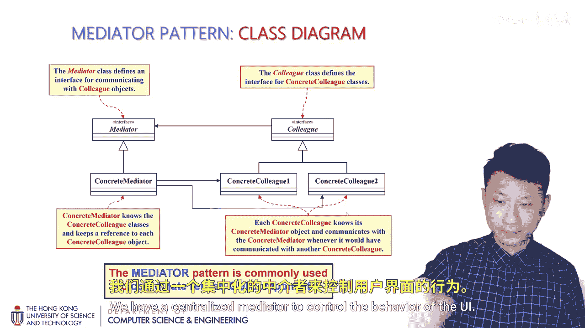
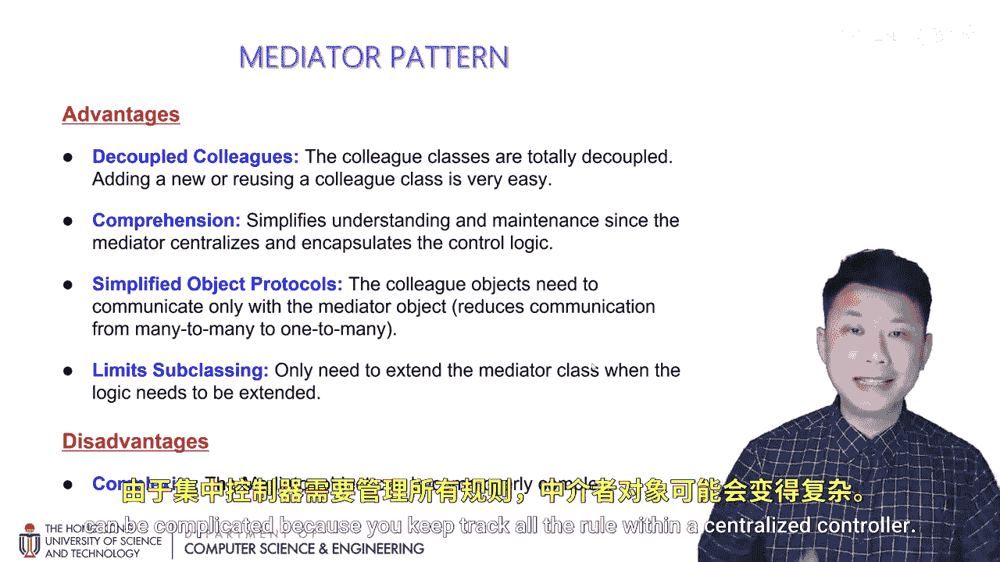

# 香港科技大学【中英⚡软件工程｜Software Engineering Specialization】 p50 P50 01_中介者模式 -BV1MMEjzoEhg_p50-

Hi， in this lecture， we will introduce more design patterns。

And we'll still be talking about this patterns in this lecture。

So the next one that we can cover is what we call the mediator pattern。

For the mediator pattern， this is the example that we're going to use。

So let's say we want to build a software system for a smart home and within the software system we're going to have different appliances。

 for example， alarm calendar， sprinkler and also copy po。

And this is something that you can do within your smart home， for example。

 when the alarm ring it's going to notify the coffee pot to start making coffee。

And the sprinkler will design whether to turn itself on or off based on the calendar temperature and the radar based on different conditions。

So now， what is the problem with this design。Let's say we allow the colleagues to communicate with each other directly。

Now， the problem is that each colleague has to keep track some rulesuse for doing something。

 For example， for the alarm is gonna check the calendar。

 check the sprinkler and also notify another colleague right for example。

 the coffee pot right to start making coffee and then a coffee pot has to keep track another set of rules right。

 for example checking the calendar checking the alarm， etc cetera， etc ce。

 So now using this design each col has to keep track a set of rulesuse。 Then later on。

 when we try to maintain all this rules become difficult because we don't know exactly where the r exists。

 For example， this start making coffee event， we don't know whether this event is gonna exist in for example。

 alarm calendar or sprinkler。So it's difficult to maintain and also keep track all the roofs that we have within the house。

So that's why instead of using this design， we're going to choose another design。

 which is based on the mediator pattern。

So now this is de media their padding。Now， instead of having individual colleagues to keep track their own rules。

 Now， we keep track all the rules within this mediata。 Now， these colleagues。

 they don't directly interact with each other。They interact with the mediator。 Okay。

 then once some events happened within the mediator。

 it's going to notify some article list to do something。

Now you can consider this mediator as a centralized controller to control the behavior within the smart。

 and we keep trying all the rules within this mediator。

And now， this is the class diagram that we use for de mediator pattern。

We have an interface for the mediator and then we have the concrete implementation of the mediator and then we have different colleagues and we have the actual implementation of the colleagues and then the colleague has a reference to the mediator interface and then the concrete mediator has a reference to the concrete colleagues。

So now we have a mediator class for the mediator interfaces。 and also， we have a。I call it in thes。

And also we have the concrete implementation of the mediator and also concrete implementation of the colleagues。

So the mediator pattern is commonly used to coordinate related GuUI components。For example。

 when you choose a particular option in the UI， then you're can enable some of the patternss within the UI。

 etc cetera， etca， so we have a centralized mediator to control the behavior of the UI。

So the advantages of mediator pattern is that we have decoupled colleagues now notice that using mediator pattern。

 the colleagues no longer communicate with each other directly。And its comprehension。

 we keep track all the rules within the centralized media。 So now if you want to maintain the rules。

 you just go into the media and then update the rules。And also simplified it optic protocols。

Just because the colleagues， right， they don't have to communicate with each other directly。

And also limits suring because we only need to extend the mediator class when the logic or the rulesuse needs to be extended。

But the disadvantage of mediator pattern is that the mediator object can be the mediator。

 but the disadvantage of mediator pattern is that the mediator object can be kind of complicated because you keep out the rules within a centralized controller so implementing the controller itself can be complicated。

