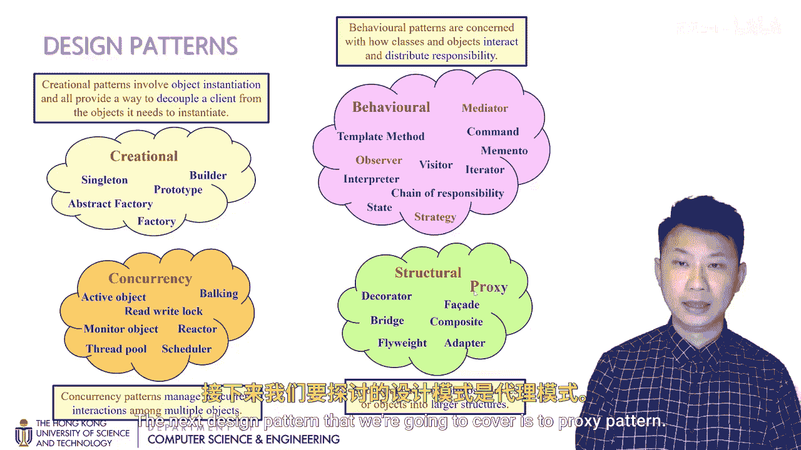
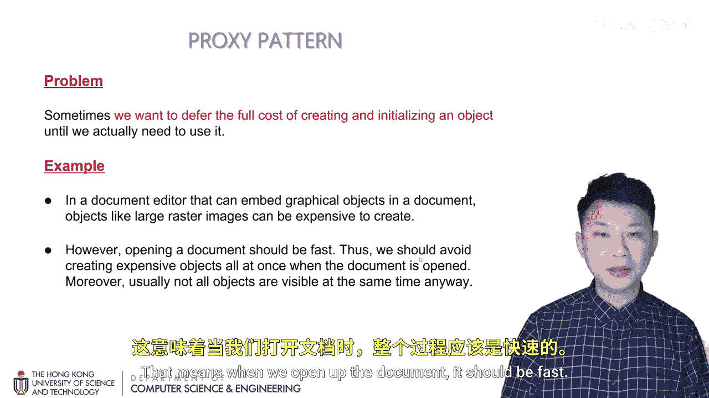
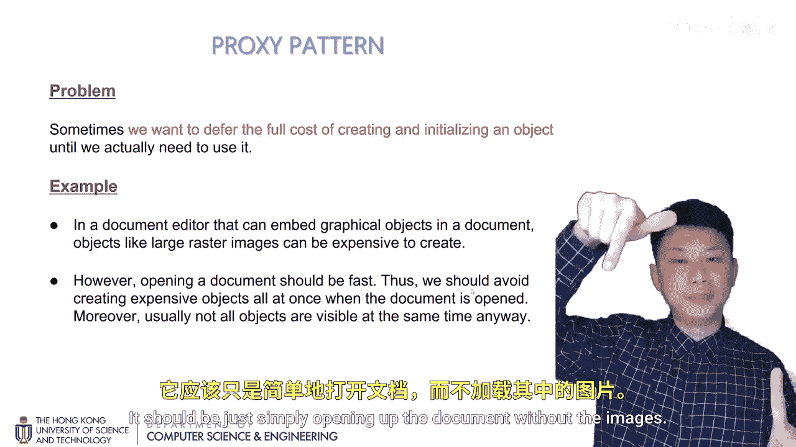
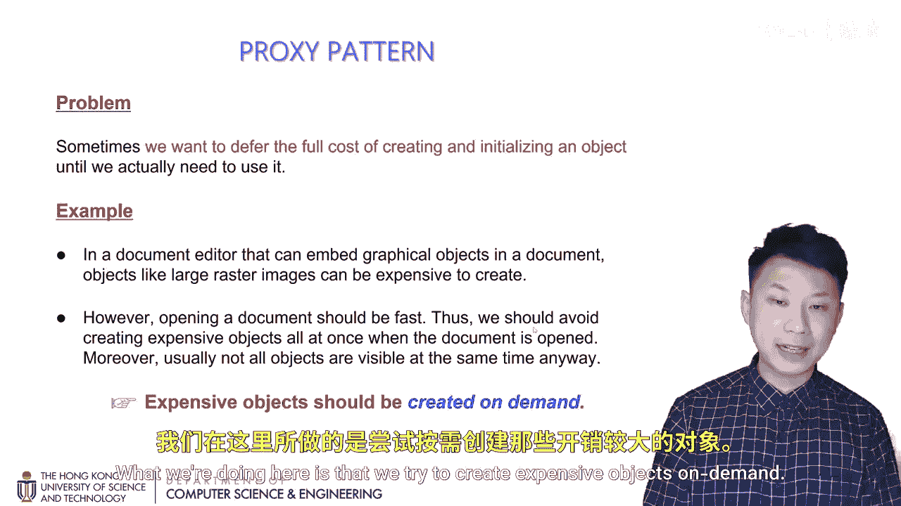
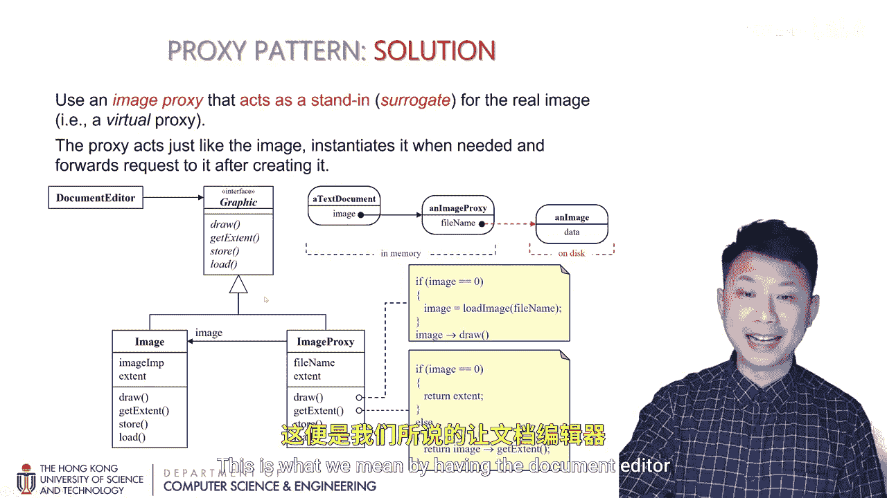
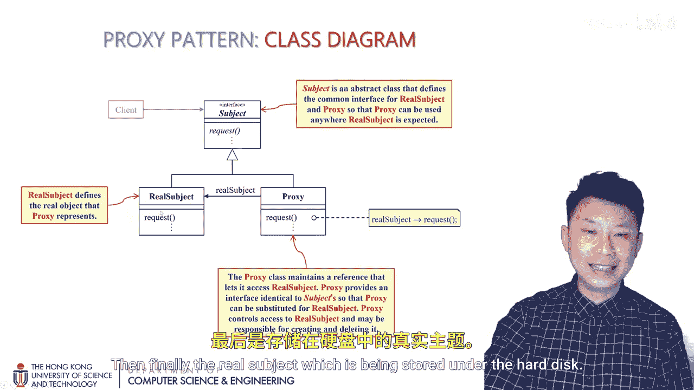

# 香港科技大学【中英⚡软件工程｜Software Engineering Specialization】 p51 P51 02_代理模式 -BV1MMEjzoEhg_p51-

And the next design pattern that we can cover is the prox pattern。So when we use the proiped。

 and this is the problem that we want to deal with。

 we want to defer the full cost of creating and initializing an object until we actually need to use it。

 For example， let's say we have some multimedia content within a webage。

 then instead of showing the content。When we open up the webage。

 we wait until we download the entire thing and then we we showed it up。 Okay。

 so this is what we mean by defer the full cost of creating and initializing an object because when we open up a webage。

 we don't want to wait until we download all the media files。For example， when we open up a web page。

 we don't want to wait until we open up all the multimedia content before we can see the webage。

 So that's why we want to defer the full cost of creating and initializing an object until we actually need to use。

 for example， the multimediator。And we want to defer the full cons of creating and imizing an object until we actually need to use it。

 For example， we don't open up the multimedia content until we really want to see the content。

So this is an example， like within a document editor， we may have images。

 then we're going to open up the images until we really need to use the images。So that means right。

 when we open up the document， it should be fast。 it should be just simply opening up the document without the images。

And what we are doing here is that we try to create expensive objects on demand。

And this is the example that we are using within a document， we have an image proxy。

 then the image proy is going to assess the actual image on hot disk。

And this may be the design that we can use for the document editor。So we have a graphic interface。

 Then when you try to get an image， you have to get it through the image proxy。

And then your image process is going to help you get the image from the hot disk。

And this is how we implement the image policy。If we really want to draw the image。

 then we're going to load the image from the hot disk and then draw the image。

But there's another choice， right， This is what we call get extend。

 We simply get the size of the image and then create an empty box within the document。

If the image is not loaded up yet， then we simply return the sites。 Okay， we is the width and height。

 Then you can create an empty box with in the document。Out of ice， we need to creep。Otherwise。

 we going return the actual image so you can see the actual image within the document。

And this is what we mean by having the document editor to access a particular image through a proxy。

And this is the class diagram that we use for proypadding。 We have a client， for example。

 the document editor， then we have some subject。And then when we try to assess the real subject。

 we have to get it through a proxy。And we don't actually get the real subject unless really necessary。

 unless we really want to use it。And now we have a subject interface。

And then a proy class so that you can get things through the proy and then finally the real subject which is being stored under the hot disk。

