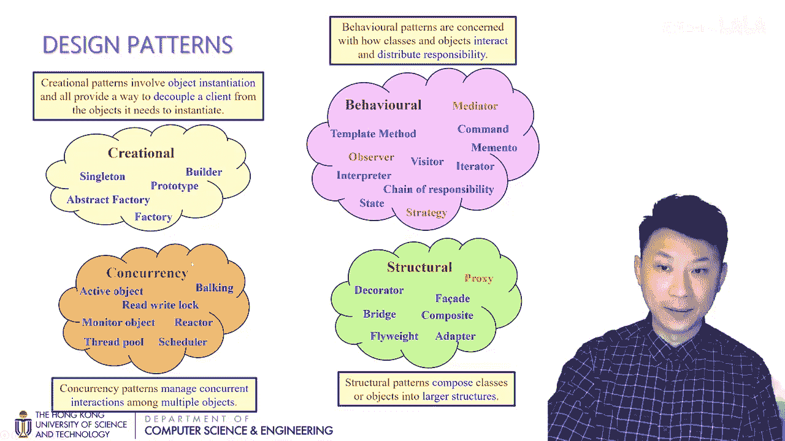
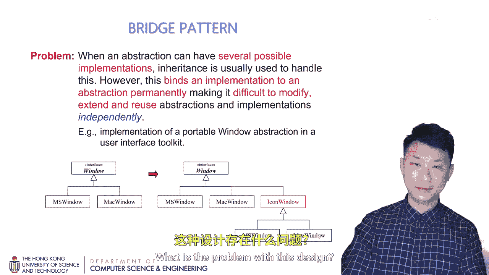
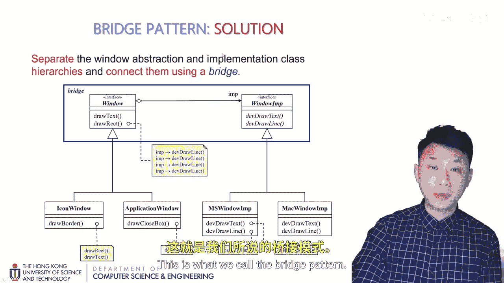
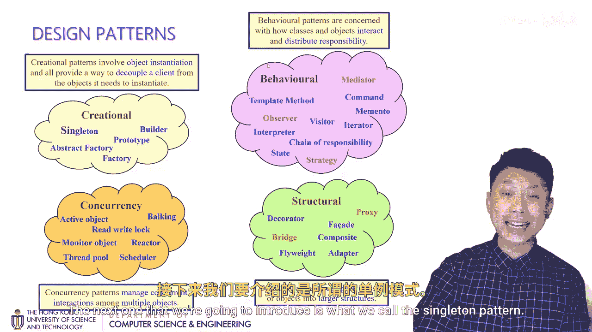
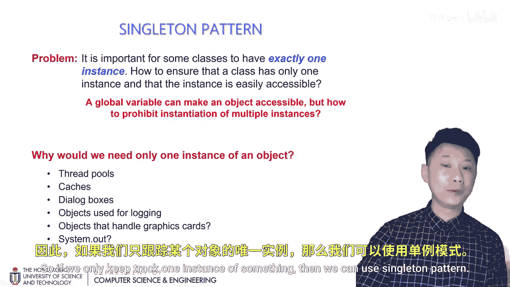
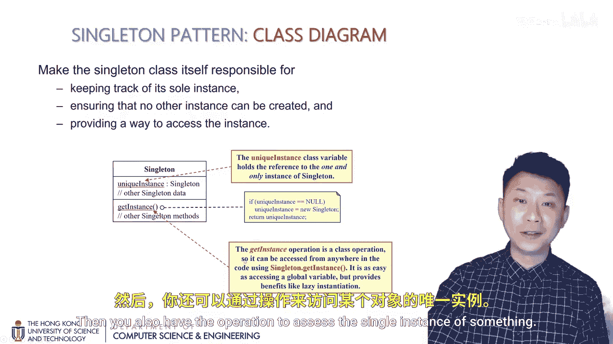

# 香港科技大学【中英⚡软件工程｜Software Engineering Specialization】 p52 P52 03_桥接模式与单例模式 -BV1MMEjzoEhg_p52-

And the next pattern that we're going to cover is what we call the bridge pattern。

So this is the example that we use for the bridge pattern。 Now。

 let's say that we have different windows。Now， let's say that we have different windows and their different operating systems。

So for example， under the Windows interface， we have the implementation for Microsoft window and also we have the implementation for Mac window window means we have the window under the operating system。

And then now， let's say we have another kind of window that we want to add within our implementation。

Which is icon window。Then under the interface， we can have another implementation for icon window。

And then on the icon window， we have two different implementation。

 One is for Microsoft window and another one is for Mac La。So now。

 what is the problem with this design。

And this is the solution。Now， we try to separate a from implementation。 Now， we have a。

Now we have an interface for window and then under this interface we have different types of windows okay。

 for example， icon window application window， they are different subtypes。

Then this window has a reference to the window implementation intervals。

And then under this window implementation in， we're going to have different implementations。

 one for Windows OS， and then another one for Mac OS。So now by using this design。

 we separate abstraction，type and subtypes with different implementations。So now。

 let's say I want to draw icon window on Windows or less。

 Then what we can do is that we're going to use the Microsoft window implementation to draw to actually draw the icon window。

 So now you can see that we have different operations here for drawing windows。 So drawing line。

 draw some text。 and we get the window。And then if we want to draw， for example。

 icon window 4 Mac OS， then we're going to use the operations under the Mac Windows implementation。

So now we separate abstraction this part supert and subt with different implementations， right。

 for example， one implementation for Microsoft windowd and then another implementation for Macass and then connect them together get are using a bridge。

And then we say that this window interface has a reference to different implementations。

In this window implementation， they are part of this window interfaces。

And this is what we call the bridge pedding。

The next one that we going introduce is what we call the single1 padding。

 This one is extremely simple。

So let's say you want something design to keep track exactly one instance of something。

 then you can always use the single ten pattern。So why do we need only one instance of something？

 These are some examples。For example， we only have one threadt poo。 We only have one catch。

 We only have one dialg box， et cetera， et cetera。 So we only keep track one instance of something。

 Then we can use singleton padding。

And this is the class diagram that we use for the single ten pattern and you can see that within the single1 pattern。

 we keep track only one single instance of something using this single1 variable。

And then anytime you can get the instance using this operation。So this pattern is very simple。

 we use the singleton to keep track one instance of something。

 then we have an operation to get the instance。And you have a variable to refer to the single tank。

And then， you also have。The operation to assess the single instance of something。

