# 香港科技大学【中英⚡软件工程｜Software Engineering Specialization】 p53 P53 04_工厂模式 -BV1MMEjzoEhg_p53-

And the last pattern that we're going to cover in this course is what we call the factory pattern。

 And from the name， you know that we can use the factory pattern to make something to manufacture something。

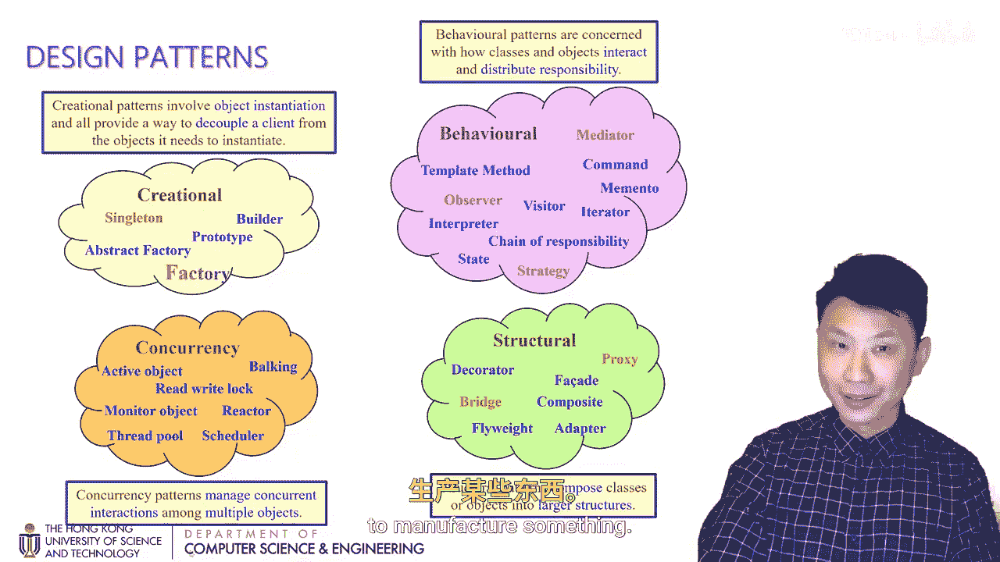

So now let's say we are using inheritance and then we have supertype and subtype。

 then when we initialize an object， we have to specify the subtype of the object right， for example。

 we can create dos。OkayThen if we go to picnic， we're going to initialize the duck as Maad duck。

 if we go hunting， then we can initialize the duck as decoy duck， and then if we go bathing。

 we can use rubber duck， etca， etc。And notice that this kind of code is not closed for modification。

 Now， let's say we have some other situations and some other type of dogs。 Then when you。

So now let's say we have some other different situations and some other types of ducks。

 then we say that this part of the code is not closed for modification because we have to modify this part of code to include the new situations and also to include the new types of ducks。

So this is one important principle that we should consider when we design a software system。Classes。

 they should be open for extension， but close for modification。

And we should allow a design to incorporate new behavior without modifying existing code。

 For example， if we have some new situations and new types of datas。

 then we don't have to modify this part of the source code。

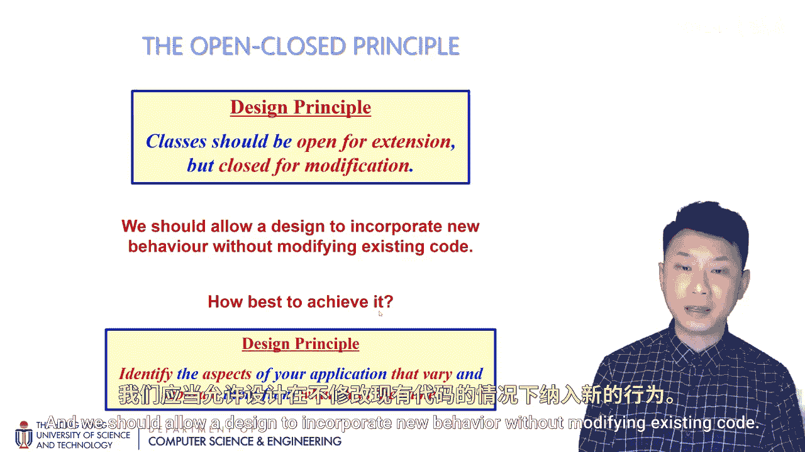

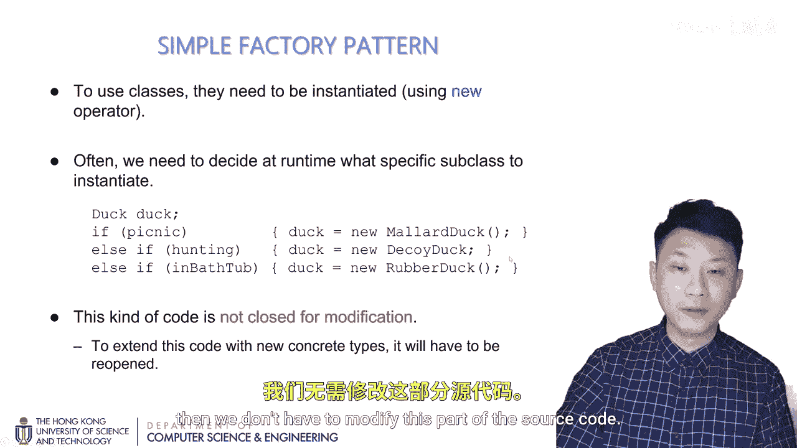

So another design principle that we're going to use in factory pattern is that we try to identify the aspects of your application that vary and then separate them from what stays the same。

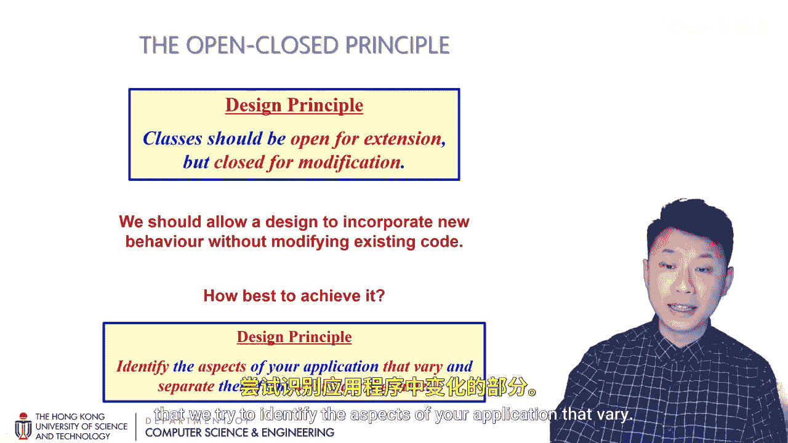

And this is the example that we use for factory pattern。

 and now let's say we try to build a software system for a pizza shop。

 and now within the software system， somehow we can order P。And then when we order pizza。

 we have to initialize the pizza and then prepare the pizza， bake the pizza。

 and then cut the pizza and box the pizza， and then eventually return the pizza。

So this is what we have to do when we make a pizza。So now within the pizza shop。

 we should be able to initialize the pizza according to the type of pizza that we want to make。

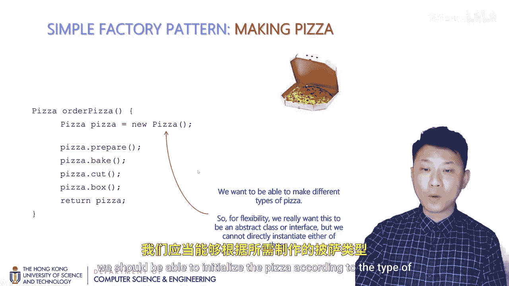

So now， if the order is a cheese pizza， then we initialize pizza as a cheese pizza。 Otherwise。

 if it's a Greek pizza， then we initialize the pizza as a Greek pizza， et cetera， et cetera。 So now。

 depending on the order， you're going to make different pizza。

And then you will know the type of pizza by this parameter type。And then based on the type of pizza。

 are're going to create different types of pizza。And then you're going prepare a bake and then cut and embos the pizza and then eventually return the pizza。

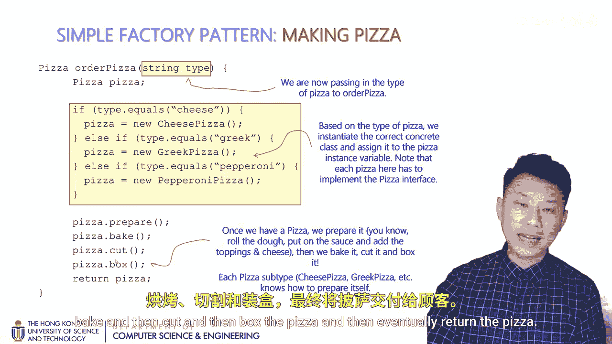

But later on， okay， let's say we remove some types of pizza within the shop。

 and then we want to introduce some new types of pizza。

Then you have to modify this part of the source code and when we introduce the factory pattern。

 we have said that we want to utilize the open close principle that means classes they should be open for extension but close for modification。

 but now if you take a look at this example。

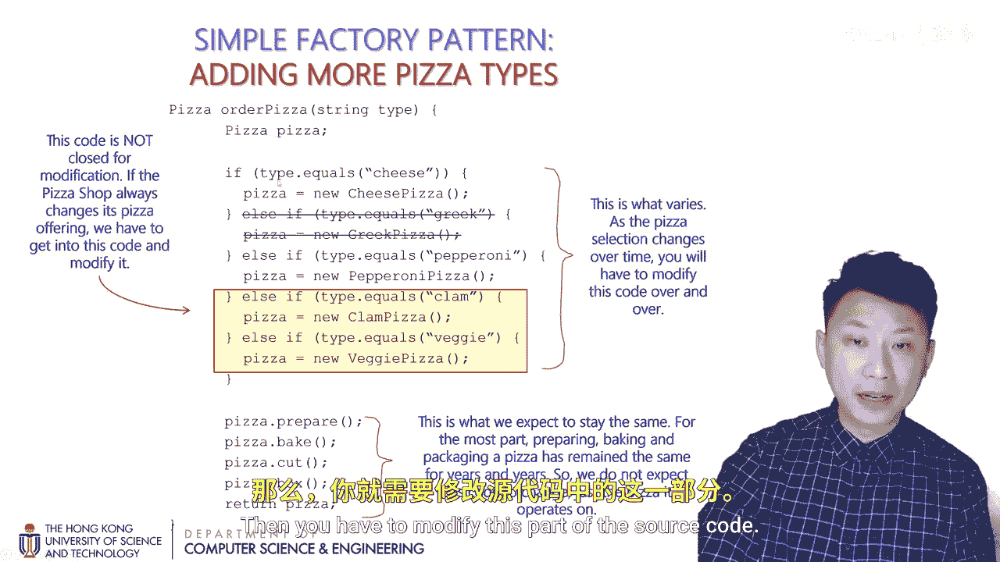

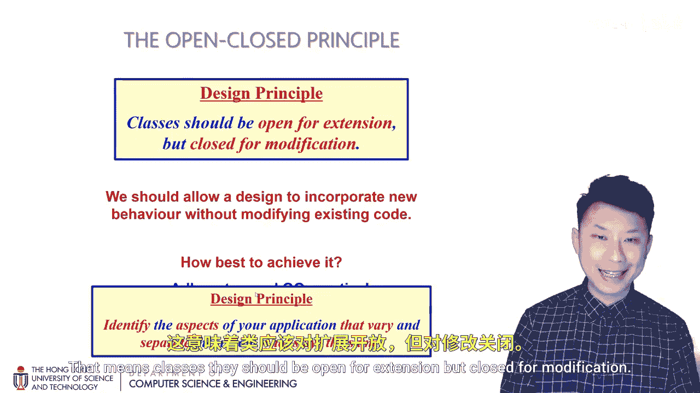

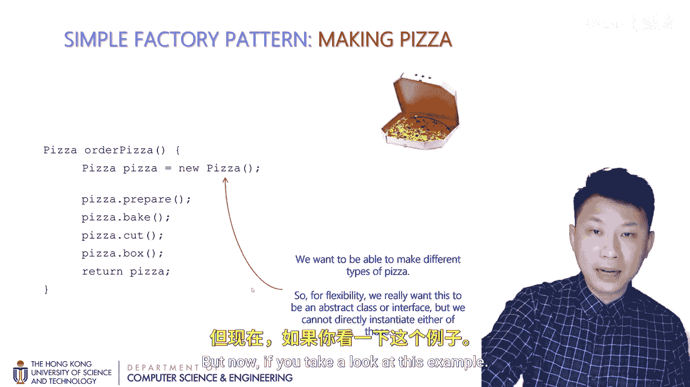

When we want to modify the types of pizza that we have in the shop。

 we have to actually open up this part of the code again and then modify this part of the code。

 and this is not what we want。But that's why we have to utilize the factory pattern to improve the design of the software system。

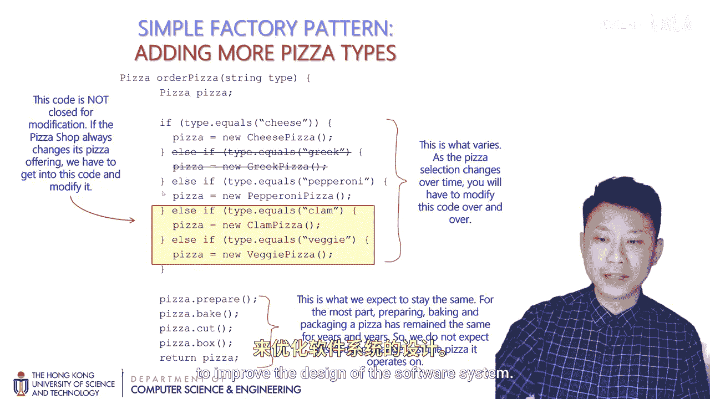

So notice that this is was being very。 Okay， so within the sharp。

 we may modify the types of pizza that we have in the shop。

Then we have to extract it out and then put it somewhere else。

 and we're going to put it within a factory。

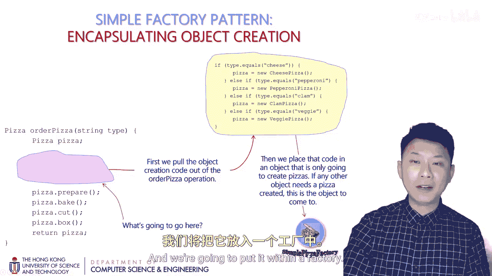

So within the factory， this is what we're going to do。 We have a factory for creating pizza。

 and then this is the operation that we can use for creating pizza。

Then according to the parameter that we get for the type of pizza that we want to create。Then we we。

Then we will create different types of pizza。And this is our new class。 right。

 We put it in a new class。 We put it in a separate class。

So now if we want to modify the types of pizza that we have in the shop。

 we only have to touch this new class， only touch this object， the factory。

And this is the operation that we use for creating pizza。

And we pulled out this part of the code and then put it in a factory。So still。

 based on the parameter type， we're gonna create different types of pizza。

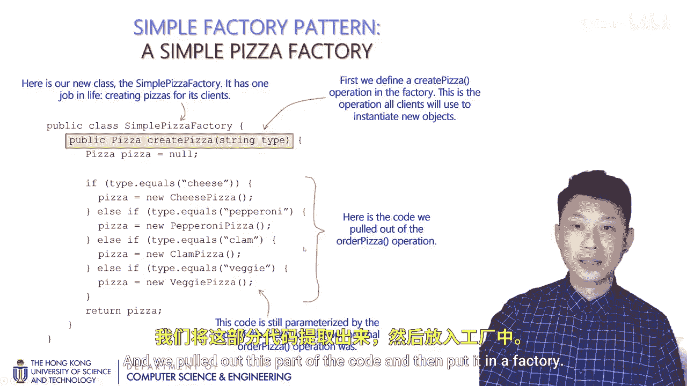

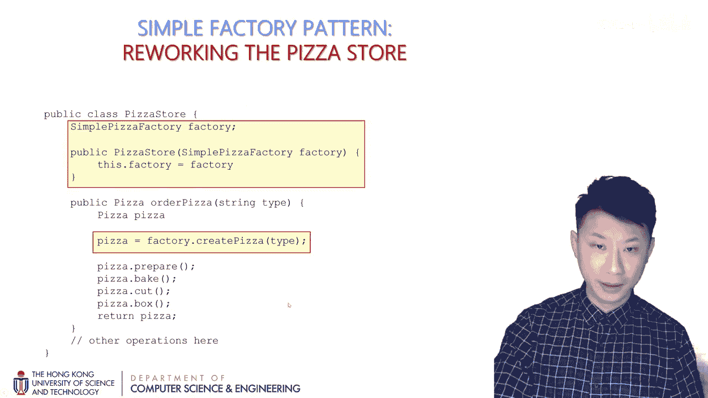

And now， when we want to create pizza， we have to create it through a factory。

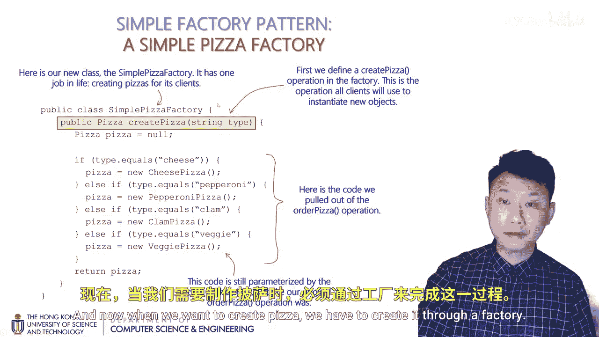

And this is how we make pizza。Okay， so within the pizza store， we're going to have a factory。Okay。

Then when we try to order pizza， we're going to initialize a pizza and then we're going to ask the factory to create the pizza according to the type of the order。

And then'm going to prepare the pizza， bake the pizza， cut the pizza， and em box the pizza。

 and then eventually return the pizza。So now when we try to create a pizza。

 we have to create it through the factory。And then when we create a pizza store。

 we also have to pass the factory into the pizza store。

 and then we're going to use the factory to create different types of pizza。

Then according to the order type， we're going to use the factory to create the type of pizza。

 according to the order。And they now notice that we're going to create a piece of we in the factory。

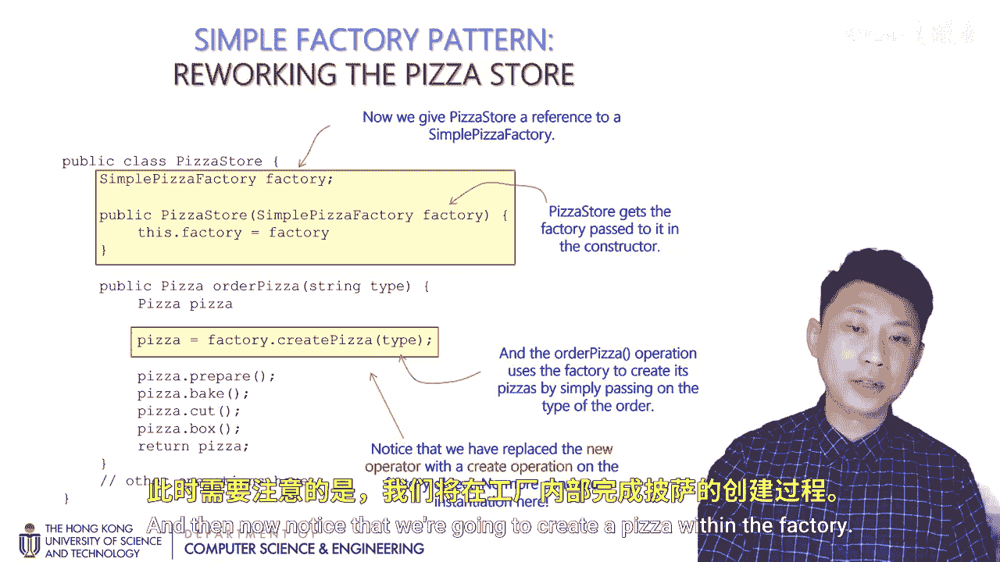

And this is the class diagram that we use for factory padding。So within a shop。

 we're going to have an interface for different types of products。

 and then we're going to have different concrete implementations of the products。

Then we're going to have a creator interface， the factory。

 and then the concrete implementation of the factory。

And then we're going to use this factory to create different types of products。

So now we have a product interface， and then we have different concrete implementation of the products。

And then we have a creator interface， right the factory interface for creating different types of products。

 and then we have the concrete implementation of the factory。

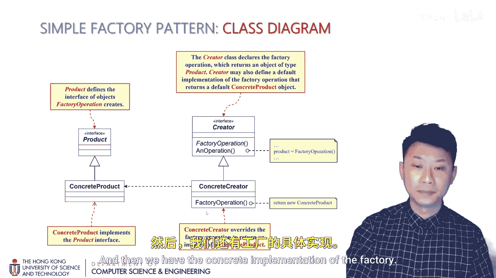

So now you may ask when to use design patterns， we use design patterns when solutions to problems that occur with variations。

So that means if we see similar problems again and again。

 then we may apply the solution that we get from this patterns。

And also solutions that require several steps， so notice that if your solution requires simply a linear set of instructions。

 then using design patterns may be overcu。And also。

 solutions where the solver is more interested in the existence of the solution than is complete derivation。

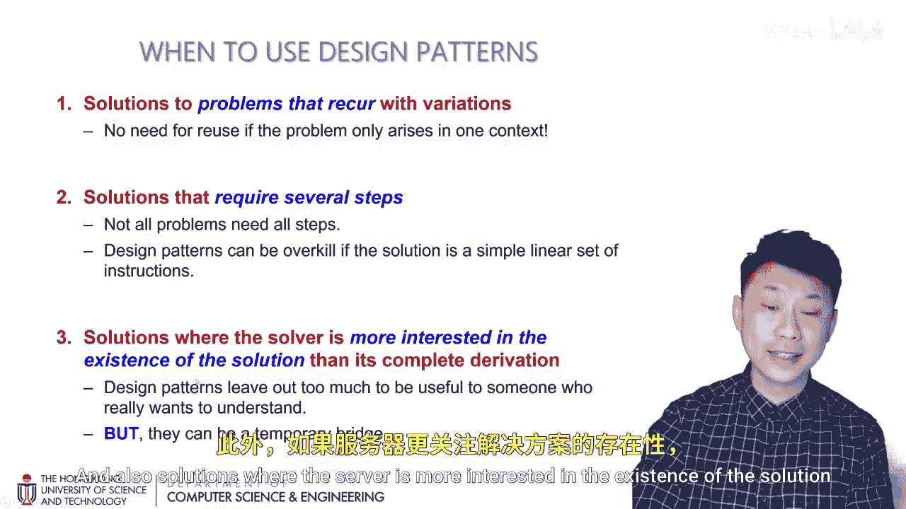

So now the benefits of using design pattern is that design patterns enable large scale re use of software designs。

And also design patterns explicitly capture expert knowledge and design trade offs and make this expertise more widely available so if you learn all these design patterns。

 you behave more like an expert。And also design patterns help improve developer communication。

 so when you communicate with other developers， then you can use the terms that you have learned from design patterns。

 for example， factory patterndding， media their patterndding， then other developers。

 they know exactly what you want to do。And also design patterns help easy the translation to object oriented technology。

 just because most of the design patterns they are object oriented。

 they can be described using a class diagram。But there are some drawbacks of using design patterns。

 for example， design patterns do not need to direct code we use。

 So it's just some design that you can follow， but not some source code that you can actually reuse。

AndDe patterns they are deceptively simple， so when we describe it， we use a class diagram。

 but when you actually implement the design pattern。

 it can be utterly quite complicated because there are more things that you have to handle。

And development teams may suffer from design pattern overload。

 that means you spend lots of time in finding a design pattern for your project。

 but eventually there may not be one single design pattern that' is appropriate for your project。

And design patterns are validated by experience and discussion rather than automated testing。

 so if you want to validate whether you have successfully implemented a design pattern。

 you have to ask and other expert to validate the design for you。

And integrating design pattern into a software development process is a human intensive anti。

 So now let's say you want to use some design pattern for your project。

 then notice that you need some expert to help you with the design pattern and help you implement the design pattern。

 It's not something that can be done automatically。And its human intensive。

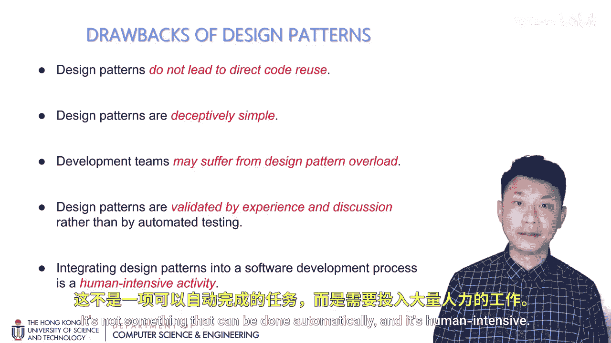