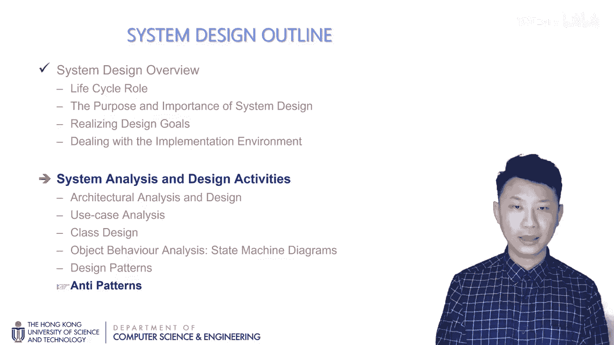
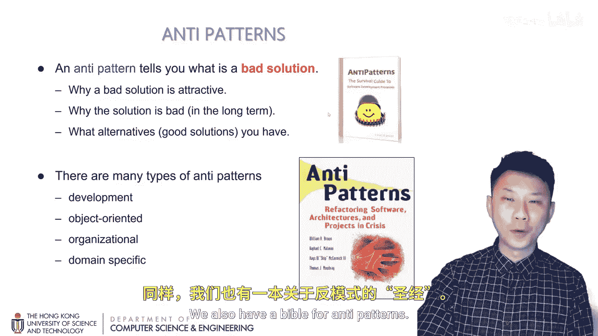
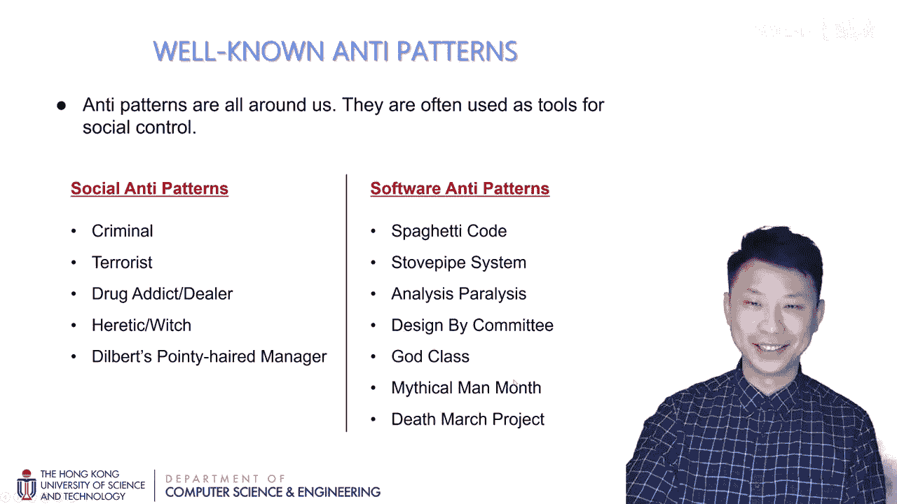
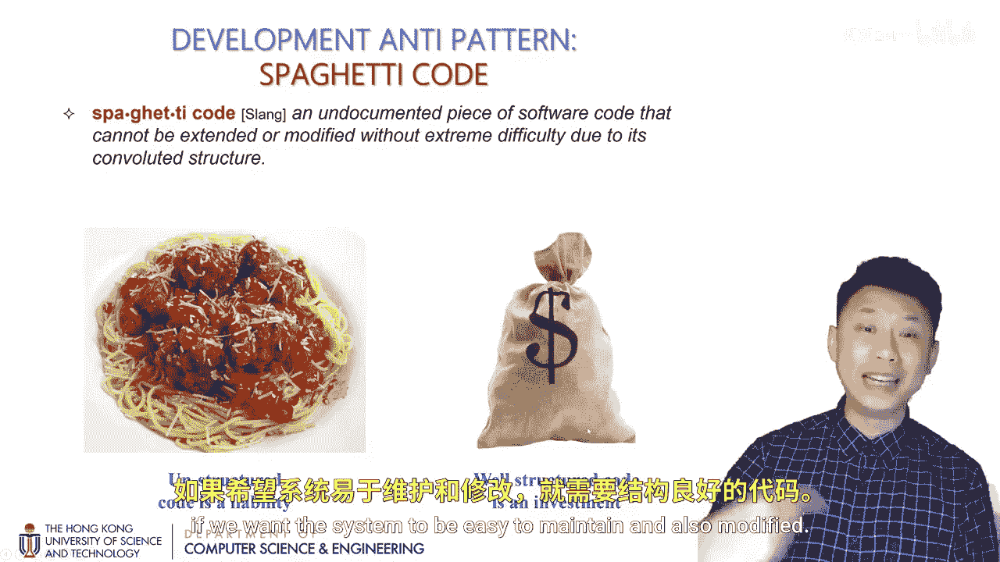
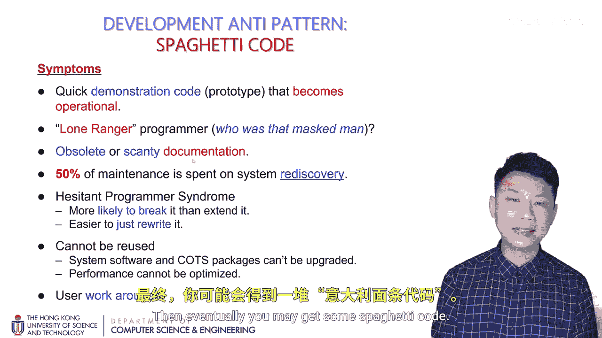
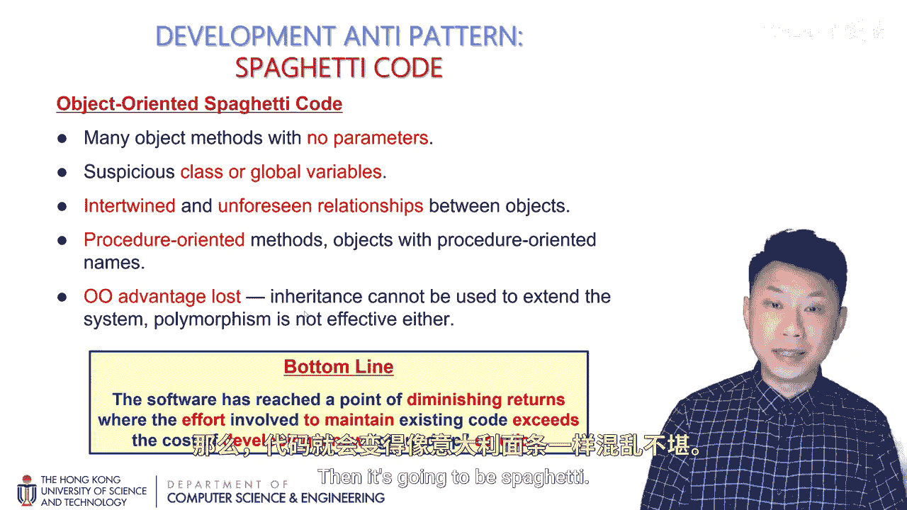
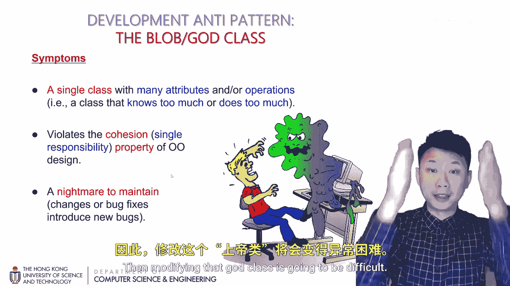
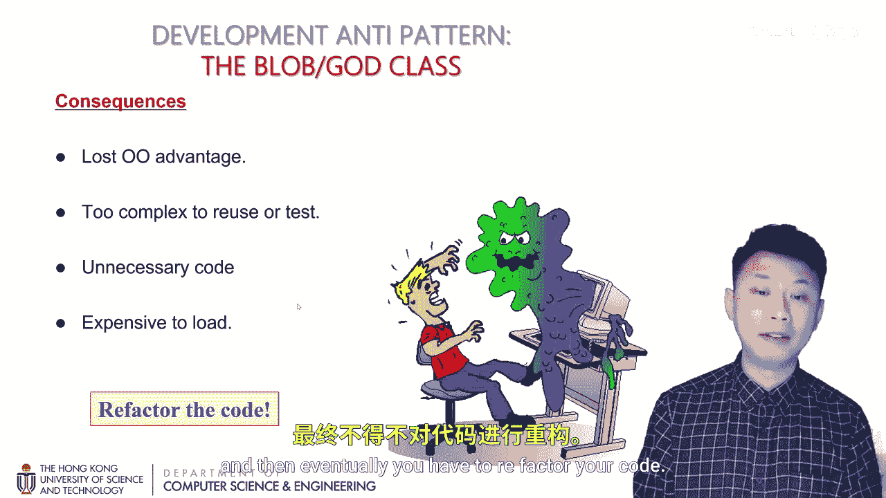
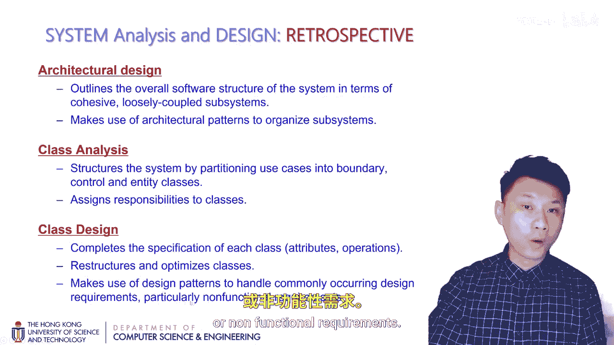
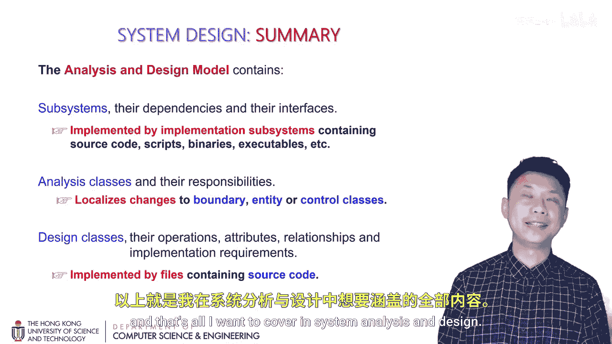

# 香港科技大学【中英⚡软件工程｜Software Engineering Specialization】 p54 P54 05_反模式 -BV1MMEjzoEhg_p54-

And the next topic that we're going to cover is antipats。So what are anti patternss。

 Notice that design patterns， they are good solutions from expert。

 and they are the good solutions that you should follow。In antipats。

 they are best solutions and they are something that you don't want to follow because they are best solutions。

So some of you may ask why do we want to study these fast solutions。

 just because right as a good programmer， you should avoid coming up with these fast solutions when you build a software system。

And there are different types of anti patternss， for example， patterns related to development。

 object oriented， organizational or domain specific。Similar to design patterndding。

 we also have a Bible for antipats。

So notice that within the society there are something that you should not do， for example。

 criminal terrorists， etc cetera， etc cetera。 So they are what we call social anti patternss But now within a software project there are also something that you should not do which are software anti patternss for example。

 spaghetti code， got class， etctera， etc ceter。 So in this course we're going to cover spaghetti code and God class。

So what is spaghettios， Spaghettio is something that is going to be difficult to be extended or modified it because the structure is bad。

So now you can see that spaghetti is unstructured。And what we want for is some Gi software system is。

And we want some well structured code if we want the system to be easy to maintain and also modified。

So what are the symptoms of spaghetti cold， for example。

 when you try to come up with some quick demonstration cold， then it may become spaghetti。Okay。

 for example， let's say in your programming assignment。

 you just want to come up with a program that's going to work then that means right become operational。

 make it work okay then eventually you may make it spaghetti。Or long Rer programmer。 case。

 someone who don't talk to other developers。Or obsolete or a scanty documentation。

 That means you don't have documentation in your development。

Or 50% of maintenance is spent on system rediscovery。

 so that means when you try to maintain the system。

 you have to somehow read and then understand the source skill before you can maintain the software system。

Or hesitant programmers indoor。 So if I ask you to try to modify the system。

 you would rather rewrite the entire system then it's going to be spaghetti。

Some system that cannot be reused。Or you include many workarounds in your Sosco。Then eventually。

 you may get some spaghetti cold。

And these are the symptoms for optic oriented spaghetti code。 For example。

 you may have many optic methods with dull parametersters。Or suspicious classes or global variables。

Or intered and unforeseen relationships between objects。Or procedure oriented methods。

And you lost the advantage of O，0。And the bottom line is that if I asked you to modify a software system and eventually you would spend a long long time to rediscover the sourceco。

 then it's going to be spaghetti， you would rather rewrite the entire software system。

Another antipa is what we call God class， and we have covered God class when we talk about refactoring。

So these are the symptoms， you may have a single class with many attributes and operations that means you have too many responsibilities for one single class。

 then that class becomes a god class。And violates the cohesion property of all design。

 because if we are talk about cohesion， one class should be responsible for just one thing。

 but not many responsibilities。And it's a nightmare to maintain because you have too many responsibilities。

 too many operations within a single class， then modifying that God class is going to be difficult。

And this are the typical causes of god class。For example， inappropriate requirements specification。

Lack of O， O architecture。Lack of any architecture。And also， lack of architecture enforcement。

And two limited intervention。 Then you put all the functionalities within one class。

And the consequences。You're going lost O advantage。

And it's going to be too complicated to reuse or test。And then you gonna have some unnecessary code。

Expensive， too low because you have a large God can。And then eventually， you have to rera your code。

And these are all the topics Im want to cover for system analysis and design。

In the last few lectures， we have talked about architectural design that means how we can organize our systems together to form the entire system。

We also talk about how to come up with NS classes， so we try to partition the system into boundary control and entity classes。

And we have also talked about how to come up with all the classes that we're going to use for implementation。

So notice that when you come up with all the classes。

 you may make use of design patterns to handle some company occurring design requirements or non functional requirements。

As a summary， we have covered how to come up with an analysis and design model for a software system in the model you have to specify the following things。

 you have to specify how to organize the subsystems together and then form the entire system you also have to specify all the analysis classes and they are boundary entity and control classes and then also you have to specify all the classes that you're going to use for implementation and they should contain the actual source code。

And that's all I want to cover in system analysis and design。

