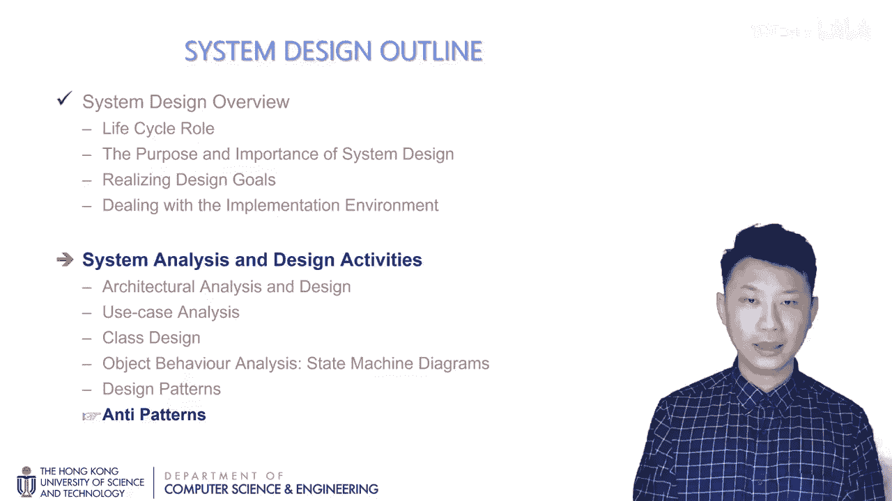
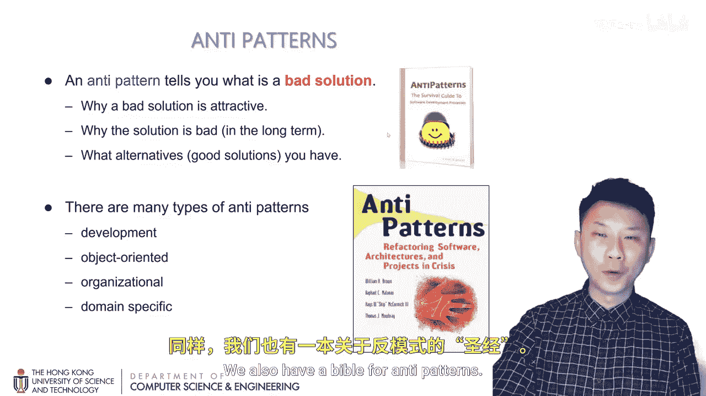
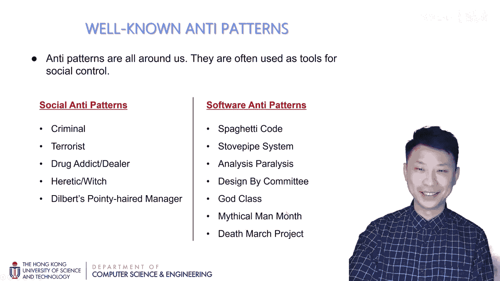
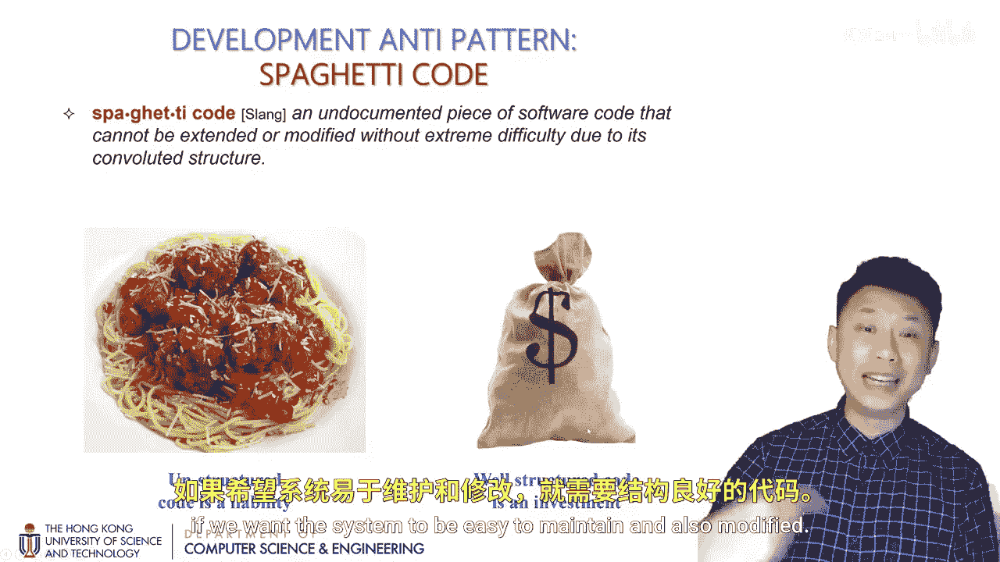
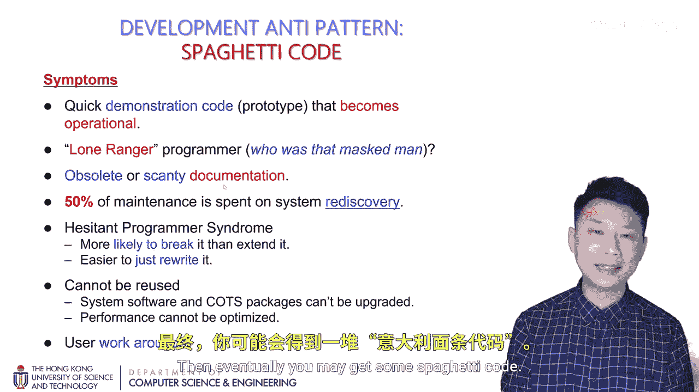
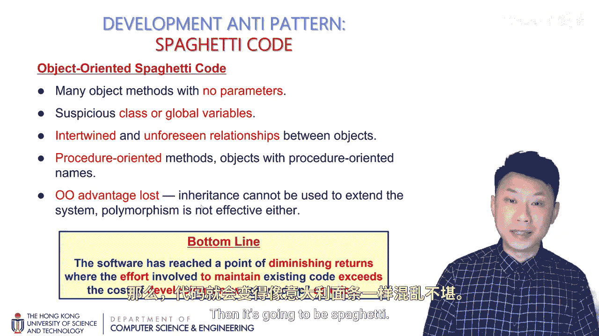
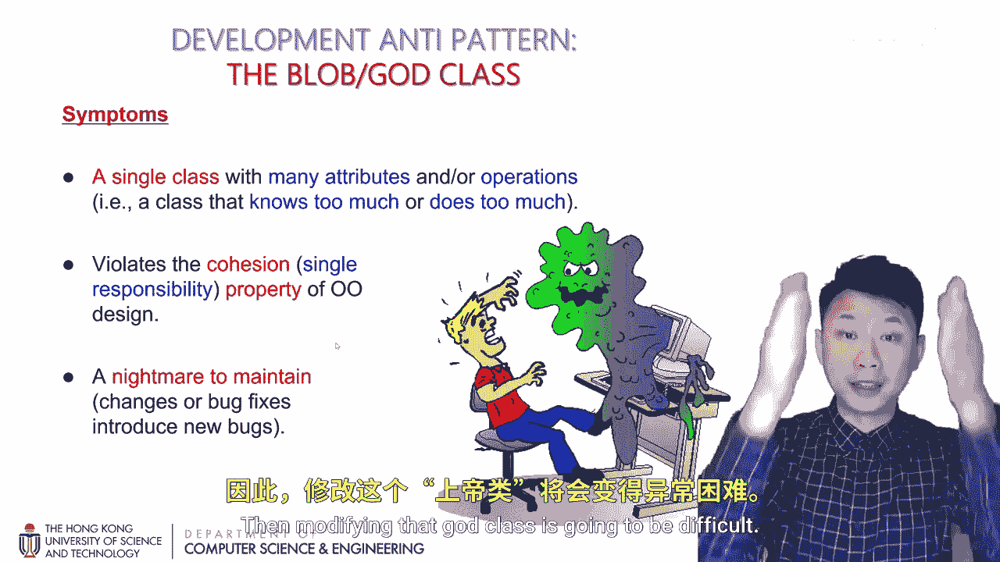
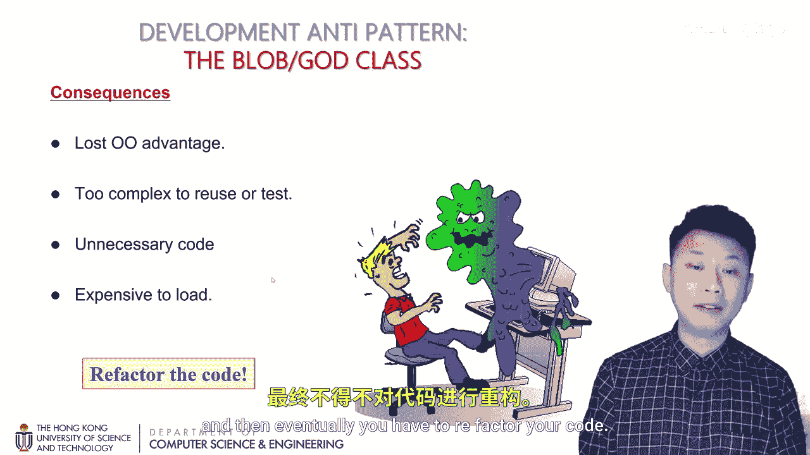
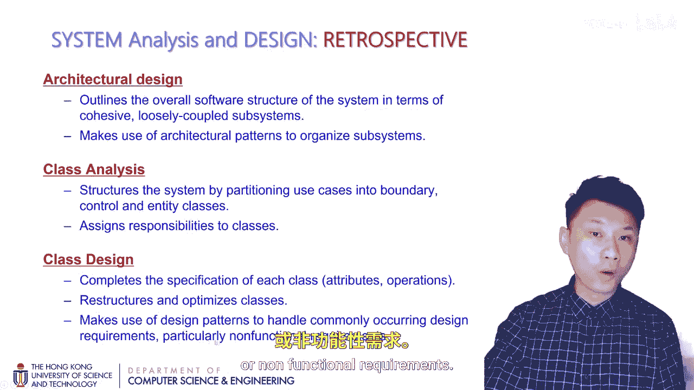
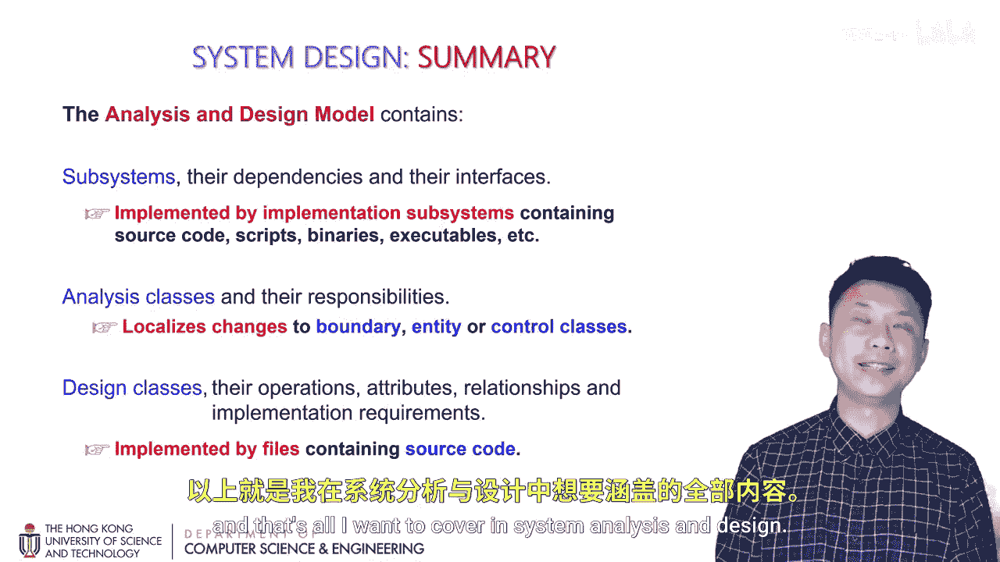

# 软件工程：P54：反模式 🚫

在本节课中，我们将要学习软件工程中的“反模式”。反模式是那些看似有效、实则有害的常见解决方案。了解它们能帮助我们避免在开发软件时犯下类似的错误。

上一节我们介绍了优秀的设计模式，本节中我们来看看它们的反面——反模式。

## 什么是反模式？

设计模式是专家总结出的**优秀解决方案**，是开发者应当遵循的典范。反模式则是**糟糕的解决方案**，是开发者应当避免的实践。

有人可能会问，为何要研究这些糟糕的方案？原因在于，作为一名优秀的程序员，你应当能够在构建软件系统时，识别并避免采用这些有害的解决方案。

反模式有多种类型，例如：
*   **开发相关**的反模式
*   **面向对象**的反模式
*   **组织管理**的反模式
*   **特定领域**的反模式

与设计模式类似，反模式也有其权威的参考著作。

## 软件中的反模式

在社会中，存在一些不应做的事情，例如犯罪、恐怖主义等，我们称之为**社会反模式**。同样，在软件项目中，也存在一些不应采取的实践，即**软件反模式**，例如“面条式代码”和“上帝类”。本课程将重点介绍这两种。

## 面条式代码 🍝

面条式代码是指结构混乱、难以扩展或修改的代码。其结构是**非结构化**的。

而我们希望软件系统是**结构化良好**的代码，这样的系统才易于维护和修改。

### 面条式代码的症状

以下是面条式代码的一些典型症状：

*   **快速演示代码**：为了快速完成编程作业或演示而编写的、只求能运行的代码，最终可能演变成面条式代码。
*   **孤独的程序员**：不与其他开发者交流的程序员所编写的代码。
*   **文档过时或匮乏**：在开发过程中缺乏或没有更新文档。
*   **50%的维护时间用于重新理解系统**：维护系统时，需要花费大量时间阅读和理解源代码。
*   **程序员犹豫不决**：当被要求修改系统时，宁愿重写整个系统也不愿修改现有代码。
*   **系统无法复用**：代码难以在其他地方重用。
*   **包含大量变通方案**：代码中充斥着许多临时性的、非标准的解决方案。

### 面向对象中的面条式代码症状

在面向对象编程中，面条式代码可能表现为：

*   **具有许多参数的方法**：`public void processData(int a, String b, double c, Object d, ...)`
*   **可疑的类或全局变量**：类的职责不清晰，或过度使用全局变量。
*   **对象间存在意外且难以预见的关系**：类之间的耦合度过高且混乱。
*   **过程式的方法**：在面向对象系统中编写了大量过程式的代码。
*   **丧失了面向对象的优势**：代码没有体现出封装、继承、多态等优点。

**核心问题**在于，如果修改一个软件系统需要花费极长时间去重新理解源代码，那么它就是面条式代码，此时开发者宁愿重写整个系统。

## 上帝类 👑

另一个常见的反模式是“上帝类”，我们在讨论重构时也曾提及。

### 上帝类的症状

上帝类通常具有以下症状：

*   **单个类拥有过多属性和操作**：这意味着一个类承担了过多的职责。
*   **违反了面向对象设计的内聚性原则**：内聚性原则要求一个类只应负责一件事，而不是许多事。
*   **维护起来如同噩梦**：由于一个类中包含了太多职责和操作，修改这个上帝类将变得异常困难。

### 上帝类的典型成因

以下是导致上帝类出现的常见原因：

*   **需求规格说明不当**
*   **缺乏面向对象的架构设计**
*   **缺乏任何架构设计**
*   **缺乏架构执行的监督**
*   **干预有限**：将所有功能都塞进一个类中。

### 上帝类的后果

上帝类会带来一系列不良后果：

*   **丧失了面向对象的优势**
*   **代码过于复杂，难以复用或测试**
*   **产生不必要的代码**
*   **开发成本高昂**，因为存在一个庞大的类
*   **最终不得不重构代码**

## 系统分析与设计内容回顾 📋

在最近的几讲中，我们讨论了系统分析与设计的核心内容。

首先，我们探讨了**架构设计**，即如何将各个子系统组织起来形成完整的系统。

接着，我们学习了如何识别**分析类**，将系统划分为边界类、控制类和实体类。

此外，我们还介绍了如何确定用于实现的**所有类**。在这个过程中，可以利用设计模式来处理一些反复出现的设计需求或非功能性需求。

### 总结

本节课我们一起学习了如何为软件系统建立分析与设计模型。在这个模型中，你需要明确以下几点：

1.  如何组织子系统以构建整个系统。
2.  所有的分析类，包括边界类、实体类和控制类。
3.  所有用于实现的类，这些类应包含实际的源代码。

同时，我们重点学习了两种需要避免的反模式：**面条式代码**和**上帝类**。识别并避免这些反模式，对于构建可维护、可扩展的高质量软件至关重要。

以上就是系统分析与设计部分希望涵盖的全部内容。