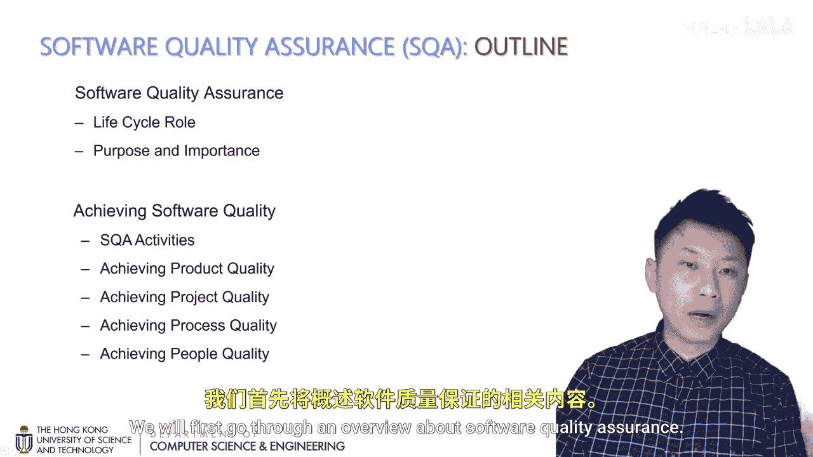
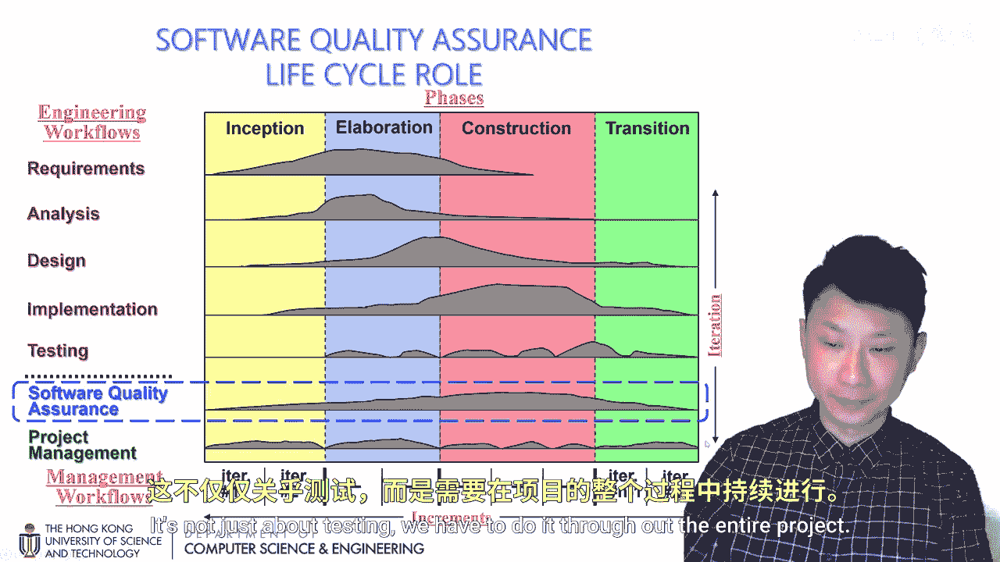
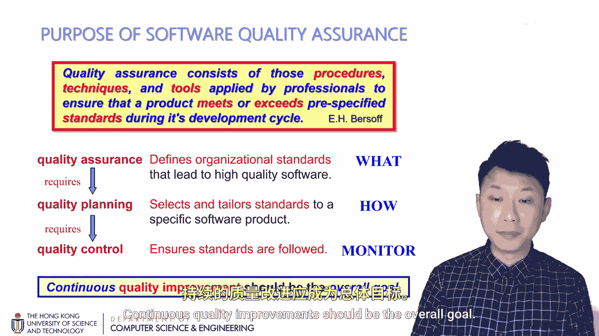
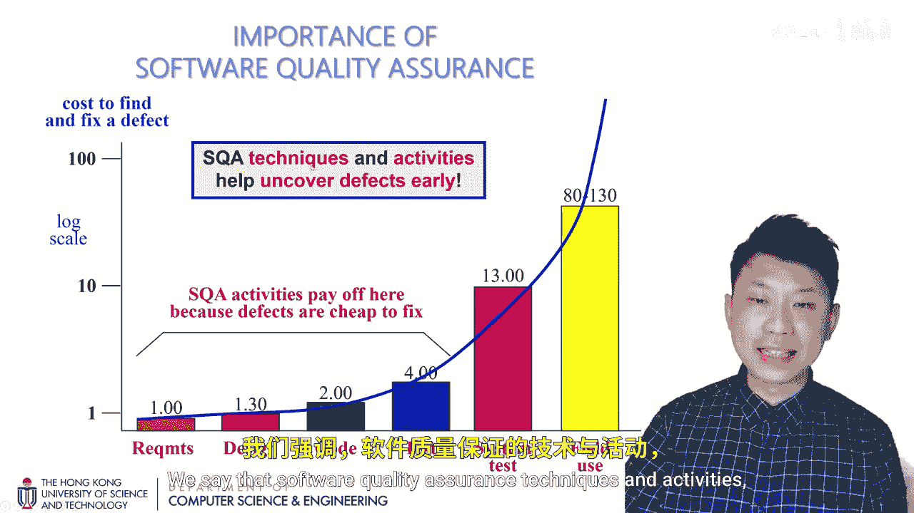
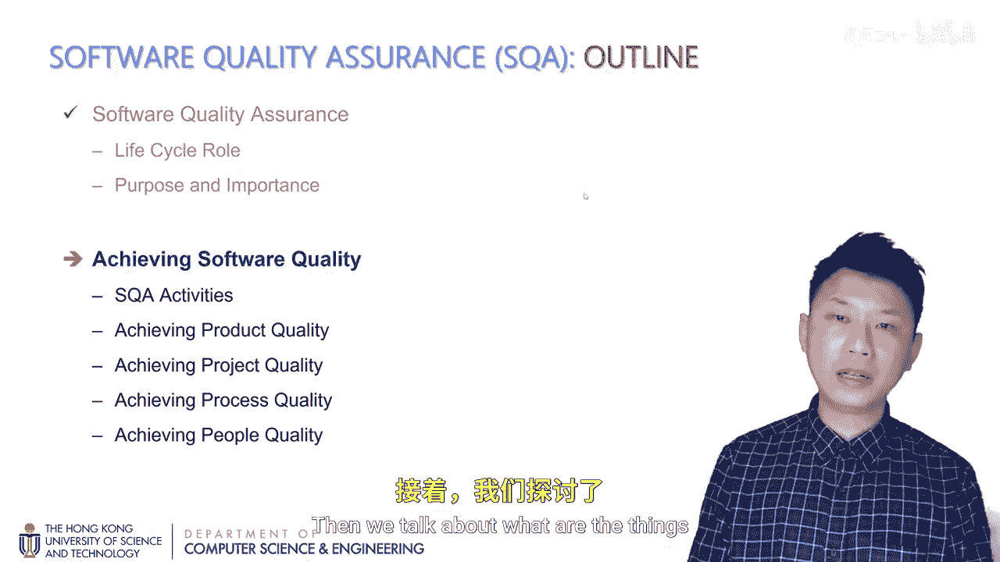
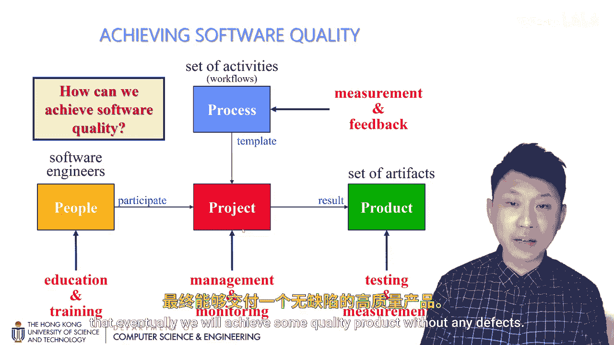
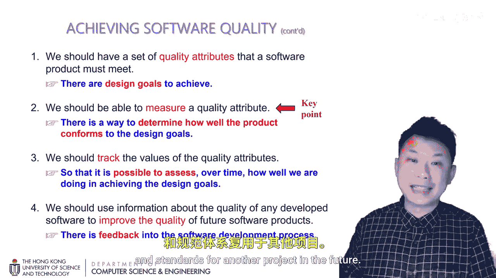

# 香港科技大学【中英⚡软件工程｜Software Engineering Specialization】 p55 P55 01_实现软件质量 -BV1MMEjzoEhg_p55-

Hi， in this lecture， we will talk about software quality assurance。

 That means what are the things that we need to do in order to ensure that eventually we will achieve some quality product for a software project。

So these are the learning objectives of this lecture after this lecture you will understand the quality assurance process and the central process activities of quality assurance。

 quality planning and quality control。You will also understand the importance and use of standards and also metrics in the quality assurance process。

And you will also understand the principles of software development process improvement and why process improvement is worthwhile。

So we will first go through an overview about software quality assurance。

And if we talk about software quality assurance， we do it throughout the entire project。

 It's not just about testing， some of you may think that if we perform enough testing。

 then we get some quality software okay but it's not just about testing。

 we have to do it throughout the entire project。

So what is software quality assurance quality assurance consists of those procedures。

 techniques and tools applied by professionals to ensure that a product meets or exceed prespecified its standards during its development cycle。

So first thing that we have to do is what we call quality assurance。

 we have to define all the organizational standards that all people within the organization they have to follow and those are the standards that will need to high quality software。

 So this is what we have to do in order to ensure that eventually we will achieve quality in our product。

Then we have to perform quality planning。 That means how to achieve quality。

 So we have to select and tailor standards to a specific software product。

 So for a particular software project， we may select some of the standards， right to。

So for one of the project， we may select and tailor some of the standards for one project and then we may select and tailor some other standards for another project。

So the standards that we're going to pick is going to be depending on the project that we're going to work with。

And then eventually we have to perform quality control。

 That means we have to ensure that all the standards they are followed throughout the entire project。

And continuous quality improvements should be the overall goal。

And we have seen this chart before。 all of you should know that if there are some defects and if we want to fix the defect at the beginning of the project。

 then it's going to be cheap if we want to fix it at the end of the project then。

If you want to fix it at。If you want to fix it late in the project， then it is going to be costly。

So software quality assurance activity is going to pay off at the beginning of the project because we know that if there are some defects。

 that's going to be cheap to fix those defects at the beginning of the project。

And we say that software， quality assurance， techniques and。

And we say that software quality assurance techniques and activities help uncover defects early。

Then we talk about what are the things that we have to do in order to achieve software quality。

So at the beginning of the semester， we have said that there are four important pieces in a project and they are the project。

 people， process and product。And in order to achieve software quality。

 we need a good project plan at the very beginning of the project。

So how can we achieve software quality， we need a set of good processes such that all the people within the organization they can follow the processes to develop the software system。

 and we also need measurement and feedback on the processes。

We also need some good people within the organization。

So that means we need to educate and also provide training to all the people within the organization。

And we have to manage our project， that means we have to come up with a project plan at the very beginning of the project。

 and also we have to monitor the entire project throughout the development。And finally。

 we have to perform enough testing to ensure that eventually we will achieve some quality product without any defects。

So these are the things that we have to do in order to achieve software quality。

 We should have set up a set of quality attributes that a software product must meet。

And usually they are the design goals that we want to achieve。

 and those are the design goals that we set up at the beginning of the project。And also。

 we should be able to measure a quality at bill。And we should be able to measure a quality attribute in order to determine how well the product conforms to the design goals。

And we should track the values of the quality attributes throughout the entire project。And finally。

 we should use information about the quality of any developed software to improve the quality of future software products let's say we have used some standards and some metrics in one of the project and it was successful Then we may consider reusing the same set of metrics and standards for another project in the future。

