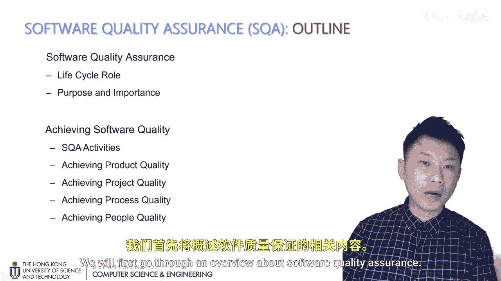
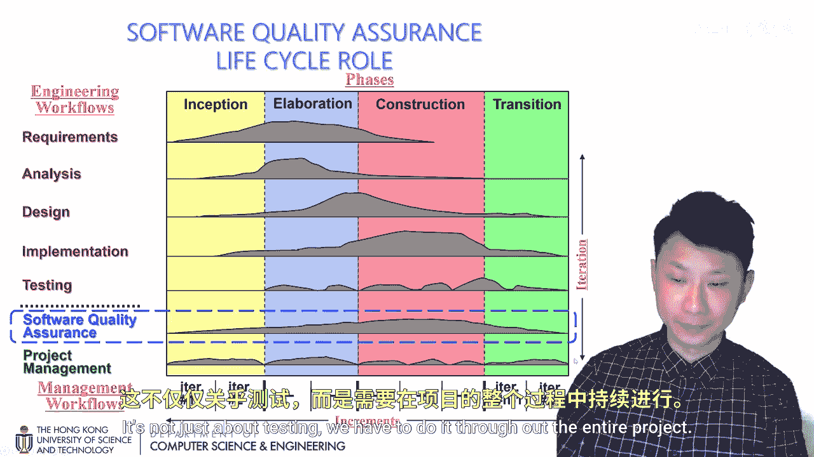
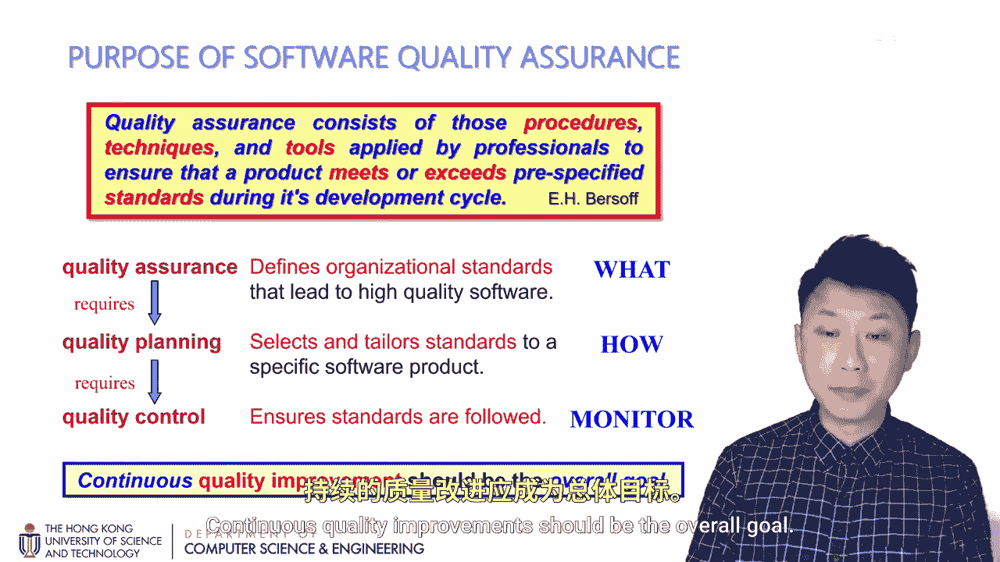
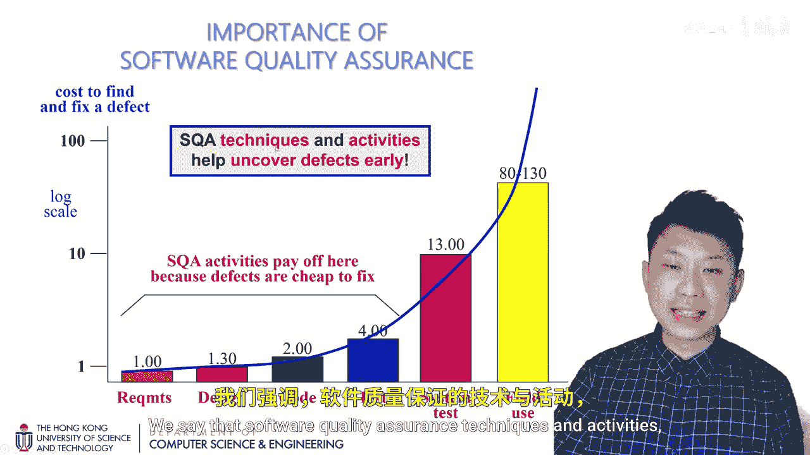
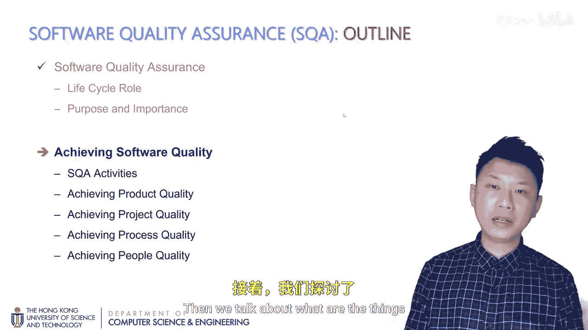
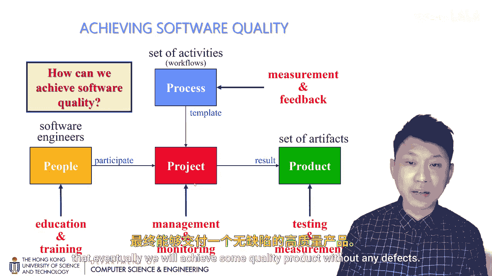
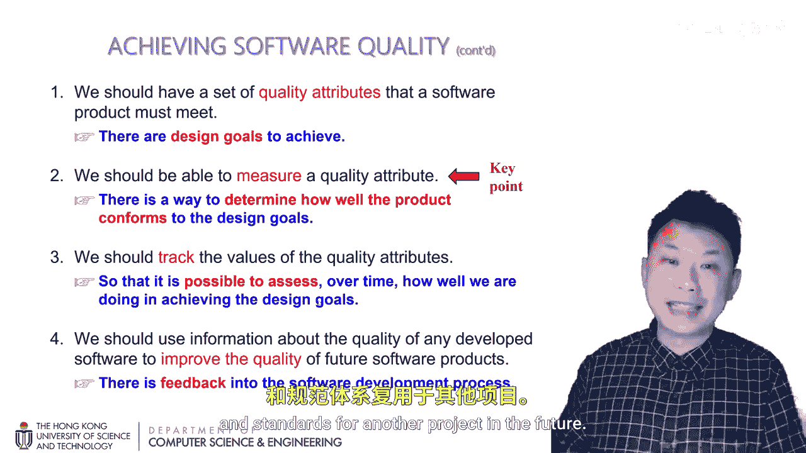

# 软件工程：P55：实现软件质量 🎯

在本节课中，我们将探讨软件质量保证。这意味着，为了确保最终能为软件项目交付一个高质量的产品，我们需要做哪些事情。

## 概述

软件质量保证贯穿整个项目周期，而不仅仅是测试。虽然充分的测试很重要，但我们需要在整个项目中持续进行质量保证活动。

## 软件质量保证概述

上一节我们介绍了课程目标，本节中我们来看看软件质量保证的具体定义。

软件质量保证是指专业人员在整个开发周期中，应用一系列**程序、技术和工具**，以确保产品达到或超过预设标准的过程。

为了确保最终产品的质量，我们需要进行以下核心活动：
1.  **质量保证**：定义整个组织必须遵循的标准，这些标准是产出高质量软件的基础。
2.  **质量规划**：为特定的软件产品选择和裁剪标准。不同项目可能适用不同的标准集合。
3.  **质量控制**：确保在整个项目中，所有标准都得到遵循。持续的质量改进是总体目标。

## 早期缺陷修复的重要性

在质量规划中，我们确定了标准。本节中我们来看看遵循这些标准的一个关键好处：及早发现缺陷。

我们之前见过这个图表。所有人都应该知道，如果在项目初期发现并修复缺陷，成本会很低；如果在项目后期修复，成本将非常高昂。

因此，软件质量保证活动在项目初期就能带来回报，因为它有助于**及早发现缺陷**，从而以较低成本进行修复。

## 实现软件质量的要素

了解了早期修复的好处后，我们来看看实现软件质量需要哪些具体要素。

在学期初我们提到，一个项目有四个重要部分：**项目、人员、过程和产品**。为了实现软件质量，我们需要：
*   **良好的过程**：需要一套完善的流程，让组织内所有人能遵循以开发软件系统，并需要对过程进行度量和反馈。
*   **优秀的人员**：需要对组织内所有人员进行教育和培训。
*   **有效的项目管理**：需要在项目初期制定计划，并在整个开发过程中进行监控。
*   **充分的测试**：需要执行足够的测试，以确保最终产品没有缺陷。

## 质量保证的具体活动

上一节我们列出了实现质量的要素，本节中我们详细看看质量保证的具体活动。

为了实现软件质量，我们需要进行以下活动：
1.  **设定质量属性**：确立软件产品必须满足的一系列质量属性。这些通常是我们希望在项目初期达成的设计目标。
2.  **度量质量属性**：必须能够度量这些质量属性，以确定产品符合设计目标的程度。
3.  **跟踪质量属性**：在整个项目过程中跟踪质量属性的数值变化。
4.  **利用质量信息改进**：利用已开发软件的质量信息，来改进未来软件产品的质量。例如，如果在某个项目中使用的标准和度量取得了成功，未来可以考虑在另一个项目中复用。

## 总结

本节课中，我们一起学习了软件质量保证的核心概念。我们了解到，质量保证是一个贯穿项目始终的过程，包括质量保证、质量规划和质量控制。我们认识到及早发现和修复缺陷的重要性，以及实现高质量软件需要关注过程、人员、项目和测试等多个方面。最后，我们明确了设定、度量、跟踪质量属性并利用其进行持续改进是质量保证的关键活动。