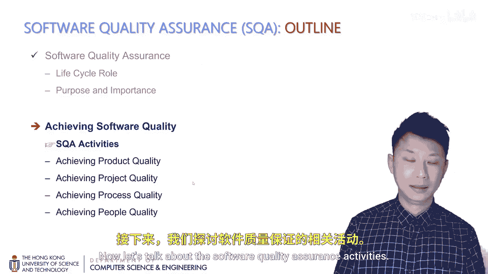
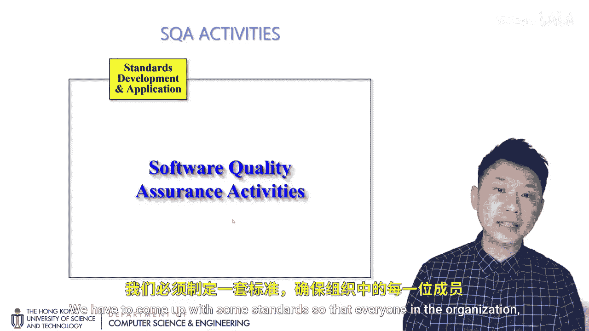
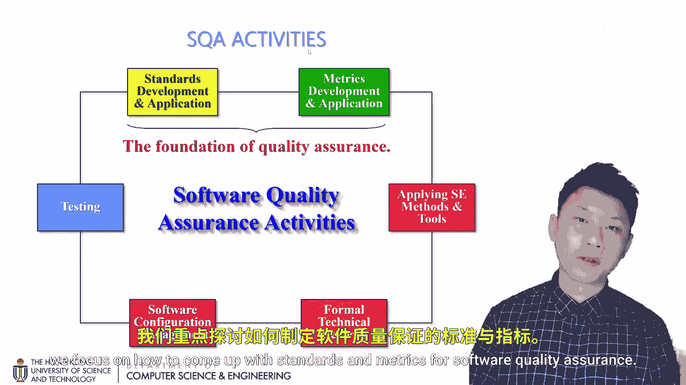
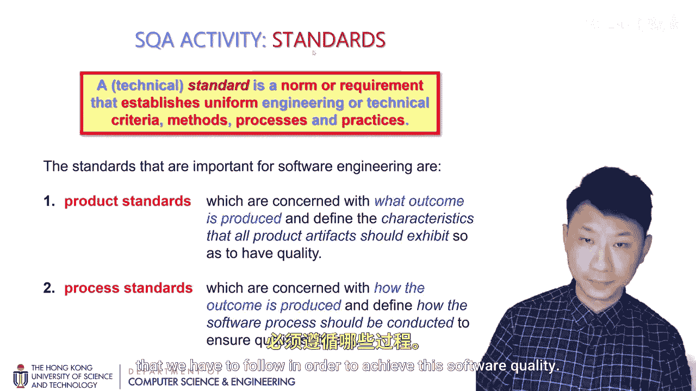
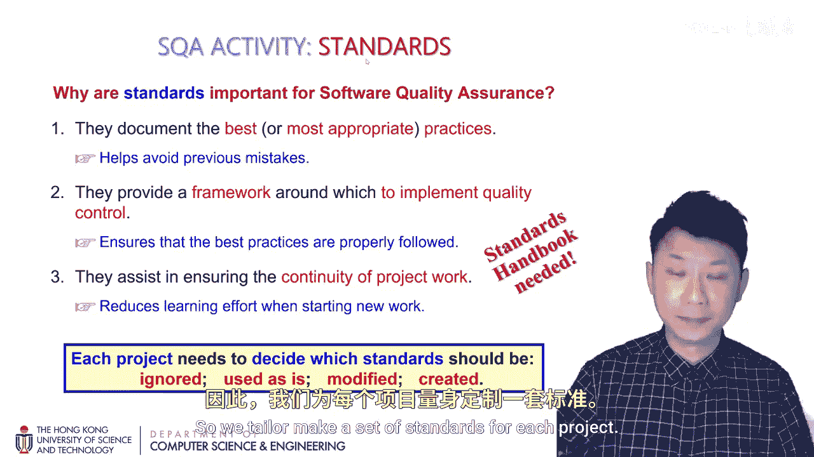
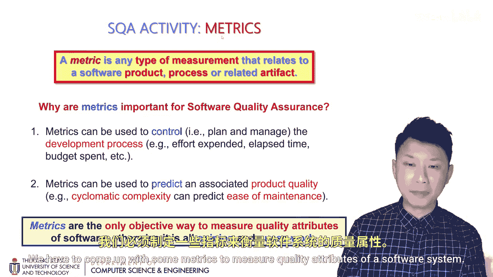

# 香港科技大学【中英⚡软件工程｜Software Engineering Specialization】 p56 P56 02_软件质量保证活动 -BV1MMEjzoEhg_p56-

Now， let's talk about the software quality assurance activities。

So these are the things that we have to do in order to achieve software quality。

We have to come up with some standards so that everyone in the organization。

 they have to follow the standards。And we also have to come up with some metrics or measurement that we will use to measure。

So these are the things that we have to do in order to achieve software quality。

 we have to come up with some standards so that everyone in the organization。

 they will follow all the standards。

And also some metrics so that we can use the metrics to measure how good the product conforms to the design goals that we have set up at the beginning of the project。

And then we need some good tools to develop the software system。

And also perform reviews from time to time to avoid making mistakes。

And also perform software configuration management to keep track on the changes within the project。

And also perform enough testing to make sure that we don't have defects in the final product。

And in this lecture， we focus on how to come up with standards and metrics for software quality assurance。

So what is a standard， a standard is a norm or requirement that establishes uniform engineering or technical criteria methods。

 processes and practices。And the standards that are important for software engineering are the product standards and also the process standards。

Product standards， they are concerned with what outcome is produced and define the characteristics that all product artifacts should exhibit so as to have quality。

 so we are focusing on the product itself。And also。

 we may have process standards which concern with how the outcome is produced and define how the software process should be conducted to ensure software quality。

 So eventually we are talking about what are the processes that we have to follow in order to achieve software quality。

So why are standards important for software quality assurance because they document the best or the most appropriate practices and it's going to help us avoid making mistakes？

And they also provide a framework around which to implement quality control and ensure us that best practices are properly followed within the project。

And they also assist in ensuring the continuity of project work。

 that means we try to reduce learning ethic when we start new work。

 when we start with another project， we may reuse some of the standards from a previous project。

So that's why we need a standard handbook to keep track all the standards and all the employees within the organization。

 they have to follow all the standards within the handbook。And for each project。

 we need to decide which standards that we should ignore， used as is， modified it or created。

So we tailor make a set of standards for each project。

And what is a metric， A metric is any type of measurement that relates to a software product。

 process or related artifact。So again， why are metrics important for software quality assurance。

Because metrics can be used to control the development process。

So then we know exactly how much effort that we need to spend on the project。

 the time and project that we need for the project， etc cetera， etc ce。

And metrics can be used to predict an associated product quality。 For example。

 we can use psychometric complexity to predict the easy of maintenance of a software system。

 because if the psychometrics。Because if the psychometric complexity is high。

 then that means the logic within the software system is going to be very complicated and the software system will become very difficult to maintain。

That means we cannot simply guess We have to come up with some metrics to measure quality attributes of a software system。

