# 香港科技大学【中英⚡软件工程｜Software Engineering Specialization】 p57 P57 03_实现产品质量 -BV1MMEjzoEhg_p57-

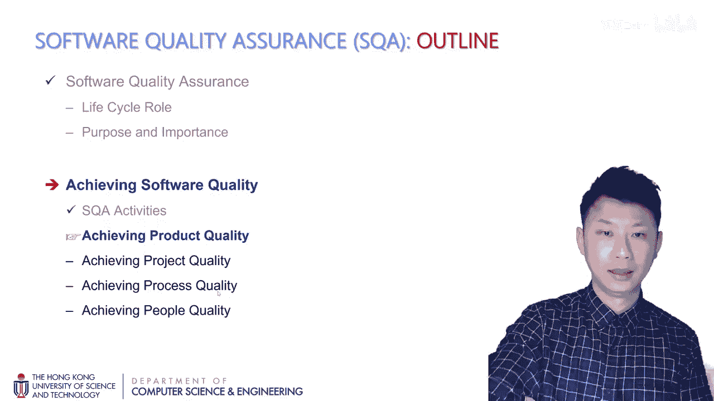

So how do we achieve product quality， we have to set up a set of design goals that are relevant to the project at the beginning of the project and remember that a design goal is an quality attribute that we want the system to have。

 for example， understandability， maintainability， reliability， etc， etc。

And usually we can only assess whether a system has one of these attributes after it's completed。

 so when we perform exception tasks， then we can test whether we have achieved the design goals that we have specified at the beginning of the project。

But what if we want to assess whether we are achieving a design goal during the system development。

 how to do it。

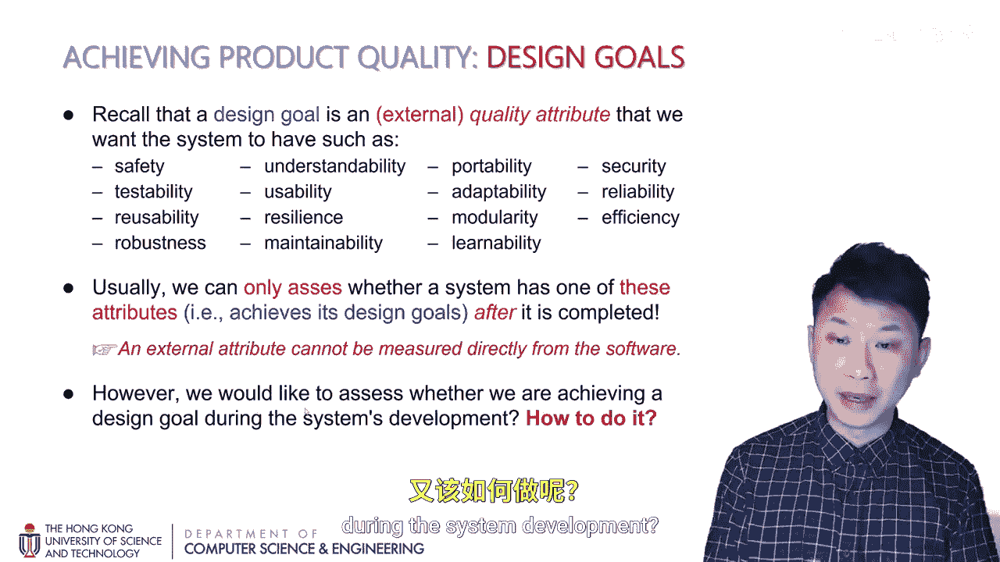

Then we have to use internal attributes to assess the。

Then we have to use some what we call internal attributes to try to assess and estimate the external attributes。

And these are some examples of possible relationships between external and internal attributes and notice that external attributes。

 they are kind of vague and difficult to measure， for example， maintainability， reliability。

 they are difficult to measure。And then we try to map them to internal attributes。

 which are measurable。For example， for maintainability。

 we can make it related to number of parameters， psychometric complexity。

 lines of code and number of error messages， right because when we have more parameters when we have higher psychometric complexity and when we have more lines of code and also more error messages then that means the software system is going to be more difficult to maintain。

If we talk about usability， then it's going to be related to the number of error messages and also the length of user menu。

 we know that when we have more error messages and when the length of user manual is long。

 then the system is going to be difficult to use。

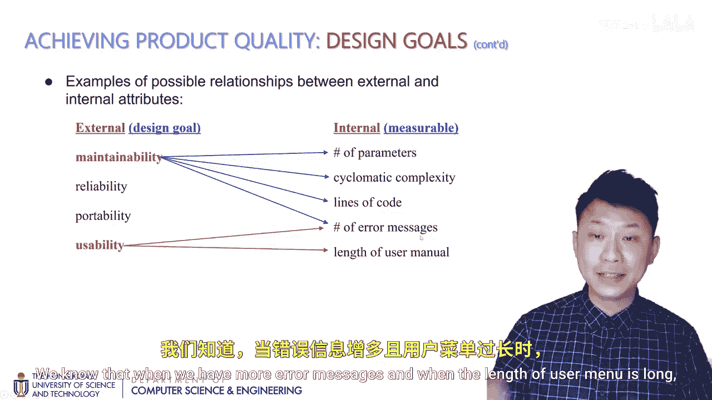

But the problem here is that it's very hard to formalte and validate relationships between internal attributes and design goals。

And also quantitative software information for computing metrics must be collected， calibrated。

 and also interpreted。

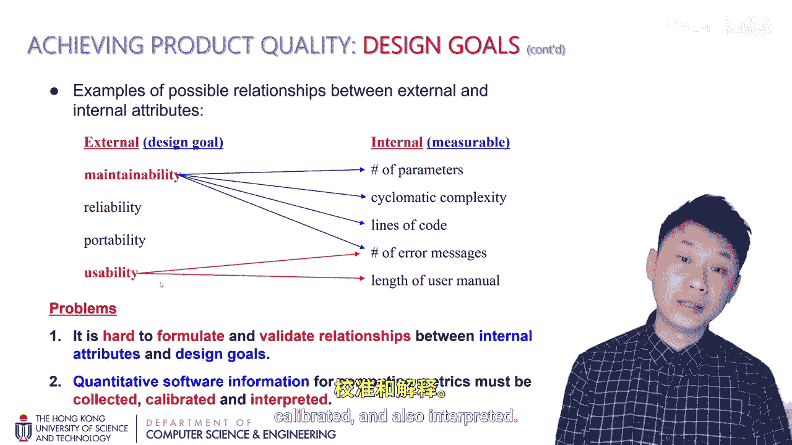

So for a design component， one design goal that you may want to achieve is maintainability。

Then from experience， we know that maintainability should be related to the complexity of a design component。

 that means when the component is complicated， then the system is going to be difficult to maintain。

So complexity in turn is related to quality attributes， for example， cohesion， coupling。

 understandability， adaptability， etc cetera， etc ceter。

But some of these attributes also cannot be measured directly， for example， understandability。

So now what can we do in order to measure the complexity of a design component and also the maintainability of a design component？

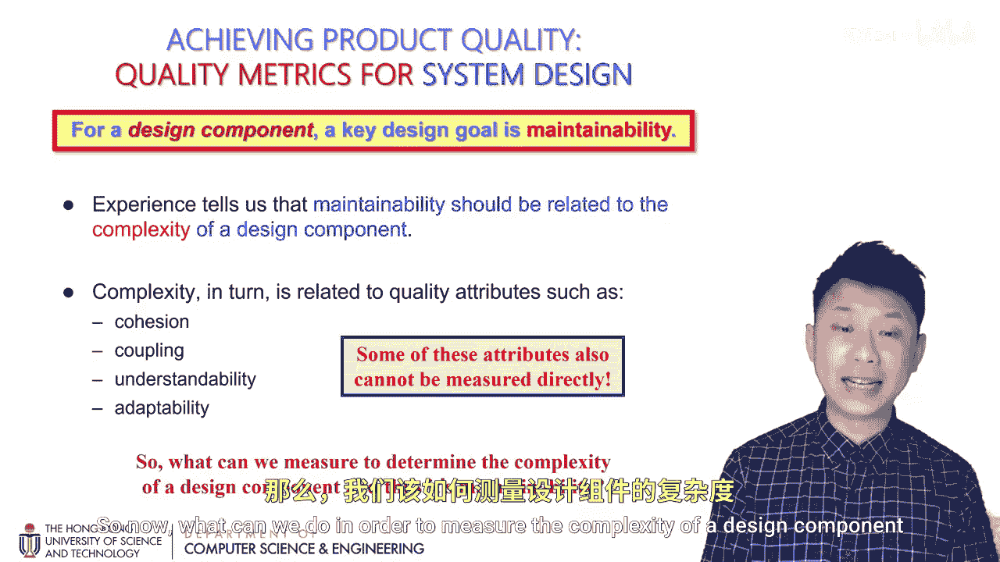

So one thing that we can use is what we call structural faning and fel fanning means if we have a component。

 let's say a class， then how many other classes is going to use that class to do something。

 That's what we call faning right， how many other classes is going to use that class to do something。

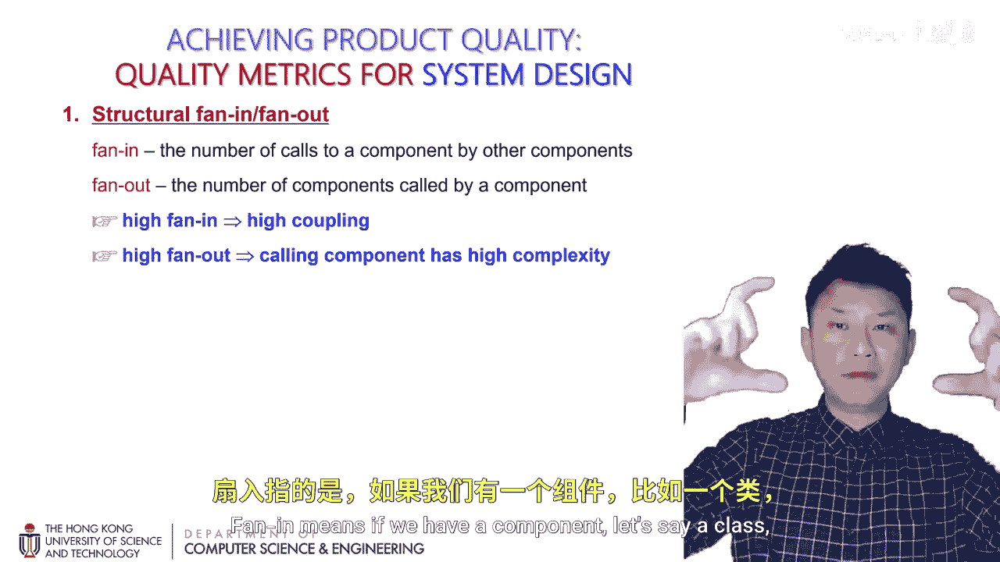

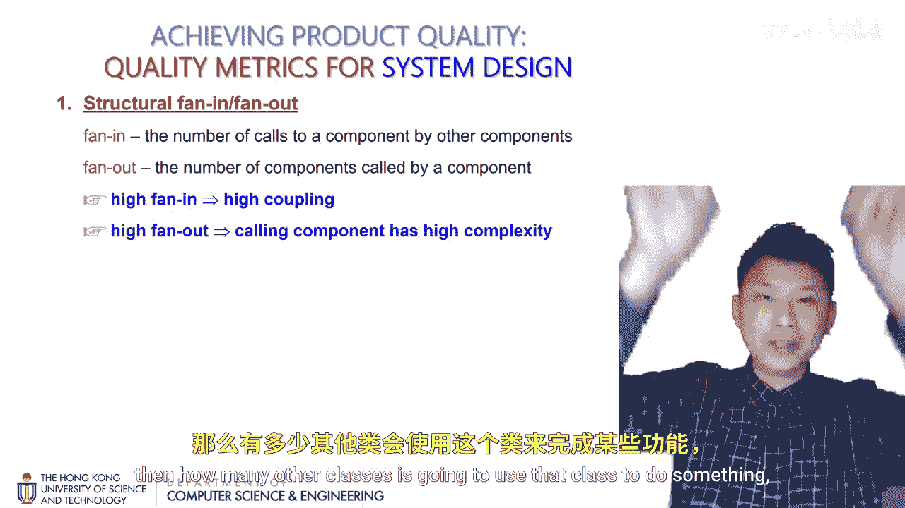

And then now means for that particular class， it's going to call how many other classes to do something for that class。

So if we have high fan in， that means eventually we're going to have high coupling。

And this is something that we should avoid。And if we have high fan out。

 then that means the calling component has a high complexity。

 it's going to be complicated because in order to get a particular functionality to be done。

 we have to call many other classes to get that functionality done so that means that component should be very complicated。

And we may also use informational fning and Fannel in informational fening and Fannel。

 we have to consider the number of parameters past it plus the number of assesses to shared data structures。

So this is how we calculate the complexity。 We're going to use the component length。

 multiplied it with Fing， multiplied with Fdal， and then we take square。

And this metric has been validated in the Uni system and is a very useful predictor of effort required for implementation。

 So that means if this complexity that we calculated using this formula is high。

Then that means that component is very difficult to implement。

 and we need more effort to implement that component。

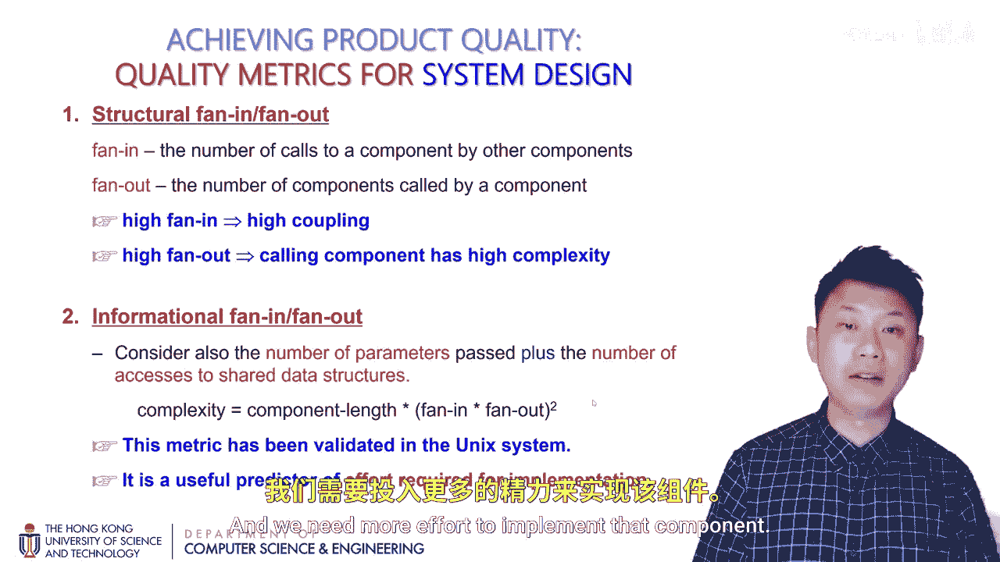

And we may also use the IE standard， which consider properties of subsystems and also database to calculate what we call the design structure quality index。

 D SQI。If this index is close to one， then that means we are doing good。 But if the SQI is low。

 then we may need further design work and review for the development。

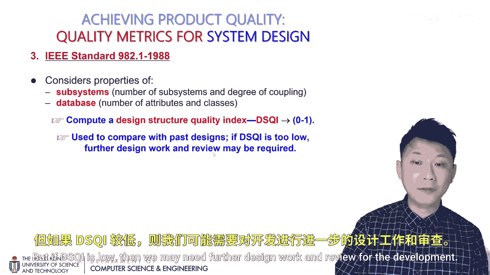

We may also consider changes throughout the product's lifetime and compute how stable it is using what we call the softwareware maturity Inex and SMI。

If SMmiI approaches one， then that means the system is kind of stable， but if the index is too low。

 let's say close to zero， then that means we are not doing good。 Okay。

 we may have to do something to improve the design of the software system for an implementation component。

 some key design goals are reliability and also easy of implementation。

 So these are some of the approaches to measure reliability and difficulty of a software system。

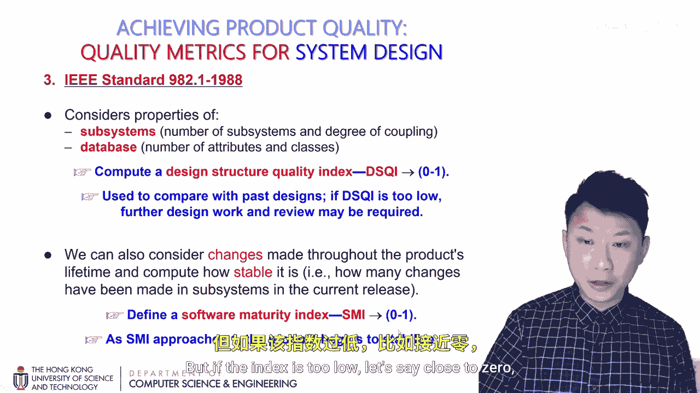

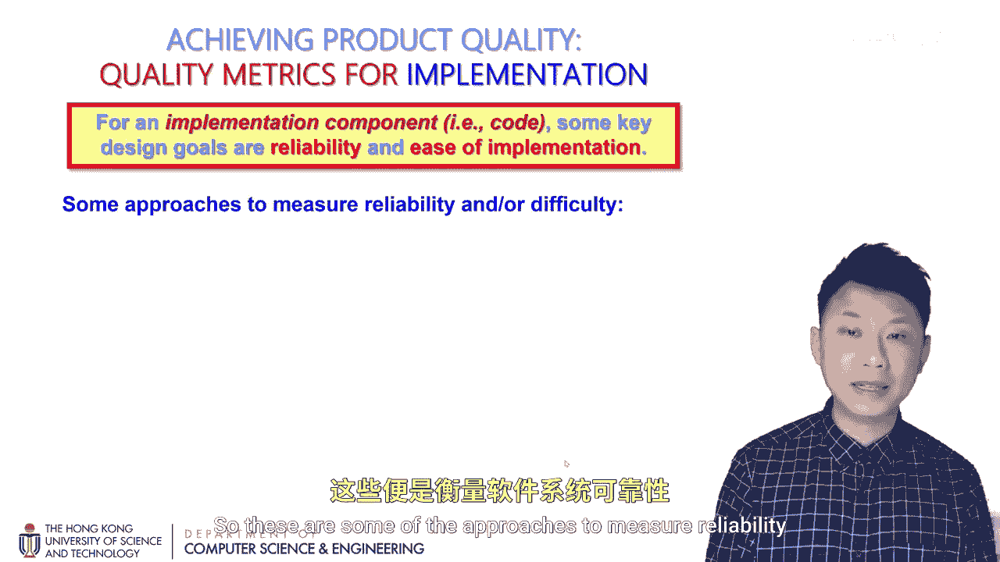

And the first one is what we call house De softwareware science。

 which is based on the component volume。And also the component difficulty and also the F so if the V D and E they are high and that means the component is very difficult to implement and also met cubebe's complexity metric。

 which is based on psychometric complexity again if psychometric complexity is high and that means that component is complicated and it's going to be difficult to implement。

All lines of code right， if we have many lines of code。

 then that means the system or that component is going to be difficult to implement。

Or a length of identifiers if we have many identifiers with very long length。

 then that means that component is kind of difficult to understand and also that component can be difficult to implement and finally depth of conditional nesting right if we have light loop inside another loop inside another loop then the complexity of the component is going to be high and that means the component is difficult to implement。

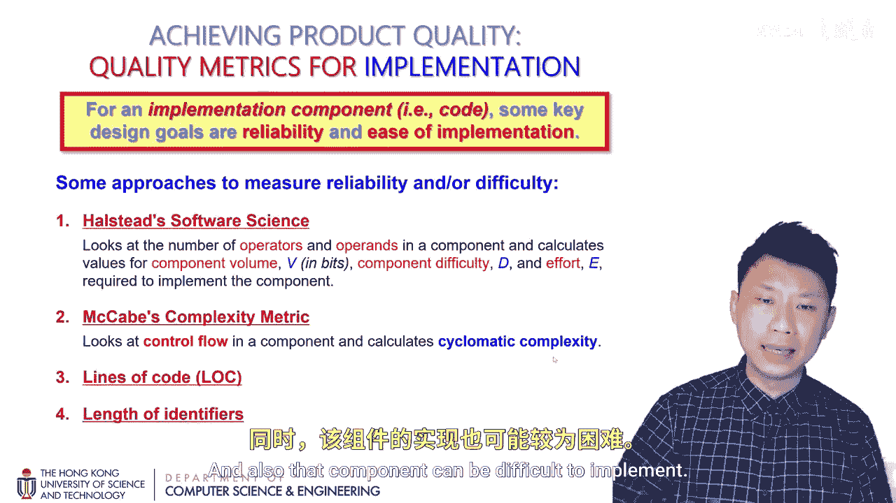

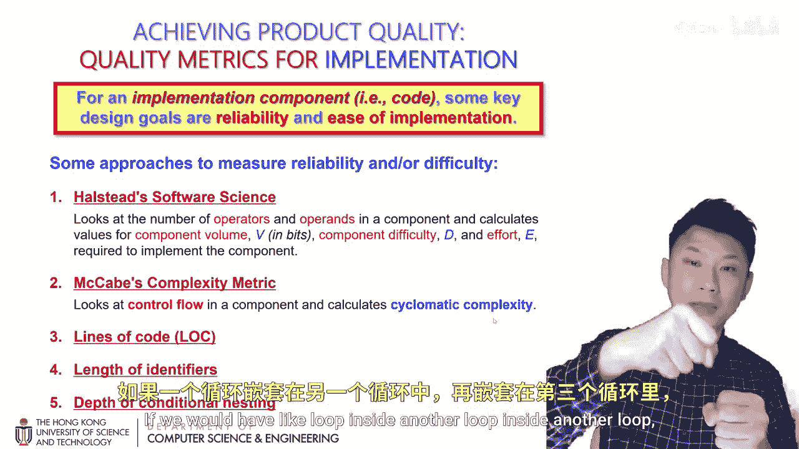

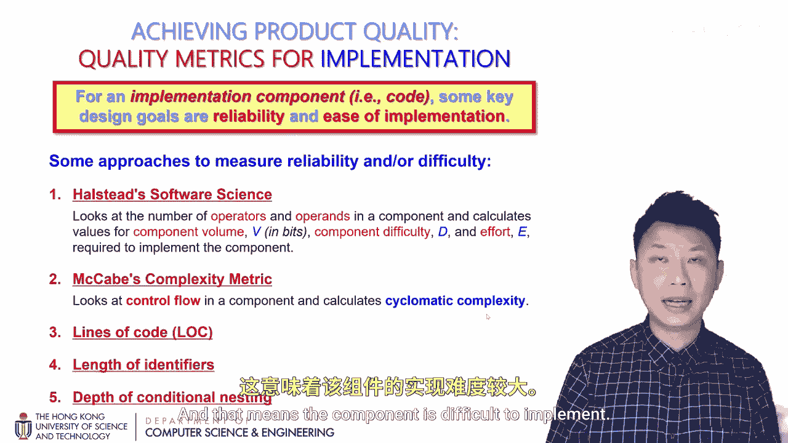

And we should come up with some standards to avoid having complex components and also highlight the problematic components。

And finally， we have to prove that the programs and specifications they are correct。

 that means we have to logically prove that all the requirements have been correctly transformed into programs。

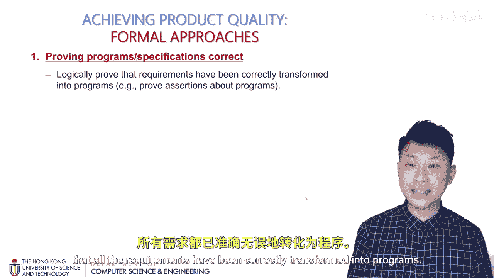

And we have to track all the software defects。 We have to categorize and determine the causes of software defects。

 and here we can apply 8020 rule because 80% of defects can be traced to 20% of the causes。

 and that means if we fix and correct the 20% of the causes， then we fix 80% of defects。And finally。

 by combining the above two approaches， we can make sure that eventually we can achieve some extremely reliable software。

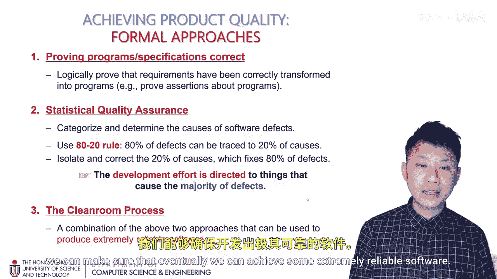