# 软件工程：P57：实现产品质量 🎯

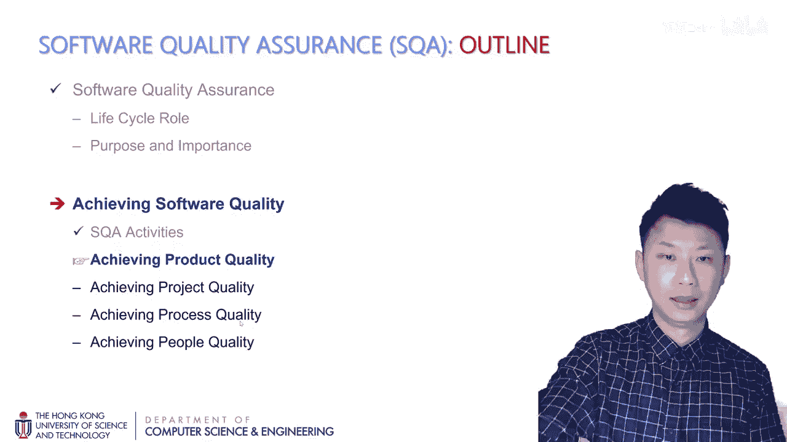

在本节课中，我们将学习如何在软件开发过程中实现和评估产品质量。我们将探讨如何设定设计目标，以及如何通过可测量的内部属性来评估这些抽象的外部质量属性。

---

## 设定设计目标 🎯

要实现产品质量，我们必须在项目初期设定一系列与项目相关的设计目标。请记住，设计目标是我们希望系统具备的质量属性。

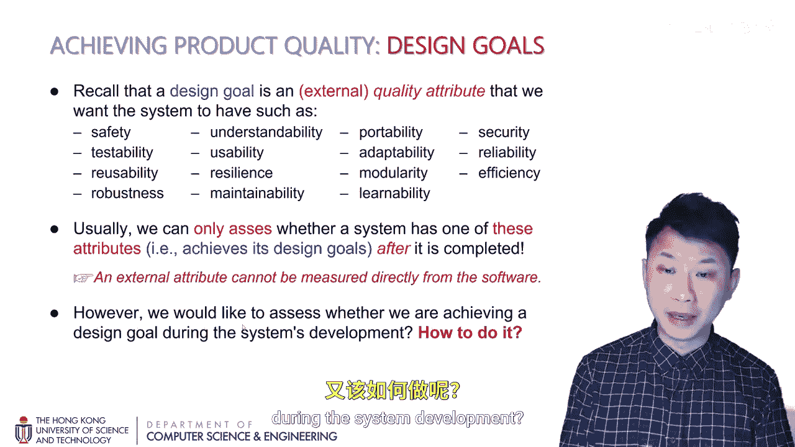

例如，这些属性包括可理解性、可维护性、可靠性等。

通常，我们只能在系统完成后评估它是否具备这些属性。因此，当我们执行验收任务时，才能测试是否达到了项目初期设定的设计目标。

但是，如果我们想在系统开发过程中评估是否正在实现某个设计目标，该如何操作呢？

---

## 内部属性与外部属性 📊

为了在开发过程中评估设计目标，我们必须使用所谓的**内部属性**来尝试评估和估算**外部属性**。

以下是一些外部属性与内部属性之间可能的关系示例。请注意，外部属性（如可维护性、可靠性）通常比较模糊且难以直接测量。

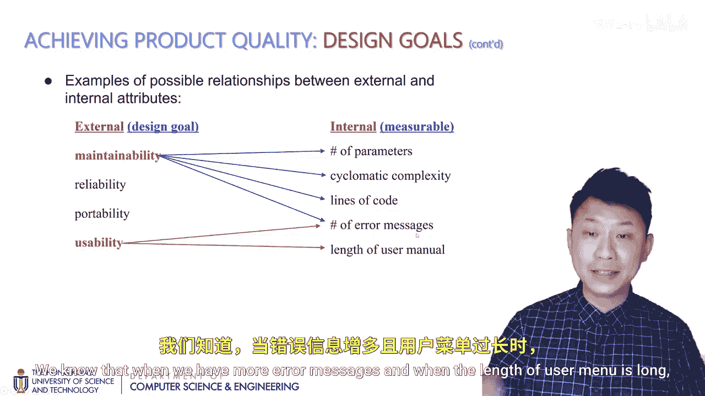

因此，我们尝试将它们映射到可测量的内部属性上。

*   **可维护性**：可以与**参数数量**、**圈复杂度**、**代码行数**和**错误信息数量**相关联。因为当参数更多、圈复杂度更高、代码行数更多、错误信息也更多时，软件系统将更难以维护。
*   **可用性**：可以与**错误信息数量**和**用户手册长度**相关联。我们知道，当错误信息更多、用户手册更长时，系统将更难以使用。

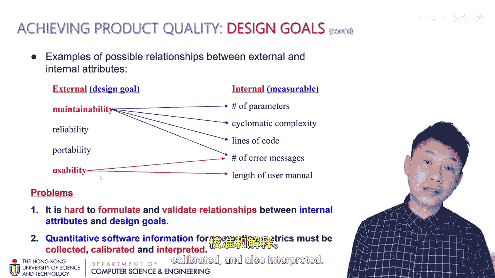

然而，这里的问题是，很难形式化地定义并验证内部属性与设计目标之间的关系。此外，用于计算度量的定量软件信息必须被收集、校准和解释。

---

## 评估设计组件的可维护性 🔧

对于一个设计组件，你可能希望实现的一个设计目标是**可维护性**。

根据经验，我们知道可维护性应该与设计组件的**复杂性**相关。这意味着当组件很复杂时，系统将难以维护。

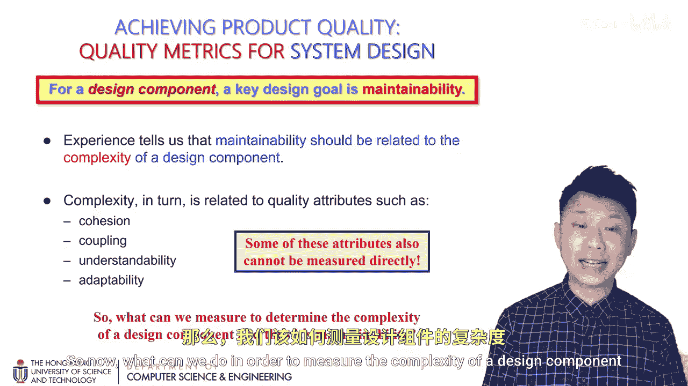

而复杂性本身又与一系列质量属性相关，例如内聚性、耦合性、可理解性、适应性等。

但其中一些属性（如可理解性）也无法直接测量。那么，为了测量设计组件的复杂性和可维护性，我们能做什么呢？

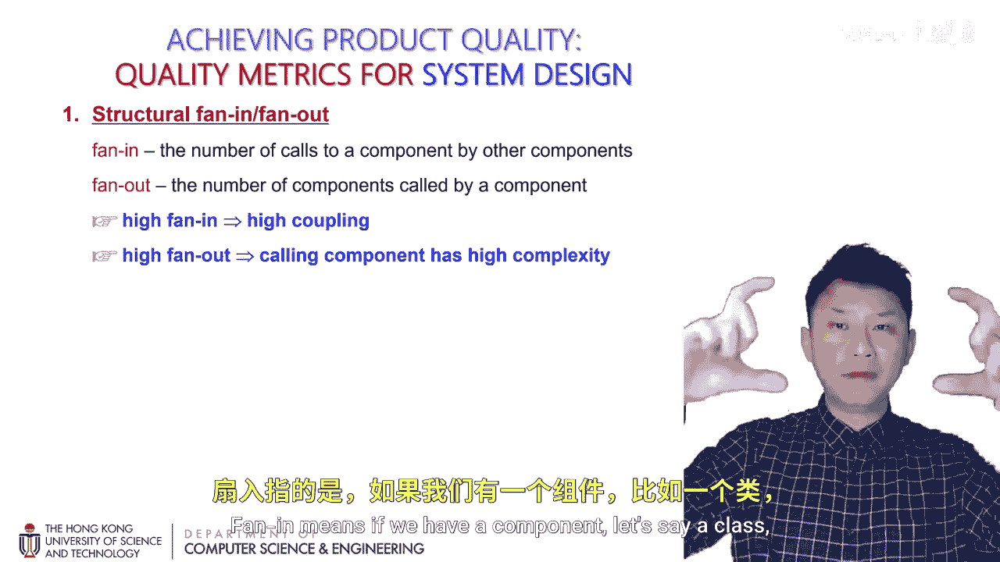

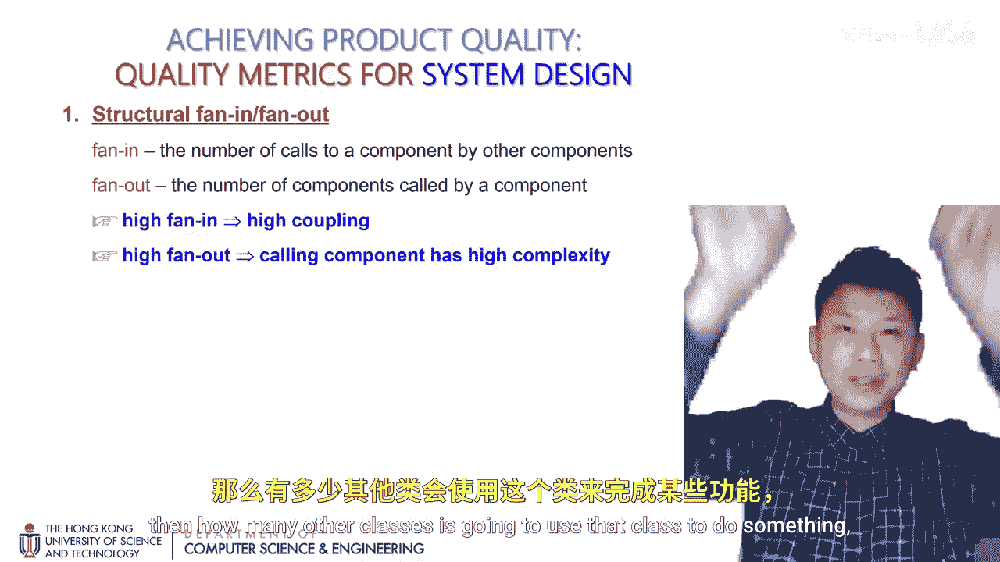

---

## 使用结构扇入与扇出 📈

我们可以使用的一种方法是**结构扇入**和**扇出**。

*   **扇入**：指一个组件（例如一个类）被多少个其他组件调用。公式上可以表示为：`扇入 = 调用该组件的其他组件数量`。高扇入通常意味着高耦合，这是我们应该避免的。
*   **扇出**：指一个组件调用了多少个其他组件。公式上可以表示为：`扇出 = 该组件调用的其他组件数量`。高扇出意味着调用组件具有较高的复杂性，因为它需要协调许多其他类来完成功能。

我们也可以使用**信息扇入和扇出**，这需要考虑传递的参数数量加上对共享数据结构的访问次数。

---

## 计算组件复杂度 🧮

我们可以使用以下公式来计算组件的复杂度：

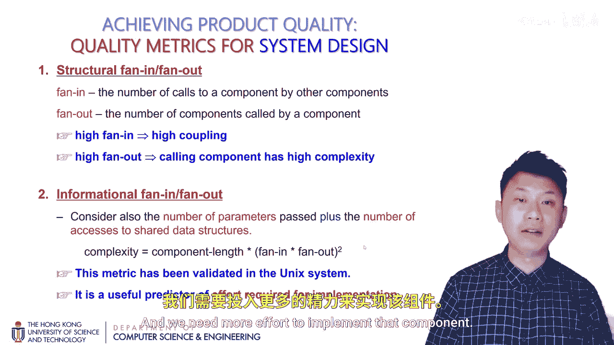

`复杂度 = (组件长度) * (扇入) * (扇出)`

然后对这个结果取平方。这个度量方法已在Unix系统中得到验证，是预测实现所需工作量的一个非常有用的指标。

这意味着，如果使用此公式计算出的复杂度很高，那么该组件将非常难以实现，我们需要投入更多精力来实现它。

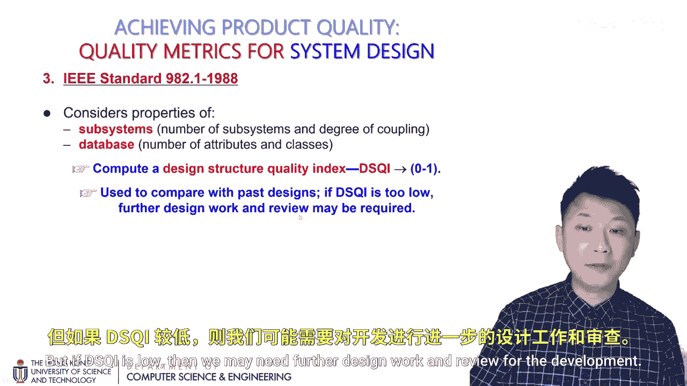

---

## 其他质量评估指标 📐

我们还可以考虑其他指标：

*   **设计结构质量指数**：遵循IE标准，考虑子系统和数据库的属性来计算DSQI。如果该指数接近1，则表明设计良好；如果DSQI较低，则可能需要进一步的设计工作和评审。
*   **软件成熟度指数**：考虑产品生命周期中的变更，使用SMI来计算其稳定性。如果SMI接近1，则系统相对稳定；如果指数太低（例如接近0），则表明设计可能存在问题，需要改进。

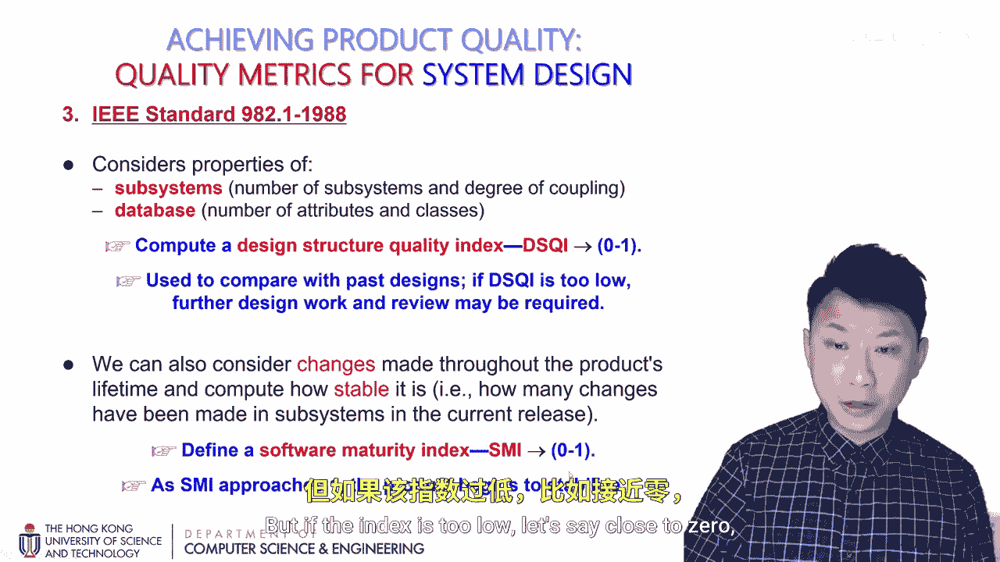

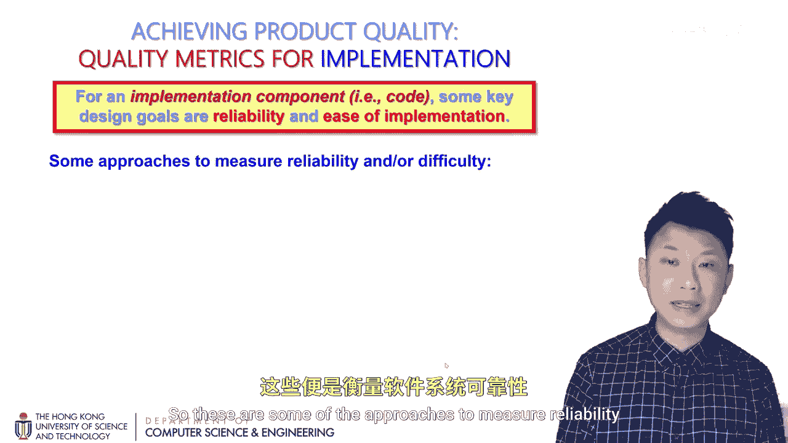

对于一个实现组件，一些关键的设计目标是**可靠性**和**易于实现**。

---

## 测量可靠性与实现难度 🛡️

以下是测量软件系统可靠性和难度的一些方法：

*   **Halstead软件科学**：基于组件体积、组件难度和预期错误数。如果V、D、E值高，则组件难以实现。
*   **McCabe圈复杂度度量**：基于代码的圈复杂度。如果圈复杂度高，则组件复杂且难以实现。
*   **代码行数**：如果代码行数很多，则系统或组件将难以实现。
*   **标识符长度**：如果有很多长度很长的标识符，则该组件可能难以理解和实现。
*   **条件嵌套深度**：如果存在多层循环嵌套，则组件的复杂度会很高，意味着难以实现。

我们应该制定一些标准来避免出现复杂的组件，并高亮显示有问题的组件。

---

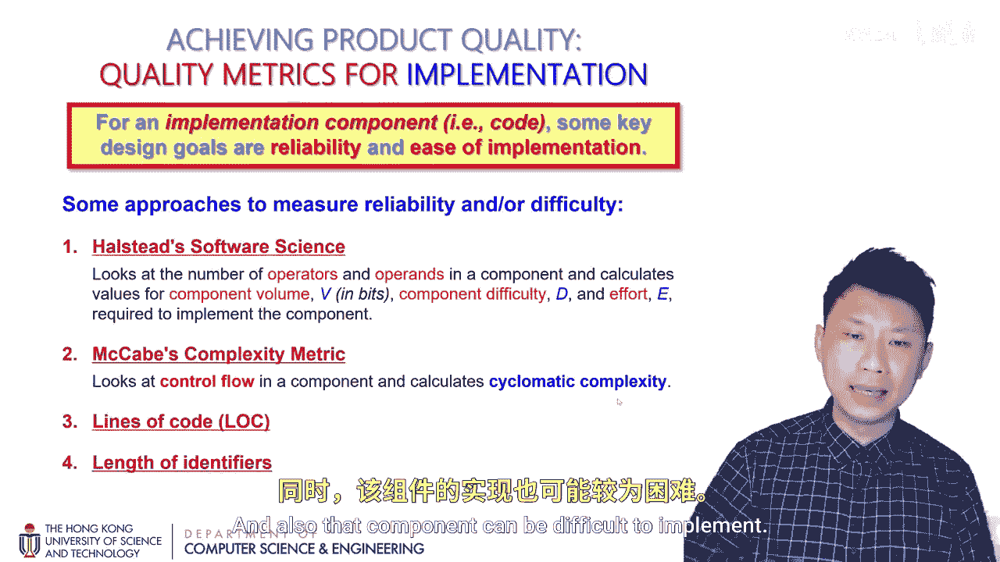

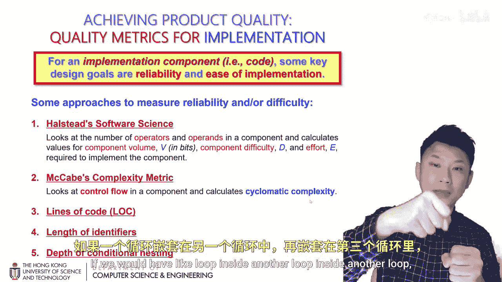

## 确保正确性与追踪缺陷 ✅

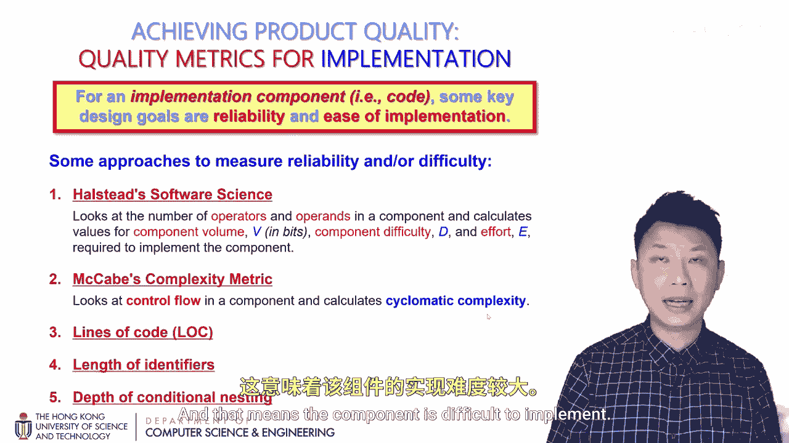

最后，我们必须证明程序和规格说明是正确的。这意味着我们必须从逻辑上证明所有需求都已正确转化为程序。

同时，我们必须追踪所有软件缺陷。我们需要对缺陷进行分类并确定其原因。在这里，我们可以应用**80/20法则**，因为80%的缺陷可以追溯到20%的原因。这意味着如果我们修复了这20%的原因，就能解决80%的缺陷。

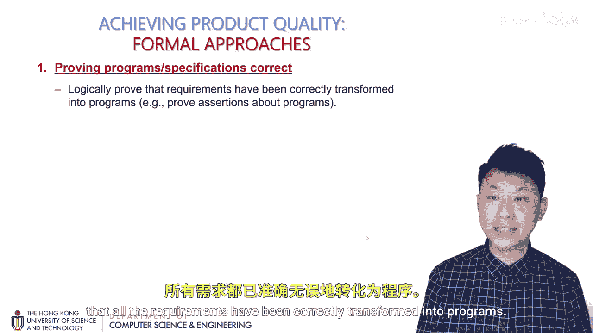

通过结合以上两种方法，我们可以确保最终能够实现高度可靠的软件。

---

## 总结 📝

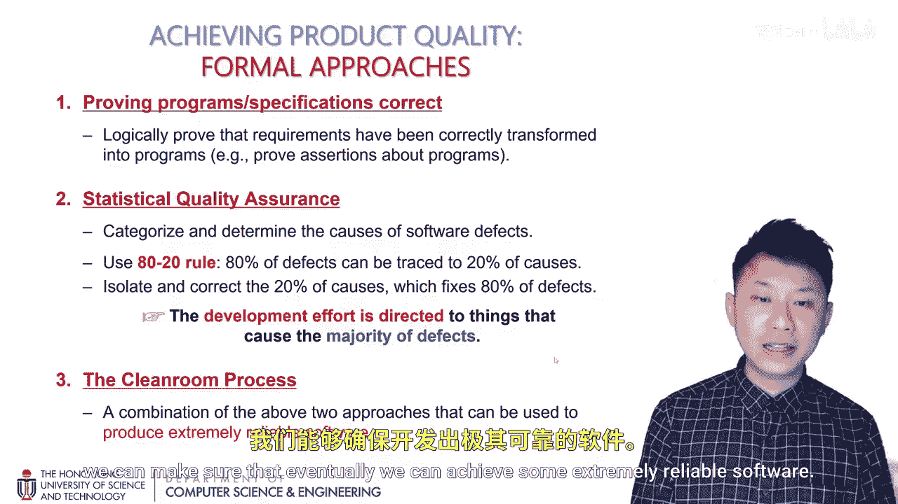

本节课中，我们一起学习了如何通过设定明确的设计目标来指导产品质量的实现。我们探讨了如何将难以直接测量的外部质量属性（如可维护性、可靠性）映射到可量化的内部属性（如扇入/扇出、圈复杂度、代码行数）上进行评估。我们还介绍了几种具体的度量方法和公式，用于计算组件复杂度、评估设计结构质量和软件稳定性。最后，我们强调了通过形式化验证和系统化缺陷追踪来确保软件最终高度可靠的重要性。掌握这些方法，有助于我们在开发过程中持续监控和改进产品质量。