# 香港科技大学【中英⚡软件工程｜Software Engineering Specialization】 p58 P58 04_实现项目、流程与人员质量 -BV1MMEjzoEhg_p58-

And then we talk about how to achieve project quality and then we talk about how to achieve project quality so we can achieve project quality by performing reviews from time time and here we are not just talking about code review because we can use code review to uncover software defects or defects within the source code But now we can also perform reviews on requirements and analysis and design which usually introduce 50 to 60% of audit defects and if you perform formal technical reviews from time time。

 you can uncover 75% of this defects。

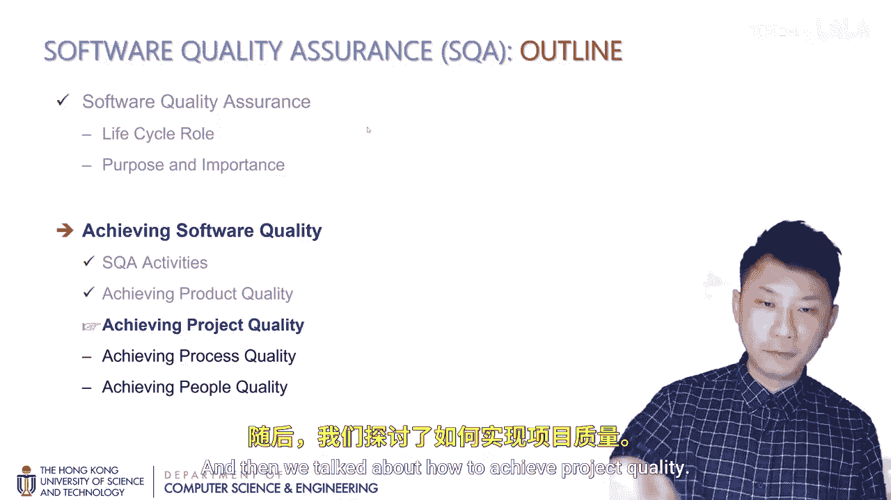

So that's why here we say that if we perform reviews early and we perform reviews often。

 then we can discover defects early。

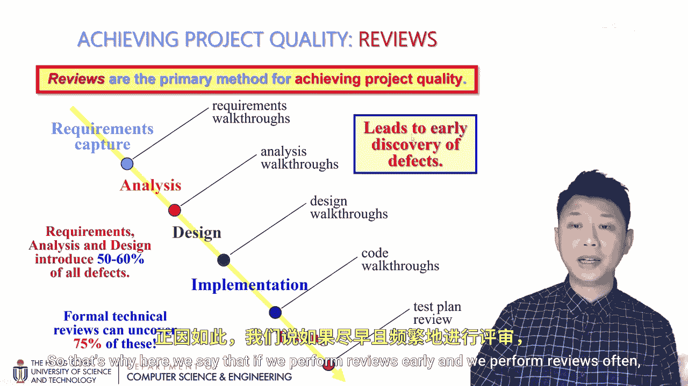

And another important thing that we have to do in order to achieve project quality is what we call software configuration management。

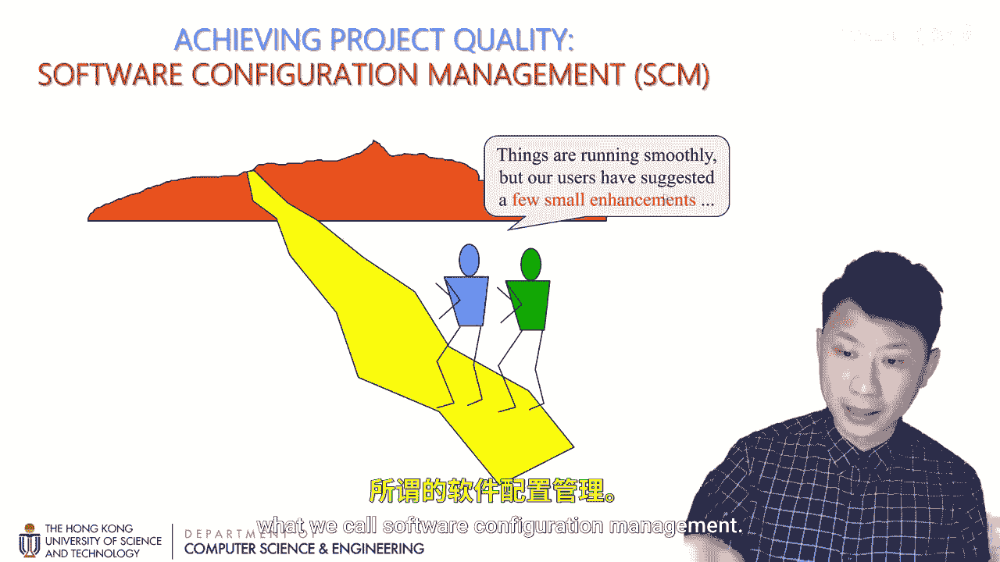

Just because change is going to happen in a project。

So that's why we need to perform software configuration management to manage。

 control and monitor all the changes within the project。

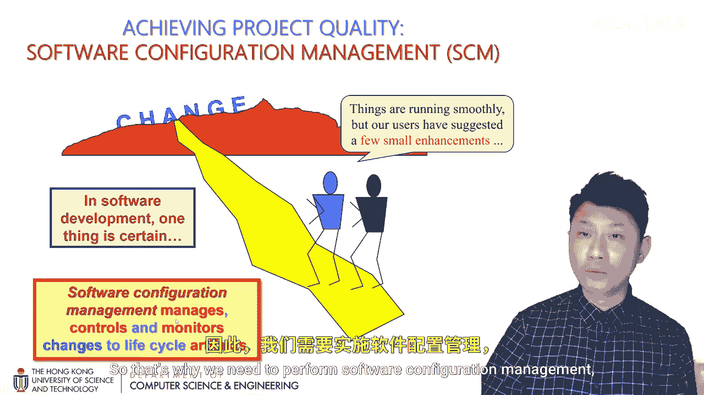

And then the next thing that we're going to talk about is how to achieve process quality。

 So some of you may ask how important is the process in software development。

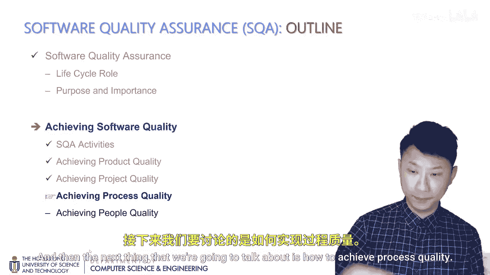

And notice that software development has some unique factors that affect the product quality independent of the process used。

Because software is designed， not manufactured。And also， software development is creative。

 not mechanical。And also， external factors may impact the quality of a software。

And individual skills and experience can have a significant influence on the project quality。

So that's why here we say that sometimes people in technology。

 they are even more important than process。So that means if you have some good people and technology。

 it's also very likely that you will success in a software project。

And insufficient resources will always affect product quality regardless of the process used。

 For example， if you don't have enough time， if you don't have enough budget for your project。

 of course， it's going to affect the product quality and a detailed software development process is usually not transferable because it's highly organizational specific。

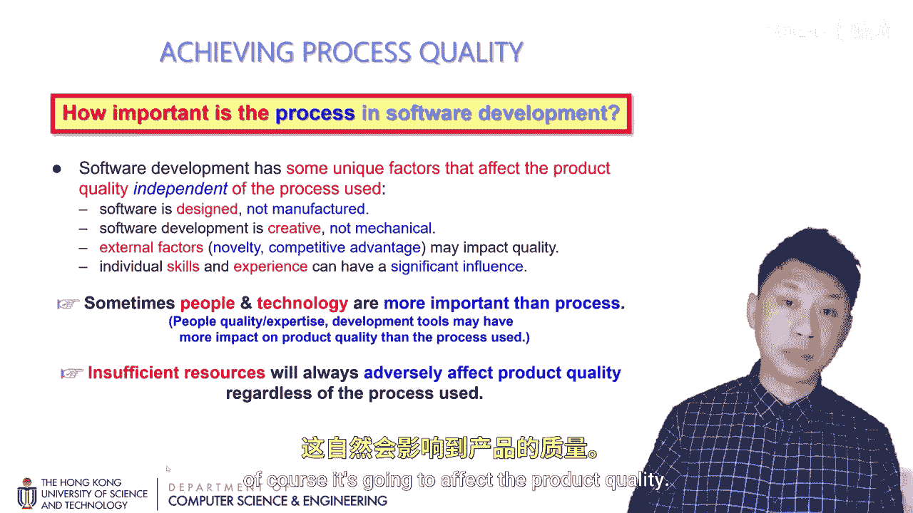

And let's say if Google is using Agile and I'm using the same process， Agile as Google。

 will I be successful， very likely no because it's highly organization specific and it's not transferable。

And there is a guideline which is called S EICMM， which is intended to help a software organization assess and improve their software development processes。

And if an organization is at level one， then that means it's at heart。Okay。

 that means there's no management at all。If it's level2， then we have some basic management。

 for example， we're going to keep track and monitor the resources that we have within the project。

 let's say the time and budget that we have within the project。If it's level3。

 then that means we defined all the processes for a project and also training are provided within the project。

If it's level four， then apart from management， we also perform measurement throughout the project。

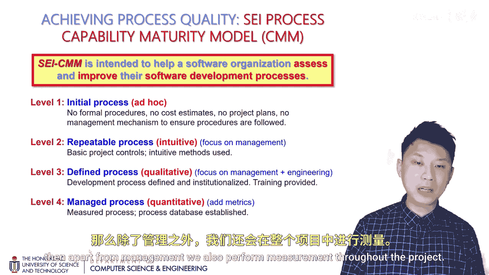

If it's level 5， then apart from management and measurement。

 we also add feedback so that we can get feedback and further improve the project。

And the last topic that we recover is achieving people quality。

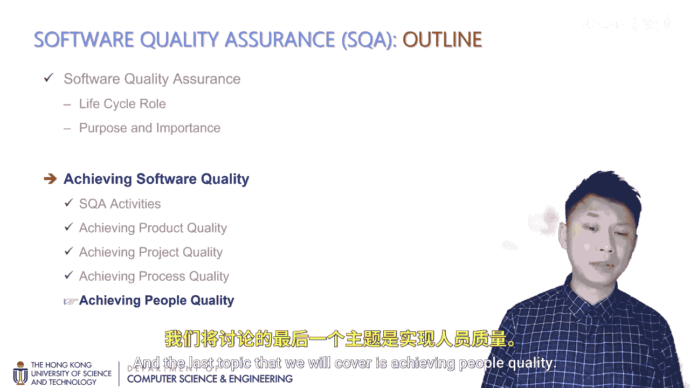

So there is a guideline which is called PCM M， which is intended to assess and improve knowledge and skill of people within an organization。

 If it's level  one， then that means there's no training provided at all。If it's level 2。

 then that means the organization is going to provide you some basic training let's say if you' are going to work on a particular programming language。

 then' going to provide you training on how to work on that language Level 3 is defined it that means we try to tailor work practices and also there is a plan to locate and also develop required talent and levell 4 is managed and the key word is that we focus on team building Level 5 is the best one It's focus on improving team and also individual skills It's going to use the best practices。

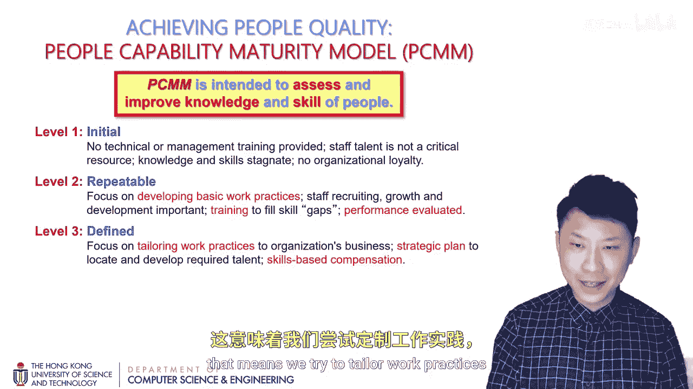

So later on， when you work in the industry， make sure that you are going to work for those organizations which are level3 or above。

 because if they are level3 or above， that means they will provide training to you and then you will learn while you are working on different projects。

So this is a little summary of what you have to do in order to achieve quality。

 So first thing is that an organization should have a quality menu。

 which documents is software quality assurance procedures。

And each project should have a quality plan which sets out the quality attributes that are most important for that project and how they will be assessed。

And then an organization should have well defined standards within a standard handbook so that all the employees within the organization。

 they will follow all the standards inside the handbook。And also。

 mechanisms and processes should be established that monitor compliance with all quality requirements of the organization。

 and reviews should be performed from time time to make sure that we won't make mistakes。

 and we should also monitor all the metrics at all time。

 which can be used to highlight anonymous part of the software that may have quality problems。

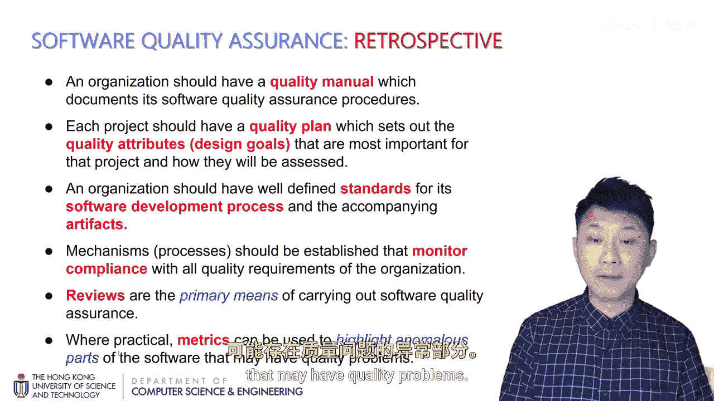

And notice that quality software does not just happen。

Software quality assurance needs to build into the software development process。

And developing quality software requires management， standards。

 metrics and also commitment and notice that testing is an important part of quality assurance。

 but it's not all there is to obtain a quality software product because we do testing late in the project and within this lecture we have talked about things that we can do in order to uncover defects early in the project。

And that's all I want to cover in this lecture。

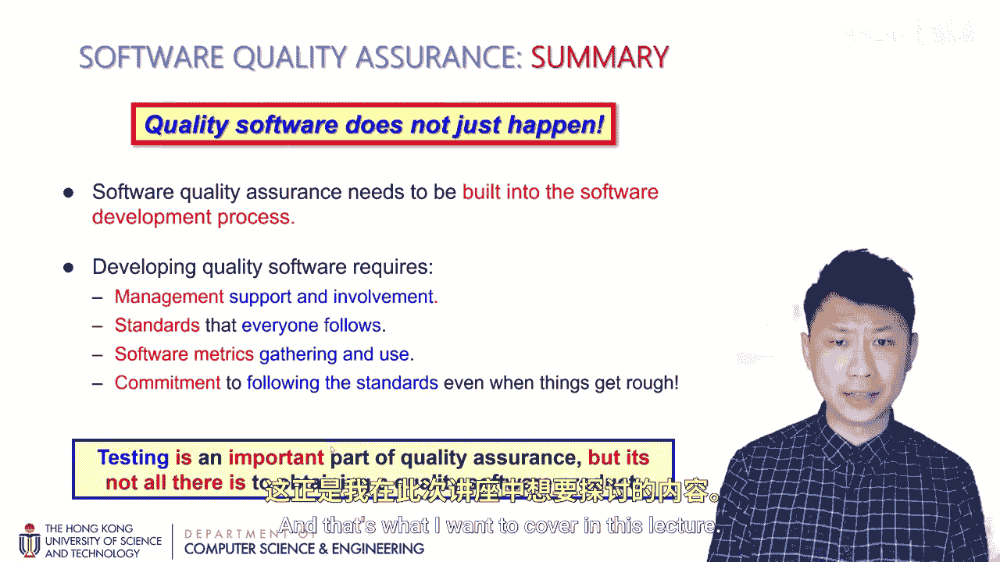