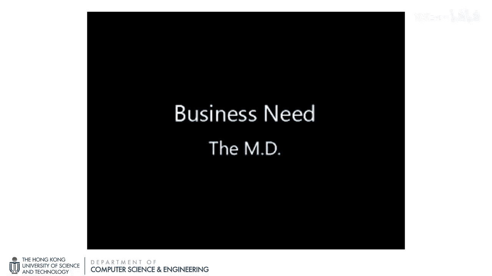
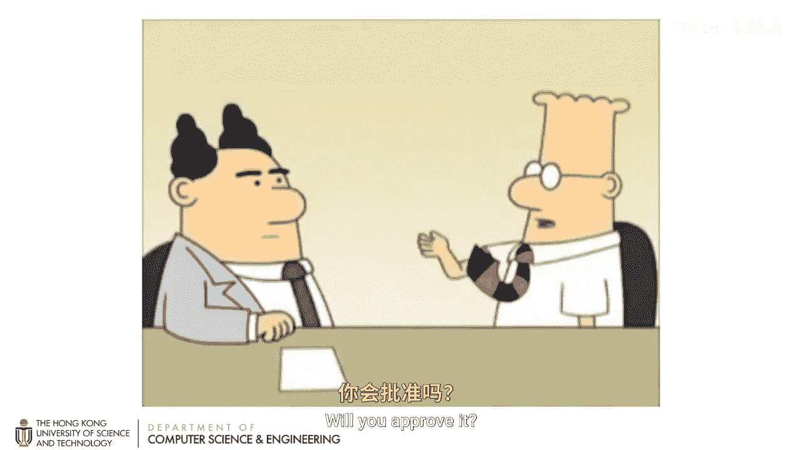
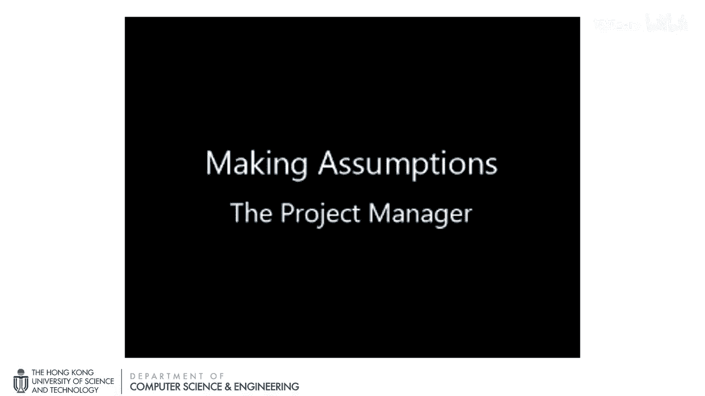
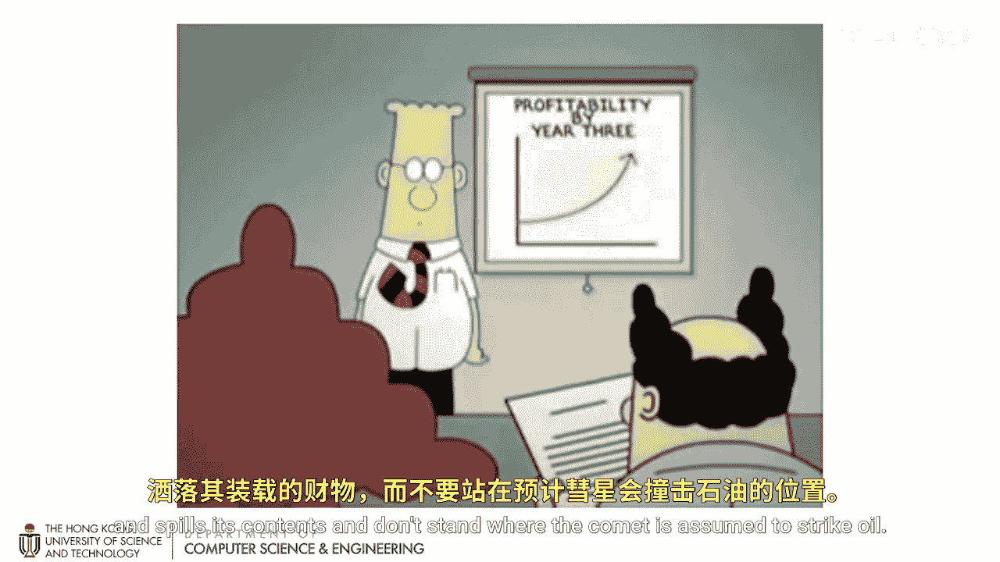
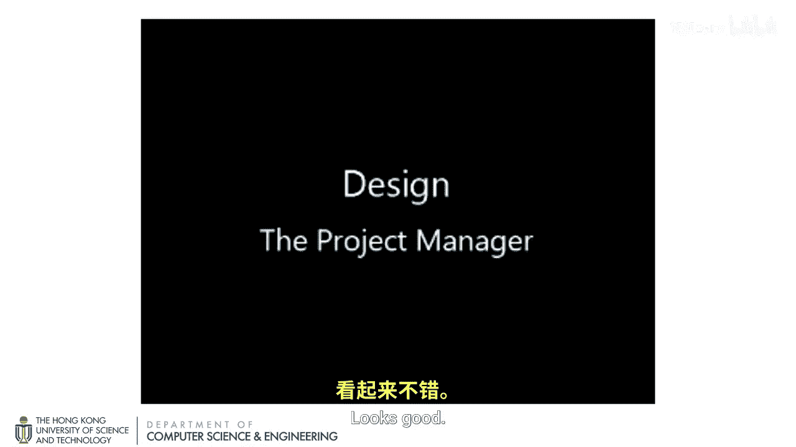
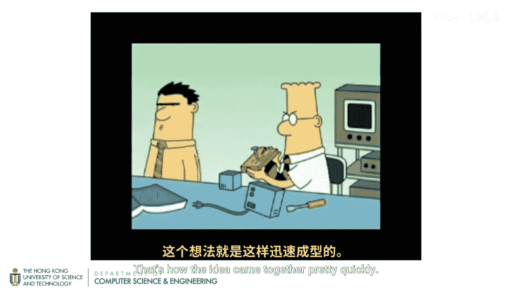
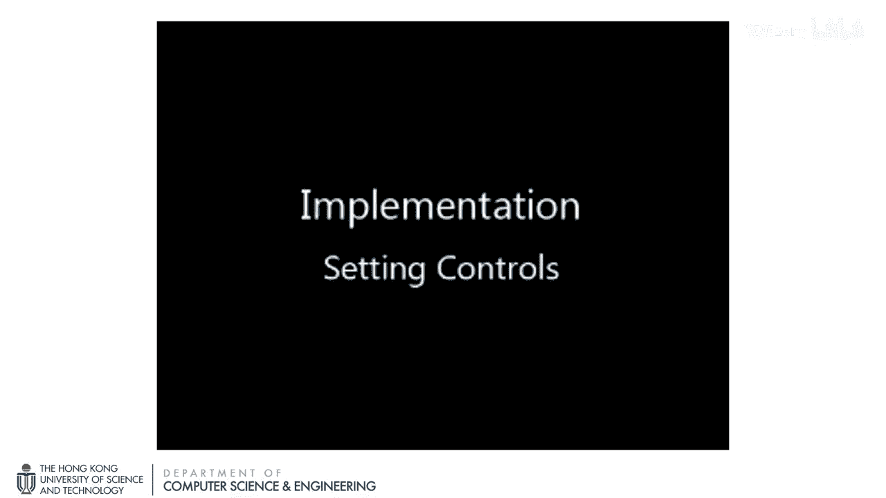
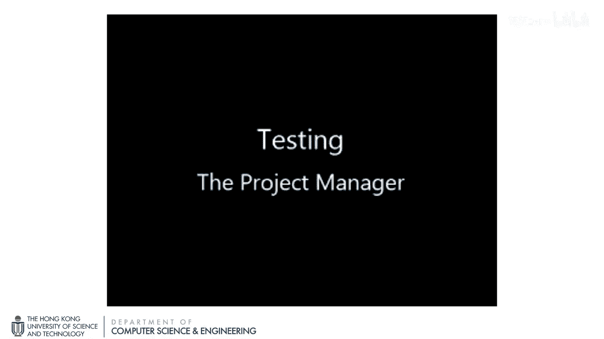
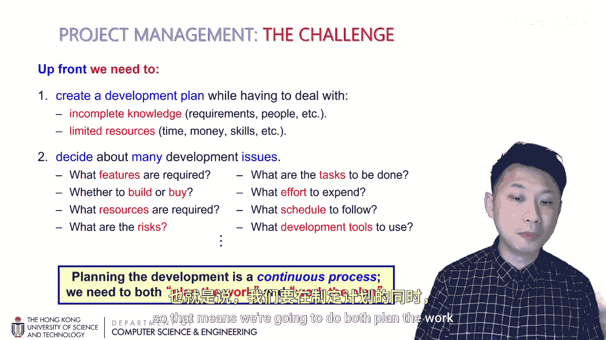

# 香港科技大学【中英⚡软件工程｜Software Engineering Specialization】 p59 P59 01_项目管理 -BV1MMEjzoEhg_p59-

Hi， in this lecture we will talk about project management。

 that means what are the things that you have to do as a good project manager。

In these are learning objectives of this lecture after this lecture。

 you will know the principal task of software project manager。And also。

 you will understand the need for project planning in all software projects。

And also you will understand some of the requirements for staffving and scheduling in software projects。

You will also know some techniques for estimating the size and cost of software development。

 and finally you will also understand the importance of project tracking and control。

And now I'm going to show you a little video about project failure。

I need to be managing a sexier project to boost my career。

It only has to sound good and not fail until I get a better job。

How about a nanotechnology stem cell for fighting terrorists？

Okay。

This is the bare minimum budget I need for my project。What could you do with half this amount？Fail。

When can you start？I think I just did。I'll ask the vendor for ballpark prices to see if the idea is feasible you can't talk with vendors until our change control board approve the project。

 but that would require a cost benefit analysis and I can't do that without ballpark prices from the vendor。

Just take your best guess so I should make up a number so I can get approval to make a phone call and ask what the number should have been。

 right， But first， you need to get my approval to do the cost benefit analysis。 Will you approve it。

I'd have to see the numbers。

As requested， I wrote the business plan to show profitability by year 3。

The key revenue assumption is that an armored car crashes through that wall and spills its contents。

And don't stand where the comet is assumed to strike oil。

Looks good。

You won't read my technical report， so I summarized it in this complicated slide。

If you stare at it long enough， you will either experience the illusion of understanding it or be too embarrassed to admit you don't。

Do you have any questions to betray your ignorance？I have a question。

 is the triangle thing mad at the tube？No， nope， nope， no。

 this design will never work in the real world。That design is already widely used in the real world。

I can come back later if you need time to concoct additional uninformed criticisms。

I didn't know how to design a power supply。 So I put a nail in a piece of wood。

I'm on vacation tomorrow， so I'll give you my files in case you need to make changes。

Let's hit the idea that all came together pretty quickly。

Wally， are you done with your project， yet？I'll be done next week。

You've said next week for seven weeks in a row。What makes you think I'm going to believe it this time？

The first six times。

So how's your project coming along， it's a steaming pile of failure。

 It's like 15 drunken monkeys with a jigsaw puzzle。How's your project coming along？Fine。嗯。

The results of our beta testing are in。Our user interface triggered widespread despondency and self mutilation。

Obviously， we'll need to delay our launch for the public good。When did you become a communist。

You have failed to meet a goal set by our CEO。Do you mean the impossible goal。

 the ill advised one or the one you didn't tell me about。I figured out what's wrong with life。

It's other people。And in this lecture， we will talk about how to avoid project failure and we will start with an overview about project management。

If we are talking about project management， we do it throughout the entire project。

And weak project management is usually fatal to software project。

So if you don't do good in project management， then eventually your project may fail。

But doing project management is not easy because up to the front。

 we need to create a development plan to come。But doing project management is not easy because up to the front。

 we need to create a development plan which contains all the information about the project and you have to come up with the plan with incomplete knowledge。

 that means you don't start with the project yet， then you have to come up with all the estimations。

 for example， before you even start implementing the system。

 you have to estimate how many people that you need for the project。

 how many lines of code that you gonna have with the software system and also how much money or the budget that you need for the project。

 etc， etc。 and also you have to plan the project with limited resources， usually in terms of time。

 money and skills。So in the project plan， you have to decide many development issues， for example。

 what features are required， what are the tasks to be done。

 whether to buy the features or to build the features ourselves。What effort to expand。

 What are the resources required， et cetera， et cetera。

And notice that planning the development is a continuous process。

 that means while we are developing the project， we're going to do the planning at the same time。

 so that means we're going to do both plan the work and also work the plan at the same time。

