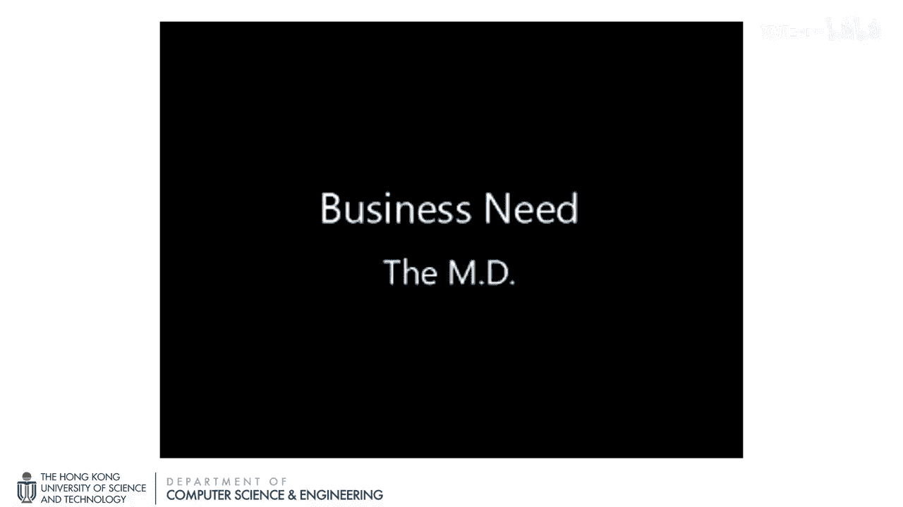
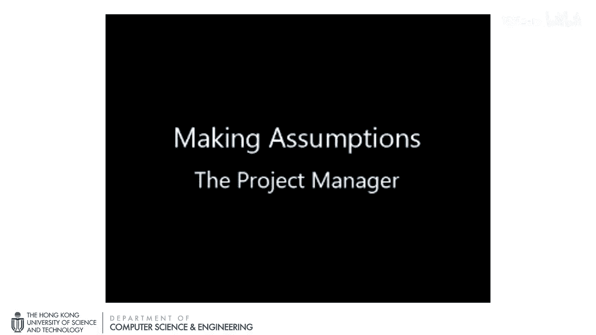
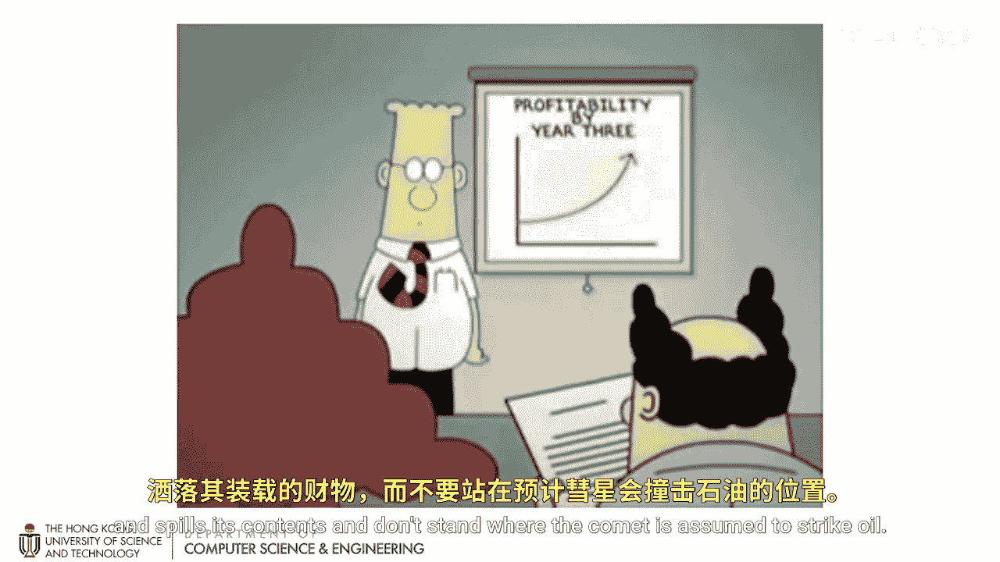
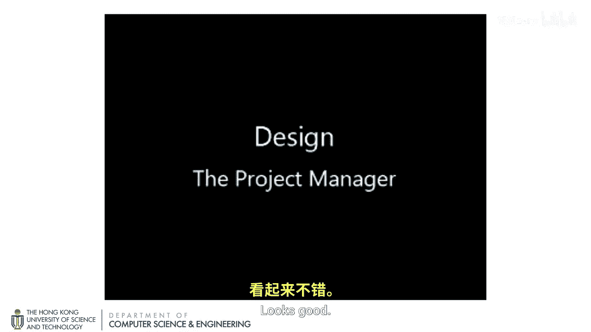
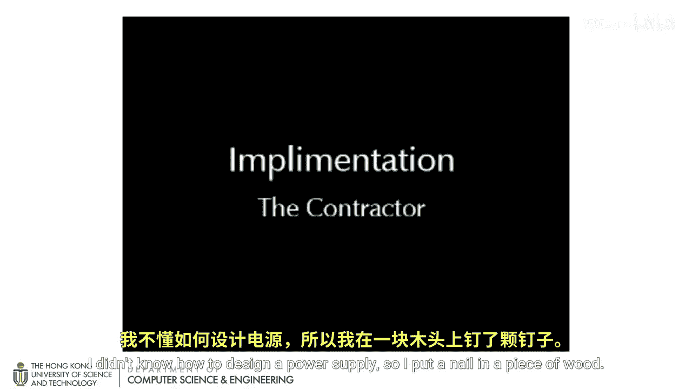
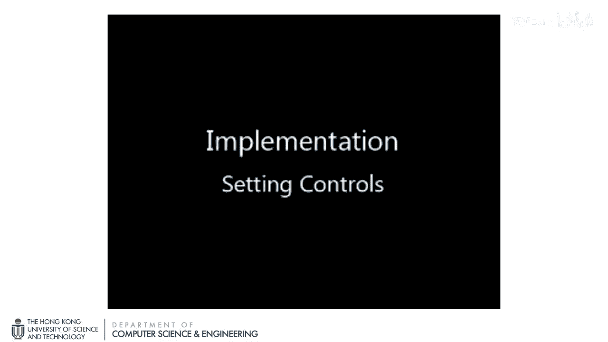
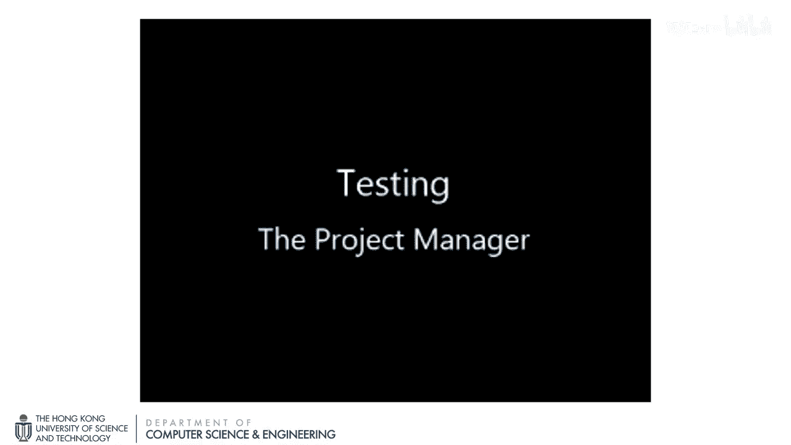
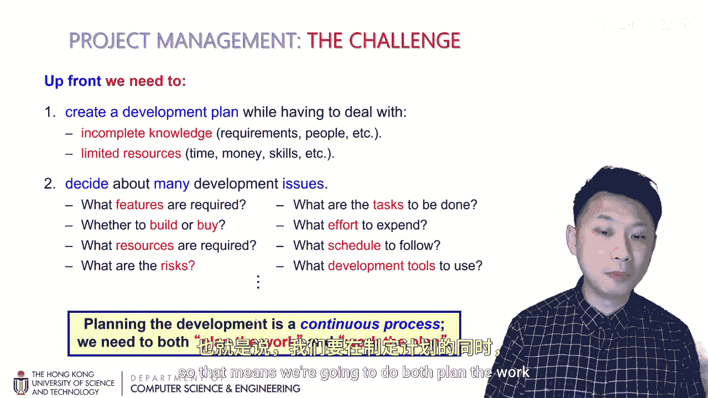

# 软件工程：P59：项目管理 🎯

在本节课中，我们将探讨项目管理。这意味着，作为一名优秀的项目经理，你需要完成哪些工作。

## 概述

项目管理贯穿整个软件项目周期。薄弱的项目管理通常是导致软件项目失败的关键原因。因此，做好项目管理至关重要。然而，项目管理并非易事，因为项目初期就需要制定一份包含项目所有信息的开发计划，并且你必须在信息不完整的情况下完成这份计划。

## 学习目标

完成本讲后，你将能够：
1.  了解软件项目经理的主要任务。
2.  理解在所有软件项目中制定项目计划的必要性。
3.  理解软件项目中人员配备和进度安排的一些要求。
4.  了解估算软件开发规模和成本的一些技术。
5.  理解项目跟踪与控制的重要性。

## 项目失败的警示

在深入探讨如何管理项目之前，我们先通过一个短片来了解项目失败的一些常见原因。

> 我需要管理一个更“性感”的项目来推动我的职业生涯。
> 它只需要听起来不错，并且在我找到更好的工作之前别失败就行。
> 一个用于打击恐怖分子的纳米技术干细胞项目怎么样？
>
> 好吧。
>
> 这是我的项目所需的最低预算。用一半的钱你能做什么？失败。
> 你什么时候可以开始？我想我已经开始了。
>
> 我会向供应商询问大概价格，看看这个想法是否可行。
> 在我们的变更控制委员会批准项目之前，你不能与供应商交谈。
> 但这需要一份成本效益分析，而没有供应商的大概价格我无法完成分析。
> 那就凭你的最佳猜测吧。
> 所以我应该编造一个数字，以便获得批准去打一个电话，询问这个数字本来应该是多少，对吗？
> 但首先，你需要获得我的批准才能进行成本效益分析。你会批准吗？
>
> 我得先看看数字。
>
> 根据要求，我撰写了商业计划书，以显示第三年实现盈利。
> 关键的营收假设是，一辆装甲车会撞穿那面墙并洒出里面的东西。
> 另外，别站在预计彗星会撞击出石油的位置。
>
> 看起来不错。
>
> 你不会读我的技术报告，所以我在这张复杂的幻灯片里总结了它。
> 如果你盯着它看足够久，要么会产生理解了它的错觉，要么会因为不好意思承认自己不懂而保持沉默。
> 你有什么问题会暴露你的无知吗？
> 我有个问题，那个三角形的东西对那个管子生气了吗？
> 不，不，不，不。这个设计在现实世界中永远行不通。
> 这个设计已经在现实世界中广泛使用了。
> 如果你需要时间来编造更多无知的批评，我可以稍后再来。
>
> 我不知道如何设计电源。所以我在一块木头上钉了颗钉子。
> 我明天开始休假，所以我把文件给你，以防你需要做修改。
> 让我们庆祝一下，这一切很快就搞定了。
>
> Wally，你的项目完成了吗？我下周完成。
> 你已经连续七周都说“下周”了。这次我凭什么相信你？
> 因为前六次。
>
> 那么，你的项目进展如何？它是一堆失败的烂摊子。就像15只醉醺醺的猴子在玩拼图。
> 你的项目进展如何？很好。嗯。
>
> 我们的Beta测试结果出来了。我们的用户界面引发了普遍的沮丧和自残行为。
> 显然，为了公共利益，我们需要推迟发布。你什么时候变成共产主义者了？
>
> 你未能达到我们CEO设定的目标。你是指那个不可能的目标，那个不明智的目标，还是那个你没告诉我的目标？
>
> 我弄明白生活的问题出在哪了。是其他人。

上一节我们看到了项目失败的多种可能性。本节中，我们将开始学习如何通过有效的项目管理来避免这些失败。

## 项目管理概述

项目管理贯穿整个项目周期。如前所述，薄弱的项目管理通常是软件项目的致命伤。如果项目管理不善，最终可能导致项目失败。

然而，项目管理并不容易。因为在项目初期，我们就需要制定一份开发计划。这份计划需要包含项目的所有信息，而你必须在知识不完整的情况下制定它。这意味着，在项目甚至还未启动时，你就需要进行各种估算。

例如，在开始实施系统之前，你就必须估算项目需要多少人手、软件系统将有多少行代码，以及项目需要多少资金或预算等等。

此外，你通常还需要在时间、资金和技能等资源有限的情况下规划项目。因此，在项目计划中，你必须决定许多开发事项。

以下是需要在项目计划中决定的关键事项：
*   需要哪些功能。
*   需要完成哪些任务。
*   是购买功能还是自行构建功能。
*   需要投入多少工作量。
*   需要哪些资源。

请注意，制定开发计划是一个持续的过程。这意味着在开发项目的同时，我们也在进行规划。换句话说，我们需要“规划工作”并“执行计划”同时进行。

## 总结

本节课中，我们一起学习了项目管理的基础。我们首先通过一个短片了解了项目失败的常见原因，然后探讨了项目管理的核心概念，即在整个项目周期中进行持续规划的重要性。我们认识到，项目经理需要在信息不完整和资源有限的条件下，对功能、任务、资源、成本等进行早期估算和决策，并随着项目进展不断调整计划，以确保项目成功。