# 香港科技大学【中英⚡软件工程｜Software Engineering Specialization】 p60 P60 02_软件开发计划 -BV1MMEjzoEhg_p60-

So now we're going to talk about what we should include in the project plan。

Within the software development plan， SDP， we have to documents the scope of the development effort and how the project will be managed。

 The scope means what should be done within the project and what should not be done within the project。

 And notice that the SDP defines the project。And we say that developing the SDP is a constrained optimization problem with incomplete data。

 we say that it's incomplete data because we have not yet started working on the project。

And we need inputs from different people in order to prepare the plan。

We need the development manager to organize the project， task， budget， etc cetera， etc cetera。

We also need some people with experience on a similar project so that that guide can tell us what are the designs that we can use for the project and also help estimate the project technical science。

And then we also need some expert user or domain expert so that we can get our requirements from the application domain through the expert users or domain expert。

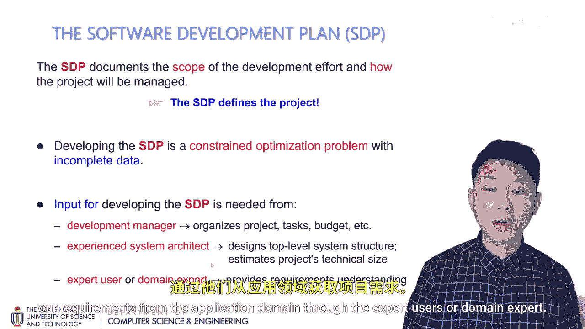

In the project plan， we also have to specify the deliverables of the project。

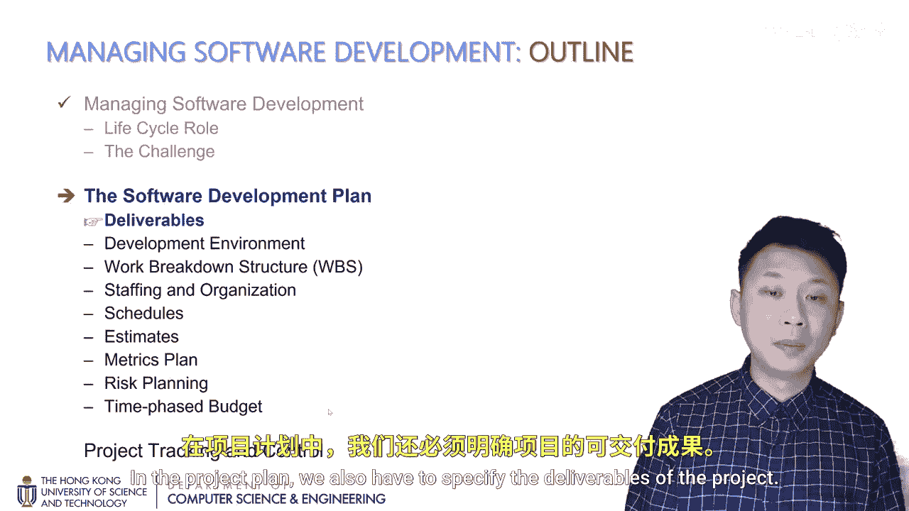

So in the plan， we have the specified what should be delivered to who and when。

Some of the deliverables they can be client products， for example， executable code， user menu， etca。

 etc， some of the deliverables they may be process artifacts， for example， system requirements。

 analysis， design specifications or object design files or source code。

Or some of them can be internal deliverables， for example， source code libraries， make fileses。

 etc cetera， etc cea。Or some of the deliverables they may be services。 For example。

 we may have to provide training to the client， provide installation service， customization。

 etc cetera， etc cetera。 So you have to specify exactly what are the deliverables for the project in the planned。

And deliverables will affect starving and also team organization。 Let's say if you have many。

 many deliverables， then obviously you need more people in your team to work on the project。

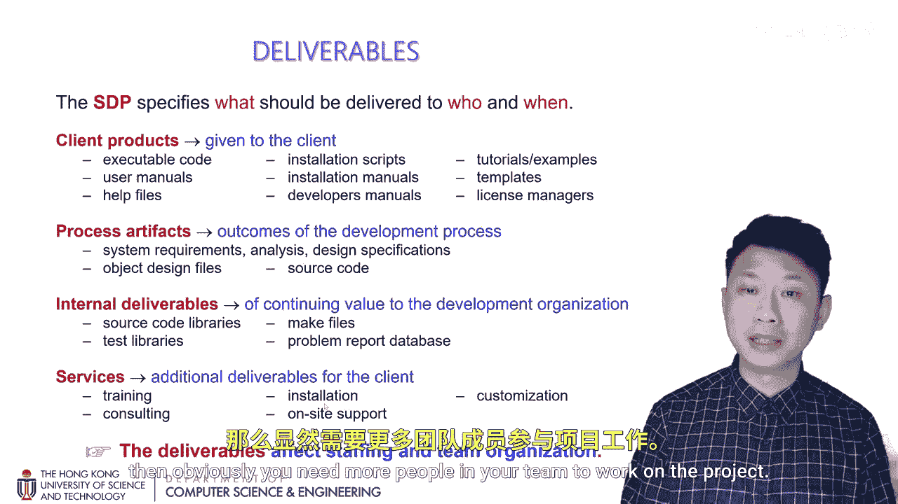

And also in the project plan， you have to specify the development environment。

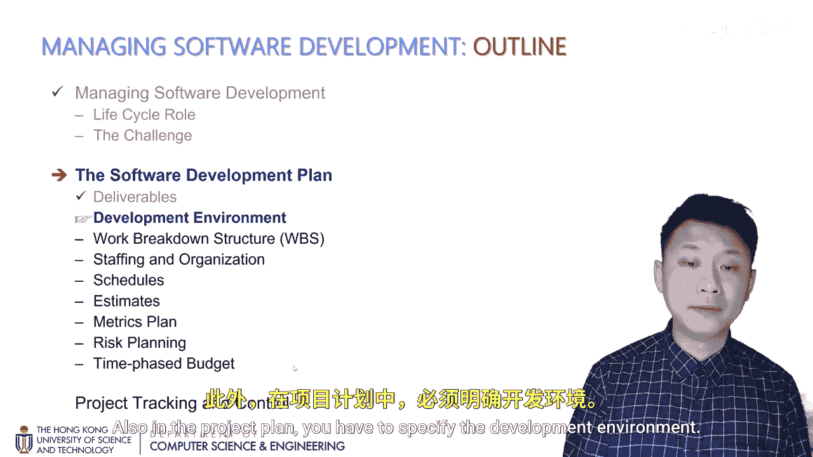

Within the SDP， we have to specify the hardware and software development tools that we can use within the project and notice that development tools。

 they are not equals to development process。Development Tuesday are just a tools that we're going to use within the project in order to be successful in a project。

 we still need some good processes so that everyone in the organization they can follow the processes to develop a project。

So tools are effective only if they make well understood processes more efficient。

And when we choose a development tool， we have to evaluate， for example。

 the support of life cycle and also risk of adoption to both cost and schedule If we are using some new tools。

 then we may have to spend some extra money in buying the tools and also we may have to provide extra training to the developers on how to use the tools。

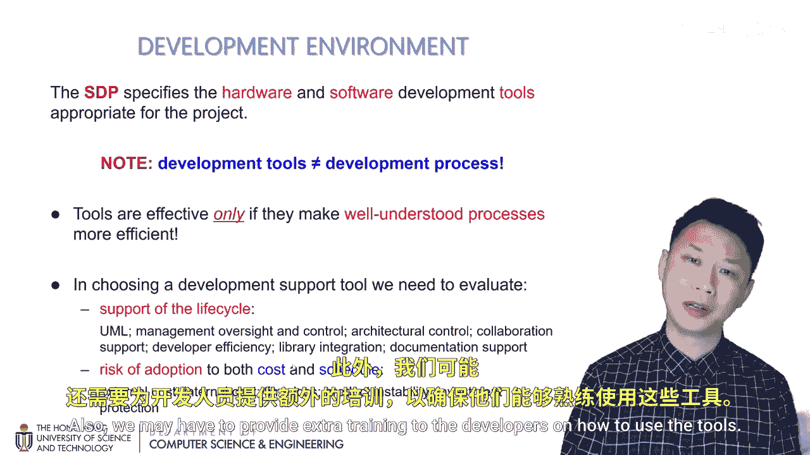

We also have to specify the work breakdown structure in the development plan。

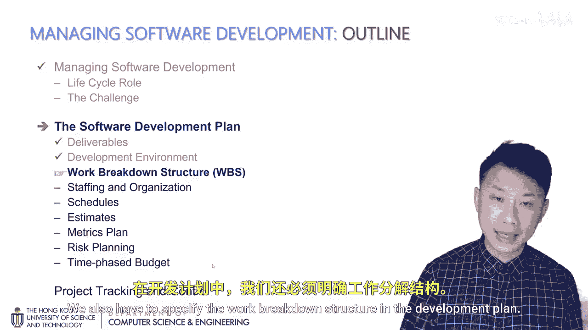

Within the project plan， we have to break down the project into task and subtask using D and Conr。

 and then usually it's going to be in terms of a tree structure which is something like this。

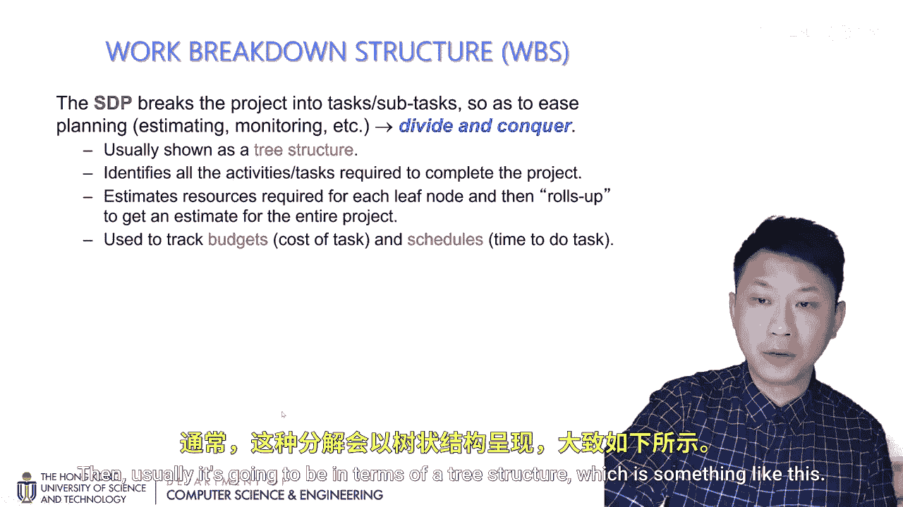

So within the project， you have to specify what are the tasks that you have to perform。

 and within a task， there may be some further subtask， etctera， etc ce。

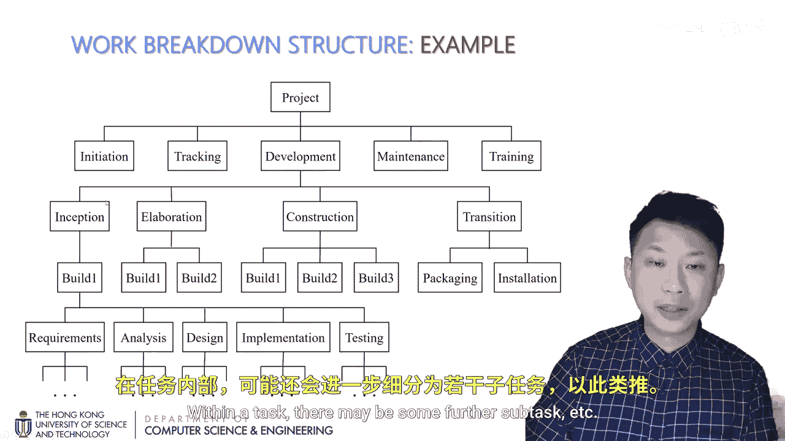

And you have to identify all the activities and tasks required to complete the project and also estimate resources required for each leaf flow and then rolled up to get an estimate for the entire project。

And also， you need to use。And then somehow you can track the but and schedules of the project using this work breakdown structure。

And the work breakdown structure allows each task to be easily planneded。

 easily assigned to individuals and teams， and also tracked it to monitor progress and to know who is working on which task。

And then also budgeted so that courses can be tracked。And they should offer write granularity。

 If it's too small， then it's going to be hard to track。 If it's too large。

 then it's going to be hard to control causes and measure progress because it's too general。

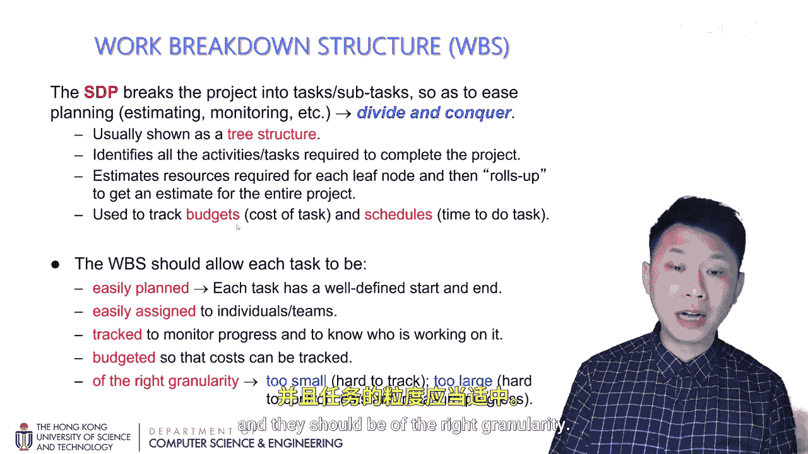

Then in the project plan， you have to also specify staffing and organization。

So you have to define the project organization and specify the roles and responsibilities within the project and also the number of staff in each role and also teams。

And there should be one project member who have experience with a similar system。

 and that member can help you estimate the size of the project and also help you design the software system。

And notice that the team organization should be modular to limit communication and also complexity of interaction if you put too many people in a team。

 then eventually you will spend a lot of time in communication。And also。

 you should assign clear responsibilities to each team member。And also form teams to have whistle。

And also form teams to have responsibility for the design and implementation of one or more subsystems。

And also identify a person in charge for each subsystem and the。

And also identify a person in charge for each subsystem and the system。

 because if there's something wrong with a particular subsystem。

 you can always talk to the person in charge。And the key to success is by achieving the right level of communication。

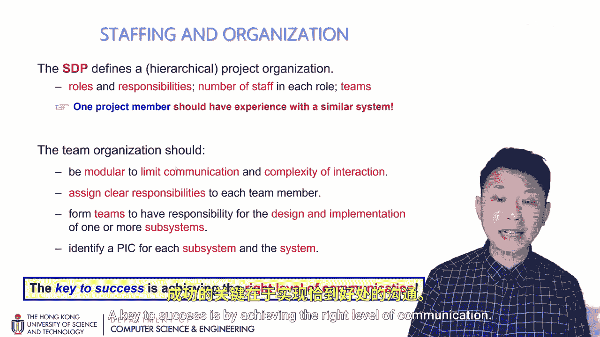

And in your project plan， you also have to come up with your project schedule。

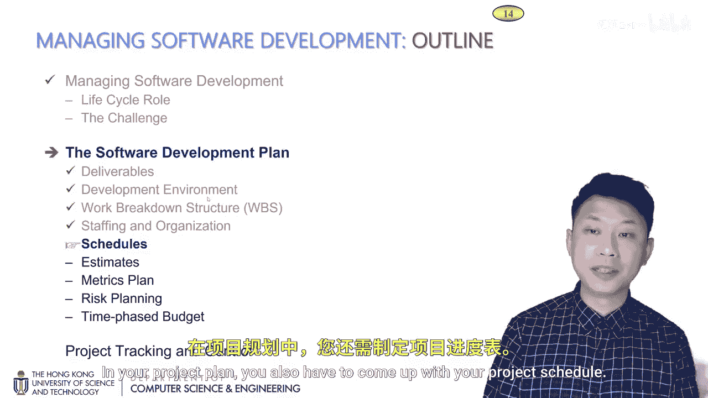

So within a project schedule， you have to define the task， ordering the task estimates for each task。

 resource assignment， milestones， deliverables， and also critical path if we have talk about per chart and usually there are three level of schedules to be maintained。

 the master schedule which is an overview of the entire project and also macro schedule for day to day project management。

And Michael S， which is for team management。In this course。

 we're going to talk about how to perform scheduling using game chart per chart and burnout chart。

 And we have already talked about how to use burn on chart to manage schedule When we talk about Scrumrum。

 So now we're going to talk about how to draw a game chart and per chart。

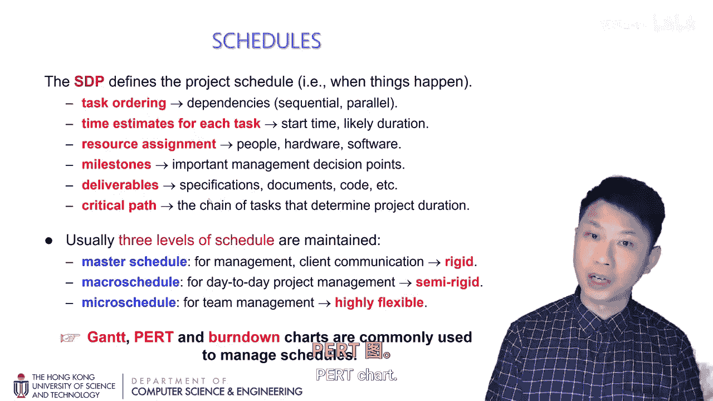

So this is an example of a game chart within a game chart you have to specify all the tasks that you have to perform within the project and then also estimate the time that you need for each task。

And this is an example of a game chart。 and from the game chart。

 we can see the overall schedule for the entire project。

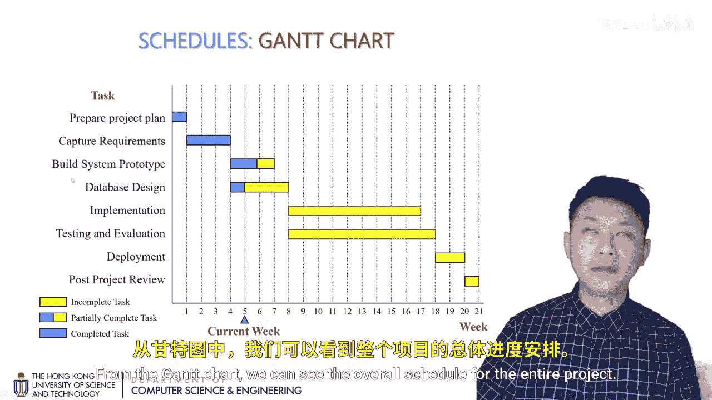

We may also specify the schedule using per chart。Within a per chart we still have to identify all tasks that we're going to perform within the project and then give an ID for each task that we're going to perform within the project and then for each task we have to estimate the duration of the task and also we have to indicate the task ordering。

Then once we have all this input。Then once we have all this information。

 then we can convert this information into a per chart。

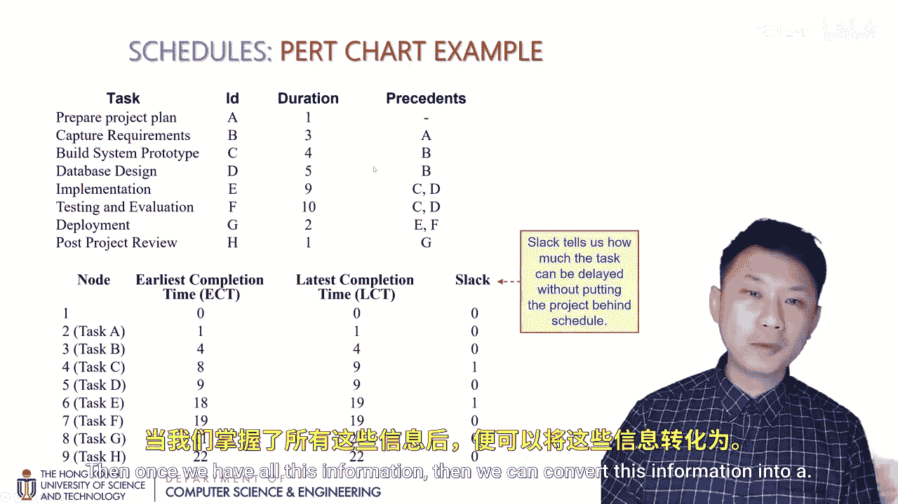

So a per chart is a graphical representation of project tasks laid out in the form of a critical path network。

So this is one example， let's say we start with this don， then we perform task A。

 then we can go from Note1 to note 2。Then after we complete task B， then we go from note2 to note3。

Then we're going to perform task C and D in parallel， and then once we finish task C， we go to No 4。

 and then once we finish task D， we go to No 5。And then we're going to perform task E andF in parallel。

 then after we finish task EF， we're going to go to task G and also task H and then we finish the project and notice that we also need those stmy tasks right in order to merge the parallel task back to the mainstream。

And then we can identify the project duration using the critical path。Which is the red one。

 and we define the critical path as the longest path from the satin note to the endal。

And since we are talking about the longest path， then we pick the path D instead of path C because it's longer and also we pick path F instead of path E because it's longer。

And we are talking about the longest path that we have from this thattn to the endn and from this path。

 somehow you can estimate the duration of the entire project。

And that's why we say that the overall schedule depends on the critical path。

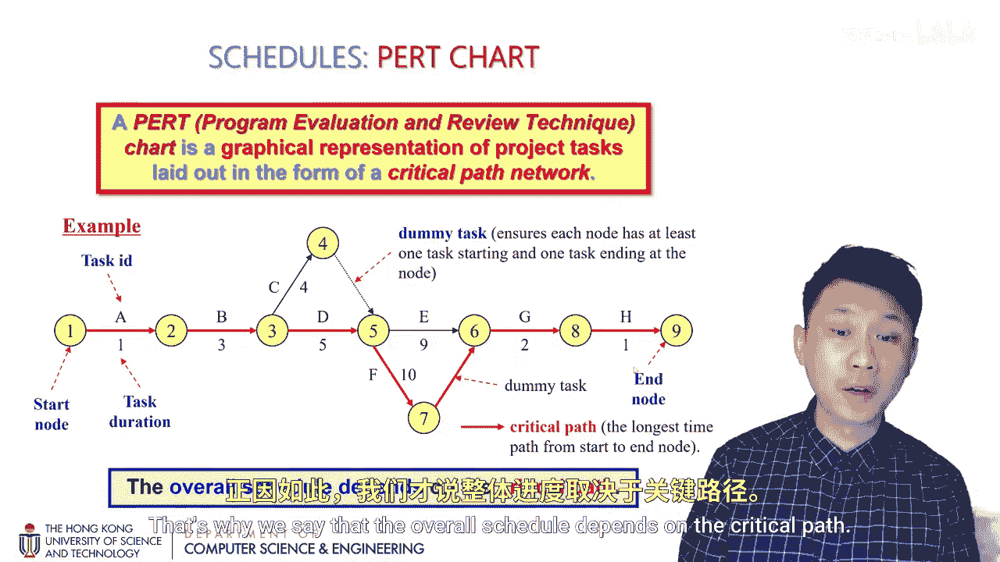

And in your project plan， you also have to come up with all the estimates。

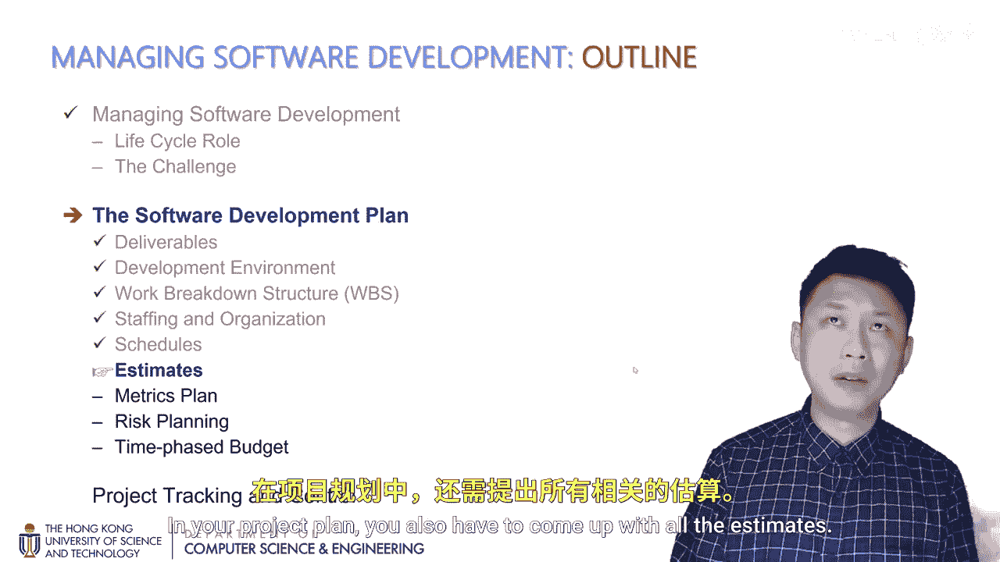

And we have to provide estimates of the project in terms of， for example， the size of the project。

Or the effort that we have to spend on the project or the duration of the project， etc cetera， etc。

And notice that estimating is based on experience， historical data。

 models and also courage so that's why it's important that in order to reduce the risk in estimating we need some people with experience on a similar system to tell us。

 for example， the size of the project， the duration of the project。

 how many people that we need in the project， etc， etc。

And that's why I say here the risk can be reduced by trying to establish the project scope in advance and then also use some metrics from past projects or some experienced people。

And also use D and Conr to break down all the tasks into smaller ones before we estimate。

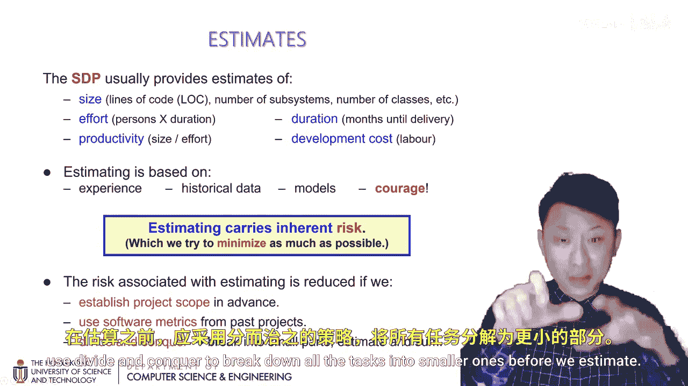

And there are many different types of metrics that we can collect for a software system。

And in this course， we're going to talk about productivity metrics， in particular。

 we're going to cover size oriented metric and also function oriented metric。

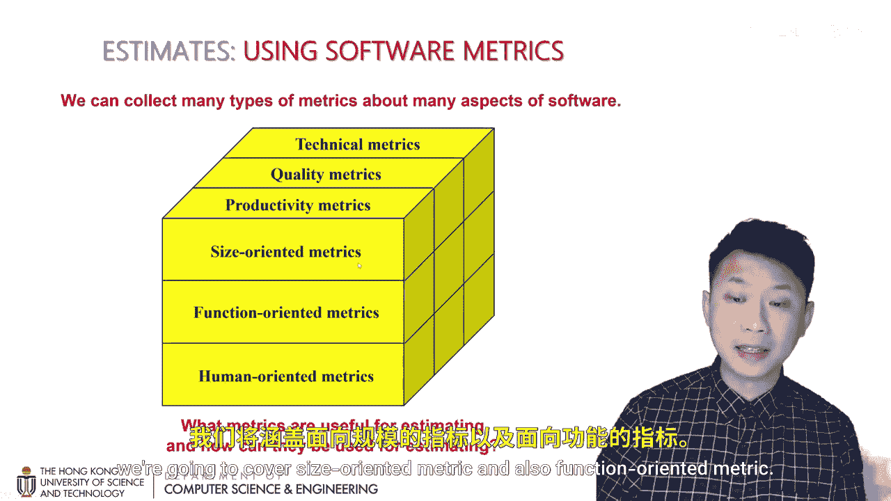

So if we are talk about size or random metric， we are talk about the size of the project so we can estimate the size of the project in terms of the lines of code that we have for the project。

And we can come up with this estimates based on data from past projects or based on people with experience on a similar project。

And then once we can estimate the size of the project in terms of kilo lump of lines of code。

 then we can use this k。To estimate， for example， productivity， cost。

 quality and also documentation of the project。So what is the problem with this approach。

 Notice that all these metrics， they are。So what is the problem with this approach。

 notice that all this estimates they are based on the size of the project in terms of the number of lines of code of the project。

And notice that different people， they may use different number of lines of code for the same program。

 so that's the problem。So it's difficult to come up with a single number because different people they have different programming styles and these estimates are based on properties of the project software。

 for example the number of user inputs that we have for the system。

 the number of outputs that we have for the system， the number of inquiries。

 the number of files that we have on the system， and also the number of external interfaces that we have on the system。

 etc cea， etc。

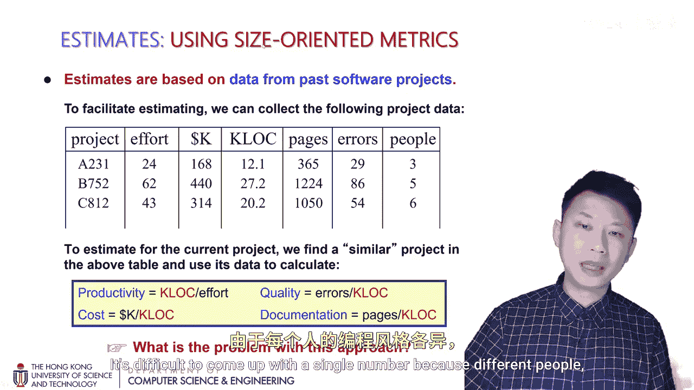

Then once we have the numbers， we're going to plug all these numbers into this equation。

And then we multiply with some weighting factors and then sum them up。

 and eventually we will get some car total。And then after we get the count total。

 we're gonna to plugl it into this equation to get a function oriented metric。

 And some of you may ask what is this F。 This Fi is actually from a survey。

 So you have to complete the survey and then calculate the average Fi， For example。

 you have to answer this questions， Does the system require reliable backup and recovery if there is no inference。

 you say that is0。 If it's essential that you say that's5， etc cea， etc cetera。

 Then you have to answer all these questions and then give a rating for each of the question and then eventually average outdi rating and then pluck it into this equation。

 in order to get the function oriented metric。 Then once you get this FB。

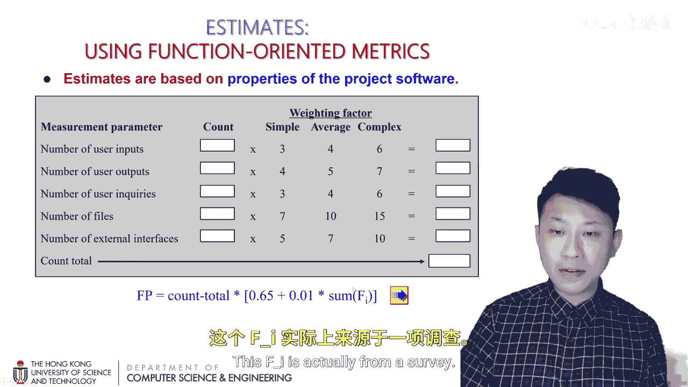

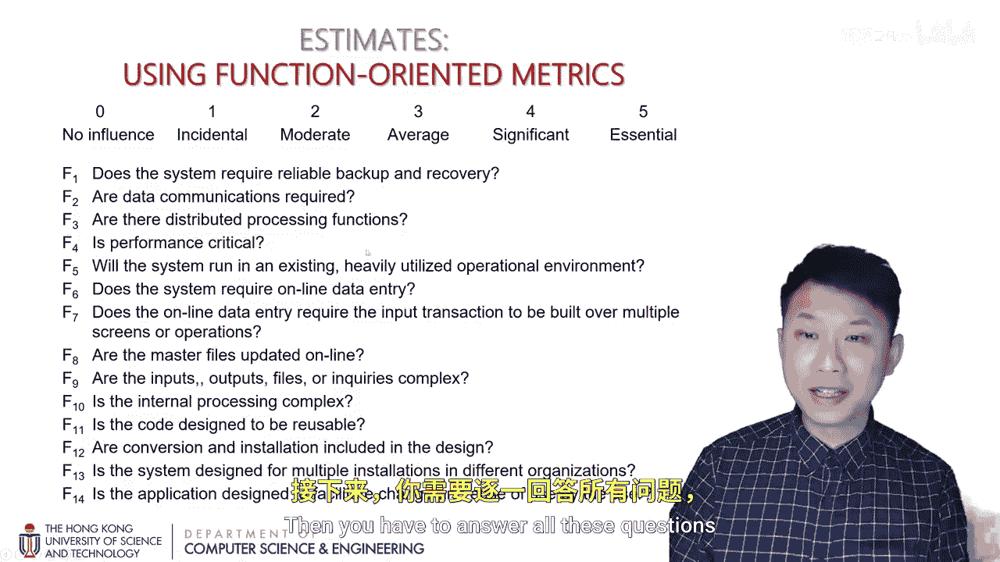

You can estimate the productivity， the cost， quality， and also documentation of the project。

And now you can see that we try to come up with all the estimates based on the functionalities provided by the software system。

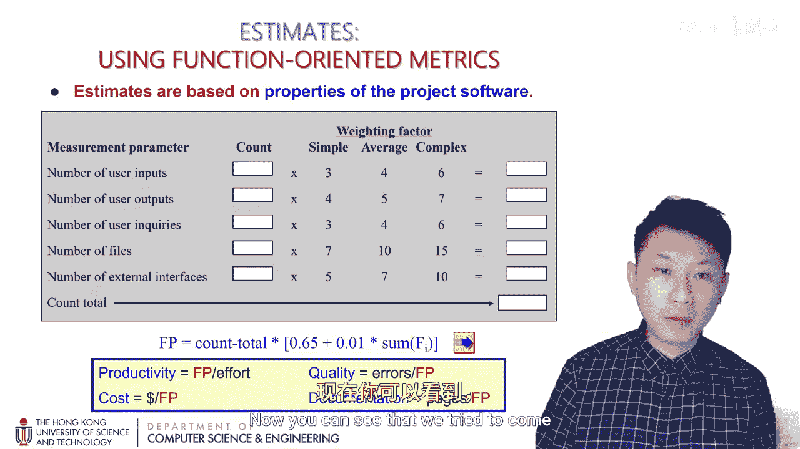

And there are some other methods that we can use to come up with estimates。

 One is what we call the Dfi technique。 We are not just going to get one single number。

 We're going to get three numbers from three different people and then average out the free numbers。

We may also use per estimation that means we need ask each expert to provide a range of value。

 typically optimistic， most likely and also permiss。

And then we're going to calculate some expected value and also standard deviation based on the range of values。

And notice that standardization is a measure of schedule and budget risk。

 that means if the standardization is higher， then we're going to have higher risk within the project。

Why， because if we have higher deviation on the estimates。

 then that means we're going to have higher risk within the project。

And if you have studied statistics before， then you will know that the exercise will fall between or within one SD 68% of time。

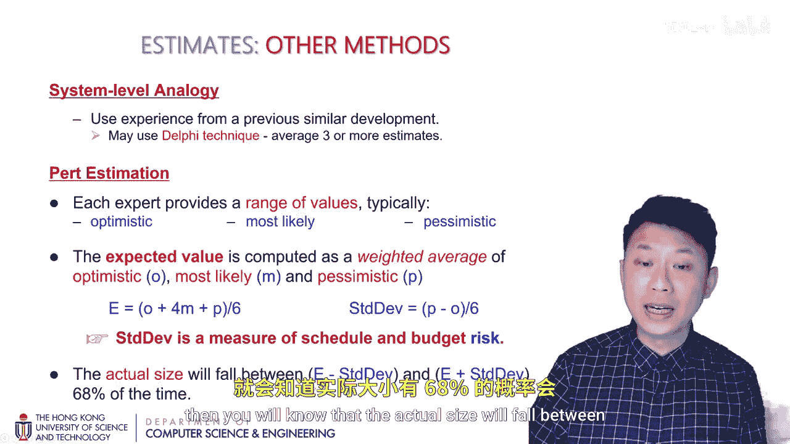

And notice that it's essential to have experienced developer doing estimating because they have experience on similar projects before。

And also， estimation should always be performed in more than one way。

 and the results should be cost track。And incompte and imprecise requirements。

 hinder accurate cost estimation， just because you don't know exactly what are the requirements。

 then it's going to be difficult to perform estimation。And in the project plan。

 you also have to specify what are the metrics that we have to collect for the project。

So you have to identify what metrics to collect and how to collect them。And usually。

 if we are talking about project management。And if we are talking about project management。

 the metrics are usually related to size， for example， number of use cases。

 number of classes or the number of lines of code that we have for the project。

And we need to compare planned sciences with current sizes to determine the progress of the project and also stability of the project。

And in the project plan， we have to foresee and come up with all the rest that may happen in the project。

So that's when I say here， you have to foresee what can go wrong in the project and then estimate the likelihood of happening and also its impact。

And also develop cost effective contingency plans that means what are the actions that you have to perform if the risk is going to happen。

And in doing this well is an important quality of a good manager。

And also risk planning is related to preventive management。

 so we try to foresee what's going to happen and then we try to avoid the risk from happening。

And also， we have to come up with a time phrased budget within the project plan。

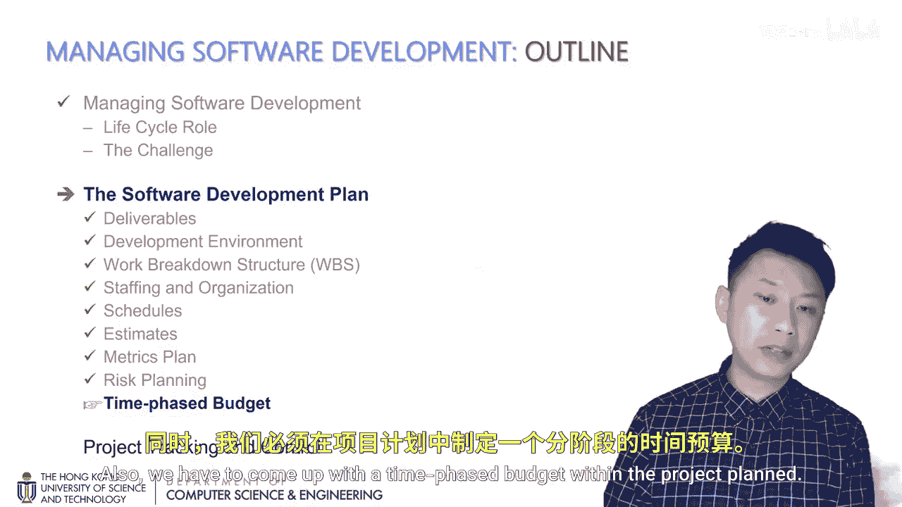

So in time phrased budget， we try to specify when the project budget is planned to be spent and also what is expected to be accomplished at each level of expenditure。

And manpower will likely be the major cost because if we are talking about a software project。

 we will mainly need programmeils to develop the project。But of course， there are also other courses。

 for example， the cost that you need for training， the cost that you need for purchasing software licenses。

 hardware components， etctera， etca。And it's a good idea to keep extra 10% to 15% as extra reserve。

Just in case something go wrong in the project， you still have some extra budget that you can spend for the project。

And make sure that you track the spending that means comparing planned against actual money spent and also plan against actual completion regularly。

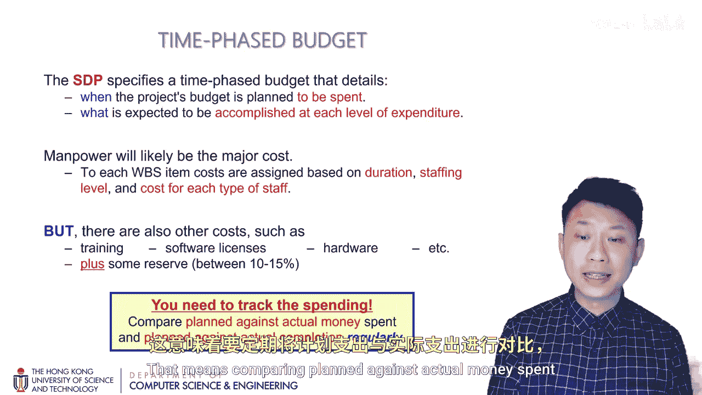