# 软件工程：02：软件开发计划 📋

在本节课中，我们将要学习如何制定一份完整的软件开发计划。软件开发计划是项目管理的核心文件，它定义了项目的范围、管理方式以及如何交付成果。我们将逐一探讨计划中必须包含的关键组成部分。

## 项目范围与定义

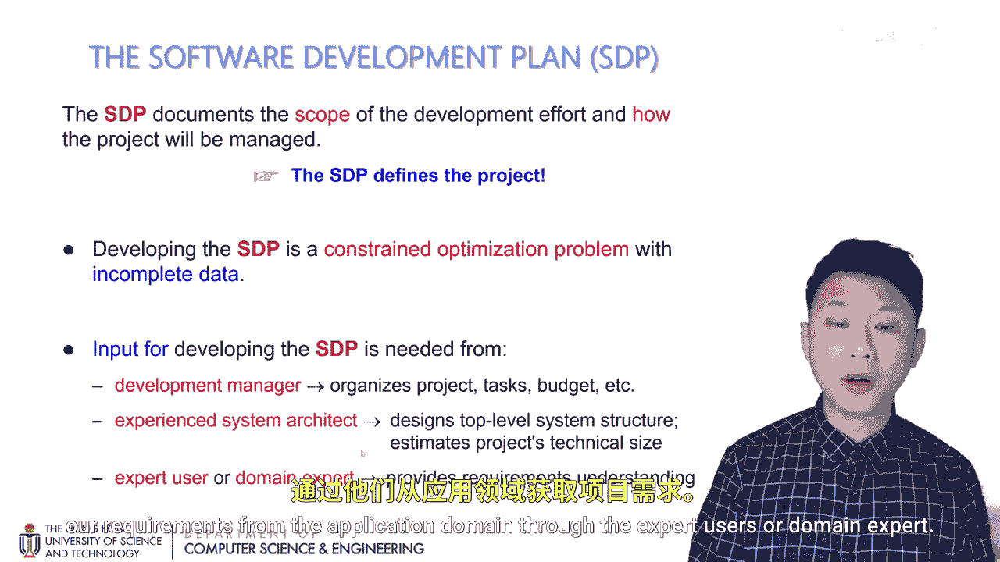

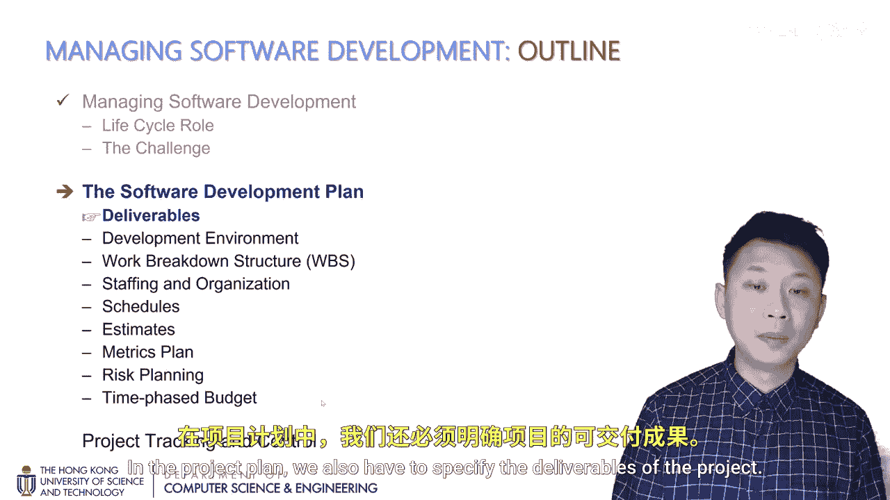

首先，我们来讨论项目计划中应包含的内容。在软件开发计划中，我们必须记录开发工作的范围以及如何管理项目。

**范围**指的是在项目中应该完成什么，以及不应该完成什么。请注意，软件开发计划定义了整个项目。制定软件开发计划是一个**具有不完整数据的约束优化问题**。

之所以说数据不完整，是因为我们尚未开始项目工作。为了制定计划，我们需要来自不同人员的输入：
*   我们需要开发经理来组织项目、任务、预算等。
*   我们还需要有类似项目经验的人员，他们可以指导我们项目可用的设计，并帮助评估项目的技术可行性。
*   此外，我们还需要专家用户或领域专家，以便通过他们从应用领域获取需求。

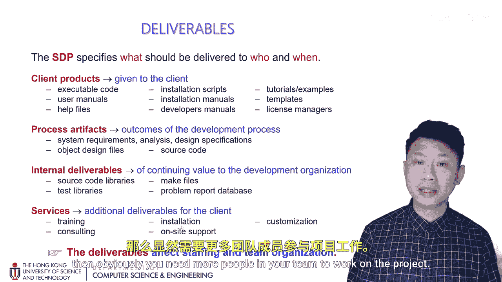

## 项目交付成果

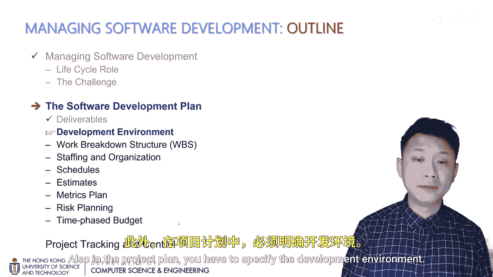

在项目计划中，我们还必须明确项目的交付成果。

因此，在计划中，我们需要具体说明应向谁、在何时交付什么。交付成果可以分为以下几类：
*   **客户产品**：例如可执行代码、用户手册等。
*   **过程制品**：例如系统需求、分析设计规格说明、对象设计文件或源代码。
*   **内部交付物**：例如源代码库、Makefile 等。
*   **服务**：例如，我们可能需要为客户提供培训、安装服务、定制服务等。

你必须在计划中明确指定项目的所有交付成果。交付成果将影响人员配置和团队组织。例如，如果你有许多交付成果，那么显然需要更多团队成员来参与项目。

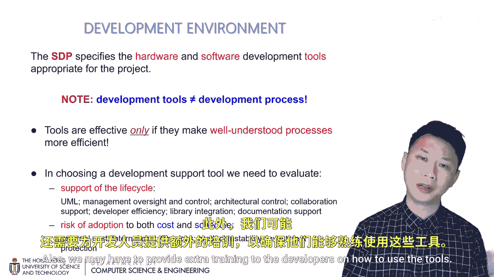

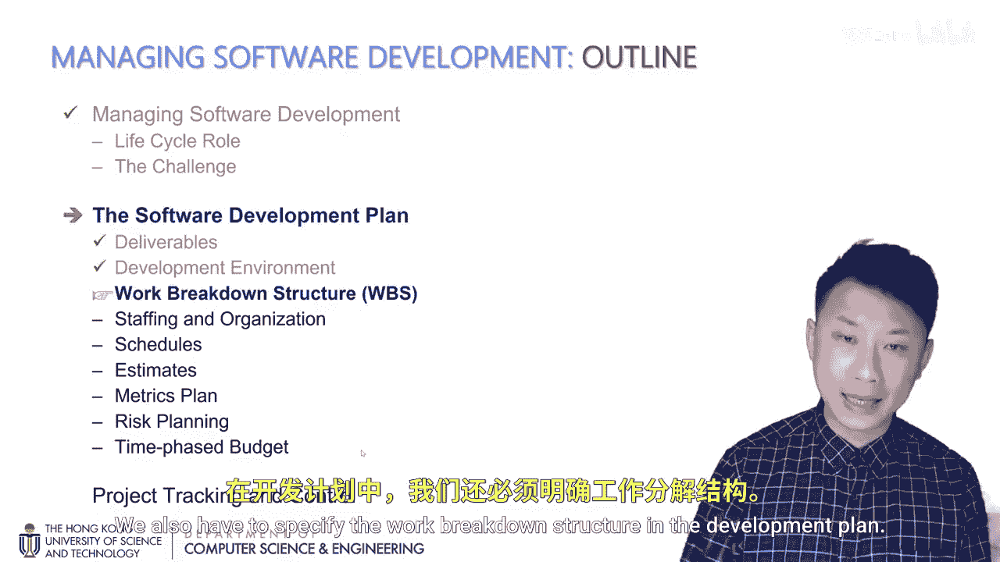

## 开发环境

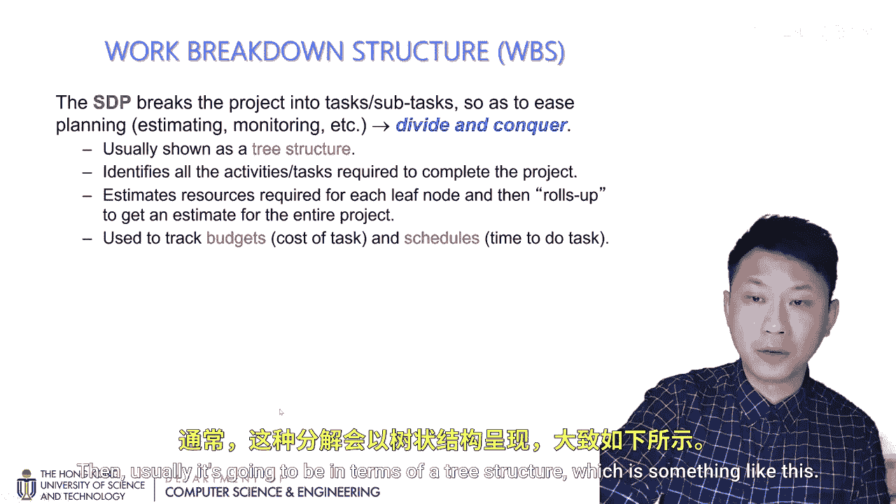

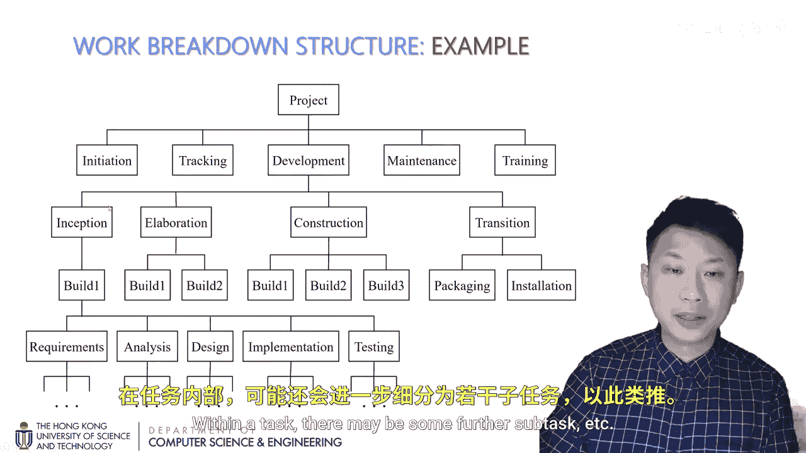

同样，在项目计划中，你必须明确开发环境。

在软件开发计划中，我们必须指定项目中可以使用的硬件和软件开发工具。请注意，**开发工具不等于开发过程**。开发工具只是我们为了成功完成项目而将在项目中使用的工具。我们仍然需要一些良好的流程，以便组织中的每个人都能遵循这些流程来开发项目。

**工具只有在使已充分理解的流程更高效时才有效**。当我们选择开发工具时，必须进行评估，例如其对生命周期的支持以及采用新工具对成本和进度的风险。如果我们使用一些新工具，则可能需要在购买工具上花费额外的资金，并且可能需要为开发人员提供额外的培训，以教会他们如何使用这些工具。

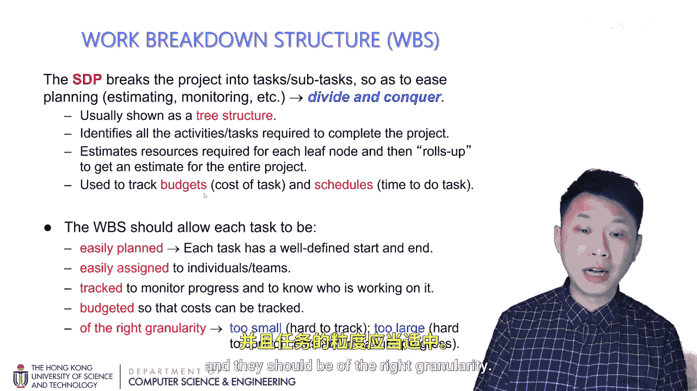

## 工作分解结构

我们还必须在开发计划中明确工作分解结构。

在项目计划中，我们必须使用**分而治之**的方法将项目分解为任务和子任务。这通常以树形结构表示，类似这样：

```
项目
├── 任务 A
│   ├── 子任务 A1
│   └── 子任务 A2
└── 任务 B
    ├── 子任务 B1
    └── 子任务 B2
```

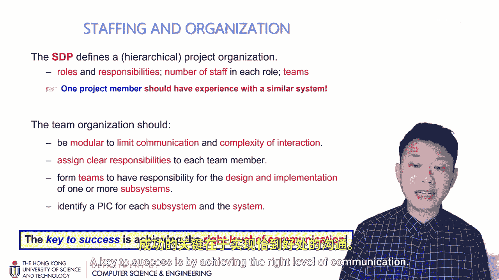

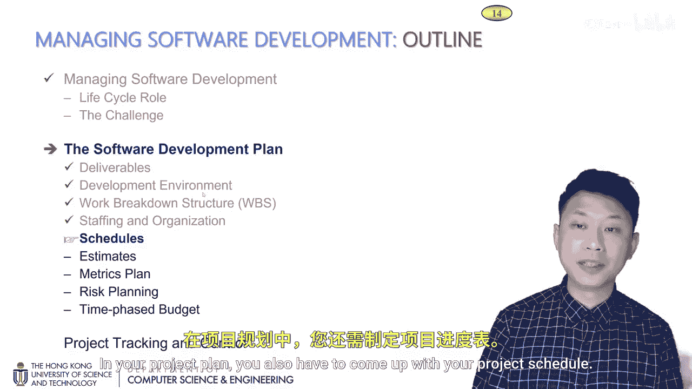

因此，在项目中，你必须明确需要执行哪些任务，而一个任务中可能包含进一步的子任务等。

你必须识别完成项目所需的所有活动和任务，并估计每个叶子节点（最底层任务）所需的资源，然后汇总起来以获得整个项目的估算。此外，你可以使用这个工作分解结构来跟踪项目的预算和进度。

工作分解结构使得每个任务能够：
*   易于规划。
*   易于分配给个人和团队。
*   易于跟踪，以监控进度并了解谁在负责哪个任务。
*   易于预算，以便跟踪成本。

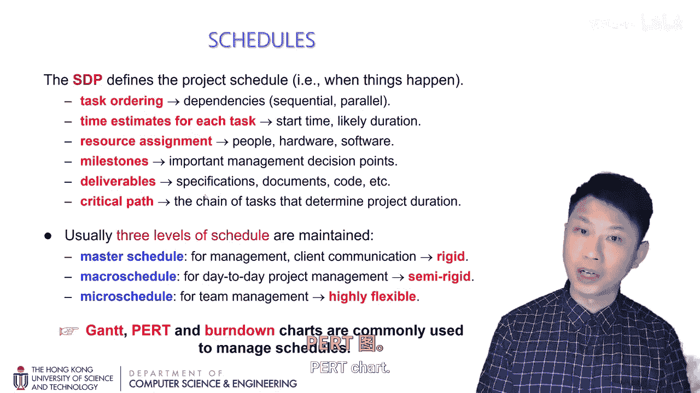

工作分解结构应具有适当的粒度。如果粒度太小，则难以跟踪；如果粒度太大，则难以控制成本和衡量进度，因为太笼统。

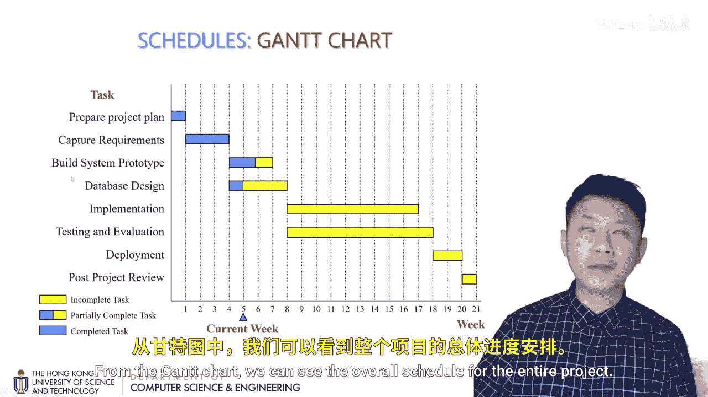

## 人员配置与组织

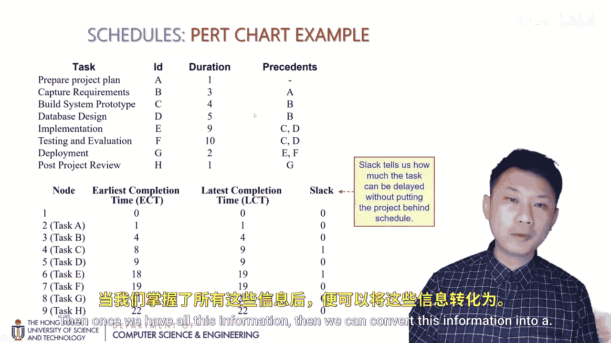

接着，在项目计划中，你还必须明确人员配置和组织。

你必须定义项目组织，明确项目中的角色和职责、每个角色的人员数量以及团队构成。项目中应至少有一名成员具有类似系统的经验，该成员可以帮助你估算项目规模，并帮助你设计软件系统。

请注意，团队组织应模块化，以限制沟通和交互的复杂性。如果一个团队中有太多人，最终你将花费大量时间在沟通上。此外，应为每个团队成员分配明确的职责。应组建团队，使其负责一个或多个子系统的设计和实现。应为每个子系统以及整个系统确定一名负责人，这样如果某个特定子系统出现问题，你总是可以与该负责人沟通。成功的关键在于达到适当的沟通水平。

## 项目进度安排

在你的项目计划中，你还必须制定项目进度表。

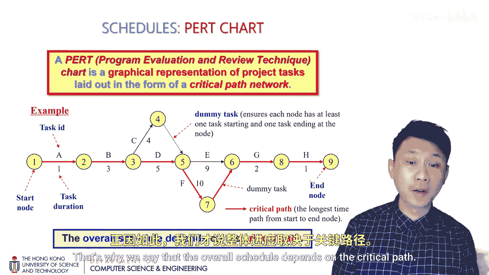

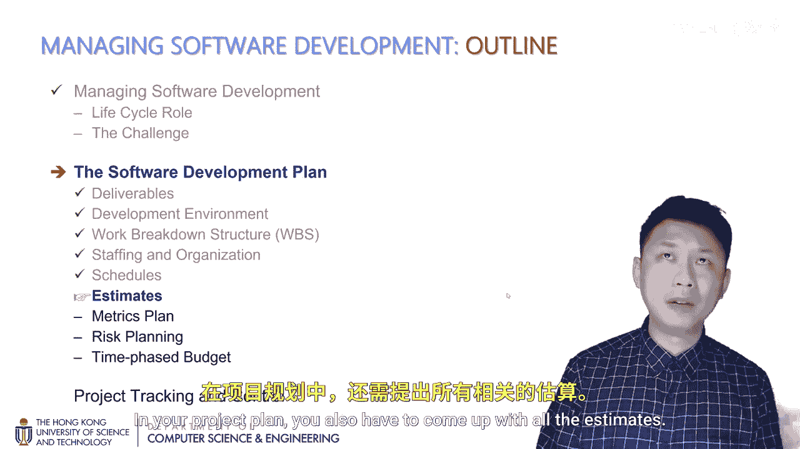

在项目进度表中，你必须定义任务、任务排序、每个任务的估算、资源分配、里程碑、交付成果，以及关键路径（如果我们讨论PERT图）。通常，需要维护三个级别的进度表：
*   **主进度表**：整个项目的概览。
*   **宏观进度表**：用于日常项目管理。
*   **微观进度表**：用于团队管理。

在本课程中，我们将讨论如何使用甘特图、PERT图和燃尽图进行进度安排。我们已经讨论过在Scrum中如何使用燃尽图管理进度。现在，我们将讨论如何绘制甘特图和PERT图。

这是一个甘特图的例子。在甘特图中，你必须指定项目中需要执行的所有任务，并估算每个任务所需的时间。从甘特图中，我们可以看到整个项目的总体进度。

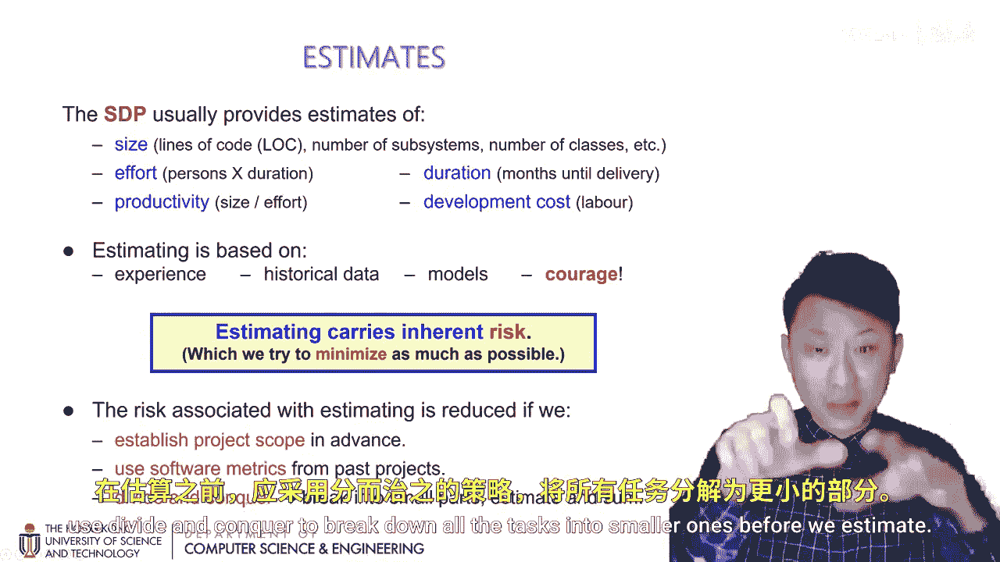

我们也可以使用PERT图来指定进度。在PERT图中，我们仍然需要识别项目中将要执行的所有任务，为每个任务分配一个ID，估算每个任务的持续时间，并指明任务间的顺序关系。一旦我们有了所有这些信息，就可以将其转换为PERT图。

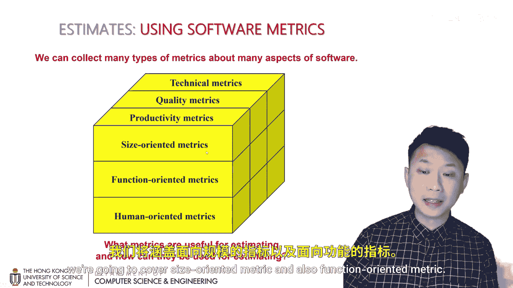

PERT图是以关键路径网络形式呈现的项目任务的图形化表示。这是一个例子：假设我们从节点1开始，然后执行任务A，接着从节点1到节点2。完成任务B后，我们从节点2到节点3。然后我们将并行执行任务C和D，一旦完成任务C，我们前往节点4；一旦完成任务D，我们前往节点5。接着我们将并行执行任务E和F，之后执行任务G和任务H，然后完成项目。请注意，我们还需要那些虚线任务（虚活动）来将并行任务合并回主流。然后，我们可以使用关键路径来识别项目持续时间。关键路径是图中红色的路径，我们将其定义为从起始节点到结束节点的**最长路径**。由于我们讨论的是最长路径，所以我们选择路径D而不是路径C（因为它更长），选择路径F而不是路径E（因为它更长）。我们讨论的是从起点到终点的最长路径，通过这条路径，你可以估算整个项目的持续时间。这就是为什么我们说总体进度取决于关键路径。

## 项目估算

在你的项目计划中，你还必须提出所有的估算。

我们必须提供项目的估算，例如项目规模、我们需要在项目上投入的工作量或项目持续时间等。请注意，估算是基于**经验、历史数据、模型和勇气**的。这就是为什么为了降低估算风险，我们需要一些有类似系统经验的人来告诉我们，例如项目的规模、项目的持续时间、项目需要多少人等。

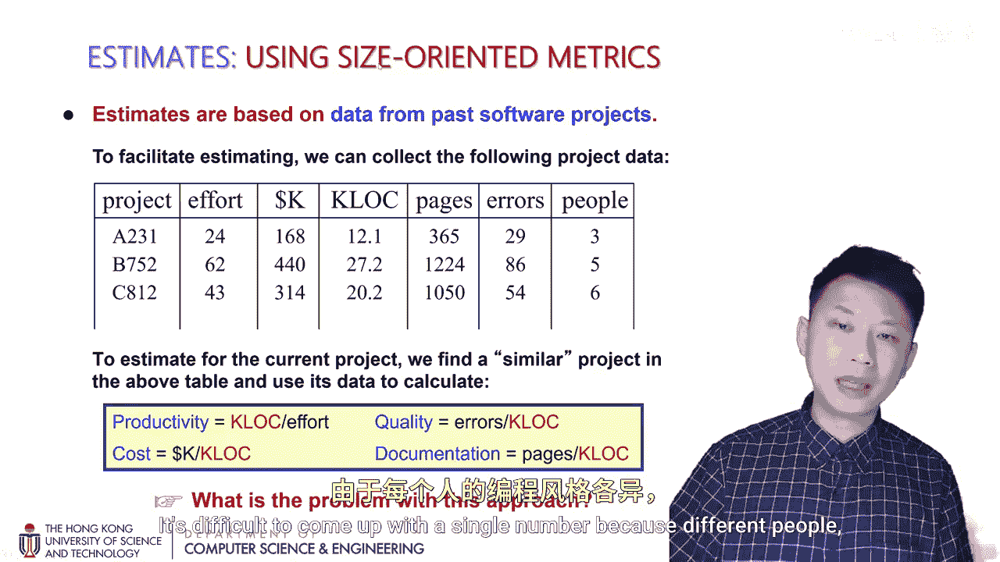

因此，这里我说风险可以通过以下方式降低：尝试提前确定项目范围，然后使用过去项目的度量数据或一些有经验的人员，并在估算之前使用分而治之的方法将所有任务分解为更小的任务。

我们可以为软件系统收集许多不同类型的度量数据。在本课程中，我们将讨论生产力度量，特别是规模导向度量和功能导向度量。

如果我们讨论规模导向度量，我们讨论的是项目的规模。我们可以根据项目的代码行数来估算项目规模。我们可以根据过去项目的数据或有类似项目经验的人员来得出这个估算。一旦我们可以用千行代码来估算项目规模，我们就可以使用这个KLoC来估算，例如项目的生产力、成本、质量和文档。这种方法的问题是什么？请注意，所有这些估算都是基于项目的代码行数。但请注意，不同的人可能为同一个程序编写不同数量的代码，这就是问题所在。因此，很难得出一个单一的数字，因为不同的人有不同的编程风格。

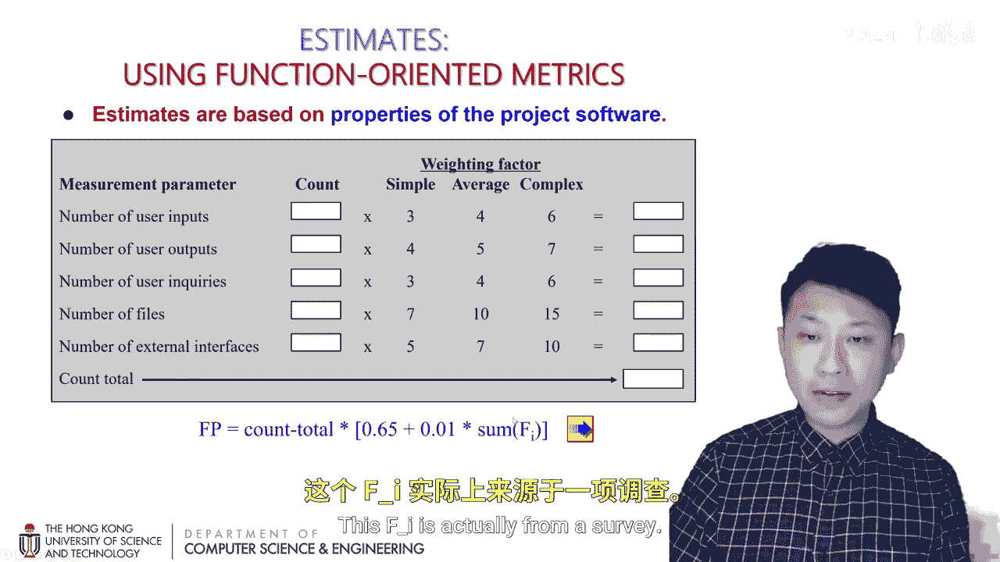

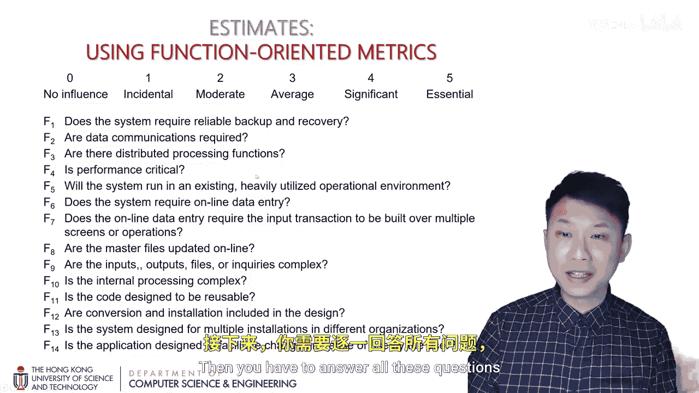

功能导向度量基于项目的软件属性，例如系统中的用户输入数量、系统输出数量、查询数量、系统中的文件数量以及系统中的外部接口数量等。

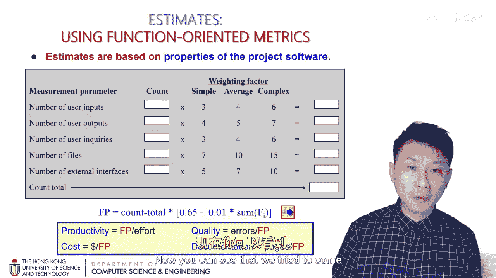

一旦我们有了这些数字，我们将把它们代入这个方程：`FP = 总计数值 * [0.65 + 0.01 * Σ(Fi)]`。然后我们乘以一些加权因子，将它们相加，最终得到总计数值。得到总计数值后，我们将其代入这个方程以获得功能导向度量。有些人可能会问这个Fi是什么。Fi实际上来自一项调查。你必须完成调查并计算平均Fi。例如，你必须回答这些问题：系统是否需要可靠的备份和恢复？如果没有影响，你说是0；如果是必需的，你说是5，等等。然后你必须回答所有这些问题，为每个问题给出评分，最终计算出平均评分，然后将其代入方程，以获得功能导向度量。一旦你得到了这个FP，你就可以估算项目的生产力、成本、质量和文档。现在你可以看到，我们试图根据软件系统提供的功能来得出所有估算。

## 其他估算方法与风险管理

我们还可以使用其他一些方法来得出估算。一种是我们所说的**德尔菲技术**。我们不只是得到一个单一的数字，而是从三个不同的人那里得到三个数字，然后对这三个数字取平均值。

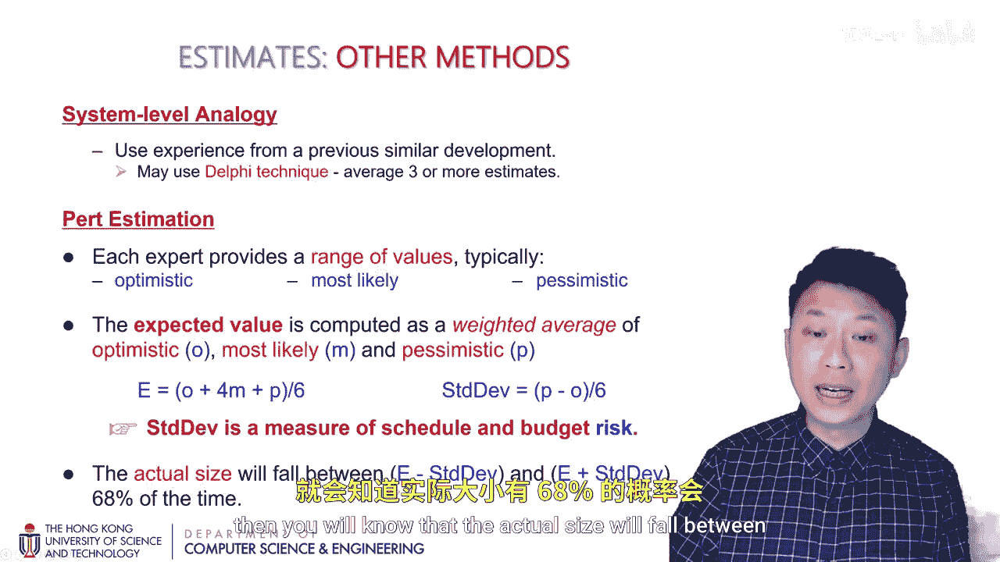

我们也可以使用**PERT估算**，这意味着我们需要请每位专家提供一个数值范围，通常是乐观值、最可能值和悲观值。然后，我们将根据这个数值范围计算一些期望值和标准差。请注意，标准差是进度和预算风险的度量，这意味着如果标准差较高，那么项目中的风险就会更高。为什么？因为如果估算的偏差较大，就意味着项目中的风险更高。如果你以前学过统计学，你就会知道期望值落在±1个标准差范围内的概率是68%。

请注意，让有经验的开发人员进行估算是至关重要的，因为他们之前有类似项目的经验。此外，估算应始终以多种方式进行，并且结果应进行交叉检查。不完整和不精确的需求会阻碍准确的成本估算，仅仅因为你不知道确切的需求是什么，就很难进行估算。

在项目计划中，你还必须明确我们需要为项目收集哪些度量数据。你必须确定收集哪些度量数据以及如何收集它们。通常，如果我们讨论项目管理，度量数据通常与规模相关，例如用例数量、类的数量或项目的代码行数。我们需要将计划的规模与当前的规模进行比较，以确定项目的进度和稳定性。

在项目计划中，我们必须预见并列出项目中可能发生的所有风险。这就是为什么我在这里说，你必须预见项目中可能出问题的地方，然后估计其发生的可能性及其影响。同时，制定具有成本效益的应急计划，即如果风险发生，你必须采取哪些行动。做好这一点是优秀经理的重要品质。此外，风险规划与预防性管理相关，因此我们试图预见将要发生的事情，然后努力避免风险发生。

## 时间分段预算

我们还必须在项目计划中制定时间分段预算。

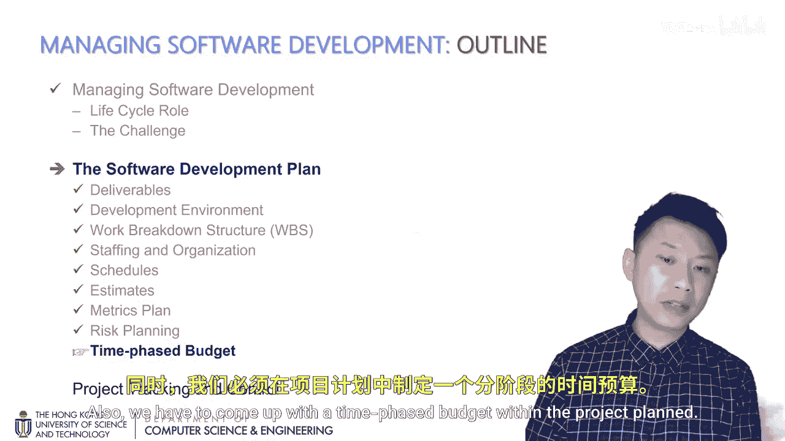

在时间分段预算中，我们试图具体说明项目预算计划在何时支出，以及在每个支出水平上预期完成什么。人力成本很可能是主要成本，因为如果我们谈论的是一个软件项目，我们主要需要程序员来开发项目。但当然，还有其他成本，例如培训所需的成本、购买软件许可证、硬件组件等所需的成本。最好保留额外的10%到15%作为额外储备金，以防项目出现问题，你仍然有一些额外的预算可以用于项目。确保跟踪支出，即定期比较计划支出与实际支出，以及计划完成情况与实际完成情况。

## 总结

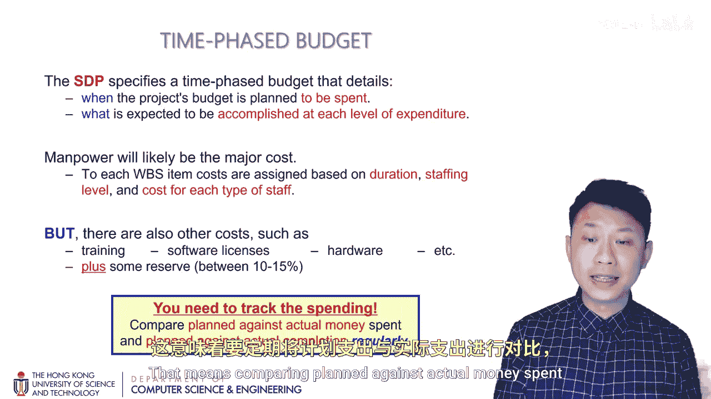

本节课中，我们一起学习了如何制定一份全面的软件开发计划。我们涵盖了计划的核心组成部分：定义项目范围、明确交付成果、配置开发环境、创建工作分解结构、规划人员组织、制定项目进度表、进行项目估算、管理风险以及制定时间分段预算。理解并掌握这些内容，是确保软件项目能够有序、高效推进并最终成功交付的关键。