# 香港科技大学【中英⚡软件工程｜Software Engineering Specialization】 p61 P61 03_项目跟踪与控制 -BV1MMEjzoEhg_p61-

And finally， we talk about project tracking and control。

Notice that software projects they may be high schedule one day at a time。😡。

So there needs to be constant， consistent inoff monitoring of project activities。

 and the major purpose of monitoring is to make sure that the project is meeting the budget and schedule。

So change is going to happen within your project， so that's why it's important that you also apply SEM。

 so what is SEM software configuration management。And notice that adding manpower to a late project is going to make it even later。

 why？because you need to spend extra time to train up the new guys to work on the project。

 so that's why we say that adding manpower to a late project is going to mimic make it even later。

And these are the things they have to do regularly within your project， for example。

 holding project status meetings， either daily， weekly or monthly。

And also doing project reviews from T time and also evaluate the results of each review。

And also check if milestones are accomplished as planneded。

And also compare the actual budget with the planned budget from time time and then also have informal charts with project staff to obtain subjective assessments of the progress。

So now I'm going to show you a little video about what are the things that you have to do as a good project manager。

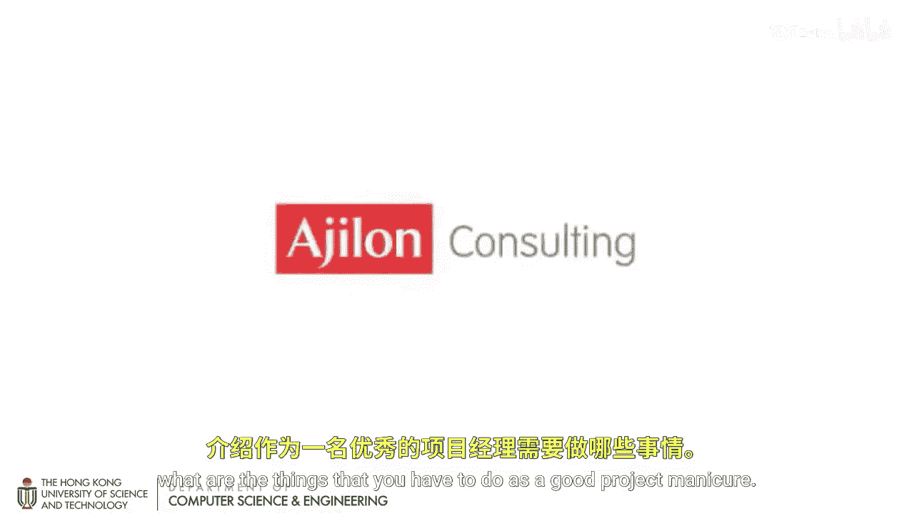

Hello everyone， Matthew， we're Paul here with Ash Long Consulting。

 Senior Vice President for our South regionion， and what we're talking about today are the keys for a successful IT project。

Through our hundreds of project managers currently on assignment in the US。

 we've been able to identify six best practices that can help you successfully deliver an IT project。

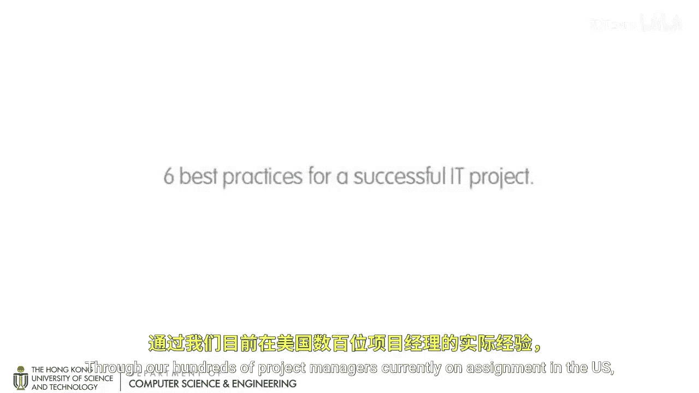

Number one is make sure that everyone involved within the project knows the scope。

 the scope should be documented in order to provide future reference if the project should run into problems down the road。

 it's also important to know what is not in scope with the project。

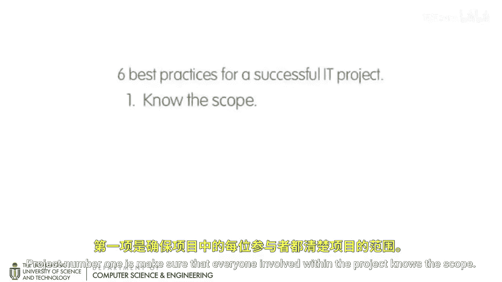

Number two is defininging the requirements， it is important to clearly define both the business and technical requirements before starting without clearly defined requirements。

 your project has little chance of。

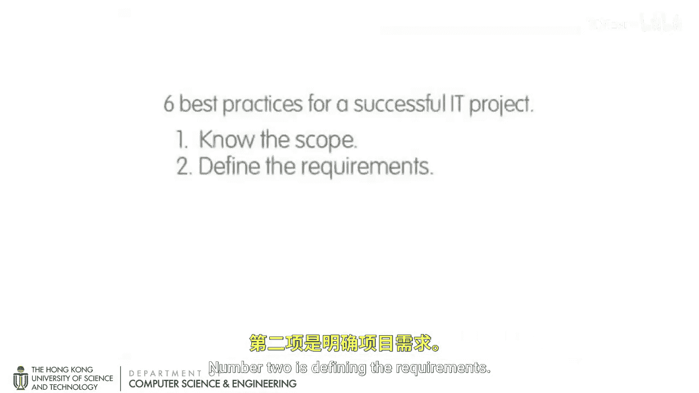

Number three is being realistic， we know the business wants this delivered yesterday and we know the business is going to pull on all the bells and whistles on this。

As the project manager， it's imperative that you've set the right expectations from the very first meeting。

Number four， give yourself some wiggle room， be sure to build in some extra time for the project timeline and extra resources for the budget We know the project's going to run into unforeseen circumstances and by having this additional breathing room it will allow you to still deliver the project on time and within budget。

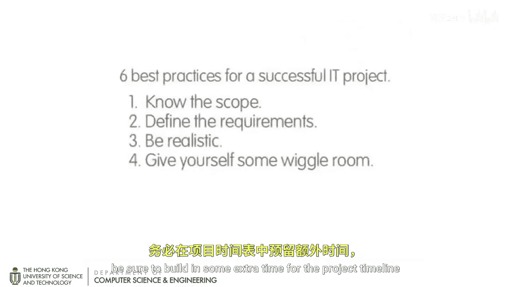

Number five， be sure to set well defined goals and KPIs within your project timeline We know that if we're hitting our goals and we're meeting our KPIs。

 the project will have a better chance to。

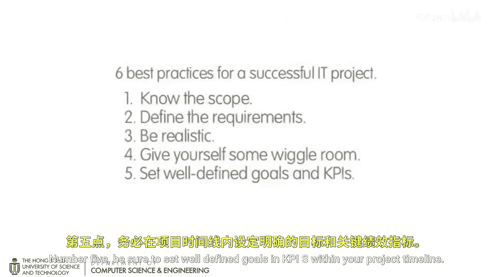

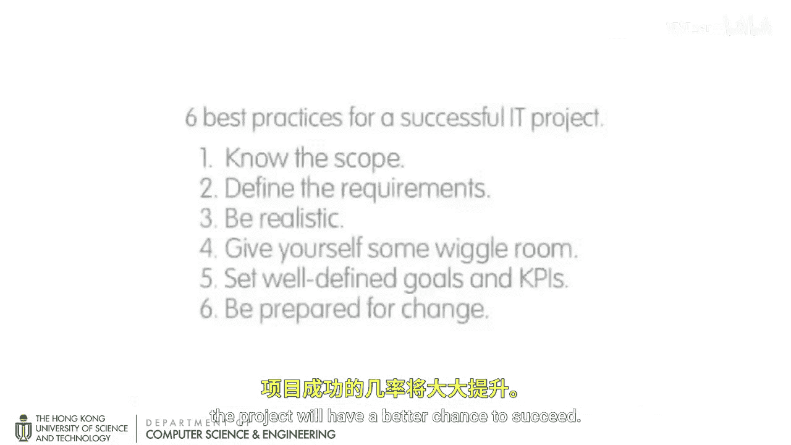

Number six， be prepared for change we know that change is going to occur as the project moves forward。

 it's imperative that your project team has a well documented change procedure in place and everyone is fully aware of how we're going to deal with change as it occurs。

If you find that your IT project is off track， here are five tips that can help get you back in the right direction。

Number one， stop pointing fingers and work collaboratively towards a solution。

 not so much how we arrived at this problem。

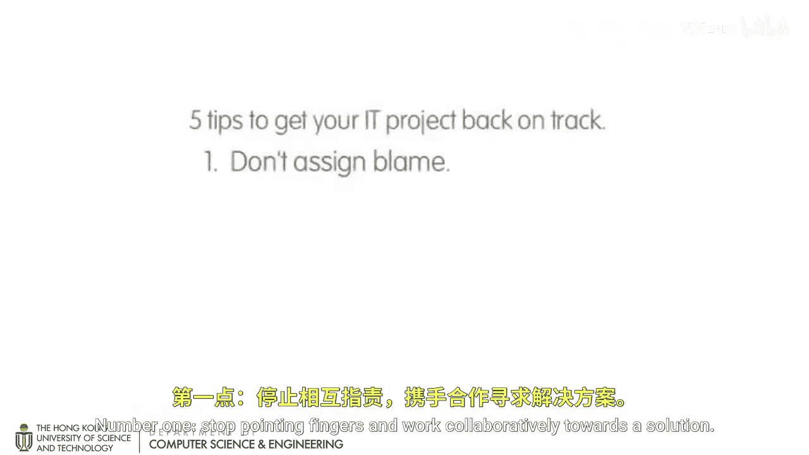

Number two is go back to basics， review the scope of the project， review the requirements。

 get back with the stakeholders， get back in line with the project， and number three。

 communicate openly and frequently， you can never over communicate when delivering an IT project。

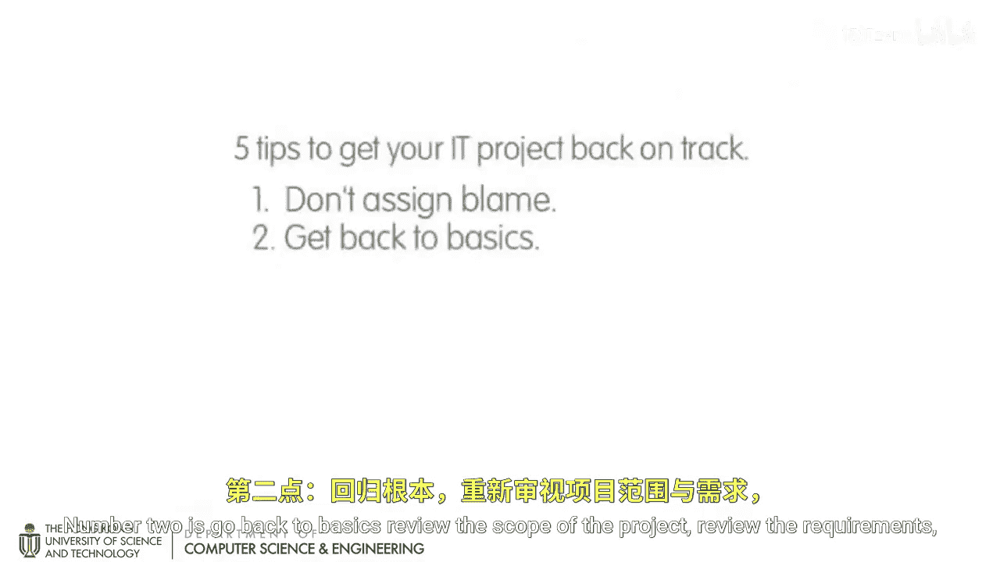

Number four， make sure you have the right resources available， not just with your core project team。

 but it's always a good idea to have additional resources on the outside that can parachute in when you need to get that project back on track。

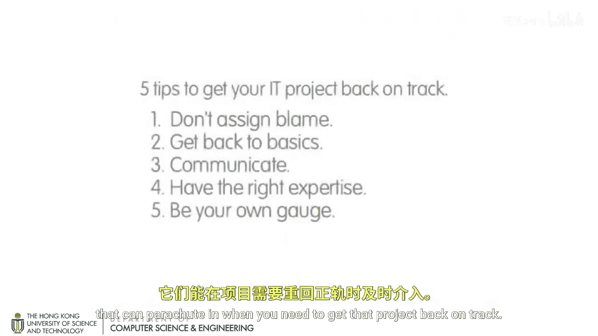

Tip number five， be your own gauge as the IT project manager continually ask yourself。

 do we have enough resources to deliver this project。

 do we have enough funding to deliver this project。

 and if the answer to one of those questions is no， don't be afraid to one。

 communicate this to the business and two， take whatever action is necessary to ensure you have the right funding and the right resources to deliver。

And as a good manicure， you should manage the process， don't let the process manage you。

And that's the end of this course。 That's all the topics I want to cover for this course。 Thank you。

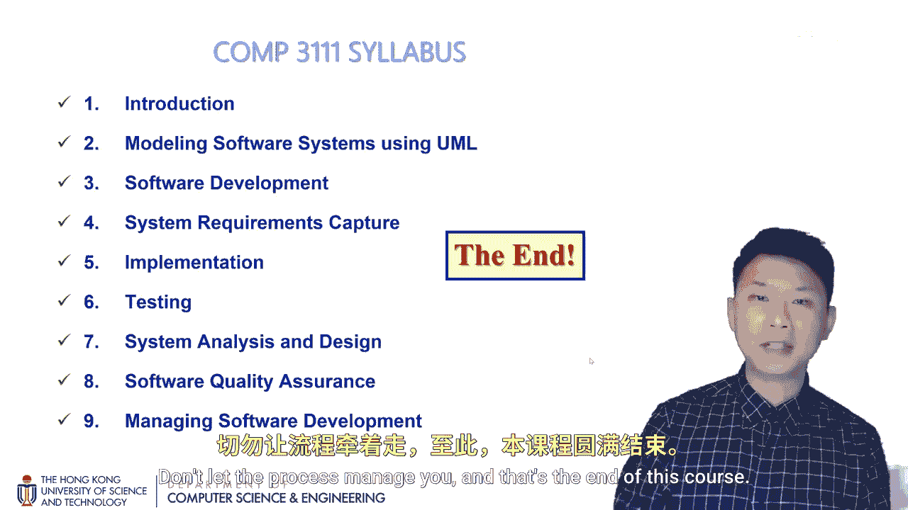