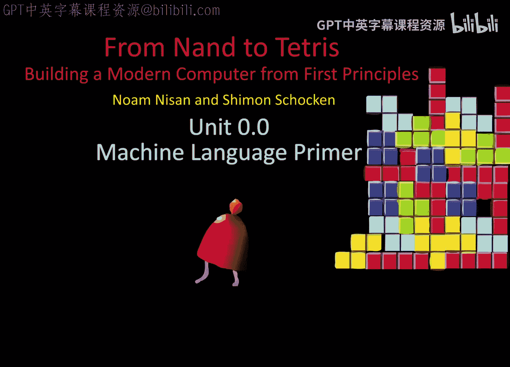
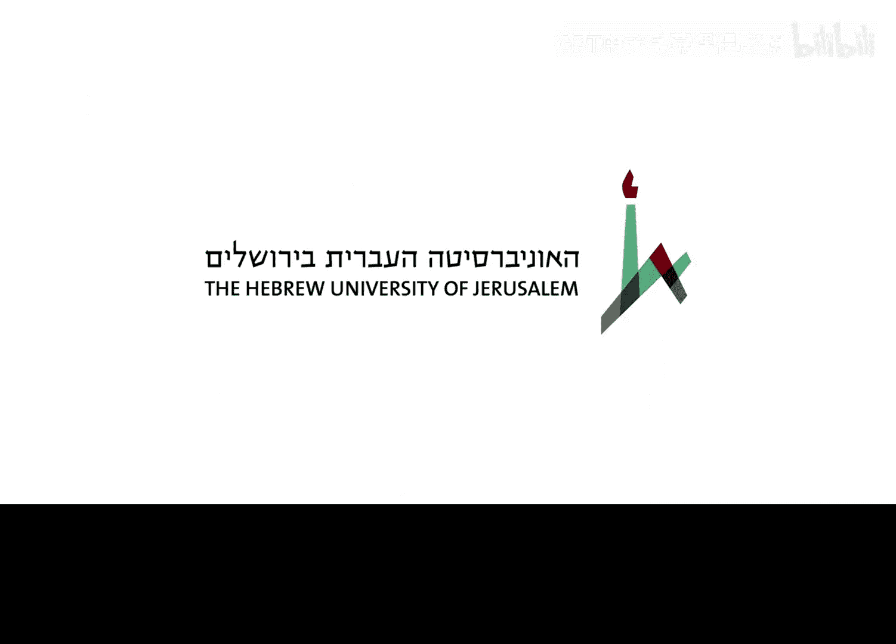

# 003：机器语言入门 🖥️

在本单元中，我们将介绍机器语言的基础知识。这是硬件与软件交汇的关键接口，也是后续构建计算机虚拟机的必要基础。

## 课程概述

欢迎来到《从零开始构建现代计算机》第二部分的第0单元。本单元将探讨应用计算机科学中一个至关重要的接口——机器语言。这是硬件与软件握手的地方，我们将通过这个接口来理解和使用硬件平台。

## 课程结构全景

以下是本课程第二部分将要学习的各个模块，我们从模块0开始。

*   **模块0**：机器语言基础（本单元）
*   **模块1**：虚拟机架构与命令
*   **模块2**：虚拟机翻译器的实现

## 为何需要学习机器语言？

为了解释硬件与软件之间这种精密的协作，请看下面的图示。

你会注意到，图中有一段用“虚拟机语言”编写的VM代码。目前你无需理解这段代码，我们将在后续介绍。关键在于，我们将讨论如何将用这种语言编写的程序翻译成机器语言（即汇编语言）。

具体来说，虚拟机翻译器（VM Translator）是一个将由你们在指导下用Java或Python等语言编写的程序。这个程序将以VM代码作为输入，逐行解析并生成对应的汇编代码。例如，它会从 `push 1` 生成你在此处看到的汇编代码，然后继续处理 `push 2` 并生成对应的代码段，依此类推。

由此可见，要完成这个任务，你必须能够用汇编语言生成和编写代码。

## 模块0的目标

在模块1和模块2中，我们将完成两件事：
1.  讨论虚拟机架构、抽象及其命令（即VM语言）。
2.  通过实现一个虚拟机翻译器来实际构建这台机器。

为了实现第二点，我们必须再次生成汇编代码。因此，模块0的目的就是解释汇编语言中的低级编程概念，并让你编写一两个程序以获得这项基础能力。没有这项能力，你将无法编写自己的虚拟机翻译器。

为了达成这个目标，我们将提供九个教学单元，最终导向一个被称为“项目4”的实践任务。

请注意，所有这些单元都是我们在《从零开始构建现代计算机》第一部分中相同单元的原样复制。在第一部分中，这些单元构成了模块4的核心内容，因此这个项目也被称为项目4。

## 学习路径指南

考虑到这一点，观看本视频的学习者可能属于以下三类情况之一。

以下是针对不同背景学习者的具体建议：

1.  **近期完成第一部分的学习者**：如果你刚学完第一部分，对机器语言掌握良好，并渴望开始第二部分的学习，我们建议你只复习本单元目录中的**第8单元**。同时，**强烈建议**你复习并可以考虑重新提交**第9单元的项目4**（这里的编号可能有些令人困惑）。这是一个可选项目，但请确保你记得如何用Hack汇编语言编写程序。
2.  **过去完成第一部分的学习者**：如果你在较早之前完成了第一部分的学习，现在关于机器语言的知识可能有些生疏。你需要“除锈”。最好的方法是复习此处列出的这个单元子集。我们同样**强烈建议**你再次完成并提交项目4。不过，在第二部分中，这个项目仍是可选的。
3.  **未学习第一部分，直接开始第二部分的学习者**：如果你决定直接开始第二部分的学习，这完全可以。但如果你做出了这个选择，我们**坚持要求**你认真学习此处列出的所有单元。特别是，**你必须完成项目4**。如果你未能获得必要的低级编程知识，将无法继续进行第二部分的学习。因此，由你来负责补齐这些先决知识。

## 单元总结

本单元到此结束。请根据你的低级编程专业水平，将自己定位到上述三条学习路径之一。决定好你需要从这些剩余单元中学习什么内容。

完成之后，我将在模块1中与你再见，届时我们将正式开始构建我们的虚拟机。

